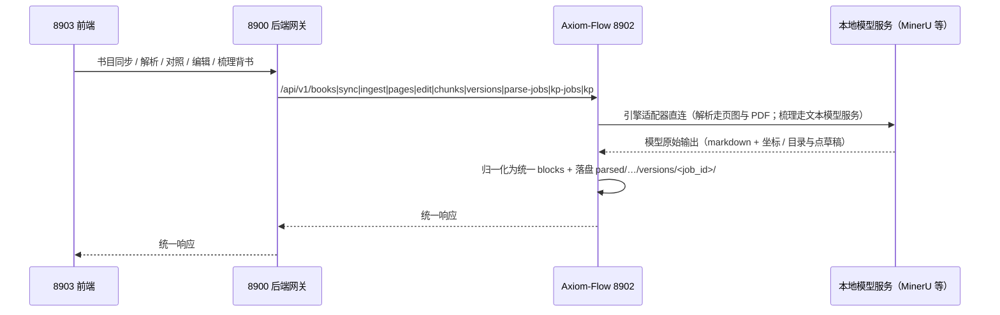

# 8902 API 接口文档

设计状态：Accepted
确认状态：已确认
实现状态：Implemented（读取面已在真库重建窗口按空窗读数复验；写入面未在新形状上跑真机）
最后更新：2026-10-24
关联代码：`src/axiom_flow/api/main.py`、`src/axiom_flow/api/admin.py`（管理面）、`src/axiom_flow/orchestrator/knowledge.py`（梳理受理门与执行体）、`src/axiom_flow/schemas.py`（响应结构单一事实源）、`scripts/axiom_flow_service.py`（生命周期脚本）
关联测试：`tests/contract/test_api_v1_contract.py`、`tests/contract/test_fixed_document_form.py`、`tests/unit/test_service_scripts.py`
关联 ADR：[ADR 0001](../adr/0001-v2-exploration-direction.md)、[ADR 0004](../adr/0004-model-boundary-and-pipeline-ownership.md)、[ADR 0007](../adr/0007-parse-status-semantics.md)、[ADR 0008](../adr/0008-fixed-doc-form-and-metadata-genres.md)、[ADR 0010](../adr/0010-page-regions-are-parse-inputs.md)、[ADR 0015](../adr/0015-db-single-source-for-readiness.md)、[ADR 0016](../adr/0016-af-family-rebuild-into-four-tables.md)

## 目的与边界

本篇是 **Axiom-Flow 的固定 API 接口文档**（根仓库 ADR 0010 文档体系范本）：8902 全部对外端点的
契约总表。按**接口类型**分四类组织：① 生命周期与健康；② 数据查询（af_* 数据库知识）；③ 解析结果
与 PDF 对照；④ 知识点梳理（af_kp）。另有一类**不进公共契约**的运维管理面（默认不挂载、凭管理
token、双确认），单独成节。本仓库只保证 API 契约与产物格式稳定；版本末期确认更新后，前版本契约进
`docs/history/`。

8902 提供解析任务提交、书目与解析产物查询、原页对照数据供给与人工编辑落库。8903 前端只连 8900
后端网关（根仓库 ADR 0007），8900 内部经 `AxiomClient` 适配 8902；8902 离线时 8900 返回 503 并降级
展示（独立性铁律，不影响其他界面）。**解析管线在 8902 直连模型服务**
（[ADR 0004](../adr/0004-model-boundary-and-pipeline-ownership.md)），不经 8900 网关；8900 只负责
模型生命周期（`/models`）与探针。

**生效解析版本**：一本书的解析产物按版本落在
`parsed/<domain>/<course>/<book_id>/versions/<job_id>/`，「哪一版生效」的唯一事实源是
`af_books.active_job_id`（NULL = 根视图 legacy，见
[database-design.md](database-design.md)）。**所有读取端点（manifest / pages / image / chunks /
edits）经该指针解析产物目录**，因此：

- URL、响应结构与 `image_url` 字面量**零变化**，根仓库前端不需要适配；
- 切版 = 单列 UPDATE，不改文件；
- 生效指针指向的版本目录缺失时**显式 404**，不静默回落根视图（ADR 0004 无自动兜底）；
- 历史版本仅经 `GET /api/v1/books/{book_id}/versions` 可见（只读列举）。

**唯一例外**是管理面 `POST /api/v1/admin/purge`：它的目的就是把**所有**版本连库行一起清除，故不走
生效指针作用域（见「非公开管理面」节）。

### 本篇不管

| 不在本篇范围 | 事实源位置 |
| --- | --- |
| 响应模型的字段级定义（Pydantic 形状、默认值、约束） | `src/axiom_flow/schemas.py` |
| af_* 表结构、列语义与迁移序列 | [database-design.md](database-design.md) |
| 解析管线内部阶段、产物文件布局与归一化规则 | [parsing-pipeline.md](../design/parsing-pipeline.md) |
| 引擎适配器与模型服务侧契约（含 `/models` 生命周期） | [model-integration.md](../design/model-integration.md)、根仓库 |
| 8900 网关侧透传适配与前端消费方式 | 根仓库 `docs/architecture/api-contracts.md` ④数据透传·Axiom-Flow |
| 服务启停运维、数据根操作与迁移 runbook | [operations.md](../guides/operations.md) |
| 端点交付过程、联调取证与需求编号留痕 | `docs/trackers/`（本篇只写当前契约） |

## 当前契约

### 服务信息

- 服务名：Axiom-Flow（FastAPI 标题 `Axiom-Flow`）。
- 自报版本：`axiom_flow.__version__`（`pyproject.toml` 的 `project.version` 属打包元数据，
  两者不要求同步；对外契约只认 `/openapi.json` 与本篇）。
- 端口：`8902`（`QED_AXIOM_URL` / `AXIOM_PORT` 可覆盖健康探测端口）；只绑 `127.0.0.1`。
- 前缀：`/api/v1`。
- 启动（仓库根目录）：`python -m uvicorn axiom_flow.api.main:app --host 127.0.0.1 --port 8902`
- 生命周期管理：`python scripts/axiom_flow_service.py {start|stop|restart|status} [--port PORT] [--wait [SECONDS]]`

### 调用链



### 接口分类

| 类型 | 端点 | 语义 |
| --- | --- | --- |
| ① 生命周期与健康 | `GET /api/v1/health` + `scripts/axiom_flow_service.py {start\|stop\|restart\|status}` | 服务启停/重启/健康检测 |
| ② 数据查询（af_*） | `GET /api/v1/books`、`GET/PATCH/DELETE /api/v1/books/{book_id}`、`POST /api/v1/books/sync`、`POST /api/v1/books/{book_id}/ingest` | 书目同步与 CRUD、页图 ingest |
| ③ 解析结果与 PDF 对照 | `GET /api/v1/books/{book_id}/manifest`、`/pages`、`/pages/{page_no}`、`/pages/{page_no}/image`、`PUT /api/v1/books/{book_id}/pages/{page_no}/blocks/{index}/edit`、`PUT /api/v1/books/{book_id}/pages/{page_no}/structure`、`GET /api/v1/books/{book_id}/pages/{page_no}/edits`、`GET /api/v1/books/{book_id}/chunks`、`GET /api/v1/books/{book_id}/versions`、`POST /api/v1/parse-jobs`、`GET /api/v1/parse-jobs`、`GET /api/v1/parse-jobs/{job_id}` | 解析进度、逐页状态清单、对照供给、块编辑、结构意图声明、分块预览、版本列举、作业列表 |
| ④ 知识点梳理（af_kp） | `POST /api/v1/kp-jobs`、`GET /api/v1/books/{book_id}/kp-jobs/{gen_batch}`、`GET /api/v1/books/{book_id}/kp`、`PATCH /api/v1/kp/nodes/{node_id}`、`POST /api/v1/kp/nodes/{node_id}/confirm`、`POST /api/v1/kp/nodes/{node_id}/summary`、`PUT /api/v1/kp/nodes/{node_id}/narrative`、`GET /api/v1/kp/nodes/{node_id}/narrative`、`PUT /api/v1/books/{book_id}/kp/outline`、`GET /api/v1/books/{book_id}/kp/export` | 梳理批次提交与进度、整册工作区读面、人工背书写入、确认／撤回、知识点单点重生成、长文两条腿（写正文＋按派生路径读回）、目录整批声明、只读导出（根侧拉取面） |
| 非公开管理面（不进上表四类） | `POST /api/v1/admin/purge` | 一键清除，默认不挂载，8900/8903 不得透传 |

### 端点总表

本表是 8902 **公共契约面**的机器对账入口：`METHOD` 与路径两列逐字取自运行时路由表（守护逐行
比对，见「验证与追溯」），且每行必须有同名 `#### METHOD path` 小节。分类含义与端点详细契约见下面的
分类小节。管理面端点**不进本表**（见「非公开管理面」节）。

| METHOD | 路径 | 分类 | 一句话用途 |
| --- | --- | --- | --- |
| `GET` | `/api/v1/health` | ① | 存活检查与就绪判据 |
| `GET` | `/api/v1/books` | ② | 书目列表（含进度与生效版本指针） |
| `GET` | `/api/v1/books/{book_id}` | ② | 单书目元数据 |
| `PATCH` | `/api/v1/books/{book_id}` | ② | 修改本仓库自有字段 |
| `DELETE` | `/api/v1/books/{book_id}` | ② | 删书（页行/编辑行/区域行全版本，可选连产物） |
| `POST` | `/api/v1/books/sync` | ② | 批量同步已验证书目（upsert 幂等） |
| `POST` | `/api/v1/books/{book_id}/ingest` | ② | 渲染页图（根视图唯一产物 `pages/`，不调模型；元数据回写 `af_books`） |
| `GET` | `/api/v1/books/{book_id}/manifest` | ③ | 生效版本产物清单（路径 + 大小 + SHA-256） |
| `GET` | `/api/v1/books/{book_id}/pages` | ③ | 生效版本逐页状态清单（一页一行） |
| `GET` | `/api/v1/books/{book_id}/pages/{page_no}` | ③ | 单页完整数据（对照主数据源） |
| `GET` | `/api/v1/books/{book_id}/pages/{page_no}/image` | ③ | 原页高清图（`image/png`） |
| `PUT` | `/api/v1/books/{book_id}/pages/{page_no}/blocks/{index}/edit` | ③ | 块编辑 upsert（绑定生效版本） |
| `PUT` | `/api/v1/books/{book_id}/pages/{page_no}/structure` | ③ | 页结构意图全量声明（人工框 / 删块 / 并块，跨版本存活） |
| `GET` | `/api/v1/books/{book_id}/pages/{page_no}/edits` | ③ | 页内编辑列表（生效版本作用域） |
| `GET` | `/api/v1/books/{book_id}/versions` | ③ | 解析版本列举（只读） |
| `GET` | `/api/v1/books/{book_id}/chunks` | ③ | 分块预览（派生数据，不入库） |
| `POST` | `/api/v1/parse-jobs` | ③ | 提交解析任务（202 受理） |
| `GET` | `/api/v1/parse-jobs` | ③ | 解析作业列表（过滤 + 分页） |
| `GET` | `/api/v1/parse-jobs/{job_id}` | ③ | 单任务状态与进度 |
| `POST` | `/api/v1/kp-jobs` | ④ | 提交梳理批次（202 受理，引擎取服务端槽位） |
| `GET` | `/api/v1/books/{book_id}/kp-jobs/{gen_batch}` | ④ | 单批次进度与流水账面 |
| `GET` | `/api/v1/books/{book_id}/kp` | ④ | 整册知识点工作区（目录＋点＋未归档池＋复核标记） |
| `PATCH` | `/api/v1/kp/nodes/{node_id}` | ④ | 人工背书域写入（只写人工可写的列） |
| `POST` | `/api/v1/kp/nodes/{node_id}/confirm` | ④ | 确认／撤回（置位带「可回指」前置校验） |
| `POST` | `/api/v1/kp/nodes/{node_id}/summary` | ④ | 知识点单点重生成（同步，覆盖本行 `summary` 并自增 `rev`） |
| `PUT` | `/api/v1/kp/nodes/{node_id}/narrative` | ④ | 长文写腿（正文落书目录，`narrative_ref` 的唯一写者） |
| `GET` | `/api/v1/kp/nodes/{node_id}/narrative` | ④ | 长文读回（按派生路径读正文，缺文件出 `exists=false`） |
| `PUT` | `/api/v1/books/{book_id}/kp/outline` | ④ | 目录整批声明（缺席只降级，不删行） |
| `GET` | `/api/v1/books/{book_id}/kp/export` | ④ | 只读导出面（`confirmed=1`，父先于子） |

### ① 生命周期与健康

#### GET /api/v1/health

存活检查，8900 控制中心与生命周期脚本（`--wait`/`status`）的就绪判据。

```json
{"status": "ok"}
```

#### 服务生命周期脚本

`scripts/axiom_flow_service.py` 是 8902 服务唯一启停入口（单文件纯标准库，8900 黑盒调用；契约
事实源沿 v0.1 版本 `docs/history/design/service-lifecycle.md`，本文件为其固定落位）：

```text
python scripts/axiom_flow_service.py {start|stop|restart|status} [--port PORT] [--wait [SECONDS]]
```

- `start`：默认拉起后立即返回；`--wait [SECONDS]` 时轮询 `/api/v1/health` 直到就绪（默认超时
  30s）。已运行时报 `already running`，幂等退出 0。成功输出 `pid: <n>` 与 `log: <path>`。
- `stop`：优雅停止（CTRL_BREAK）→ 5s 宽限（`_proc_alive` 判活）→ taskkill 强杀整树再等
  5s → 复核仍存活报 `stop failed` 并退出 1（PID 文件保留现场）；确认终止后清理 PID 文件，
  强杀兜底生效时输出 `stopped (forced)`；PID 文件陈旧（进程已死）时清理残留并幂等退出 0。
- `stop` 的**无 PID 文件分诊**：端口不通＝真未运行，输出 `not running (no pid file)` 并幂等
  退出 0；端口仍在监听＝该 8902 实例非本脚本启动，脚本按 `netstat -ano` 反查监听 PID（只读、
  只认 TCP LISTENING 且本地地址以 `:端口` 结尾）后**走同一条停止链真停它**，成功输出
  `stopped (unmanaged listener pid <n>)`（强杀兜底时带 `forced`）并以 0 退出；反查不到监听 PID
  时不终止任何进程，输出「未终止任何进程」并以 **3** 回报「无从处置」。脚本对 8902 端口有属主
  身份，故在此执行真停；8900 控制中心对同一形态只检测不杀（根仓库
  `docs/design/service-hosting.md`「停止后端口复核」，其 `_stop_via_script` 把 0 与 3 一并交端口复核）。
- `restart`：先 stop 后 start，透传 `--wait`；`stop` 返回非 0 即中止并原样返回该码
  （回显 `restart aborted`，停止失败不再拉起第二实例）。
- `status`：PID 存活 / 端口探测（socket 预检 + HTTP 健康确认）双路径，输出
  `running (pid <n>)` / `running (port probe <port>)` / `stopped`，信息型恒退出 0。
- `--port` 优先级：`--port` > `QED_AXIOM_URL` > `AXIOM_PORT` > 8902。
- 退出码：`0` 成功或幂等（含按端口真停的外部实例）；`1` 运行失败（spawn 失败、`--wait` 健康超时、
  stop 无法终止）；`2` 参数错误；`3` 端口由非本脚本启动的进程监听且反查不到监听 PID。
- **无模式开关**：解析始终直连模型服务（ADR 0004），配置由 `config.py` 向上走查 `.env` 自读；
  脚本不注入密钥、不接受「本地/网关」二选一参数。

运行产物：`logs/qed-axiom.pid`（PID 文件）、`logs/qed-axiom-serve.log`（子进程 stdout/stderr，
已 gitignore）。环境：脚本从仓库根向上查找 `.env` 并 `setdefault` 注入 `AXIOM_*`，已有环境变量不覆盖。

### ② 数据查询（af_*）

af_* 表（`af_books` / `af_operations` / `af_pages` / `af_kp`）为 Axiom-Flow 私有（qed 库 af_* 命名空间，
Alembic 独立建表），表结构见 [database-design.md](database-design.md)。
`af_kp` 是分析模块（知识点梳理）的存储形状，其读写面全在**④ 知识点梳理**类端点（本类只读它自己的
`af_books` 一列作书目存在性判据）；管理面 `POST /api/v1/admin/purge` 会连它的行一起清（见「非公开
管理面」节）。判据正文在 [knowledge-analysis.md](../design/knowledge-analysis.md) 的 `KA-n`，本篇只写
端点形状与状态码映射。
`GET /api/v1/books`、`GET /api/v1/books/{book_id}` 读 `af_books`，读取面**纯 DB 驱动**：空表即
空列表 / 404，**不回落文件系统 `book.json`**（根视图只保留 `pages/p*.png`，`af_books` 是书目元数据
唯一事实源；书目录仅在其行存在且目录在位时可达）。路径参数 `book_id` 受安全路径段约束（违规 422）。

#### GET /api/v1/books

书目列表。返回 `BookOut` 列表（扩展字段 `domain_id`/`course_id`/`course_name`/`knowledge_id`/`part`/
`display_title`/`file_path`/`ingest_status`/`parse_status`/`pages_done`/`active_job_id`/
`last_parse_result` 向前兼容）。`pages_done` 与 `active_job_id` 一致地描述**生效版本**（PM-4）；
`active_job_id=null` 表示读根视图。**进度与结局分列（ADR 0007）**：`parse_status` 只回答「做到哪」
（`pending`/`parsing`），`last_parse_result` 只回答「上一次怎么结束」（`completed`/`partial`/
`failed`/`interrupted`，`""` = 从未有任务）——前端列表不必再看 `progress` 猜结局。

#### GET /api/v1/books/{book_id}

单书目元数据（`BookOut`）。**错误：** 404 书目不存在。

#### PATCH /api/v1/books/{book_id}

修改书目（Axiom-Flow 自有字段，如 `notes`）。请求：`{notes?: string}`；响应：更新后
`BookOut`。**错误：** 404。

#### DELETE /api/v1/books/{book_id}

删除 `af_books` 行、该书**全部解析版本**的 `af_pages` 页行与 `af_operations` 的 `edit` 意图行，以及该书的
`structure` 意图行（人工框随书消失：意图行只在「全量声明缺席 / 删书与清除」两种情形下消失，
版本更替不删它）；`?purge=true` 时同时删除 `parsed/` 产物目录，含 `versions/` 子树。
`af_operations` 的 parse 事件行保留为审计，不随删除清理——**唯一例外**是管理面 `POST /api/v1/admin/purge`
（见「非公开管理面」节，它按书目或全项目连事件行一起清除）。**错误：** 404。

#### POST /api/v1/books/sync

批量同步已验证书目（upsert `af_books`，幂等，`book_id` 同源 `qt_books`）。请求：
`[{book_id, domain_id, course_id, course_name, knowledge_id, title, part, authors, file_path}]`；
响应：`{synced: int, updated: int, books: [...]}`。

**入参边界：** `book_id`/`domain_id`/`course_id` 须为安全路径段（拒绝 `/`、`..`、前导点），
`file_path` 须为数据根相对路径（≤512 字符，段间只允许 `/`），违规 422。**`file_path` 的段规则是
黑名单式**：拒 `\`、半角 `:`（Windows 盘符）、`/ : * ? " < > |`、控制字符、前导 `.`（含 `..`）与
首尾空白/句点，**其余字符一律放行**——中文书名的全角标点（`（）：`、`【】`）不是遍历风险，用
`\w` 白名单会让一条违规殃及整批同步（实测发生过整批 422、靠改书名止血的故障，教训已固化为条文的
反例判据）。

#### POST /api/v1/books/{book_id}/ingest

渲染页图（**不调模型**）：源 PDF（`QED_DATA_ROOT/<file_path>` 只读）→
`parsed/<domain>/<course>/<book_id>/pages/p<NNNN>.png`——这是根视图**唯一**产物，`book.json` /
`manifest.json` 已退役，元数据（`page_count`/`sha256`/`ingested_at`/`ingest_status`）直接回写
`af_books`。响应：`{book_id, page_count, sha256, ingest_status}`。

**重复 ingest 幂等且版本安全（PM-16）**：原子替换的只是**根视图**（`pages/`），旧布局残留文件
（`book.json`/`manifest.json`/`chunks.json`）随替换一并清退；`versions/` 子树**完整保留**（历史
版本不因重新 ingest 失明）。DB 侧回置
`active_job_id=NULL`（生效指针回到根视图）、`parse_status=pending`、`pages_done=0`，并只清空
`job_id='legacy'` 的 `af_pages` 行（真实版本作用域的页行保留）；`last_parse_result` **不回置**——
它记录「最近一次任务的结局」，ingest 不是任务。`af_operations` 的 parse 事件行与意图行全部保留。

**错误：** 404 书目不存在 / 源 PDF 缺失。

### ③ 解析结果与 PDF 对照

本节端点以**生效解析版本**为读取作用域（`af_books.active_job_id` → `versions/<job_id>/`；
NULL → 书目录根 = 根视图 legacy）。唯一的例外是结构声明端点（`PUT .../structure`）：它写的是
**页级**人工意图，作用域不含版本（跨版本存活，[ADR 0010](../adr/0010-page-regions-are-parse-inputs.md)
决定 1），只在把块下标换算成几何锚时读一次生效版本产物。块编辑端点（`PUT .../blocks/{index}/edit`）为
af_* 表族契约，**取代** 8900 现用的 `/review`（ok/bad）；8900 侧适配（`/review`→`/edit`、补
ingest/chunks 透传）归根仓库的请求承载（见「验证与追溯」的来源条）。

#### GET /api/v1/books/{book_id}/manifest

**生效版本**的产物清单：文件路径 + 大小 + SHA-256（防篡改/增量），路径相对该版本目录自身，响应为
`ManifestEntry` 列表。legacy 作用域（`active_job_id=NULL`）**固定 404**「尚无生效版本：{book_id}」
——根视图已无清单正本，重算会把已退役文件写回磁盘。**错误：** 404。

#### GET /api/v1/books/{book_id}/pages

**生效版本**的逐页状态清单（只读）。存在理由：`GET /api/v1/books/{book_id}/pages/{page_no}` 是单页
端点，前端要判断「哪些页还没有产物」只能 1..`page_count` 逐页请求试错（486 页 = 486 次往返）；
本端点一次给全集，供「失败页重解析按钮」直接算出待重跑集合。

**不分页**：一本书一次给全（486 页量级 ≈ 数十 KB）。「齐备与否」是**全集**判据，分页会让客户端无法在
一次往返内判定，反而退回逐页试。

响应 `PageListOut`：

| 字段 | 类型 | 语义 |
| --- | --- | --- |
| `book_id` | str | 路径参数回显 |
| `job_id` | str | 本次读取的**版本作用域**（= `af_books.active_job_id`；无生效版本时为 `"legacy"`） |
| `scope` | `"active"` \| `"legacy"` | 作用域自证：`active` = 读生效版本目录，`legacy` = 读根视图 |
| `total` | int | 清单长度 = 枚举域页数 |
| `pages` | `PageStateOut[]` | 按 `page_no` 升序，**逐页连续覆盖 `1..total`**（没有页行的页也要出行，不缺项） |

`PageStateOut`（轻量行，**不含 blocks / markdown / 质量信号**——正文仍走单页端点）：

| 字段 | 类型 | 语义 |
| --- | --- | --- |
| `page_no` | int | 页码（1 基，与 `p<NNNN>.png` 对齐） |
| `status` | `"parsed"` \| `"failed"` \| `"pending"` | `af_pages.status` **原值透传**；**`pending` = 该版本没有这一页的页行**（管线从不写 `pending` 页行，列默认值只是约束） |
| `has_artifact` | bool | 该页 `pages/p<NNNN>.blocks.json` 在**生效作用域目录**内存在（磁盘事实，独立于页行取） |
| `error` | str | 页行 `error` 原值（写入时已截断至 500 字符）；无页行时为 `""` |
| `edit_count` | int | 该页在**本版本作用域**内的 `edit` 意图行数（块编辑存在性，供前端标「已人工核对」） |

**两条判据（客户端只需实现这两条）**：

- **需重解析** = `not has_artifact or status == "failed"`——一条规则覆盖「从未跑过」「跑失败」「产物
  被外部删除」三种形态，客户端不必自己组合三态。
- **`status="parsed"` 且 `has_artifact=false`** 属**数据不一致**：编排层的不变式是「有页行必有产物」
  （继承来的页行也逐个校验产物在位才复制），故该组合只可能来自产物被外部删除。本端点**如实暴露**
  该组合而不静默改判为 `pending`——静默改判会让磁盘事故在台账上消失。读该页仍然 404（`页产物缺失`）。

**枚举域**：`total` **只取** `af_books.page_count`（页清单枚举域唯一来源）；该列为 NULL →
404「书目不存在或产物缺失：{book_id}」——不再有文件系统回落。

**作用域**：`job_id` / `scope` / `has_artifact` 三项全部取自 `_read_scope` 返回的 `(产物目录, job_id)`
（见「兼容与不可变规则」的唯一入口条），不得自行拼 `book_dir`——否则会把 legacy 根视图与版本视图混读。

**错误：** 404 书目不存在或产物缺失 / 404 生效版本产物缺失（**不回落根视图**）；`book_id` 非法路径段
422（含 `%2F` 等编码分隔符的穿越会在路由层就不匹配而落 404，两者都是拒绝，不是放行）。

#### GET /api/v1/books/{book_id}/pages/{page_no}

单页完整数据（对照主数据源）：**生效版本**的结构化 blocks + 页级 markdown + 原页图 URL + 已合并的
人工编辑（编辑作用域与生效 `job_id` 一致）。

**块序列读的是改判后的类型**：同版本同块存在 `corrected_type` 时，`blocks[i].type` 被它覆盖，其余
字段与产物逐字一致（`PM-5` 的读时叠加；回放实现在 `normalize/intents.py`）。`edits[]` 同时给出
`block_type`（产物原类型快照）与 `corrected_type`，所以改判后「模型当初怎么判的」依然可指认。
`markdown` 与磁盘产物一律不改写——改判只动判别维，内容字段不补也不删。

**`furniture_blocks` 是读时派生的家具块下标**（0 基、版本内块坐标，升序稀疏）：类型维＝回放后
`type ∈ {header, footer, page_number}` 的块，线维＝整本跨页重复线（同文本、同纵向位置、多数页）落在
本页的块，两维取并集（纯函数 `normalize/furniture.py` 的 `furniture_hints`＋`furniture_blocks`，与梳理
取材的 `furniture_texts` 同一判据）。它**只活在读投影**：产物文件与 `markdown` 一字不改（`KA-19` 的
「对照视图按原文判」不破），屏侧据此逐块隐藏、不自算跨页线（第二处事实源，禁）。判一条线要整本页集，
故服务端按 `(book_id, job_id)` 进程内缓存一次整本派生；失效只有两条——换版即换键，块编辑（同版本内
唯一能改标记的写）后作废本书本版键。

```json
{
  "blocks": {"page": 1, "image_size": [1240, 1754], "source": "mineru",
             "blocks": [{"index": 0, "type": "paragraph", "text": "...", "bbox": [72, 96, 540, 132], "order": 0}]},
  "markdown": "# Page 1\n\n...（$$...$$ 内嵌公式）",
  "image_url": "/api/v1/books/{book_id}/pages/{page_no}/image",
  "edits": [{"block_index": 0, "job_id": "pj_...", "verdict": "ok", "note": "", "corrected_text": null, "corrected_bbox": null, "corrected_type": null}],
  "furniture_blocks": [0]
}
```

**`image_url` 是字面量常量**（`/api/v1/books/{book_id}/pages/{page_no}/image`）：版本化不引入版本段或
查询参数，切版对前端透明（契约测试以常量钉住）。

#### GET /api/v1/books/{book_id}/pages/{page_no}/image

原页高清图（`image/png`，对照左栏），取**生效版本**目录下的 `pages/p<NNNN>.png`（版本内页图为根视图
页图的硬链接，见 [parsing-pipeline.md](../design/parsing-pipeline.md)）。**错误：** 404 页图缺失。

#### PUT /api/v1/books/{book_id}/pages/{page_no}/blocks/{index}/edit

块编辑 upsert（落 `af_operations` 的 `op_kind='edit'`、`lifecycle='intent'` 行，**幂等键 `intent_key`
含生效版本 `job_id`**，同版本同块重复编辑覆盖更新）。
请求：`{verdict?: "ok"|"bad", note?: string, corrected_text?: string, corrected_bbox?:
[x0,y0,x1,y1], corrected_type?: BlockType}`；请求键是**闭集**（多余键不静默吞），故闭集外的键与
`corrected_type` 的闭集外取值各判 **422**。`corrected_type`＝**人工改判的块类型**（取值是 `schemas.py`
`BlockType` 的十枚全集，缺省 `null`＝未改判），它**不写回产物文件**、只落意图行，由读侧两处回放消费
（页数据端点的 `blocks` 与梳理取证取材）；响应里的 `block_type` 仍是产物原类型的只读快照，两枚分职不互覆。
响应：编辑记录（`EditRecord`，含 `job_id`）。编辑绑定其核对时的版本：块下标 `index`
只在版本内有意义，换版本后旧编辑不自动套用。**错误：** 400 块下标越界 / 422 闭集外取值或多余键 / 404。

#### PUT /api/v1/books/{book_id}/pages/{page_no}/structure

页结构意图**全量声明**（落 `af_operations` 的 `op_kind='structure'`、`lifecycle='intent'` 行，
**页级作用域、`job_id` 恒 `''` 即不绑解析版本**，
[ADR 0010](../adr/0010-page-regions-are-parse-inputs.md) 决定 1）：新框（`add`）、删块（`delete`）、
并块（`merge`）一次说清，**缺席即撤销**——本次未列出的意图行随之删除，所以重复提交同一组意图结果不变
（幂等，不需要 undo 端点）。本端点不调模型服务：画框先于解析，模型不可用时也必须能声明意图。

```json
{
  "adds": [[72, 900, 600, 1010]],
  "deletes": [{"block_index": 1}],
  "merges": [{"targets": [{"block_index": 0}, {"bbox": [600, 96, 1100, 210]}]}]
}
```

三类键都可省略（= 空列表），请求体不接受未知字段。`deletes` 与 `merges[].targets` 用**三选一定位**：
`block_index`（生效版本产物里的块下标）、`region_id`（上次响应给过的区域身份）或 `bbox`（直接给几何），
**恰好给一项**——给多给少都拒绝，猜一个等于替人做结构决定。下标只在版本内有意义，因此服务端在
**受理时生效版本**的产物上把它换算成几何锚（`anchor_bbox`/`members`）后才落库；重解析后的重新命中用的
就是这份快照，下标 ↔ `region_id` 的翻译归本仓库。

响应：`RegionRecord[]`（本页当前意图行，`region_id`/`op`/`bbox`/`anchor_bbox`/`members`/`kind`/`note`/
`created_at`/`updated_at`）。`region_id` 由 `op` + 身份几何**确定性派生**：`add` 看自身框、`delete` 看锚、
`merge` 看**成员集合**（数组序不参与身份——改判阅读序仍是同一个合并，`kind`/`note` 同理不算新意图），
因此跨版本、跨请求稳定，根侧可长期持有。合并成员的快照唯一落在 `members`，不另存并集列。人工框几何与
产物块同一坐标系（原页图像素、左上原点），不引入第二套坐标约定。区域投影视图（人工区域 + 生效版本块
的服务端合并结果）是另一条**读语义**，`GET /api/v1/books/{book_id}/pages/{page_no}` 现状仍并列返回
`blocks` 与 `edits`，本端点只承载写入面。

**错误：** 404 书目不存在 / **页不存在**（`page_no` 小于 1 或超出 `af_books.page_count`，受理前判）/
无生效解析版本（legacy 根视图无可锚定的块，故 add/delete/merge 一并拒绝，
[ADR 0010](../adr/0010-page-regions-are-parse-inputs.md) 决定 7）；422 请求体形状违规（未知字段、
`block_index < 0`）；400 意图条数超出每页上限（`AXIOM_MAX_REGIONS_PER_PAGE`，默认 16，判在落库前）、
定位未恰好给一项、块下标越出产物、`region_id` 不存在于本页、`bbox` 形状非法（负坐标或 `x1≤x0`/`y1≤y0`）、
合并成员少于 2。**所有拒绝都判在写入之前**，失败批次零落库。状态码归属与提交面不同：本端点是
**结构意图的取值违规**（超上限归 400），[ADR 0010](../adr/0010-page-regions-are-parse-inputs.md) 决定 4
给 `POST /api/v1/parse-jobs` 的框数上限定的是 422（该端点受理前判，防的是请求打到模型）。

#### GET /api/v1/books/{book_id}/pages/{page_no}/edits

页内编辑列表（对照视图回显）。作用域 = 生效版本；响应：`EditRecord[]`。

#### GET /api/v1/books/{book_id}/versions

解析版本列举（**只读**，不切换生效指针）：按任务创建时间返回该书每次解析任务的自证信息，响应为
`ParseVersionOut[]`（`job_id`/`engine`/`status`/`page_count`/`parsed`/`source_sha256`/`created_at`/
`active`）。`active=true` 的行即 `af_books.active_job_id` 指向的版本；`parsed` 为该版本已解析页数。
**错误：** 404 书目不存在。

#### GET /api/v1/books/{book_id}/chunks

分块预览（blocks → chunk，派生数据，不入库）：读**生效版本**的 `chunks.json`；带
`?max_chars=&overlap_blocks=` 时基于该版本页产物实时重算（不落盘）。响应：`ChunkSet`
（`book_id`/`params`/`chunks`）。**错误：** 404 书目不存在 / 分块未生成。

#### POST /api/v1/parse-jobs

提交解析任务。请求：`{book_id, pages?, engine?}`（`pages` 缺省 = 全部页，走**全本解析**；指定页 =
逐页页图重解析；`engine` 为 `mineru`/`paddleocr-vl`/`qwen-vl` 之一，**缺省回落
`AXIOM_OCR_ENGINE`**，未实现的槽位返回 400、非法字面值返回 422，**绝不回落到其他引擎**）。
202 返回 `ParseJob`（状态机见下表），任务落 `af_operations` 的 `op_kind='parse'` 事件行
（`engine` 存**解析后的实际引擎名**）并由后台执行。

每个任务即**一个解析版本**：产物只写 `parsed/.../<book_id>/versions/<job_id>/`，并在任务开始时记录
`source_sha256`/`page_count` 自证（版本 ↔ 源 PDF 快照对应）。失败页跳过不中断：`failed_pages` 给出
**结构化、不截断**的页码数组，`progress.error` 记录进行中失败页摘要（≤200 字符），终态摘要写 `error`
（≤500 字符）——摘要会截断，页码不会丢（ADR 0007 决定 2）。

**激活门槛（PM-11）= `completed` 判据本身**：目标页齐备且清单重算成功才激活
`af_books.active_job_id`，同一次判定同时定 `status`，故「completed 但未激活」不可能；`partial`/
`failed` 或中断**不激活**，产物保留不删（自然回滚 = 指针从未动过）。

**受理前门槛**（顺序固定）：书目存在 → 已 ingest 校验 → **`pages` 越界 422**（逐页判
`1 ≤ p ≤ af_books.page_count`；若放行越界页，会在 `af_pages` 写出指向不存在页图的幽灵行）→
**目标页人工框数超每页上限 422**（逐页判 `add` 框数 ≤ `AXIOM_MAX_REGIONS_PER_PAGE`，见下「区域驱动」）→
引擎名解析 → 模型服务探活（不可用 503，**不创建任务行**）；**越界与框数违规都判在探活之前**，非法请求不打模型。

**受理后不并行打模型**：执行前经单一占用闸门等待（见「单占用与排队」）。

**区域驱动（目标页存在人工待识别框时）**：`pages` 指定的每一页以 `structure` 意图行当前 `add` 框为
识别单元，管线侧框内裁剪、每框一次单页提交（[ADR 0010](../adr/0010-page-regions-are-parse-inputs.md)
决定 4），一框至多一块。**请求体不新增区域字段**——框图必须先经 `PUT …/pages/{page_no}/structure`
落库，提交时由服务端读取，不在任务入参与库内留两处真相。人工框数超 `AXIOM_MAX_REGIONS_PER_PAGE`
（默认 16）时受理前 422：每框独立计 `AXIOM_OCR_TIMEOUT` 且各过一次单一占用闸门，最坏挂钟随框数
线性增长，成本必须在受理前可见。**全本提交（`pages` 缺省）**下有人工框的页同样剔出解析窗口、走
逐页区域驱动，窗口切分只对剩余页（串行提交纪律同 [PP-11](../design/parsing-pipeline.md)）；
无人工框的页回落引擎默认检测（现状路径，即回滚面）。裁剪提交形态、bbox 回映射、框内归一与
失败域守则见 [PP-21](../design/parsing-pipeline.md)。

#### 任务状态机（ADR 0007 决定 1）

| `status` | 判据 | 谁写 |
| --- | --- | --- |
| `queued` | 已受理、未开始 | 建任务行 |
| `running` | 执行中（含排队等闸门） | 管线开始 |
| `completed` | 目标页**全部** `parsed` 且产物在位、清单重算成功（= 版本激活判据） | 管线终态 |
| `partial` | ≥1 页 `parsed` 但未齐备；`failed_pages` 非空 | 管线终态 |
| `failed` | 0 页产出，或引擎整体异常/闸门超时 | 管线终态 |
| `interrupted` | 上次进程留下 `queued`/`running` 行 → 冷启动归一 | **只有启动期归一**（单实例前提，见 [operations.md](../guides/operations.md)） |

`progress` 只描述做到哪（`parsed`/`total`/`failed`/`error`），**不再兼任结局**；书目侧同一分列：
`af_books.parse_status` ∈ `pending`/`parsing`，任务结局独立落 `last_parse_result`（`""` = 从未有任务）。

#### GET /api/v1/parse-jobs

解析作业列表（只读）。供 8903「任务中心抽屉」列举与过滤作业；
`GET /api/v1/parse-jobs/{job_id}` 只能按**已知 id** 查单个，无法枚举。

查询参数（全部可选、可组合）：

| 参数 | 类型 | 默认 | 语义 |
| --- | --- | --- | --- |
| `book_id` | 安全路径段 | 不过滤 | 只列该书的作业；**书不存在时返回 200 + 空列表**（列表过滤不是资源定位，不 404）；非法路径段 422 |
| `status` | `JobStatus`，**可重复** | 不过滤 | 多值 **OR** 过滤（`?status=queued&status=running` = 只看活跃）；值不在六态内 → 422 |
| `limit` | int，`1..200` | `50` | 本页行数上限；越界 422 |
| `offset` | int，`≥0` | `0` | 分页偏移；越界 422 |

响应 `ParseJobListOut` = `{jobs: ParseJobListItem[], total, limit, offset}`。`total` 是**过滤后的总行数**
（不是本页行数），客户端据此判定还有没有下一页。

**排序稳定**：`created_at DESC, job_id DESC`。第二键是必需的而非装饰——`MySQL DATETIME` 只到秒，
同秒创建的多条作业仅按时间排序结果不可重复，翻页会漏行或重行。

`ParseJobListItem` = **`ParseJob` 全部字段原样**（`id`/`book_id`/`pages`/`engine`/`status`/`progress`/
`failed_pages`/`error`）再加四个列表专用字段：

| 字段 | 类型 | 语义 |
| --- | --- | --- |
| `created_at` | `datetime \| null` | 排序键，**必须在响应里可见**——客户端看不到它就无法稳定翻页，也无法展示 |
| `started_at` | `datetime \| null` | `null` = 仍在 `queued`（含单一占用闸门的等待期） |
| `finished_at` | `datetime \| null` | `null` = 未进终态 |
| `active` | bool | 该行是否为其所属书的**当前生效版本**（与 `af_books.active_job_id` 相等） |

**三条不变式**：

- **六态原值透传**：`status` 不做任何「看起来更好」的归并与改写（`interrupted` 就是 `interrupted`，
  不并入 `failed`）。读取面一旦加工，就把语义分歧冻结给了前端（ADR 0004 不做静默兼容层）。
- **不读产物**：作业行事实全在 `af_operations` 的 parse 事件行，因此本端点**不经** `_read_scope`——那是 per-book 的
  产物作用域解析，跨书列表没有单一作用域，硬套会造出第二套作用域语义。`active` 经 `af_books` 联结
  取得，仍然只是数据库读、不摸磁盘，与「只读端点不依赖模型服务与凭据」一致。
- **含已删书的审计行**：`DELETE /api/v1/books/{book_id}` 保留 parse 事件行（见 ② 该节），
  全局列表**不排除**它们，其 `active` 恒为 `false`。故不带 `book_id` 过滤时 `total` 可能大于现存书目
  的作业数——这是审计留痕的预期结果，不是脏数据。

#### GET /api/v1/parse-jobs/{job_id}

任务状态与进度（`ParseJob`：`id`/`book_id`/`pages`/`engine`/`status`/`progress`/`failed_pages`/
`error`）。运行中可见 `progress.parsed` 递增（节流写入：≥1s 或每 10 页）；终态的 `failed_pages` 是
完整页码数组，供「只重跑失败页」直接取用。

**`queued` 可以很久**：本机 GPU 只容得下一个解析，任务在单 worker 队列里排队、且启动前还要等模型
服务空闲（`queued_tasks + processing_tasks == 0`，最长 900 秒）；等待期 `started_at` 为空，超时则
`failed` 且 `error` 写「模型服务被其他解析任务占用」，与「模型服务不可用」区分。

**`interrupted` 不是引擎失败**：`error` 写「服务重启中断，可重跑」，续跑方式是**用同一 `job_id`
重放**（已 `parsed` 且产物在位的页跳过引擎），不必新建版本。

### ④ 知识点梳理（af_kp）

本类把 `af_kp` 的读写面对外开放：机器批次（梳理作业）与人工背书（复核、确认、目录重排）共用一张表，
三个写者各自的列域不重叠，端点只是它们的入口。判据正文在
[knowledge-analysis.md](../design/knowledge-analysis.md) 的 `KA-n`，本篇只写形状与状态码映射。

四条通则，每条都有对应守护用例：

- **作用域不含解析版本指针**：知识点是跨版本存活的人工资产，锚点按**行自身的 `job_id`** 那一版解释
  （`KA-18`）。本类读端点**不走** `_read_scope`：生效指针被换掉不改写读数，也不因版本产物目录缺失而
  404——读不到就落进 `review_flags`，一行都不改写、不删除（`KA-19`）。
- **`rev` 乐观并发（CW-6）**：`PATCH …/kp/nodes/{node_id}`、`POST …/kp/nodes/{node_id}/confirm`
  与 `POST …/kp/nodes/{node_id}/summary` 接受 `if_rev`，不匹配一律 **409**，且 409 **先于**形状校验
  ——人已离开该页时提交的旧表单不得被读成「行不合形状」的 422，更不得静默覆盖新结论；缺省不比序号。
- **只写人工可写的列**：背书域之外的列（来源三列 `gen_batch`/`model_ref`/`gen_status`、身份 `norm_key`、
  确认位 `confirmed`、时刻列）在请求模型里根本不存在（`extra="forbid"`）——改不动是形状保证，不是运行期判断。
- **批次与解析任务共用单一 worker**：批次受理后串行执行，不与解析并发压模型服务；发起面唯一是人工提交
  （`KA-24`），没有定时或自动触发。

#### POST /api/v1/kp-jobs

提交一次梳理批次。请求体是书目、可选页区间、可选的人工评审备注与可选的阶段（`KA-25`：区间缺省＝整本书，给出即单章范围；`KA-31`：备注注入该轮两阶段 prompt 并随批次流水存档；`KA-34`：阶段缺省 `full`＝两腿全跑）：

```json
{"book_id": "mathanalysis-b05", "page_start": 1, "page_end": 12, "review_note": "第 3 章的节标题把书眉粘进来了，剔掉"}
```

**没有 `engine` 字段**，也没有 `pages`：文本引擎取服务端槽位 `AXIOM_KP_ENGINE`（`KA-22`），其**默认值就是登记好的
`qed-gateway`**——不配任何环境变量也能受理；页区间用起止两键（梳理的单位是「连续页区间」，不是逐页重跑）。
让请求体点名引擎等于让调用方绕过「未接入就拒」。`review_note` 可缺省（空串＝本轮不带意见），上限
`KP_REVIEW_NOTE_MAX_CHARS`＝2000 字符，超限判 422 而**不是截断**，且它不是账目维——不进归因 `meta`，
也不改变取材范围。

`stage` 是同一件事的范围参数，与起止两键同类，**不另开端点**：`"outline"` 时知识点阶段整条不发起（零点次调用、
零点行），目录行照常落库、收尾翻面与批次流水照跑——人工先在屏上审目录时用这一枚，代价是本批没有知识点行。
取值是三值闭集 `{full, outline, content}`，域外值判 422 且零写入。目录阶段以模型为正腿（`KA-35`／`KA-37`）：一次判页
挑出目录页与正文前后的附件页，逐页整理成条目行，**单页失败只回落那一页**的确定性条目腿（`KA-33`）；印刷页码
先走偏移标定直查定锚，只有窗口内查不中的坏行才攒成一批交一次核对（`KA-38`）。所以 `outline` 这一枚只指
「点腿不发起」，目录步的调用上界＝1＋目录页数＋核对 1 次，不再是零调用批次。

`"content"` 时**目录腿整条不发起**（`KA-43`，需求方第九令「内容解析在有目录之后一定要能按」）：`build_outline` 跳过、
目录步零调用，本批的节区间由库内**在册目录行**（`node_kind='outline'` 且 `candidate`）重构，点腿照常逐节跑，并**同批把
该节的节级总结写进那枚目录行的 `summary`**——只在 `confirmed=0` 且原值为空串时落笔、不递增 `rev`（机器不与人工结论争
同一身份）。它多一道库侧前置：在册目录行零枚 ⇒ 422 点名「先解析目录」，零写入、零流水行。附件行（`toc_role=reference`）
的节段照旧不发起调用，页区间仍由它切，只是不问。`full` 与 `outline` 两值逐字不动。

门槛全判在写入之前，七道都不产生 `af_kp` 行、也不写流水：

| 门槛 | 状态码 | detail |
| --- | --- | --- |
| 请求体形状：多余键、起止只给一端的类型错、`review_note` 超上限，或 `stage` 取域外值 | 422 | 形状闸在请求模型里（`extra="forbid"` ＋ `max_length` ＋ 三值闭集），**先于下面七道门**，零写入（`KA-31`/`KA-34`） |
| 受理门：书目不存在 | 404 | 「书目不存在：{book_id}」 |
| 受理门：无生效解析版本 | 422 | 锚点将无处解释，零写入（`KA-1`） |
| 受理门：页区间只给一端，或越出 `af_books.page_count`、`start>end` | 422 | 逐条点名读到的两端与共页数（`KA-25`） |
| 受理门：`stage='content'` 而该书在册目录行零枚 | 422 | 点名「先解析目录」（`KA-43`：对着零枚目录行做内容解析，抽出的点全进未归档池） |
| 受理门：该书已有在飞批次（`af_kp` 里有 `draft` 行） | 409 | 点名在飞的 `gen_batch`（`KA-4`，同书至多一个） |
| 文本引擎槽位名为空（默认值被显式清空），或配成闭集外的名字 | 503 | 「梳理引擎槽位未接入…」并点名读到的名字，**不回落**、不建批（`KA-22`） |
| 提交期探活失败（`qed-gateway`＝统一中转服务不在听；文案同解析任务的 `MODEL_UNAVAILABLE`） | 503 | 不建批。探活打的是网关 `GET /api/v1/health`，**不是模型进程**：网关在听而文字通道没配好时，故障按 `KA-5` 的失败域在批次里披露——目录阶段整批记 `failed`，知识点阶段逐节跳过并计数 |

受理成功返回 **202**（`KpJobAccepted`），批次号由服务端发放，客户端此后只用它轮询：

```json
{"book_id": "mathanalysis-b05", "gen_batch": "afkp-2f1c9a7b3d10", "evidence_job_id": "a1b2c3d4e5f6",
 "page_start": 1, "page_end": 12, "status": "queued"}
```

执行期两阶段（目录 → 逐节抽点 → 收尾）跑完即整批 `candidate`；`stage="outline"` 时第二条腿不发起，收尾照跑
（三态不因阶段分叉，`KA-34`）；`stage="content"` 时反过来——第一条腿不发起，节区间取自在册目录行，收尾的作废面
只覆区间内的旧**点**候选行（`KA-43`）；执行期第一眼的在飞复查同样抛 409，该批自止、零写入。

批次号与节点号**同形**（都是 `afkp-<hex12>`，`KA-10` 的随机发放）：名单本身看不出先后，也不区分两种
身份——「哪一批」由 `af_kp.gen_batch` 与流水行的 `target_id` 承载，读侧的「最新」一律按行内 `created_at`
分组取。

#### GET /api/v1/books/{book_id}/kp-jobs/{gen_batch}

单批次进度与流水账面（`KpJobProgressOut`）。`counts` 与 `in_flight` 的第一条腿读 `af_kp` 的行，`ledger` 读
`op_kind='kp'` 那一行流水（`KA-27`）；`in_flight` 另有在途登记这条进程内的腿（`KA-40`，见下面第二条）：

```json
{"book_id": "mathanalysis-b05", "gen_batch": "afkp-2f1c9a7b3d10", "in_flight": false,
 "counts": {"draft": 0, "candidate": 18, "rejected": 2, "outline": 6, "point": 14},
 "ledger": {"gen_batch": "afkp-2f1c9a7b3d10", "book_id": "mathanalysis-b05", "job_id": "a1b2c3d4e5f6",
            "status": "ok", "page_start": 1, "page_end": 12, "review_note": "第 3 章的节标题把书眉粘进来了，剔掉",
            "stage": "full",
            "result": {"outline_rows": 6, "point_rows": 14,
            "candidate_rows": 18, "let_away_rows": 0, "unarchored": 2, "dropped_depth": 0, "dropped_nodes": 1,
            "failed_sections": 0, "failed_section_details": [], "symmetric_duplicates": 0, "detached_to_pool": 0, "dropped_edges": 0,
            "foreign_cycles": 0, "missing_page_nos": [], "unparsed_page_nos": [7],
            "unlocated_outline_entries": ["附录 习题解答"], "dropped_toc_pages": [5],
            "superseded_rows": 0, "outline_toc_pages": [7, 8], "outline_fallback_pages": [8],
            "verified_outline_entries": ["函数的极限"], "reference_rows": 2}, "error": "",
            "created_at": "…"}}
```

- `in_flight` **不看流水行的 `status`**：事件行只答「发生过什么」，禁作当前态判据；本批还有 `draft` 行
  就是在飞（`KA-4`/`KA-9`）。判据另有第二条腿（`KA-40`）：进程内的**在途登记**——目录行逐页落库之前
  库里可以一行皆无，而批次明明是活的（受理时发出的批次号即存在），只读 `draft` 行会把这一窗读成「不在飞」。
  登记只在**本批次自己的批次号**上为真、不落盘、不参与受理门；进程重启后只剩库里的 `draft` 行，残留由启动期归一处置。
- `counts` 的作用域是**本批**（`book_id + gen_batch` 分组，`KA-25`），不是整册——整册的读数是工作区端点，
  两屏不共用一个数字。五键恒发（缺格记 0），客户端不必猜这批有没有目录行。
- `ledger` 为 `null` 表示流水还没写出（批次仍在跑），此时 `in_flight` 恒真——这条由在途登记钉住：
  流水是整批一行（`KA-27`），受理到首枚目录页落库那一窗既无流水也可能无行。
- `result.failed_section_details` 与 `failed_sections` **同序等长**（`KA-32`）：每枚失败节一条
  `{"title": "§ 3. 函数的概念", "page_start": 33, "page_end": 34, "reason": "…非法 JSON…（截 200 字符）"}`，
  零失败节出**空数组**而不是缺键。这一位存在的原因是失败节在 `af_kp` 里**没有行可回读**，账面不点名就只剩
  一条会滚走的服务日志。
- `ledger.review_note` **恒发**（缺省空串而不是缺键）：它是这一批的入参回声（`KA-31`），与
  `page_start`/`page_end` 同源——都取自流水行的 `payload`。
- `ledger.stage` 同样**恒发**（`KA-34`）：`outline` 批次的 `counts.point` 为 0 有两种来路（这一批没跑点腿、
  跑了但全节失败），读侧要区分只能问这一枚——`counts` 是结果，`payload` 才是这一批的入参。
- `result.unlocated_outline_entries` 是目录页条目腿的披露面（`KA-33`）：数组里是**回定位没落进正文页**
  的条目名原文。这些条目照样成了目录行，只是锚指向书自身的那一页，人工照名字在屏上补页即可；
  `stage="content"` 批次里**锚仍停在目录页、被整节跳过**的行也并入这一位（`KA-43`：不跑目录腿就没有
  核对腿救锚，跳过并在账面点名）；零未定位出**空数组**而不是缺键，与 `failed_section_details` 同一条口径。
- `result.dropped_toc_pages` 是页级复核的披露面（`KA-33`）：偏移标定成功时，条目过半回定位不中的页
  整页不算目录页（符号表／索引页与目录页行形状相同），这里点名被剔的页码。空数组＝没有页被剔；
  偏移标定不出时不做这一步，因而也不会出现这一位的非空值。
- `result.superseded_rows` 是重解析的取代面（`KA-36`）：本批页区间内被取代的旧候选行计数
  （`gen_status='candidate'` 且 `confirmed=0` 才入内，已确认行与区间外行不计）。零取代出 `0` 而不是缺键。
- `result.outline_toc_pages` 与 `result.outline_fallback_pages` 是目录正腿的两半读数（`KA-37`）：前者＝模型
  判页认出的目录页号（升序），后者＝其中**整理失败或超时、整页回落确定性条目腿**的那几页。两值同现一页
  是正常读数（这一页仍出了目录行，只是那一次由规则代笔）；判页失败或判页空集时 `outline_toc_pages` 出空数组、
  全书走回落腿——账面因此读得出「这一批的目录有几页是模型读的」。
- `result.verified_outline_entries` 是核对腿的点名面（`KA-38`）：偏移窗口内查不中、由一次批量核对改判出锚页的
  条目名。核对**只改落在哪一页**，名字与层级不变，所以这一位是「页码由模型定」的凭据位；零核对出空数组。
- `result.reference_rows` 是非知识点目录行的计数（`KA-39`）：正文前后的附件行（前言／符号表／附录／参考文献／
  索引／习题等）与回落腿里按名字判成附件的行都计入。行仍在 `af_kp` 里、照常成目录，只是 `meta.toc_role`
  标 `reference`——**零新列**，两枚身份键只进 `meta` JSON。
- `result.outline_summary_rows` 是内容解析批次的节级总结写入计数（`KA-43`）：本次跑完有多少枚**在册目录行**
  的 `summary` 由空串变成非空。只计真正落笔的行——`confirmed=1` 的行与原值非空的行都不在面内，所以这一位读的是
  「这一批给目录补了几节导读」而不是「扫了几节」。零写入出 `0` 而不是缺键，非 `content` 批次恒 `0`。
- `result` 的键是闭集（`KP_RESULT_KEYS`，逐列语义见
  [database-design.md](database-design.md)「af_operations 列清单」的 `payload`/`result` 两行），失败批次没有 `result`——
  账面只在跑通的那条路上存在，失败原因在 `error`。
- 该批次**行 / 流水 / 在途登记三者全无** ⇒ **404**（批次不存在，中文 detail 点名 `gen_batch`）；只有行还没落
  而登记在位是「刚受理」的正常读数，读 **200 + `counts` 全零**（`KA-40`：「读不到行」与「批次不存在」是两件事）。

#### GET /api/v1/books/{book_id}/kp

整册工作区（`KpWorkspaceOut`）：目录＋点＋未归档池一次给全，**不分页**。翻页会把结构切成两屏，
而「谁挂在谁下面」必须整册读，所以这是形状决定而非性能取舍。

```json
{"book_id": "mathanalysis-b05", "in_flight_batch": null,
 "nodes": [{"node_id": "afkp-2f1c9a7b3d10", "book_id": "mathanalysis-b05", "job_id": "a1b2c3d4e5f6",
            "node_kind": "point", "parent_id": "afkp-77aa00bb11cc", "depth": null, "order_hint": 3,
            "name": "一致收敛的判别法", "role": "core", "type": "procedure", "summary": "…",
            "links": [{"kind": "prerequisite", "to": "afkp-1010…", "note": ""}],
            "anchors": [{"kind": "page_block", "page": 42, "block_indexes": [3], "snippet": "…"}],
            "page_start": 42, "page_end": 42,
            "narrative_ref": "", "gen_status": "candidate", "gen_batch": "afkp-…", "model_ref": "…",
            "toc_role": "knowledge", "toc_kind": "",
            "confirmed": 0, "rev": 1, "created_at": "…", "updated_at": "…"}],
 "review_flags": [{"node_id": "afkp-…", "page": 999, "reason": "锚点页不在取证版本的页集内"}]}
```

- `in_flight_batch` 就是 `KA-4` 的在飞批次号（无在飞为 `null`），界面据此禁用提交。
- `review_flags` 两路并置：`KA-19` 的锚点越界（页不在该行取证版本的页集内、块序越出该版
  `blocks.json`、人工直填行无取证版本）与 `KA-3` 的锚点页未确认（页确认门启用时才产出）。
  **只标记、只点名，不改写、不删行、不拦截**。
- 行投影不含 `norm_key` 与 `meta`：前者是去重用的派生值（冲突由 422 的点名承载），后者是扩展槽。
- `page_start`／`page_end` 是**读时派生**的本节正文区间（`KA-42`，零 DDL、零新端点）：目录行＝起点页到
  **下一枚在册目录行起点页 −1**（末行到 `af_books.page_count`），算式与知识点腿取材用的同一条纯函数，两处不会切出
  两份区间；点行＝自身锚点的 min／max（把屏侧原来自算的那一步挪到服务端，读数不变）。两键可空——无锚行给 `null`，
  `page_count` 缺时终点折回起点页。屏上「从 X 页到 Y 页」的文案与「重新解析」的起止都读这两枚，不再各自推一遍。
- 书目不存在 ⇒ **404**；书存在但一行梳理产物都没有 ⇒ **200 + 空 `nodes`**（「还没梳过」是合法现状）。

#### PATCH /api/v1/kp/nodes/{node_id}

人工背书域写入（`KpNodePatch` → `KpNodeOut`）。只列出要改的键——**缺席与显式 `null` 是两件事**：
只有出现在请求体里的键参与写入，否则「只想改 `summary`」会变成把其余列一起覆盖成空。

```json
{"summary": "改过的摘要", "anchors": [{"kind": "page_block", "page": 42, "block_indexes": [3]}],
 "if_rev": 1}
```

- `links` 的四条服务端不变式在此生效，违规 **422** 且逐条点名：端点必须存在（缺失项原样回显 `to`）、
  不得自环、`prerequisite`/`extends` 不得成环（其余三种 kind 成环合法）、`co_requisite` 的反向重复
  声明按端点序归一后落库（幂等，不报错）。校验复用收尾的同一张活图与同一批函数，人工腿不另造读法。
- `node_kind='outline'` 的行 `type` 恒为空串：给目录行提交非空 `type` ⇒ **422**（两层目录的分类型属点，
  不是属目录）。
- `parent_id` 只写列、**不校验父是否存在**：悬父的形状缺口由导出序（`order_for_export` 的尾置）与工作区
  同一条读法承接，这里判 422 等于给「父读不到」造出第二处判据；把点挂进目录声明端点（`PUT …/kp/outline`）
  才是声明父的合法位置，那里整批查父。
- 行不存在 ⇒ **404**；`if_rev` 不符 ⇒ **409**。写入成功回显整行，`rev` 已自增。
- 单行回显**同样带** `page_start`／`page_end`（`KA-42`）：回显前按该书在册目录行重切一次，屏上已读到的
  区间不会被一次人工写入抹成 `null`；改过 `anchors` 的行回显的就是改后的区间。

#### POST /api/v1/kp/nodes/{node_id}/confirm

确认或撤回（`KpConfirmIn` → `KpConfirmOut`）。置位跑「可回指」前置校验（`KA-14`），撤回永远可执行
（`KA-17`：锚坏了的行不能卡在已确认态）。

```json
{"confirmed": true, "if_rev": 2}
```

判定序本身就是契约：

| 情形 | 状态码 | 响应 |
| --- | --- | --- |
| 行不存在 | 404 | 中文 detail 点名 `node_id` |
| `if_rev` 与当前 `rev` 不符 | 409 | **先于**形状校验（旧表单的冲突不得读成 422） |
| 置位但缺可回指（`anchors` 为空 / 锚点缺 `page` / 锚点页不在该行取证版本、非 `parsed` 或页确认门启用时未确认 / 边端点缺失或自环） | 422 | 正文与 200 **同形**（`missing` 非空、`confirmed` 保持原值、`rev` 不自增），不套 `detail`：`missing` 是要逐条显示的清单，两种码两套形状会把界面逼成先判码再判体 |
| 置位成功 / 撤回 | 200 | `{"node_id": "…", "confirmed": 1, "rev": 3, "missing": []}` |

人工直填行（`job_id=''`）没有取证版本，置位时只报「`job_id` 为空：该行没有取证版本，锚点页无法解释」
这一条，不逐页刷屏。确认位只有 `confirmed` 一列，且只有这一条通路能写它（`KA-11`）。

#### POST /api/v1/kp/nodes/{node_id}/summary

知识点单点重生成（`KpSummaryRegenIn` → `KpNodeOut`，`KA-45`）：详情面「重新生成总结」的落点。
**同步腿**——一次百秒级模型调用，不建批次、不返 202；`summary` 覆盖本行旧值并自增 `rev`，
其余列一律不动（`narrative_ref` 仍只由 `PUT …/narrative` 写）。

```json
{"if_rev": 4}
```

只有**知识点**（`node_type='point'`，即 `toc_role='knowledge'` 且 `depth>=2`）可以重生成：章节的
总结与导读由内容批次的章腿按整章材料产出，习题与其他按令文口径「什么都不需要」。取材区间与该书
知识点腿同一条算式（`section_spans_of` 的树序区间），剔除眉脚也与节腿一致。

判定序本身就是契约：

| 情形 | 状态码 | 响应 |
| --- | --- | --- |
| 行不存在 | 404 | 中文 detail 点名 `node_id` |
| `if_rev` 与当前 `rev` 不符 | 409 | **先于**形状与类型校验 |
| 行不是知识点（章节／习题／其他） | 422 | detail 点名当前 `node_type` 与「只有知识点可以重生成总结」 |
| 同书有梳理批次在飞（`KA-4` 的 `draft` 批） | 409 | detail 点名在飞批次；本腿不走单 worker 队列，故显式挡住，避免两路并压模型服务 |
| 行没有取证版本、或区间内没有可用页产物 | 422 | detail 点名缺页／未解析页，零模型调用 |
| 模型调用失败 | 502 | detail 带上游原因；旧 `summary` 原样保留 |
| 模型没给出总结（空串） | 422 | 不落库，旧 `summary` 原样保留 |
| 成功 | 200 | 整行回显（含 `page_start`／`page_end`），`rev` 已自增 |

#### PUT /api/v1/kp/nodes/{node_id}/narrative

长文写腿（`KpNarrativeWriteIn` → `KpNarrativeOut`）：把一篇**已成文**的详解正文落到该书产物目录内的
`kp/<node_id>.md`（`KA-20` 的派生路径），并把单段文件名写进 `af_kp.narrative_ref`——这一列在 UPDATE
通路上的**唯一写者**就是本端点（`KA-30`；机器 `create` 只在插入时给值，梳理通路恒给空串）。本端点不生成正文：梳理的生成腿在批次的两阶段里跑，长文的成文规格属生成腿的
prompt，不在这里。

```json
{"content": "学什么\n…\n\n为什么要学\n…", "if_rev": 3}
```

判定序与 `PATCH`／`confirm` 同族，两处不同是刻意的：形状闸在请求模型里，故 **422 先于查行**；而
**409 先于任何磁盘写入**——旧表单不得先把文件改了再被序号拒：

| 情形 | 状态码 | 响应与后果 |
| --- | --- | --- |
| 正文为空或超 `NARRATIVE_MAX_CHARS`（512000） | 422 | 请求模型即形状闸，**不截断**：长文被砍一半不会报错，只会让人对着一篇缺尾的详解讲不下去（与 `summary[:1000]` 的截断方向相反） |
| 行不存在 | 404 | 中文 detail 点名 `node_id`，磁盘与库里都不动 |
| `if_rev` 与当前 `rev` 不符 | 409 | 点名两侧读数；先于落盘，磁盘上什么都不多 |
| 写入成功 | 200 | `{"node_id", "narrative_ref", "exists": true, "content", "bytes", "rev", "updated_at"}`——写完即回显正文，调用方不必再发一次读腿 |

- **jail 一字不放宽**：路径唯一由 `KA-20` 的派生式算出（按行所属书的 `domain_id/course_id` 现算，**不读**
  `narrative_ref`），`ensure_safe_segment` ＋ `ensure_within` 两道闸照用；调用方给不了文件名也给不了路径。
- **先落盘再落列**：反过来会留一个指不到文件的列值。落盘成功而提交失败时事务回滚，磁盘上多出的那份
  正文按 `KA-21` 的孤儿判据**不算孤儿**（行仍在），重发一次即收敛——文件名由 `node_id` 派生，同名覆盖，
  本端点天然幂等。
- `node_kind` 两种都能写（章与点各有自己的详解）；`confirmed`、来源三列与背书域其余列都不在请求模型里，
  改不动是形状保证（`extra="forbid"`）。`rev` 随每次成功写入自增，与归一各条系统腿同形。

#### GET /api/v1/kp/nodes/{node_id}/narrative

长文读回（→ `KpNarrativeOut`）：按同一条派生式现算路径读那一篇正文。整册工作区
`GET …/books/{book_id}/kp` 不带正文，长文只能逐篇取——一次一篇是形状决定，不给整册读法装上正文体积。

```json
{"node_id": "afkp-3c1f9a7b3d10", "narrative_ref": "afkp-3c1f9a7b3d10.md", "exists": true,
 "content": "学什么\n…", "bytes": 2048, "rev": 4, "updated_at": "…"}
```

| 情形 | 状态码 | 响应与读法 |
| --- | --- | --- |
| 行不存在 | 404 | 中文 detail 点名 `node_id` |
| 列为空，或列有值而文件不在位 | **200** | `exists=false`、`content=""`、`bytes=0`，`narrative_ref` 原值回显——**不判 404**：把「节点存在但正文缺」报成「节点不存在」会让界面谎报行本身，而这个矛盾正是需要被显示出来的东西（磁盘被外部清退属产物缺失的披露面，本端点不改判库里任何一列） |

- 读的是**文件**，不是列：列只存单段文件名，路径永远现算（`KA-20`）；列值与磁盘不同步时以磁盘为准出
  `exists=false`，本端点既不修列也不删文件——两处都不是它的职权。`narrative_ref` 的回显跟着磁盘走：
  文件在位回**派生名**（端点通路写的行必然与列同值），文件不在位回**列原值**——「列有值而正文没了」
  这个矛盾正是披露的对象，读腿不替它圆场。
- 与写腿共用同一条路径派生与同一道 jail，两条腿读到的必然是同一个文件。

#### PUT /api/v1/books/{book_id}/kp/outline

目录**整批**声明（`KpOutlineDeclareIn` → `KpOutlineDeclareOut`）：一次给出全集的挂载与序，
在 `af_books` 行锁内「读现有 → 算差异 → 写全部」（CW-4，与逐页结构意图同一把锁）。

```json
{"declarations": [{"node_id": "afkp-0a1b…", "parent_id": null, "order_hint": 1},
                  {"node_id": "afkp-0c3d…", "parent_id": "afkp-0a1b…", "order_hint": 2}]}
```

- 声明项只有身份与挂载两列：**没有** `depth`/`name`。层数与名是分层的产物或行自身的列，放进声明
  等于让一次重排顺手改名，绕过列域分列（`KA-8`/`KA-11`）。
- **缺席只降级，不下线**：没被声明的目录行不删、不改身份，它的**点**子行退回未归档池（`parent_id`
  置空）；目录子树（`depth=2` 挂 `depth=1`）原样保留，避免出现无父的节。
- 校验全部先于写入，违规 **422** 且逐条点名：`node_id` 不存在／不属于本书／不是 `depth` 合法的
  `outline` 行，`depth=1` 给了父，`depth=2` 的父不是本批的 `depth=1` 行，同一最终父下 `norm_key` 重名。
- 重复提交同一份声明结果不变（幂等，无需 undo 端点）；响应 `outline` 按声明序回显，
  `detached_points` 是本次退池的点行数。

#### GET /api/v1/books/{book_id}/kp/export

只读导出面（`KpExportOut`）＝根侧拉取面（`KA-15`）：只给 `confirmed=1` 的行，一册全给，**目录先于点**
（前序下行，同层按 `order_hint`），未归档池与父未确认的行尾置。

```json
{"book_id": "mathanalysis-b05", "total": 4,
 "nodes": [{"node_id": "afkp-0a1b…", "node_kind": "outline", "confirmed": 1, "rev": 2, "…": "同工作区行投影"}],
 "review_flags": [{"node_id": "afkp-0c3d…", "page": 42, "reason": "锚点页尚未人工确认（页确认门已启用）"}]}
```

- 逐行带 `rev` 与 `updated_at`：拉取方按它们做增量，服务端不记「谁拉过什么」。
- 空集是 **200 + `total: 0`**，不是 404——「这本书还没有已确认结论」是合法现状。书目不存在才 404。
- `review_flags` 承载 `KA-3` 的外发提示：确认门是**外发**门槛，不是梳理门槛，因此只提示、不拦截。

**预留（无端点）**：检索与向量化仍不开放。`chunks.json` 已按块级切分（paragraph/formula/table 为切分点，
含页/块溯源），即天然向量化单元，接入 Milvus 时不改产物格式；块级语义检索端点（如 `GET /api/v1/search`）
待检索任务立项后按 ADR 流程登记，本文件届时新增分类或小节；`formula.latex` 为数学解析器探索入口，
af_* 扩展命名空间不提前建表。

### 非公开管理面（af_* 与产物一键清除）

这一类**不属于上面四类公共契约**：它是「先清后建」的运维通路，一次调用把 `af_*` 表族的解析侧数据与
`QED_DATA_ROOT/parsed/` 产物目录一起清掉，作用域可以是指定书目或全项目。**8900 网关与 8903 前端
不得透传、不得消费**，因此它不进「端点总表」（总表只覆盖公共契约面）。

「不对外开放」不靠网络实现——8902 本来就只绑 `127.0.0.1`。真实边界是三件事叠加：

1. **默认不挂载**：`QED_ADMIN_ENABLED` 未置真 ⇒ 路由不进 app，请求得 **404**（不是 405/403，避免
   泄漏管理面存在性）。
2. **凭管理 token**：`QED_ADMIN_ENABLED=1` 而 `QED_ADMIN_TOKEN` 为空 ⇒ **启动即失败**
   （`AdminConfigError`），不静默放行、不降级为「无凭据可用」（ADR 0004）。token 经
   `X-QED-Admin-Token` 请求头逐字比对（`hmac.compare_digest`），缺失与错值同为 **401**。
3. **双确认**：`dry_run` 缺省 `true`（只回「将删清单 + 计数」，零删除）；真删须显式
   `dry_run:false` **且** `confirm` 逐字等于 `PURGE`，否则 **400**。

#### POST /api/v1/admin/purge

请求（两形态）：

```json
{"scope": {"all": true}, "dry_run": true, "confirm": ""}
{"scope": {"book_ids": ["mathalysis-b05"]}, "dry_run": false, "confirm": "PURGE"}
```

| 字段 | 类型 | 默认 | 语义 |
| --- | --- | --- | --- |
| `scope.all` | bool | `false` | `true` = 全项目：`af_*` 表族**全部行** + `parsed/` 下所有书目录（含每个版本子树） |
| `scope.book_ids` | str[] | — | 按书目：清这些书在 af_* 表族的行（**含全部解析版本**，也含 parse 审计事件行）与其磁盘目录；每项须为安全路径段（违规 422） |
| `dry_run` | bool | **`true`** | 缺省即演练：响应给清单与计数，磁盘与库**零改动** |
| `confirm` | str | `""` | 仅 `dry_run:false` 时校验，须逐字为 `"PURGE"` |

`scope.all` 与 `scope.book_ids` **互斥且必填**（两者皆缺或同时给出 → 400），且**没有默认值**——
「清除范围」猜不得：缺省即报错比缺省即全删安全。

响应 `AdminPurgeOut`：

| 字段 | 类型 | 语义 |
| --- | --- | --- |
| `scope` | object | 请求作用域原样回显 |
| `dry_run` | bool | 本次是否为演练（`true` 时零删除） |
| `targets` | str[] | 命中的书目录，**相对数据根**的路径（不含绝对路径与磁盘位置） |
| `deleted` | object | `af_*` 表族逐表行数（键名即表名，与 `AF_TABLES` 同集合）+ `directories` 目录数 |
| `failures` | str[] | 人类可读中文失败项（逐项列出删除失败的对象与后果）；**不含**凭据与绝对路径 |

`dry_run:true` 时 `deleted` 是**将删计数**（枚举得到、未执行），`dry_run:false` 时是**已删计数**；
两态形状相同，客户端「先演练后真删」不必换解析逻辑。

磁盘作用域＝**书目目录**（`parsed/<domain>/<course>/<book_id>`，含其下所有版本子树）；空的
`domain`/`course` 父级不裁剪——与 `DELETE /api/v1/books/{book_id}` 同一口径
（[operations.md](../guides/operations.md)），`sync` 会复用这层骨架，多留一个空目录不构成脏数据。

**书目录的识别只看产物标记、不看层数**：目录内存在 `book.json` 或 `pages/` 或 `versions/` 即为书
目录，命中后不再下钻（版本目录不是书目录）。层数本身不可依赖——`domain_id`/`course_id` 为空串时
pathlib 拼接会**折叠空段**，书目录可落在 `parsed/<course_id>/<book_id>/`（两层）。按固定三层匹配会
把 `pages/`、`versions/` 误当书目录：真删后 `book.json`/`manifest.json` 与空书目录残留、重跑的
`targets` 不为空 ⇒ 幂等不成立（回归用例
`test_empty_domain_book_dir_is_purged_whole`）。遍历深度上限 3 层（`<domain>/<course>/<book>`）。

**六条不变式**：

- **库侧只碰 `af_*` 表族的行**：只用 DML，无 DDL、无 `DROP DATABASE`（与 ADR 0005 的同源纪律）；
  共享库中其他项目的 `qt_*` 表不受影响。`af_books` 行同样清除——书目可经
  `POST /api/v1/books/sync` 从根库重建，它不是本仓库的持久资产。
- **作用域守卫**：磁盘目标经 `resolve()` 后必须落在 `QED_DATA_ROOT/parsed/` 之内，否则 **400 整请求
  拒绝、零删除**。判据不止磁盘：作用域内**每条 `af_books` 行的落点路径**同样要过守卫——目录不存在
  也要判，否则库里 `domain_id='..'` 的脏值会绕过磁盘枚举、被全表扫尾连行一起删掉（不信任存量脏值）。
- **在飞拒删（409）**：作用域内存在 `queued`/`running` 任务行即拒绝且**零删除**——「边解析边删」会
  留下半删状态。`interrupted`/`partial` 等终态不拦（它们正是待清理对象）。两条守卫同时命中时
  **作用域守卫先判**（⇒ 400）：脏落点是配置问题，报成「等解析跑完」会把运维引向走不通的恢复路径。
- **删除顺序＝先磁盘后库**：磁盘失败 ⇒ 库行原样保留（可重跑，读取面最多 404）；库失败 ⇒ 已删目录
  **不回滚**，但残行必被下一次清除幂等收掉，且 `failures` 明写。**不做「假装成功」**（ADR 0004）。
- **幂等**：重复清除（无匹配行/目录）返回 200 且 `deleted` 全 0、`failures` 空——「没什么可删」不是
  失败。按书目形态**不判书目存在性**（与 `GET /api/v1/parse-jobs?book_id=` 同一口径）。
- **不可回滚**：本端点没有 undo。执行纪律＝先 `dry_run` 留清单，再备份 `af_*` 表族，最后真删
  （见 [operations.md](../guides/operations.md)）；真实数据根上的全项目清除属**另一次 D 类批准**。

错误次序固定：`confirm` → 作用域（形状 + 落点）→ 在飞判定 → 删除，故脏落点必判 400 而非 409；
码表见「失败与兼容语义」。

## 失败与兼容语义

### 状态码总表

| 场景 | 状态码 |
| --- | --- |
| 参数非法（**块下标**越界、verdict 非枚举、引擎槽位未实现、结构意图定位违规〔三选一给多或给少 / `region_id` 不存在于本页 / `bbox` 形状非法 / 合并成员少于 2〕、结构声明**每页意图条数超上限**等） | 400 |
| book / page / job / 产物不存在（含 `PUT …/structure` 的 `page_no` 小于 1 或越出 `af_books.page_count`，受理前判） | 404（中文 detail，如「书目不存在：{id}」「页不存在：{id} 共 {n} 页，请求第 {p} 页」） |
| **无生效解析版本时声明结构意图** | 404 `无生效解析版本，拒绝结构操作：{book_id}`（legacy 根视图无可锚定的块，add/delete/merge 一并拒绝，ADR 0010 决定 7） |
| **生效版本产物目录缺失** | 404 `生效版本产物缺失：{book_id} @ {job_id}`（指针所指版本目录被外部删除等；**不回落根视图**，ADR 0004 无自动兜底） |
| 入参 schema 违规（安全路径段、引擎字面值、`file_path` 形态、**`pages` 页码越界**、未知字段） | 422 |
| **`POST /api/v1/parse-jobs` 目标页人工框数超每页上限**（`AXIOM_MAX_REGIONS_PER_PAGE`） | 422（受理前判，**不打模型、不创建任务行**；与 `PUT …/structure` 的 400 分档——提交面防成本打到模型，声明面是取值违规） |
| **列表端点**查询参数违规（`status` 不在六态内、`limit` 非 `1..200`、`offset` 为负、`book_id` 非法路径段） | 422 |
| `GET /api/v1/parse-jobs?book_id=<不存在的书>` | **200 + 空 `jobs`**（列表过滤不判资源存在性；单本读取面仍是 404） |
| 模型服务不可用（**提交期探活失败**，MinerU 未起等） | 503（提示经 8900 `/models/{slot}` 启停模型或检查 `QED_OCR_MODEL_URL`（5002））；**不创建任务行** |
| 模型服务在任务受理后故障 | 202 已受理 → job `failed`（`error` 记原因），已解析页保留 |
| 模型服务被其他解析占用至闸门超时 | 202 已受理 → job `failed`，`error` 写「模型服务被其他解析任务占用」（**不冒充**「模型服务不可用」）；不写页行、不激活版本 |
| 逐页任务部分页失败 | 202 已受理 → job `partial`（`failed_pages` 列页码），齐备页产物保留、**不激活版本**（激活判据未满足） |
| 进程被杀/重启留下 `queued`/`running` 行 | 无 HTTP 侧码：**冷启动受理首个请求之前**归一为 `interrupted`，书目进度回 `pending`、结局仅在最新任务时置 `interrupted`（ADR 0007 决定 4；单实例前提见运维指南） |
| **梳理受理门**：无生效解析版本、页区间只给一端或越界、`start>end` | 422（判在写入前，零 `af_kp` 行、零流水行；`KA-1`/`KA-25`） |
| **该书已有在飞梳理批次**（`af_kp` 里有 `draft` 行；在途登记**不进**这道门，`KA-40` 的边界条） | 409（detail 点名在飞 `gen_batch`，`KA-4`；同书至多一个） |
| **梳理引擎槽位名为空或配成闭集外的名字**（默认值即登记好的 `qed-gateway`，配错才可能空）/ 统一中转服务提交期探活失败 | 503（**不回落**到解析引擎、不建批，`KA-22`） |
| 梳理批次**行／流水／在途登记三者全无** / `node_id` 不存在 | 404（中文 detail 点名 `gen_batch` 或 `node_id`；`KA-40`：只缺行不判 404） |
| **`if_rev` 与当前 `rev` 不符**（背书 PATCH、确认／撤回） | 409（**先于**形状校验：旧表单的冲突不得读成 422，CW-6） |
| **确认置位缺「可回指」**（`anchors` 空 / 缺 `page` / 锚点页不在该行取证版本、非 `parsed` 或未过页确认门 / 边端点缺失或自环） | 422（`missing` 逐条点名；`confirmed` 与 `rev` 原样不动，`KA-14`） |
| **人工背书的边或目录形状违规**（边端点不存在 / 自环 / `prerequisite`·`extends` 成环 / 目录行给非空 `type`；目录整批声明的父层错位、同父重名、`node_id` 非本书 outline） | 422（逐条点名缺失项；校验全部先于写入，零部分落库） |
| 管理面：未启用 / token 不匹配（含缺头）/ 作用域违规或 `confirm` 缺失错值 / 作用域内有活动任务 / 请求体形状违规 | 404 / 401 / 400 / 409 / 422 |

### 离线与降级

- 8902 离线或 5xx 时，8900 返回 503 + `Axiom-Flow 服务不可达：…`（独立性铁律，不影响配置域端点）。
- 只读端点不依赖模型服务与凭据；书目读取面纯 DB 驱动，`af_books` 空表即空列表 / 404，无文件系统回落。
  梳理的三个读端点（`…/kp`、`…/kp-jobs/{gen_batch}`、`…/kp/export`）同样不调模型服务。
- 提交解析任务与提交梳理批次是两处按需初始化引擎适配器的入口，都只做**提交期探活**（不可用 503、
  不落任务行也不建批）。

### 单占用与排队

本机 GPU 只容得下一个解析：任务受理后在执行前经过单一占用闸门（探测模型侧
`queued_tasks + processing_tasks == 0` 才放行，最长等待 900 秒）。因此 `queued` 可以持续很久，
等待期 `started_at` 为空；超时归 `failed` 并写「模型服务被其他解析任务占用」。

梳理批次与解析任务**共用同一个单 worker 线程池**（`max_workers=1`）：两类作业在 8902 内串行，
不需要第二把闸门，也不会互相压模型服务。批次没有「续跑同一批次」的通路——残留 `draft` 在冷启动
受理首个请求之前整批判 `rejected`（`KA-9`），重跑就是重新提交一次新批次。

### 兼容承诺

- URL、响应结构与 `image_url` 字面量在版本化改造中保持零变化；切版只动数据库指针，不动文件名。
- 响应结构以 `src/axiom_flow/schemas.py` 为单一事实源；新增/变更端点先更新本文件与契约测试，
  再实现（文档先行）。
- `BookOut` 的扩展字段向前兼容：消费方按字段名取用，未知字段可忽略。

### 兼容与不可变规则

- 只读端点（books / pages / manifest / image / chunks / versions / health / kp / kp-jobs 列表与进度 /
  kp export）**不依赖模型服务与凭据**；仅提交解析任务与提交梳理批次时按需初始化引擎适配器，并只做
  **提交期探活**。
- **`af_kp` 的列域分列由请求模型承载**：人工端点的请求体里没有来源三列（`gen_batch`/`model_ref`/
  `gen_status`），批次提交端点也不带任何背书字段；确认位只有 `POST …/nodes/{node_id}/confirm` 一条
  通路能写（`KA-11`）——「谁写哪一列」在契约面上就是可写的列集合，不靠运行期判断。
- **读取面的版本作用域只有一个入口**（`api/main.py:_read_scope`）：**读磁盘产物**的只读端点必须经它取
  `(产物目录, job_id)`，不得自行拼 `book_dir`——否则会绕过生效指针、把 legacy 与版本视图混读。
  纯数据库读的列表端点（`GET /api/v1/parse-jobs` 跨书枚举）不套此入口，但也**不得另造作用域判定**：
  「哪一版生效」的事实源只有 `af_books.active_job_id` 一列，`active` 只能由它比出。
- 错误响应不泄漏堆栈与凭据；模型服务不可达映射为可读中文错误信息。
- **管理面不得透传**：`/api/v1/admin/*` 不是公共契约——8900 网关与 8903 前端不得注册、不得轮询、
  不得做成按钮；本仓库的运维通路经回环直连 8902。管理 token 绝不进任何响应、日志与异常文本（与
  [database-design.md](database-design.md)「凭据与敏感字段」同一条纪律）。

## 验证与追溯

### 运行时对账

- **端点总表 ↔ 路由表**：`tests/contract/test_fixed_document_form.py` 拉起 app（管理面启用态），取
  `app.routes` 的 `METHOD path` 全集，与本篇「端点总表」逐行比对，并断言每个总表行有同名
  `#### METHOD path` 小节。表多于路由 = 文档虚报；路由多于表 = 契约漏登。
- **响应结构 ↔ schemas**：`tests/contract/test_api_v1_contract.py` 断言返回结构与
  `src/axiom_flow/schemas.py` 一致。

### 契约测试面

`tests/contract/test_api_v1_contract.py` 全绿，覆盖：

- health / books / pages / image / manifest / parse-jobs 返回结构与 schemas 一致；
- `TestParseVersions`：激活轮换读生效版且被替换版本目录即删（磁盘只留生效正本）、`image_url`
  字面量不变、重 ingest 后历史版本可直读、生效目录缺失 404、manifest 在 legacy 作用域 404；
- `TestPageListEndpoint`：`1..total` 连续覆盖、`pending` = 无页行、`parsed`+无产物如实暴露（读该页
  仍 404）、`edit_count` 按版本作用域、`scope` 自证、生效目录缺失 404 不回落；
- `TestParseJobListEndpoint`：六态原值、可重复 `status` 多值 OR、`created_at DESC, job_id DESC`
  可复现翻页、`total` 为过滤后总数、不存在的书 200 空集、删书审计行仍列出且 `active=false`；
- `TestAdminPurgeEndpoint`：未启用即 404 且 `/openapi.json` 不收录、fail-closed 启动、token 缺失/错值
  401、`dry_run` 缺省零删除、缺 `confirm` 400、在飞任务 409、作用域越界不落库、脏落点与在飞同时命中
  判 400（守卫次序）、磁盘失败保留库行、响应只给相对路径与计数；
- `TestStructureEndpoint`：`add`/`delete`/`merge` 三类意图落库与几何锚换算（下标 → 锚逐字等于产物块
  `bbox`，转译错一次即污染人工核对现场）、`region_id` 确定性派生（重复声明幂等、改判阅读序不换身份）、
  作用域只作用于本页、legacy 一律 404 且 detail 指到原因、页码越界判 404（页不存在）、超每页上限判 400，
  两者都判在写入前（零落库）、
  定位三选一违规判 400、重复 ingest 与删书对人工框的保留/带走两向；
- `TestKpCurationEndpoints`：受理五道门逐条零写入（404／422／409／503，槽位缺配不回落）、批次流水的
  `result` 键闭集与 `in_flight` 的两条腿（`draft` 行 ∧ 在途登记，事件行不作判据；受理到首枚目录行落库
  那一窗读 **200 不读 404**，`KA-40`）、工作区读面不走生效指针（换版读数
  不变、缺产物只落 `review_flags`）、背书 PATCH 的「缺席 vs 显式 null」分列、`if_rev` 冲突判 409 且先于
  形状的 422、确认置位的 `missing` 逐条点名与撤回永远可执行、目录整批声明的缺席只降级与幂等重放、
  导出面 `confirmed=1`／目录先于点／空集 200；
- 手动冒烟：`python scripts/axiom_flow_service.py start --wait` → `GET /api/v1/health` 200 →
  `GET /api/v1/books` 返回书目 → `status` → `stop` → `status stopped`。

### 来源

- 生命周期脚本契约自 v0.1 版本 `docs/history/design/service-lifecycle.md` 晋升为本篇固定落位。
- 接口四类划分与 v2 架构重构（ARCH-020）来自 `PLAN-001`；块编辑取代 `/review` 与 af_* 四表契约来自
  `PLAN-002`。
- 生效解析版本与读取作用域统一入口：`PLAN-004`（REQ-080，已归档）。
- 进度与结局分列、`failed_pages` 结构化：`PLAN-006`（承载 [ADR 0007](../adr/0007-parse-status-semantics.md)，已归档）。
- 单一占用闸门与越界页幽灵行修复：`PLAN-003`（DEFECT-003/006，已归档）。
- 逐页清单与作业列表两条只读端点：`PLAN-008`（REQ-087/088，已归档）。
- 非公开管理面一键清除及其目录识别缺陷修正：`PLAN-010` / `PLAN-011`（ARCH-024 / ARCH-026，已归档）；
  真机两形态演练留档 `tmp/probes/purge-20260923/`、`tmp/probes/purge-business-20260923/`。
- 8900 侧透传适配（`/review`→`/edit`、ingest/chunks 透传）：入站请求 REQ-001，状态与回执见
  `docs/trackers/todo.md` 跨项目节。
