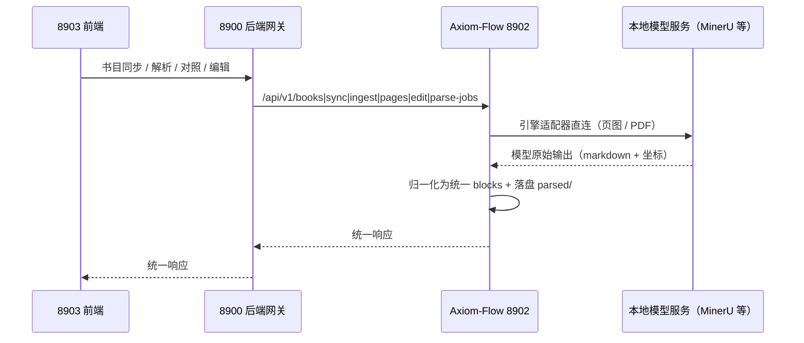

# 8902 API 接口文档

设计状态：Accepted
确认状态：暂定
实现状态：Current（af_* 持久化 + 异步 parse-jobs + 对照编辑 + 分块预览已实现；8900 透传适配待 REQ-001）
最后更新：2026-09-17
关联代码：`src/axiom_flow/api/main.py`、`src/axiom_flow/schemas.py`（响应结构单一事实源）、`scripts/axiom_flow_service.py`（生命周期脚本）
关联测试：`tests/contract/test_api_v1_contract.py`、`tests/unit/test_service_scripts.py`
关联 ADR：[ADR 0001](../adr/0001-v2-exploration-direction.md)、[ADR 0004](../adr/0004-model-boundary-and-pipeline-ownership.md)

> 本文件是 **Axiom-Flow 的固定 API 接口文档**（根仓库 ADR 0010 文档体系范本）：8902 全部对外
> 端点的契约总表，按**接口类型**组织（REQ-046 四类）：① 生命周期与健康；② 数据查询
> （af_* 数据库知识）；③ 解析结果与 PDF 对照；④ 未来 RAG / 知识图谱预留。版本末期确认更新
> 后，前版本契约进 `docs/history/`。本仓库只保证 API 契约与产物格式稳定；8900 侧透传适配
> 见根仓库 `docs/architecture/api-contracts.md` ④数据透传·Axiom-Flow。

## 目的与边界

8902 是 Axiom-Flow（QED-Engine 后端解析组件）的**对外 API 契约总表**：提供解析任务提交、
书目与解析产物查询、原页对照数据供给与人工编辑落库。8903 前端只连 8900 后端网关
（根仓库 ADR 0007），8900 内部经 `AxiomClient` 适配 8902；8902 离线时 8900 返回 503 并降级
展示（独立性铁律，不影响其他界面）。

**解析管线在 8902 直连模型服务**（[ADR 0004](../adr/0004-model-boundary-and-pipeline-ownership.md)），
不经 8900 网关；8900 只负责模型生命周期（`/models`）与探针。

接口按类型分为**四类**（2026-08-20 根仓库 REQ-046 分类，2026-09-14 ARCH-020 重构）：

| 类型 | 端点 | 语义 |
| --- | --- | --- |
| ① 生命周期与健康 | `GET /health` + `scripts/axiom_flow_service.py {start\|stop\|restart\|status}` | 服务启停/重启/健康检测 |
| ② 数据查询（af_*） | `GET /books`、`GET/PATCH/DELETE /books/{id}`、`POST /books/sync`、`POST /books/{id}/ingest` | 书目同步与 CRUD、页图 ingest |
| ③ 解析结果与 PDF 对照 | `GET /books/{id}/manifest`、`/pages/{no}`、`/pages/{no}/image`、`PUT /blocks/{index}/edit`、`GET /pages/{no}/edits`、`GET /books/{id}/chunks`、`POST /parse-jobs`、`GET /parse-jobs/{id}` | 解析进度、对照供给、块编辑、分块预览 |
| ④ 未来 RAG·知识图谱预留 | 见「④ 预留分类」节 | Milvus 接入占位、检索端点设计 |

## 服务信息

- 服务名：Axiom-Flow（FastAPI 标题 Axiom-Flow，version 0.4.0）
- 端口：`8902`（`QED_AXIOM_URL` / `AXIOM_PORT` 可覆盖健康探测端口）
- 前缀：`/api/v1`
- 启动（仓库根目录）：`python -m uvicorn axiom_flow.api.main:app --host 127.0.0.1 --port 8902`
- 生命周期管理：`python scripts/axiom_flow_service.py {start|stop|restart|status} [--port PORT] [--wait [SECONDS]]`



## ① 生命周期与健康

### GET /api/v1/health

存活检查，8900 控制中心与生命周期脚本（`--wait`/`status`）的就绪判据。

```json
{"status": "ok"}
```

### 服务生命周期脚本（scripts/axiom_flow_service.py）

8902 服务唯一启停入口（单文件纯标准库，8900 黑盒调用，契约事实源沿 v0.1 版本
`docs/history/design/service-lifecycle.md`，本文件为其固定落位）：

```text
python scripts/axiom_flow_service.py {start|stop|restart|status} [--port PORT] [--wait [SECONDS]]
```

- `start`：默认拉起后立即返回；`--wait [SECONDS]` 时轮询 `/api/v1/health` 直到就绪（默认超时
  30s）。已运行时报 `already running`，幂等退出 0。成功输出 `pid: <n>` 与 `log: <path>`。
- `stop`：优雅停止（CTRL_BREAK）→ 5s 宽限（`_proc_alive` 判活）→ taskkill 强杀整树再等
  5s → 复核仍存活报 `stop failed` 并退出 1（PID 文件保留现场）；确认终止后清理 PID 文件，
  强杀兜底生效时输出 `stopped (forced)`；无 PID/进程已死时清理残留并幂等退出 0。
- `restart`：先 stop 后 start，透传 `--wait`。
- `status`：PID 存活 / 端口探测（socket 预检 + HTTP 健康确认）双路径，输出
  `running (pid <n>)` / `running (port probe <port>)` / `stopped`，信息型恒退出 0。
- `--port` 优先级：`--port` > `QED_AXIOM_URL` > `AXIOM_PORT` > 8902。
- 退出码：`0` 成功或幂等；`1` 运行失败（spawn 失败、`--wait` 健康超时、stop 无法终止）；`2` 参数错误。
- **配置简化（2026-09-17，PLAN-002）**：`--mode local|qed-engine` 与密钥注入退役——解析始终
  直连模型服务（ADR 0004），配置由 `config.py` 向上走查 `.env` 自读。

运行产物：`logs/qed-axiom.pid`（PID 文件）、`logs/qed-axiom-serve.log`（子进程 stdout/stderr，
已 gitignore）。环境：脚本从仓库根向上查找 `.env` 并 `setdefault` 注入 `AXIOM_*`，已有环境
变量不覆盖。

## ② 数据查询（af_*）

af_* 表（af_books / af_parse_jobs / af_pages / af_block_edits）为 Axiom-Flow 私有（qed 库
af_* 命名空间，Alembic 独立建表），表结构见 [database-design.md](database-design.md)。

> **实现状态**：`GET /books`、`GET /books/{id}` 现读文件系统 `book.json`；ARCH-001 建表后改读
> af_books（**空表回退文件系统**，独立性降级）。其余端点为规划契约，随 ARCH-002~007 落地。

### GET /api/v1/books

书目列表。返回 `BookMeta` 列表（扩展字段 domain_id/course_id/course_name/knowledge_id/part/
display_title/file_path/ingest_status/parse_status/pages_done 向前兼容）。

### GET /api/v1/books/{book_id}

单书目元数据（`BookMeta`）。**错误：** 404 书目不存在。

### PATCH /api/v1/books/{book_id}

修改书目（Axiom-Flow 自有字段，如 `notes`）。请求：`{notes?: string}`；响应：更新后
`BookMeta`。**错误：** 404。

### DELETE /api/v1/books/{book_id}

删除 af_books 行（`?purge=true` 时同时删除 `parsed/` 产物）。**错误：** 404。

### POST /api/v1/books/sync

批量同步已验证书目（upsert af_books，幂等，book_id 同源 qt_books）。请求：
`[{book_id, domain_id, course_id, course_name, knowledge_id, title, part, authors, file_path}]`；
响应：`{synced: int, updated: int, books: [...]}`。

### POST /api/v1/books/{book_id}/ingest

渲染页图 + 生成 book.json（**不调模型**）：源 PDF（`QED_DATA_ROOT/<file_path>` 只读）→
`parsed/<domain>/<course>/<book_id>/pages/pXXXX.png` + `book.json`（page_count/sha256）。
响应：`{book_id, page_count, sha256, ingest_status}`。**错误：** 404 书目不存在 / 源 PDF 缺失。

## ③ 解析结果与 PDF 对照

块编辑端点（`PUT .../blocks/{index}/edit`）为 af_* 四表契约，**取代** 8900 现用的 `/review`
（ok/bad）；8900 侧适配（`/review`→`/edit`、补 ingest/chunks 透传）由本仓库 `REQ-001` 请求承载。

### GET /api/v1/books/{book_id}/manifest

产物清单：文件路径 + 大小 + SHA-256（防篡改/增量），响应为 `ManifestEntry` 列表。

### GET /api/v1/books/{book_id}/pages/{page_no}

单页完整数据（对照主数据源）：结构化 blocks + 页级 markdown + 原页图 URL + 已合并的人工编辑。

```json
{
  "blocks": {"page": 1, "image_size": [1240, 1754], "source": "mineru",
             "blocks": [{"index": 0, "type": "paragraph", "text": "...", "bbox": [72, 96, 540, 132], "order": 0}]},
  "markdown": "# Page 1\n\n...（$$...$$ 内嵌公式）",
  "image_url": "/api/v1/books/{book_id}/pages/{page_no}/image",
  "edits": [{"block_index": 0, "verdict": "ok", "note": "", "corrected_text": null, "corrected_bbox": null}]
}
```

### GET /api/v1/books/{book_id}/pages/{page_no}/image

原页高清图（`image/png`，对照左栏），产物 `pages/pXXXX.png`。

### PUT /api/v1/books/{book_id}/pages/{page_no}/blocks/{index}/edit

块编辑 upsert（落 af_block_edits，同块重复编辑覆盖更新）。请求：
`{verdict?: "ok"|"bad", note?: string, corrected_text?: string, corrected_bbox?: [x0,y0,x1,y1]}`；
响应：编辑记录。

### GET /api/v1/books/{book_id}/pages/{page_no}/edits

页内编辑列表（对照视图回显）。响应：`EditRecord[]`。

### GET /api/v1/books/{book_id}/chunks

分块预览（blocks → chunk，派生数据，不入库）：读 `chunks.json`；带 `?max_chars=&overlap_blocks=`
时基于页级 blocks 实时重算（不落盘）。响应：`ChunkSet`（book_id/params/chunks）。**错误：** 404
书目不存在 / 分块未生成。

### POST /api/v1/parse-jobs

提交解析任务。请求：`{book_id, pages?, engine?}`（`pages` 缺省 = 全部页，走**全本解析**；指定
页 = 逐页页图重解析；`engine` 缺省 `mineru`）。202 返回 `ParseJob`（queued/running/completed/failed），
任务落 `af_parse_jobs` 并由后台执行。失败页跳过不中断，`progress.error` 记录摘要（截断 200 字符）。

### GET /api/v1/parse-jobs/{job_id}

任务状态与进度（`ParseJob`：id/book_id/pages/engine/status/progress）。

### 错误语义

| 场景 | 状态码 |
| --- | --- |
| 参数非法（页码越界、verdict 非枚举等） | 400 |
| book / page / job / 产物不存在 | 404（中文 detail，如「书目不存在：{id}」） |
| 模型服务不可用（MinerU 未起等） | 503（提示经 8900 `/models/{slot}` 启停模型或检查 `QED_OCR_MODEL_URL`（5002）） |

8902 离线/5xx 时 8900 返回 503 + `Axiom-Flow 服务不可达：…`（独立性铁律，不影响配置域端点）。

## ④ 未来 RAG·知识图谱预留

本类不开放具体端点，登记**预留设计**（第一版明确不做，仅预留字段与切分点）：

- **Milvus 接入占位**：`chunks.json` 已按块级切分（paragraph/formula/table 为切分点，含页/块
  溯源），即天然向量化单元；接入时不改产物格式。
- **检索端点预留**：块级语义检索端点设计（如 `GET /api/v1/search`）待检索任务立项后按 ADR
  流程登记，本文件届时新增分类或小节。
- **知识图谱预留**：`formula.latex` 字段为数学解析器探索入口；块类型 + text 支持定义/定理
  语义识别。af_* 表扩展预留命名空间，不提前建表。

## 强制规则

- 响应结构以 `src/axiom_flow/schemas.py` 为单一事实源；本文件与契约测试
  （`tests/contract/test_api_v1_contract.py`）同步守护。
- 只读端点（books/pages/manifest/image/health）不依赖模型服务与凭据（独立性降级）；仅提交
  解析任务时按需初始化引擎适配器。
- 错误响应不泄漏堆栈与凭据；模型服务不可达映射为可读中文错误信息。
- 新增/变更端点：先更新本文件与契约测试，再实现（根仓库 REQ-002 文档治理）。

## 验证

- 契约测试 `tests/contract/test_api_v1_contract.py` 全绿（health/books/pages/image/manifest/
  parse-jobs 返回结构与 schemas 一致）。
- 全量门禁 `pytest tests -q` + `ruff check src tests`。
- 手动冒烟：`python scripts/axiom_flow_service.py start --wait` → `GET /api/v1/health` 200 →
  `GET /api/v1/books` 返回书目 → `status` → `stop` → `status stopped`。
