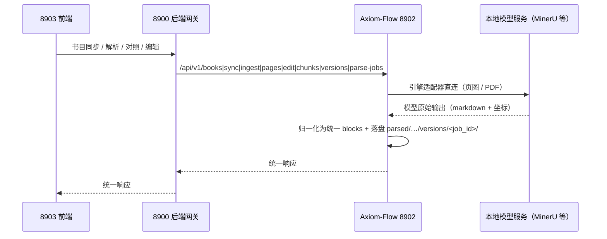

# 8902 API 接口文档

设计状态：Accepted
确认状态：暂定
实现状态：Verified（8902 全部对外端点已实现并真机取证；8900 透传适配待根侧 REQ-001）
最后更新：2026-09-23
关联代码：`src/axiom_flow/api/main.py`、`src/axiom_flow/api/admin.py`（管理面）、`src/axiom_flow/schemas.py`（响应结构单一事实源）、`scripts/axiom_flow_service.py`（生命周期脚本）
关联测试：`tests/contract/test_api_v1_contract.py`、`tests/unit/test_service_scripts.py`
关联 ADR：[ADR 0001](../adr/0001-v2-exploration-direction.md)、[ADR 0004](../adr/0004-model-boundary-and-pipeline-ownership.md)、[ADR 0007](../adr/0007-parse-status-semantics.md)

> 本文件是 **Axiom-Flow 的固定 API 接口文档**（根仓库 ADR 0010 文档体系范本）：8902 全部对外
> 端点的契约总表，按**接口类型**组织（REQ-046 四类）：① 生命周期与健康；② 数据查询
> （af_* 数据库知识）；③ 解析结果与 PDF 对照；④ 未来 RAG / 知识图谱预留。版本末期确认更新
> 后，前版本契约进 `docs/history/`。本仓库只保证 API 契约与产物格式稳定；8900 侧透传适配
> 见根仓库 `docs/architecture/api-contracts.md` ④数据透传·Axiom-Flow。

## 目的与边界

8902 是 Axiom-Flow（QED-Engine 后端解析组件）的**对外 API 契约总表**：提供解析任务提交、
书目与解析产物查询、原页对照数据供给与人工编辑落库。8903 前端只连 8900 后端网关
（根仓库 ADR 0007），8900 内部经 `AxiomClient` 适配 8902；8902 离线时 8900 返回 503 并降级
展示（独立性铁律，不影响其他界面）。

**解析管线在 8902 直连模型服务**（[ADR 0004](../adr/0004-model-boundary-and-pipeline-ownership.md)），
不经 8900 网关；8900 只负责模型生命周期（`/models`）与探针。

接口按类型分为**四类**（2026-08-20 根仓库 REQ-046 分类，2026-09-14 ARCH-020 重构）：

| 类型 | 端点 | 语义 |
| --- | --- | --- |
| ① 生命周期与健康 | `GET /health` + `scripts/axiom_flow_service.py {start\|stop\|restart\|status}` | 服务启停/重启/健康检测 |
| ② 数据查询（af_*） | `GET /books`、`GET/PATCH/DELETE /books/{id}`、`POST /books/sync`、`POST /books/{id}/ingest` | 书目同步与 CRUD、页图 ingest |
| ③ 解析结果与 PDF 对照 | `GET /books/{id}/manifest`、`/pages`、`/pages/{no}`、`/pages/{no}/image`、`PUT /blocks/{index}/edit`、`GET /pages/{no}/edits`、`GET /books/{id}/chunks`、`GET /books/{id}/versions`、`POST /parse-jobs`、`GET /parse-jobs`、`GET /parse-jobs/{id}` | 解析进度、逐页状态清单、对照供给、块编辑、分块预览、版本列举、作业列表 |
| ④ 未来 RAG·知识图谱预留 | 见「④ 预留分类」节 | Milvus 接入占位、检索端点设计 |

上表四类是**公共契约面**（8900/8903 消费）。另有一类**不进公共契约**的运维管理面：默认不挂载、
凭管理 token、双确认，见「非公开管理面」节（PLAN-010 / ARCH-024）。

**生效解析版本（2026-09-21，PLAN-004 / REQ-080）**：一本书的解析产物按版本落在
`parsed/<domain>/<course>/<book_id>/versions/<job_id>/`，「哪一版生效」的唯一事实源是
`af_books.active_job_id`（NULL = 根视图 legacy）。**所有读取端点（manifest/pages/image/chunks/
edits）经该指针解析产物目录**，因此：① URL、响应结构与 `image_url` 字面量**零变化**，根仓库前端
不需要适配；② 切版 = 单列 UPDATE，不改文件；③ 生效指针指向的版本目录缺失时**显式 404**，
不静默回落根视图（ADR 0004 无自动兜底）。历史版本仅经 `GET /books/{id}/versions` 可见（只读列举）。
**唯一例外**是管理面 `POST /api/v1/admin/purge`：它的目的就是把**所有**版本连库行一起清除，故不走
生效指针作用域（见「非公开管理面」节）。

## 服务信息

- 服务名：Axiom-Flow（FastAPI 标题 Axiom-Flow，version 0.5.0；与 `axiom_flow.__version__` 同源）
- 端口：`8902`（`QED_AXIOM_URL` / `AXIOM_PORT` 可覆盖健康探测端口）
- 前缀：`/api/v1`
- 启动（仓库根目录）：`python -m uvicorn axiom_flow.api.main:app --host 127.0.0.1 --port 8902`
- 生命周期管理：`python scripts/axiom_flow_service.py {start|stop|restart|status} [--port PORT] [--wait [SECONDS]]`



## ① 生命周期与健康

### GET /api/v1/health

存活检查，8900 控制中心与生命周期脚本（`--wait`/`status`）的就绪判据。

```json
{"status": "ok"}
```

### 服务生命周期脚本（scripts/axiom_flow_service.py）

8902 服务唯一启停入口（单文件纯标准库，8900 黑盒调用，契约事实源沿 v0.1 版本
`docs/history/design/service-lifecycle.md`，本文件为其固定落位）：

```text
python scripts/axiom_flow_service.py {start|stop|restart|status} [--port PORT] [--wait [SECONDS]]
```

- `start`：默认拉起后立即返回；`--wait [SECONDS]` 时轮询 `/api/v1/health` 直到就绪（默认超时
  30s）。已运行时报 `already running`，幂等退出 0。成功输出 `pid: <n>` 与 `log: <path>`。
- `stop`：优雅停止（CTRL_BREAK）→ 5s 宽限（`_proc_alive` 判活）→ taskkill 强杀整树再等
  5s → 复核仍存活报 `stop failed` 并退出 1（PID 文件保留现场）；确认终止后清理 PID 文件，
  强杀兜底生效时输出 `stopped (forced)`；无 PID/进程已死时清理残留并幂等退出 0。
- `restart`：先 stop 后 start，透传 `--wait`。
- `status`：PID 存活 / 端口探测（socket 预检 + HTTP 健康确认）双路径，输出
  `running (pid <n>)` / `running (port probe <port>)` / `stopped`，信息型恒退出 0。
- `--port` 优先级：`--port` > `QED_AXIOM_URL` > `AXIOM_PORT` > 8902。
- 退出码：`0` 成功或幂等；`1` 运行失败（spawn 失败、`--wait` 健康超时、stop 无法终止）；`2` 参数错误。
- **配置简化（2026-09-17，PLAN-002）**：`--mode local|qed-engine` 与密钥注入退役——解析始终
  直连模型服务（ADR 0004），配置由 `config.py` 向上走查 `.env` 自读。

运行产物：`logs/qed-axiom.pid`（PID 文件）、`logs/qed-axiom-serve.log`（子进程 stdout/stderr，
已 gitignore）。环境：脚本从仓库根向上查找 `.env` 并 `setdefault` 注入 `AXIOM_*`，已有环境
变量不覆盖。

## ② 数据查询（af_*）

af_* 表（af_books / af_parse_jobs / af_pages / af_block_edits）为 Axiom-Flow 私有（qed 库
af_* 命名空间，Alembic 独立建表），表结构见 [database-design.md](database-design.md)。

> **实现状态**：全部端点已实现；`GET /books`、`GET /books/{id}` 读 af_books，**空表回退文件系统
> `book.json`**（独立性降级）。路径参数 `book_id` 受安全路径段约束（违规 422）。

### GET /api/v1/books

书目列表。返回 `BookOut` 列表（扩展字段 domain_id/course_id/course_name/knowledge_id/part/
display_title/file_path/ingest_status/parse_status/pages_done/**active_job_id**/**last_parse_result**
向前兼容）。`pages_done` 与 `active_job_id` 一致地描述**生效版本**（PM-4）；`active_job_id=null` 表示读
根视图。**进度与结局分列（ADR 0007）**：`parse_status` 只回答「做到哪」（`pending`/`parsing`），
`last_parse_result` 只回答「上一次怎么结束」（`completed`/`partial`/`failed`/`interrupted`，`""` =
从未有任务）——前端列表不必再看 `progress` 猜结局。

### GET /api/v1/books/{book_id}

单书目元数据（`BookOut`）。**错误：** 404 书目不存在。

### PATCH /api/v1/books/{book_id}

修改书目（Axiom-Flow 自有字段，如 `notes`）。请求：`{notes?: string}`；响应：更新后
`BookOut`。**错误：** 404。

### DELETE /api/v1/books/{book_id}

删除 af_books 行、该书**全部解析版本**的 `af_pages` 页行与 `af_block_edits` 编辑行（`?purge=true`
时同时删除 `parsed/` 产物目录，含 `versions/` 子树）。`af_parse_jobs` 历史行保留为审计，不随删除
清理——**唯一例外**是管理面 `POST /api/v1/admin/purge`（见「非公开管理面」节，它按书目或全项目
连任务行一起清除）。**错误：** 404。

### POST /api/v1/books/sync

批量同步已验证书目（upsert af_books，幂等，book_id 同源 qt_books）。请求：
`[{book_id, domain_id, course_id, course_name, knowledge_id, title, part, authors, file_path}]`；
响应：`{synced: int, updated: int, books: [...]}`。**入参边界：** `book_id`/`domain_id`/`course_id`
须为安全路径段（拒绝 `/`、`..`、前导点），`file_path` 须为数据根相对路径（≤512
字符，段间只允许 `/`），违规 422。**`file_path` 的段规则是黑名单式**（REQ-083）：拒 `\`、半角
`:`（Windows 盘符）、`/ : * ? " < > |`、控制字符、前导 `.`（含 `..`）与首尾空白/句点，**其余字符
一律放行**——中文书名的全角标点（`（）：`、`【】`）不是遍历风险，用 `\w` 白名单会让一条违规殃及
整批同步（根仓库 2026-09-21 实测整批 422，靠改书名止血）。

### POST /api/v1/books/{book_id}/ingest

渲染页图 + 生成 book.json（**不调模型**）：源 PDF（`QED_DATA_ROOT/<file_path>` 只读）→
`parsed/<domain>/<course>/<book_id>/pages/p<NNNN>.png` + `book.json`（page_count/sha256）。
响应：`{book_id, page_count, sha256, ingest_status}`。**重复 ingest 幂等且版本安全（PM-16）**：原子
替换的只是**根视图**（`book.json` + `pages/`），并作废根视图 `chunks.json`；`versions/` 子树
**完整保留**（历史版本不因重新 ingest 失明）。DB 侧回置 `active_job_id=NULL`（生效指针回到根视图）、
`parse_status=pending`、`pages_done=0`，并只清空 `job_id='legacy'` 的 `af_pages` 行（真实版本作用域
的页行保留）；`last_parse_result` **不回置**——它记录「最近一次任务的结局」，ingest 不是任务。
`af_parse_jobs` 历史与 `af_block_edits` 全部保留。**错误：** 404 书目不存在 / 源 PDF 缺失。

## ③ 解析结果与 PDF 对照

块编辑端点（`PUT .../blocks/{index}/edit`）为 af_* 四表契约，**取代** 8900 现用的 `/review`
（ok/bad）；8900 侧适配（`/review`→`/edit`、补 ingest/chunks 透传）由本仓库 `REQ-001` 请求承载。

本节全部端点以**生效解析版本**为读取作用域（`af_books.active_job_id` → `versions/<job_id>/`；
NULL → 书目录根 = 根视图 legacy）。

### GET /api/v1/books/{book_id}/manifest

**生效版本**的产物清单：文件路径 + 大小 + SHA-256（防篡改/增量），路径相对该版本目录自身，响应为
`ManifestEntry` 列表。根视图清单**排除 `versions/` 子树**（历史版本不混入当前版对账）。

### GET /api/v1/books/{book_id}/pages

**生效版本**的逐页状态清单（只读；PLAN-008 W1 于本文成文、W4 已实现）。存在理由：
`GET /pages/{page_no}` 是单页端点，前端要判断「哪些页还没有产物」只能
1..page_count 逐页请求试错（486 页 = 486 次往返）；本端点一次给全集，供「失败页重解析按钮」直接
算出待重跑集合。

**不分页**：一本书一次给全（486 页量级 ≈ 数十 KB）。「齐备与否」是**全集**判据，分页会让客户端无法在
一次往返内判定，反而退回逐页试。

响应 `PageListOut`：

| 字段 | 类型 | 语义 |
| --- | --- | --- |
| `book_id` | str | 路径参数回显 |
| `job_id` | str | 本次读取的**版本作用域**（= `af_books.active_job_id`；无生效版本时为 `"legacy"`） |
| `scope` | `"active"` \| `"legacy"` | 作用域自证：`active` = 读生效版本目录，`legacy` = 读根视图 |
| `total` | int | 清单长度 = 枚举域页数 |
| `pages` | `PageStateOut[]` | 按 `page_no` 升序，**逐页连续覆盖 `1..total`**（没有页行的页也要出行，不缺项） |

`PageStateOut`（轻量行，**不含 blocks / markdown / 质量信号**——正文仍走 `/pages/{page_no}`）：

| 字段 | 类型 | 语义 |
| --- | --- | --- |
| `page_no` | int | 页码（1 基，与 `p<NNNN>.png` 对齐） |
| `status` | `"parsed"` \| `"failed"` \| `"pending"` | `af_pages.status` **原值透传**；**`pending` = 该版本没有这一页的页行**（管线从不写 `pending` 页行，列默认值只是约束） |
| `has_artifact` | bool | 该页 `pages/p<NNNN>.blocks.json` 在**生效作用域目录**内存在（磁盘事实，独立于页行取） |
| `error` | str | 页行 `error` 原值（写入时已截断至 500 字符）；无页行时为 `""` |
| `edit_count` | int | 该页在**本版本作用域**内的 `af_block_edits` 行数（块编辑存在性，ARCH-006 消费） |

**两条判据（客户端只需实现这两条）**：

- **需重解析** = `not has_artifact or status == "failed"`——一条规则覆盖「从未跑过」「跑失败」「产物
  被外部删除」三种形态，客户端不必自己组合三态。
- **`status="parsed"` 且 `has_artifact=false`** 属**数据不一致**：编排层的不变式是「有页行必有产物」
  （继承来的页行也逐个校验产物在位才复制），故该组合只可能来自产物被外部删除。本端点**如实暴露**
  该组合而不静默改判为 `pending`——静默改判会让磁盘事故在台账上消失。读该页仍然 404（`页产物缺失`）。

**枚举域**：`total` 取 `af_books.page_count`；该列为 NULL 时回落书目录 `book.json` 的 `page_count`；
两者都取不到 → 404（与产物目录缺失同一措辞）。

**作用域**：`job_id` / `scope` / `has_artifact` 三项全部取自 `_read_scope` 返回的 `(产物目录, job_id)`
（见「强制规则」的唯一入口条），不得自行拼 `book_dir`——否则会把 legacy 根视图与版本视图混读。
**错误：** 404 书目不存在或产物缺失 / 404 生效版本产物缺失（**不回落根视图**）；`book_id` 非法路径
段 422（含 `%2F` 等编码分隔符的穿越会在路由层就不匹配而落 404，两者都是拒绝，不是放行）。

### GET /api/v1/books/{book_id}/pages/{page_no}

单页完整数据（对照主数据源）：**生效版本**的结构化 blocks + 页级 markdown + 原页图 URL + 已合并的
人工编辑（编辑作用域与生效 `job_id` 一致）。

```json
{
  "blocks": {"page": 1, "image_size": [1240, 1754], "source": "mineru",
             "blocks": [{"index": 0, "type": "paragraph", "text": "...", "bbox": [72, 96, 540, 132], "order": 0}]},
  "markdown": "# Page 1\n\n...（$$...$$ 内嵌公式）",
  "image_url": "/api/v1/books/{book_id}/pages/{page_no}/image",
  "edits": [{"block_index": 0, "job_id": "pj_...", "verdict": "ok", "note": "", "corrected_text": null, "corrected_bbox": null}]
}
```

**`image_url` 是字面量常量**（`/api/v1/books/{book_id}/pages/{page_no}/image`）：版本化不引入版本
段或查询参数，切版对前端透明（契约测试 S4 以常量钉住）。

### GET /api/v1/books/{book_id}/pages/{page_no}/image

原页高清图（`image/png`，对照左栏），取**生效版本**目录下的 `pages/p<NNNN>.png`（版本内页图为根
视图页图的硬链接，见 [parsing-pipeline.md](../design/parsing-pipeline.md)）。**错误：** 404 页图缺失。

### PUT /api/v1/books/{book_id}/pages/{page_no}/blocks/{index}/edit

块编辑 upsert（落 af_block_edits，**唯一键含生效版本 `job_id`**，同版本同块重复编辑覆盖更新）。
请求：`{verdict?: "ok"|"bad", note?: string, corrected_text?: string, corrected_bbox?: [x0,y0,x1,y1]}`；
响应：编辑记录（`EditRecord`，含 `job_id`）。编辑绑定其核对时的版本：块下标 `index` 只在版本内有意义，
换版本后旧编辑不自动套用。

### GET /api/v1/books/{book_id}/pages/{page_no}/edits

页内编辑列表（对照视图回显）。作用域 = 生效版本；响应：`EditRecord[]`。

### GET /api/v1/books/{book_id}/versions

解析版本列举（**只读**，不切换生效指针）：按任务创建时间返回该书每次解析任务的自证信息，响应为
`ParseVersionOut[]`（`job_id/engine/status/page_count/parsed/source_sha256/created_at/active`）。
`active=true` 的行即 `af_books.active_job_id` 指向的版本；`parsed` 为该版本已解析页数。**错误：**
404 书目不存在。

### GET /api/v1/books/{book_id}/chunks

分块预览（blocks → chunk，派生数据，不入库）：读**生效版本**的 `chunks.json`；带
`?max_chars=&overlap_blocks=` 时基于该版本页产物实时重算（不落盘）。响应：`ChunkSet`
（book_id/params/chunks）。**错误：** 404 书目不存在 / 分块未生成。

### POST /api/v1/parse-jobs

提交解析任务。请求：`{book_id, pages?, engine?}`（`pages` 缺省 = 全部页，走**全本解析**；指定
页 = 逐页页图重解析；`engine` 为 `mineru`/`paddleocr-vl`/`qwen-vl` 之一，**缺省回落
`AXIOM_OCR_ENGINE`**，未实现的槽位返回 400、非法字面值返回 422，**绝不回落到其他引擎**）。
202 返回 `ParseJob`（状态机见下表），任务落 `af_parse_jobs`（`engine` 存**解析后的实际引擎名**）
并由后台执行。每个任务即**一个解析版本**：产物只写
`parsed/.../<book_id>/versions/<job_id>/`，并在运行时记录 `source_sha256`/`page_count` 自证
（版本 ↔ 源 PDF 快照对应）。失败页跳过不中断：`failed_pages` 给出**结构化、不截断**的页码数组，
`progress.error` 记录进行中失败页摘要（≤200 字符），终态摘要写 `error`（≤500 字符）——摘要会截断，
页码不会丢（ADR 0007 决定 2）。**激活门槛（PM-11）= `completed` 判据本身**：目标页齐备且清单重算成功
才激活 `af_books.active_job_id`，同一次判定同时定 `status`，故「completed 但未激活」不可能；
`partial`/`failed` 或中断**不激活**，产物保留不删（自然回滚 = 指针从未动过）。**受理前门槛**（顺序固定）：书目存在 → 已 ingest 校验 → **`pages` 越界 422**（逐页判
`1 ≤ p ≤ af_books.page_count`，DEFECT-006；此前接受 `pages=[40,999]` 会在 `af_pages` 写出指向不存在
页图的幽灵行）→ 引擎名解析 → 模型服务探活（不可用 503，**不创建任务行**）；**越界判在探活之前**，
非法请求不打模型。**受理后不并行打模型**：执行前经单一占用闸门等待（见下）。

### 任务状态机（ADR 0007 决定 1）

| `status` | 判据 | 谁写 |
| --- | --- | --- |
| `queued` | 已受理、未开始 | 建任务行 |
| `running` | 执行中（含排队等闸门） | 管线开始 |
| `completed` | 目标页**全部** `parsed` 且产物在位、清单重算成功（= 版本激活判据） | 管线终态 |
| `partial` | ≥1 页 `parsed` 但未齐备；`failed_pages` 非空 | 管线终态 |
| `failed` | 0 页产出，或引擎整体异常/闸门超时 | 管线终态 |
| `interrupted` | 上次进程留下 `queued`/`running` 行 → 冷启动归一 | **只有启动期归一**（单实例前提，见 [operations.md](../guides/operations.md)） |

`progress` 只描述做到哪（`parsed`/`total`/`failed`/`error`），**不再兼任结局**；书目侧同一分列：
`af_books.parse_status` ∈ `pending`/`parsing`，任务结局独立落 `last_parse_result`（`""` = 从未有任务）。

### GET /api/v1/parse-jobs

解析作业列表（只读；PLAN-008 W1 于本文成文、W3 已实现）。供 8903
「任务中心抽屉」列举与过滤作业；`GET /parse-jobs/{job_id}` 只能按**已知 id** 查单个，无法枚举。

查询参数（全部可选、可组合）：

| 参数 | 类型 | 默认 | 语义 |
| --- | --- | --- | --- |
| `book_id` | 安全路径段 | 不过滤 | 只列该书的作业；**书不存在时返回 200 + 空列表**（列表过滤不是资源定位，不 404）；非法路径段 422 |
| `status` | `JobStatus`，**可重复** | 不过滤 | 多值 **OR** 过滤（`?status=queued&status=running` = 只看活跃）；值不在六态内 → 422 |
| `limit` | int，`1..200` | `50` | 本页行数上限；越界 422 |
| `offset` | int，`≥0` | `0` | 分页偏移；越界 422 |

响应 `ParseJobListOut` = `{jobs: ParseJobListItem[], total, limit, offset}`。`total` 是**过滤后的总行数**
（不是本页行数），客户端据此判定还有没有下一页。

**排序稳定**：`created_at DESC, job_id DESC`。第二键是必需的而非装饰——`MySQL DATETIME` 只到秒，
同秒创建的多条作业仅按时间排序结果不可重复，翻页会漏行或重行（与
`ParseJobRepository.list_for_book` 的定序理由同源）。

`ParseJobListItem` = **`ParseJob` 全部字段原样**（`id`/`book_id`/`pages`/`engine`/`status`/`progress`/
`failed_pages`/`error`）再加四个列表专用字段：

| 字段 | 类型 | 语义 |
| --- | --- | --- |
| `created_at` | `datetime \| null` | 排序键，**必须在响应里可见**——客户端看不到它就无法稳定翻页，也无法展示 |
| `started_at` | `datetime \| null` | `null` = 仍在 `queued`（含单一占用闸门的等待期，见下条端点） |
| `finished_at` | `datetime \| null` | `null` = 未进终态 |
| `active` | bool | 该行是否为其所属书的**当前生效版本**（与 `af_books.active_job_id` 相等） |

**三条不变式**：

- **六态原值透传**：`status` 不做任何「看起来更好」的归并与改写（`interrupted` 就是 `interrupted`，
  不并入 `failed`）。读取面一旦加工，就把语义分歧冻结给了前端（ADR 0004 不做静默兼容层）。
- **不读产物**：作业行事实全在 `af_parse_jobs`，因此本端点**不经** `_read_scope`——那是 per-book 的
  产物作用域解析，跨书列表没有单一作用域，硬套会造出第二套作用域语义。`active` 经 `af_books` 联结
  取得，仍然只是数据库读、不摸磁盘，与「只读端点不依赖模型服务与凭据」一致。
- **含已删书的审计行**：`DELETE /books/{book_id}` 保留 `af_parse_jobs` 历史行（见 ② 该节），全局列表
  **不排除**它们，其 `active` 恒为 `false`。故不带 `book_id` 过滤时 `total` 可能大于现存书目的作业数
  ——这是审计留痕的预期结果，不是脏数据。

### GET /api/v1/parse-jobs/{job_id}

任务状态与进度（`ParseJob`：id/book_id/pages/engine/status/progress/**failed_pages**/error）。
运行中可见 `progress.parsed` 递增（节流写入：≥1s 或每 10 页）；终态的 `failed_pages` 是完整页码
数组，供「只重跑失败页」直接取用。**`queued` 可以很久**：本机 GPU 只容得下一个
解析，任务在单 worker 队列里排队、且启动前还要等模型服务空闲（`queued_tasks + processing_tasks
== 0`，最长 900 秒）；等待期 `started_at` 为空，超时则 `failed` 且 `error` 写「模型服务被其他解析
任务占用」，与「模型服务不可用」区分（2026-09-21 R1 窗口后成文）。**`interrupted` 不是引擎失败**：
`error` 写「服务重启中断，可重跑」，续跑方式是**用同一 `job_id` 重放**（已 `parsed` 且产物在位的页
跳过引擎），不必新建版本。

### 错误语义

| 场景 | 状态码 |
| --- | --- |
| 参数非法（**块下标**越界、verdict 非枚举、引擎槽位未实现等） | 400 |
| book / page / job / 产物不存在 | 404（中文 detail，如「书目不存在：{id}」） |
| **生效版本产物目录缺失** | 404 `生效版本产物缺失：{book_id} @ {job_id}`（指针所指版本目录被外部删除等；**不回落根视图**，ADR 0004 无自动兜底） |
| 入参 schema 违规（安全路径段、引擎字面值、`file_path` 形态、**`pages` 页码越界**） | 422 |
| **列表端点**查询参数违规（`status` 不在六态内、`limit` 非 `1..200`、`offset` 为负、`book_id` 非法路径段） | 422 |
| `GET /parse-jobs?book_id=<不存在的书>` | **200 + 空 `jobs`**（列表过滤不判资源存在性；单本读取面仍是 404） |
| 模型服务不可用（**提交期探活失败**，MinerU 未起等） | 503（提示经 8900 `/models/{slot}` 启停模型或检查 `QED_OCR_MODEL_URL`（5002））；**不创建任务行** |
| 模型服务在任务受理后故障 | 202 已受理 → job `failed`（`error` 记原因），已解析页保留 |
| 模型服务被其他解析占用至闸门超时 | 202 已受理 → job `failed`，`error` 写「模型服务被其他解析任务占用」（**不冒充**「模型服务不可用」）；不写页行、不激活版本 |
| 逐页任务部分页失败 | 202 已受理 → job `partial`（`failed_pages` 列页码），齐备页产物保留、**不激活版本**（激活判据未满足） |
| 进程被杀/重启留下 `queued`/`running` 行 | 无 HTTP 侧码：**冷启动受理首个请求之前**归一为 `interrupted`，书目进度回 `pending`、结局仅在最新任务时置 `interrupted`（ADR 0007 决定 4；单实例前提见运维指南） |

8902 离线/5xx 时 8900 返回 503 + `Axiom-Flow 服务不可达：…`（独立性铁律，不影响配置域端点）。

## ④ 未来 RAG·知识图谱预留

本类不开放具体端点，登记**预留设计**（第一版明确不做，仅预留字段与切分点）：

- **Milvus 接入占位**：`chunks.json` 已按块级切分（paragraph/formula/table 为切分点，含页/块
  溯源），即天然向量化单元；接入时不改产物格式。
- **检索端点预留**：块级语义检索端点设计（如 `GET /api/v1/search`）待检索任务立项后按 ADR
  流程登记，本文件届时新增分类或小节。
- **知识图谱预留**：`formula.latex` 字段为数学解析器探索入口；块类型 + text 支持定义/定理
  语义识别。af_* 表扩展预留命名空间，不提前建表。

## 非公开管理面（af_* 与产物一键清除）

这一类**不属于上面四类公共契约**（PLAN-010 / ARCH-024，2026-09-23 用户裁决立项）：它是「先清后建」
的运维通路，一次调用把 `af_*` 四表的解析侧数据与 `QED_DATA_ROOT/parsed/` 产物目录一起清掉，作用域
可以是指定书目或全项目。**8900 网关与 8903 前端不得透传、不得消费**。

「不对外开放」不靠网络实现——8902 本来就只绑 `127.0.0.1`。真实边界是三件事叠加：

1. **默认不挂载**：`QED_ADMIN_ENABLED` 未置真 ⇒ 路由不进 app，请求得 **404**（不是 405/403，避免
   泄漏管理面存在性）。
2. **凭管理 token**：`QED_ADMIN_ENABLED=1` 而 `QED_ADMIN_TOKEN` 为空 ⇒ **启动即失败**
   （`AdminConfigError`），不静默放行、不降级为「无凭据可用」（ADR 0004）。token 经
   `X-QED-Admin-Token` 请求头逐字比对（`hmac.compare_digest`），缺失与错值同为 **401**。
3. **双确认**：`dry_run` 缺省 `true`（只回「将删清单 + 计数」，零删除）；真删须显式
   `dry_run:false` **且** `confirm` 逐字等于 `PURGE`，否则 **400**。

### POST /api/v1/admin/purge

请求（两形态）：

```json
{"scope": {"all": true}, "dry_run": true, "confirm": ""}
{"scope": {"book_ids": ["mathanalysis-b05"]}, "dry_run": false, "confirm": "PURGE"}
```

| 字段 | 类型 | 默认 | 语义 |
| --- | --- | --- | --- |
| `scope.all` | bool | `false` | `true` = 全项目：`af_*` 四表**全部行** + `parsed/` 下所有书目录（含每个版本子树） |
| `scope.book_ids` | str[] | — | 按书目：清这些书在四表的行（**含全部解析版本**，也含 `af_parse_jobs` 审计行）与其磁盘目录；每项须为安全路径段（违规 422） |
| `dry_run` | bool | **`true`** | 缺省即演练：响应给清单与计数，磁盘与库**零改动** |
| `confirm` | str | `""` | 仅 `dry_run:false` 时校验，须逐字为 `"PURGE"` |

`scope.all` 与 `scope.book_ids` **互斥且必填**（两者皆缺或同时给出 → 400），且**没有默认值**——
「清除范围」猜不得：缺省即报错比缺省即全删安全。

响应 `AdminPurgeOut`：

| 字段 | 类型 | 语义 |
| --- | --- | --- |
| `scope` | object | 请求作用域原样回显 |
| `dry_run` | bool | 本次是否为演练（`true` 时零删除） |
| `targets` | str[] | 命中的书目录，**相对数据根**的路径（不含绝对路径与磁盘位置） |
| `deleted` | object | `af_books`/`af_parse_jobs`/`af_pages`/`af_block_edits` 行数 + `directories` 目录数 |
| `failures` | str[] | 人类可读中文失败项（逐项列出删除失败的对象与后果）；**不含**凭据与绝对路径 |

`dry_run:true` 时 `deleted` 是**将删计数**（枚举得到、未执行），`dry_run:false` 时是**已删计数**；
两态形状相同，客户端「先演练后真删」不必换解析逻辑。

磁盘作用域＝**书目目录**（`parsed/<domain>/<course>/<book_id>`，含其下所有版本子树）；空的
`domain`/`course` 父级不裁剪——与 `DELETE /books/{id}` 同一口径（[operations.md](../guides/operations.md)），
`sync` 会复用这层骨架，多留一个空目录不构成脏数据。

**书目录的识别只看产物标记、不看层数**：目录内存在 `book.json` 或 `pages/` 或 `versions/` 即为书目录，
命中后不再下钻（版本目录不是书目录）。层数本身不可依赖——`domain_id`/`course_id` 为空串时 pathlib 拼接
会**折叠空段**，书目录落在 `parsed/<course_id>/<book_id>/`（两层；业务库 17 本即此形态）。按固定三层
匹配会把 `pages/`、`versions/` 误当书目录：真删后 `book.json`/`manifest.json` 与空书目录残留、重跑的
`targets` 不为空 ⇒ 幂等不成立（判例 ARCH-026 / PLAN-011，回归用例
`test_empty_domain_book_dir_is_purged_whole`）。遍历深度上限 3 层（`<domain>/<course>/<book>`）。

**六条不变式**：

- **库侧只碰 `af_*` 四表的行**：只用 DML，无 DDL、无 `DROP DATABASE`（与 ADR 0005 的同源纪律）；
  共享库中其他项目的 `qt_*` 表不受影响。`af_books` 行同样清除——书目可经 `POST /books/sync` 从
  根库重建，它不是本仓库的持久资产。
- **作用域守卫**：磁盘目标经 `resolve()` 后必须落在 `QED_DATA_ROOT/parsed/` 之内，否则 **400 整请求
  拒绝、零删除**。判据不止磁盘：作用域内**每条 `af_books` 行的落点路径**同样要过守卫——目录不存在
  也要判，否则库里 `domain_id='..'` 的脏值会绕过磁盘枚举、被全表扫尾连行一起删掉（不信任存量脏值）。
- **在飞拒删（409）**：作用域内存在 `queued`/`running` 任务行即拒绝且**零删除**——「边解析边删」会
  留下半删状态。`interrupted`/`partial` 等终态不拦（它们正是待清理对象）。两条守卫同时命中时
  **作用域守卫先判**（⇒ 400）：脏落点是配置问题，报成「等解析跑完」会把运维引向走不通的恢复路径。
- **删除顺序＝先磁盘后库**：磁盘失败 ⇒ 库行原样保留（可重跑，读取面最多 404）；库失败 ⇒ 已删目录
  **不回滚**，但残行必被下一次清除幂等收掉，且 `failures` 明写。**不做「假装成功」**（ADR 0004）。
- **幂等**：重复清除（无匹配行/目录）返回 200 且 `deleted` 全 0、`failures` 空——「没什么可删」不是
  失败。按书目形态**不判书目存在性**（与 `GET /parse-jobs?book_id=` 同一口径）。
- **不可回滚**：本端点没有 undo。执行纪律＝先 `dry_run` 留清单，再备份 `af_*` 四表，最后真删
  （见 [operations.md](../guides/operations.md)）；真实数据根上的全项目清除属**另一次 D 类批准**。

**错误语义**：400 作用域违规 / `confirm` 缺失或错值；401 token 不匹配（含缺头）；404 管理面未启用；
409 作用域内有活动任务；422 请求体形状违规（`book_ids` 非安全路径段、未知字段）。次序固定：
`confirm` → 作用域（形状 + 落点）→ 在飞判定 → 删除，故脏落点必判 400 而非 409。

## 强制规则

- 响应结构以 `src/axiom_flow/schemas.py` 为单一事实源；本文件与契约测试
  （`tests/contract/test_api_v1_contract.py`）同步守护。
- 只读端点（books/pages/manifest/image/chunks/versions/health）不依赖模型服务与凭据（独立性降级）；
  仅提交解析任务时按需初始化引擎适配器，并只做**提交期探活**（不可用 503，不落任务行）。
- **读取面的版本作用域只有一个入口**（`api/main.py:_read_scope`）：**读磁盘产物**的只读端点必须经它取
  `(产物目录, job_id)`，不得自行拼 `book_dir`——否则会绕过生效指针、把 legacy 与版本视图混读。
  纯数据库读的列表端点（`GET /parse-jobs` 跨书枚举）不套此入口，但也**不得另造作用域判定**：
  「哪一版生效」的事实源只有 `af_books.active_job_id` 一列，`active` 只能由它比出。
- 错误响应不泄漏堆栈与凭据；模型服务不可达映射为可读中文错误信息。
- 新增/变更端点：先更新本文件与契约测试，再实现（根仓库 REQ-002 文档治理）。
- **管理面不得透传**（PLAN-010）：`/api/v1/admin/*` 不是公共契约——8900 网关与 8903 前端不得注册、
  不得轮询、不得做成按钮；本仓库的运维通路经回环直连 8902。管理 token 绝不进任何响应、日志与
  异常文本（与「敏感字段规则」同一条纪律）。

## 验证

- 契约测试 `tests/contract/test_api_v1_contract.py` 全绿（health/books/pages/image/manifest/
  parse-jobs 返回结构与 schemas 一致；`TestParseVersions` 守护版本化：两版本并存读生效版、
  `image_url` 字面量不变、重 ingest 后历史版本可直读、生效目录缺失 404；`TestParseJobListEndpoint`
  守护作业列表：六态原值、可重复 `status` 多值 OR、`created_at DESC, job_id DESC` 可复现翻页、
  `total` 为过滤后总数、不存在的书 200 空集、删书审计行仍列出且 `active=false`；`TestPageListEndpoint`
  守护页清单：`1..total` 连续覆盖、`pending` = 无页行、`parsed`+无产物如实暴露（读该页仍 404）、
  `edit_count` 按版本作用域、`scope` 自证、生效目录缺失 404 不回落；`TestAdminPurgeEndpoint`
  守护管理面：未启用即 404 且 `/openapi.json` 不收录、fail-closed 启动、token 缺失/错值 401、
  `dry_run` 缺省零删除、缺 `confirm` 400、在飞任务 409、作用域越界不落库、脏落点与在飞同时命中判 400（守卫次序）、磁盘失败保留库行、响应只给相对路径与计数；真机两形态演练留档 `data/probes/purge-20260923/`（PLAN-010 W6：`qed_test` + 独立探针数据根，业务侧零写入自证）。
- 全量门禁 `pytest tests -q` + `ruff check src tests`。
- 手动冒烟：`python scripts/axiom_flow_service.py start --wait` → `GET /api/v1/health` 200 →
  `GET /api/v1/books` 返回书目 → `status` → `stop` → `status stopped`。
