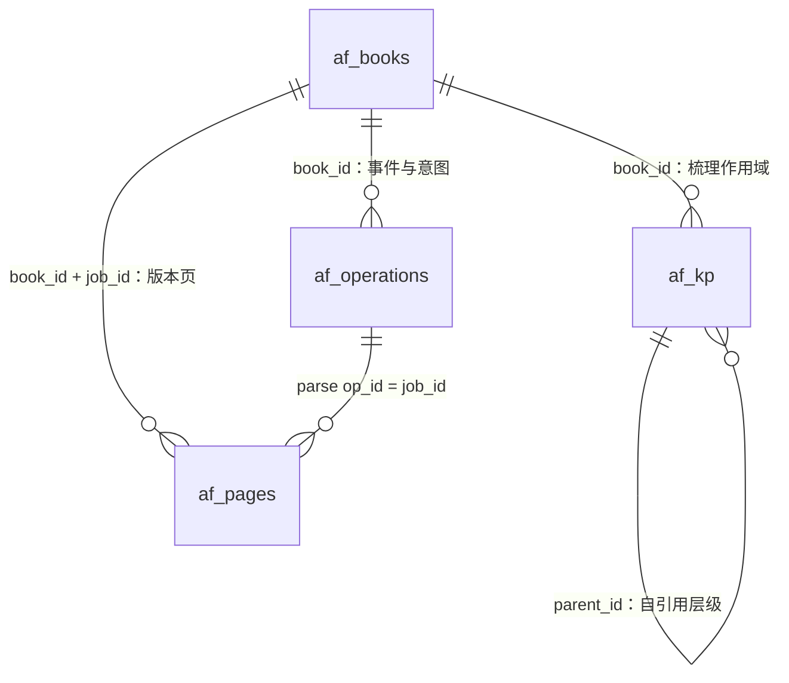

# 数据库实现与迁移说明

设计状态：Accepted
确认状态：已确认
实现状态：Implemented（四表、两版迁移与本侧梳理通路已落地）
最后更新：2026-11-27
关联代码：`src/axiom_flow/db/models.py`、`src/axiom_flow/db/repositories.py`、`src/axiom_flow/migrations/versions/`
关联测试：`tests/unit/test_db.py`、`tests/unit/test_db_migrations.py`、`tests/unit/test_db_table_family_governance.py`、`tests/integration/test_parse_persistence.py`
关联 ADR：[ADR 0005](../adr/0005-mysql-integration-test-isolation.md)、
[ADR 0007](../adr/0007-parse-status-semantics.md)、
[ADR 0010](../adr/0010-page-regions-are-parse-inputs.md)、
[ADR 0015](../adr/0015-db-single-source-for-readiness.md)、
[ADR 0017](../adr/0017-database-design-eight-chapter-skeleton.md)、
[ADR 0035](../../../docs/adr/0035-unified-sixteen-table-database-design.md)（全库设计正本集中）

> 全库 16 表列级设计正本只在根文档 `../../../docs/architecture/database-design.md`。
> 本篇只说明 `af_*` 迁移链、运行约束、版本/事件/意图/确认/并发语义、保留裁剪和人工窗口；保留的列清单/DDL 是实现镜像。

## 一、前言

本篇承载 Axiom-Flow 自有 `af_*` 表族的实现与迁移事实，不替代根仓库的全库设计。四张表位于共享 `qed`
数据库，但表族、列形状、索引和迁移动作均由本仓库负责；共享 `qed_*` 与对端 `qt_*` 的跨库设计不复制到本篇。

| 主题 | 正本或入口 | 本篇位置 |
| --- | --- | --- |
| 全库 16 表列级设计 | `../../../docs/architecture/database-design.md` | 只保留根指针，不重述他表字段 |
| 三项目四服务边界 | `../../../docs/architecture/four-service-architecture.md` | 第一章边界、第六章消费契约 |
| 8900 对外 API | `../../../docs/architecture/api-contracts.md` | 第六章 HTTP 边界 |
| Axiom-Flow 端点 | [api.md](api.md) | 只引用，不复制端点正文 |
| `af_*` 执行形状 | `models.py` 与 Alembic 迁移 | 第五章列清单与关键 DDL 的实现镜像 |
| 模块、测试与设计映射 | [code-map.md](code-map.md) | 第八章守护面 |

**实现镜像**的含义是：列清单用于人工审阅与守护对账，可执行结构以同版本 ORM 和迁移为准；镜像落后于
执行真源时先修迁移、ORM 与镜像，再发布。本篇不把镜像当作另一套可独立修改的设计输入。

## 二、遵循的规则

1. **前缀即所有权**：Axiom-Flow 只维护 `af_books`、`af_operations`、`af_pages`、`af_kp`；共享 `qed_*`
   按根契约消费，`qt_*` 只经 8901 HTTP 同步。
2. **DB 存元数据与状态**：页图、Markdown、版面块、分块和长文正本在数据根文件系统；数据库只存索引、
   状态、指针与溯源数据。
3. **无跨族物理外键**：四表按业务键逻辑关联，共享表之间不创建跨项目外键，避免迁移所有权互相牵制。
4. **服务不自动迁移**：启动路径没有 `create_all` 或 `upgrade`；代码合入不会改写运行库。
5. **ORM 与迁移同窗口**：新增列、索引或表时，ORM、迁移、列清单和测试必须同批交付。
6. **唯一生效指针**：`af_books.active_job_id` 是解析版本生效判据；其他表不存第二个“是否生效”位。
7. **事件与意图分列语义**：`event` 记录流水，`intent` 保存人工当前意图；parse 事件的状态只表达该版本自身进度。
8. **人工位不可机器代写**：`af_kp.confirmed` 与版本内页确认只能由人工路径置位。
9. **JSON 整列覆写**：`links`、`payload`、`artifacts`、`meta` 不做无锁增量改；需要读旧值改一点的形态必须落在
   同一把锁内。
10. **无写者列保持空哨兵**：`embedding_signature` 当前无写者，任何路径不得写非空值。
11. **保留先于裁剪**：常规路径不自动清理 `af_operations` 或 `af_kp`；任何裁剪必须先出只读清单并获批准。
12. **凭据隔离**：数据库密码等只从环境读取，不进入响应、日志、异常或自由文本列。

## 三、本项目表总览

当前表族由 `AF_TABLES` 登记，共四张；列数按 `models.py` 中显式 `mapped_column` 定义复核：

| 表 | 一行含义 | 版本作用域 | 当前 ORM 列数 | 常规写入者 |
| --- | --- | --- | --- | --- |
| `af_books` | 一册已同步书及其进度、结局与生效指针 | 书级 | 24 | 同步、ingest、解析、梳理 |
| `af_operations` | 一次事件或一条人工意图 | parse 行即版本；intent 按类型定作用域 | 27 | 作业服务、人工编辑、梳理批次 |
| `af_pages` | 一册书的一页在一个版本内的状态 | `(book_id, job_id, page_no)` | 12 | 解析管线、人工页确认 |
| `af_kp` | 章、节或知识点节点 | 书级；`job_id` 只作取证 | 23 | 梳理管线、人工复核 |

四表各有一个 `meta` JSON 扩展槽。扩展键不得进入 WHERE、函数索引或唯一键；定档后升实体列并清空对应键。
`af_books.meta` 有同步与人工双写者风险，因此同步 upsert 只覆盖同步域，人工写走整列覆写。

### 前身表对照

| 现行表 | 前身 | 迁移口径 |
| --- | --- | --- |
| `af_books` | `af_documents` | 整族重建时新建，不从旧表灌行 |
| `af_operations` | `af_jobs`、`af_edits`、`af_regions` | 事件与两类意图合并到一张表，以 `lifecycle` 分流 |
| `af_pages` | `af_page_results` | 页主键加入 `job_id`，按版本隔离 |
| `af_kp` | `af_analysis_nodes`、`af_analysis_edges` | 节点与关系合并，关系存 `links` JSON |

前身表名只用于历史对账，任何运行代码、端点或状态机不得再以它们为判据。

## 四、整体架构（本项目所需部分）

### 迁移链与当前 head

当前迁移链只有两版，线性追加：

| revision | down_revision | upgrade | 当前角色 |
| --- | --- | --- | --- |
| `20261022_0001` | `None` | 一次创建 `af_books`、`af_operations`、`af_pages`、`af_kp` | 唯一 base |
| `20261106_0001` | `20261022_0001` | 给 `af_books` 增加 `doc_kind`、`last_curation_result` | 当前 head |

- `20261022_0001` 是唯一 base，一次建四表；base 的 `af_books` 为 22 列。
- `20261106_0001` 是当前 head，只给 `af_books` 增加两列；当前 `af_books` 为 24 列。
- **base 单独不能生成当前 `af_books`**：缺少 `doc_kind` 与 `last_curation_result`。
- head 不回填历史行：`doc_kind=''` 表示未声明，`last_curation_result=''` 表示从未梳理；前者须同步腿再灌，
  后者由后续批次收尾或启动期归一更新。
- base 可能已执行，禁止改写；后续结构变更只追加新 revision，不重排链序。
- 服务不自动迁移；生产 `qed` DDL 属人工窗口，执行前须备份留指纹并获批准。

head 迁移的两列 DDL 实现镜像（MySQL 口径）为：

```sql
ALTER TABLE af_books ADD COLUMN doc_kind VARCHAR(16) NOT NULL DEFAULT '';
ALTER TABLE af_books ADD COLUMN last_curation_result VARCHAR(16) NOT NULL DEFAULT '';
```

### 关系与版本坐标



- parse 行 `op_kind='parse'`、`lifecycle='event'`、`op_id == job_id`；它同时是解析版本身份。
- `af_books.active_job_id` 指向 parse 行 `op_id`；`NULL` 表示根视图 `legacy`。
- 页行按 `(book_id, job_id, page_no)` 隔离；产物对应 `versions/<job_id>/`。
- 块编辑意图绑定版本；结构意图 `job_id=''`，跨版本存活；`af_kp.job_id` 只记取证版本，不参与作用域。
- 无物理外键；跨表一致性由仓储事务与服务端不变式维护。

### 事件与意图分工

| 行类型 | 写入形态 | 读取语义 |
| --- | --- | --- |
| parse `event` | 受理时插入；运行中条件 UPDATE 进度；终态条件 UPDATE | 版本自身生命周期与失败明细 |
| 其他 `event` | 只 INSERT，不改写、不删除 | 发生过什么；不参与人工当前态判据 |
| edit `intent` | `intent_key` 唯一键 upsert | 某版本某块的人工当前判定 |
| structure `intent` | 书行悲观锁内整批替换 | 跨版本页面结构意图；缺席即撤销 |

当前态只有四类来源：`af_books` 的书级进度/结局/生效指针、`af_pages` 的页级状态与确认、
`lifecycle='intent'` 的人工意图、parse 行的版本状态。其他读数都是派生视图，不再新增判据列。

### 人工位、哨兵与无写者列

| 判据 | 现行约束 |
| --- | --- |
| `af_kp.confirmed` | 0/1 人工确认位；只有人工路径可置 1，机器批次恒写 0 |
| `af_pages.confirm_state` | `unconfirmed`/`confirmed`/`rejected`；只在 `(book_id, job_id, page_no)` 内生效，不跨版继承 |
| `af_pages.job_id='legacy'` | 根视图页行哨兵；`af_operations` 不创建 `job_id='legacy'` 的事件行 |
| `af_operations.embedding_signature` | 检索索引代际签名；本轮无写者，任何路径不得写非空值 |
| `af_operations.op_kind` | 有写者为 `parse`/`edit`/`structure`/`kp`；`confirm`/`ingest`/`sync`/`purge`/`index` 当前无写者 |

### 并发与事务

| 场景 | 写入形态 | 保证 |
| --- | --- | --- |
| 同一人工意图重复提交 | `intent_key` 唯一约束 + 单语句 upsert | 一行当前态，禁止先查后插 |
| 结构意图全量声明 | 锁住目标 `af_books` 行后读差异并整批替换 | 并发声明只保留后提交者，无复活行 |
| 知识节点人工改写 | `rev` 乐观序号；提交可带 `if_rev` | 旧读数提交返回 409 |
| parse 进度回写 | 带前序状态条件的 UPDATE | 迟到的重启归一不改写已完成任务 |
| JSON 列更新 | 锁内读旧值后整列覆写 | 不产生无锁读改写丢键 |
| SQLite | 单写者串行；`with_for_update()` 为空操作 | 单测只证语义 |
| MySQL | `SELECT ... FOR UPDATE` 与唯一约束 | 真并发判据仅在显式 `qed_test` 集成层成立 |

## 五、详细设计

本章保留四张列清单作为当前 ORM 与迁移的**实现镜像**。每列一行；类型、可空、主键、VARCHAR 长度、唯一键和
索引名必须与 `models.py` 双向对账。完整可执行 DDL 以 Alembic 迁移为准，本篇不另行发明结构。

### af_books 列清单

| 列 | 类型 | 可空 | 键 | 语义 |
| --- | --- | --- | --- | --- |
| `book_id` | VARCHAR(100) | 否 | PK | 同源 `qt_books.book_id`，同步幂等键 |
| `domain_id` | VARCHAR(32) | 否 | — | 领域归属；空串 = 未归属 |
| `course_id` | VARCHAR(64) | 否 | i | 课程归属；空串 = 未归属 |
| `course_name` | VARCHAR(200) | 否 | — | 课程名（冗余，建树不必读 8901） |
| `knowledge_id` | VARCHAR(100) | 否 | — | 上游知识标识 |
| `title` | VARCHAR(500) | 否 | — | 书名 |
| `part` | VARCHAR(32) | 否 | — | 分册标识 |
| `display_title` | VARCHAR(500) | 否 | — | 展示用标题 |
| `authors` | JSON | 否 | — | `list[{name, role}]` |
| `file_path` | VARCHAR(512) | 否 | — | 源 PDF 的数据根相对路径 |
| `doc_kind` | VARCHAR(16) | 否 | — | `textbook`/`exercise` 两值闭集，由同步行 `roles` 派生；`''` = 未声明且不受理梳理 |
| `page_count` | INT | 是 | — | 全书页数；`NULL` = 尚未 ingest |
| `sha256` | VARCHAR(64) | 否 | — | 源 PDF SHA-256；根 `book.json` 退役后的源指纹事实位 |
| `ingest_status` | VARCHAR(16) | 否 | — | `none`/`ingesting`/`ingested`/`failed` |
| `ingested_at` | DATETIME | 是 | — | ingest 完成时刻（UTC naive）；`NULL` = 从未 ingest |
| `parse_status` | VARCHAR(24) | 否 | i | 只表达进度：`pending`/`parsing` |
| `last_parse_result` | VARCHAR(16) | 否 | — | `completed`/`partial`/`failed`/`interrupted`；`''` = 从未有任务 |
| `last_curation_result` | VARCHAR(16) | 否 | — | `completed`/`partial`/`failed`/`interrupted`；`''` = 从未梳理 |
| `pages_done` | INT | 否 | — | 生效版本已 `parsed` 页数 |
| `active_job_id` | VARCHAR(64) | 是 | — | 生效解析版本 = `af_operations.op_id`；`NULL` = 根视图 `legacy` |
| `notes` | TEXT | 是 | — | 人工备注；自由文本只落此列 |
| `meta` | JSON | 是 | — | 结构化扩展槽；同步 upsert 不得触碰 |
| `synced_at` | DATETIME | 否 | — | 最近一次同步时刻 |
| `updated_at` | DATETIME | 否 | — | 最近一次本侧写入时刻 |

索引：`ix_af_books_course(course_id)`、`ix_af_books_status(parse_status)`。

同步以 `book_id` 幂等 upsert，只覆盖九个快照列与时刻，不触碰本侧进度、结局、生效指针和 `meta`。
`doc_kind` 只由同步腿派生；`last_curation_result` 不在同步域内。`parse_status` 与 `last_parse_result` 分列，
运行中只刷新进度，终态才写结局。重新 ingest 把进度收回 `pending`、`pages_done` 归零并清除 `legacy` 页行，
不改写结局列。

`active_job_id` 只由 `BookRepository.set_active_job()` 单列更新。任务终态与激活使用同一完成判据，
`completed` 才切指针；`partial`、`failed`、`interrupted` 不改指针。`NULL` 表示根视图，不表示“无数据”。

### af_operations 列清单

| 列 | 类型 | 可空 | 键 | 语义 |
| --- | --- | --- | --- | --- |
| `op_id` | VARCHAR(64) | 否 | PK | 事件身份；parse 行的 `op_id` 就是版本号 |
| `book_id` | VARCHAR(100) | 否 | i | 书级作用域 |
| `job_id` | VARCHAR(64) | 否 `''` | i | parse 行等于 `op_id`；edit 绑版本；kp 记取证版本；structure/ingest/sync/purge 为空串 |
| `op_kind` | VARCHAR(24) | 否 | i | `parse`/`edit`/`structure`/`confirm`/`ingest`/`sync`/`purge`/`index`/`kp`；扩值须评审 |
| `lifecycle` | VARCHAR(16) | 否 `event` | — | `event` = 流水；`intent` = 人工当前态 |
| `actor` | VARCHAR(16) | 否 `human` | — | `human`/`system`/`model` |
| `page_no` | INTEGER | 是 | i | 页坐标；`NULL` = 不落在具体页 |
| `block_index` | INTEGER | 是 | i | 版本内块坐标；edit 使用 |
| `target_id` | VARCHAR(64) | 否 `''` | — | structure = `region_id`；kp = `gen_batch`；其余通常为空串 |
| `intent_key` | VARCHAR(64) | 是 | UQ | 意图幂等键；`event` 行恒 `NULL`，MySQL 唯一键因此只约束意图行 |
| `engine` | VARCHAR(24) | 否 `''` | — | parse 行显式引擎名；空串不是回落值 |
| `pages` | JSON | 是 | — | parse 请求页集；`NULL` = 全本 |
| `page_count` | INTEGER | 是 | — | 受理时的全书页数快照 |
| `source_sha256` | VARCHAR(64) | 否 `''` | — | 本版实际使用的源文件 SHA-256 |
| `parser_signature` | VARCHAR(64) | 否 `''` | i | 解析代际签名；空串 = 未知，只判需重跑 |
| `embedding_signature` | VARCHAR(64) | 否 `''` | — | 检索索引代际签名；当前无写者，非空值禁止 |
| `render_profile` | VARCHAR(32) | 否 `''` | — | 版本级产物格式档案 |
| `status` | VARCHAR(16) | 否 `queued` | i | parse 六态；非 parse 只用 `ok`/`failed` |
| `progress` | JSON | 否 `{}` | — | parse 进度读数；内部时刻键在对外序列化时剥离 |
| `failed_pages` | JSON | 否 `[]` | — | 结构化失败页码数组，不截断 |
| `error` | VARCHAR(500) | 否 `''` | — | 人读错误摘要 |
| `payload` | JSON | 否 `{}` | — | 操作载荷；形状闭集，禁自由键 |
| `result` | JSON | 是 | — | 结果明细；`NULL` = 无额外读数 |
| `note` | VARCHAR(1000) | 否 `''` | — | 人写备注 |
| `meta` | JSON | 是 | — | 结构化扩展槽 |
| `created_at` | DATETIME | 否 | — | 事件发生时刻（UTC naive） |
| `updated_at` | DATETIME | 否 | — | 意图最后改写时刻；非 parse 事件恒等于 `created_at` |

键与索引：`uq_af_operations_intent(intent_key)`、`ix_af_operations_book(book_id, op_kind, created_at)`、
`ix_af_operations_version(job_id, page_no)`、`ix_af_operations_sig(book_id, parser_signature, status)`。
`embedding_signature` 当前不建索引，随检索面首个消费方同批增加。

parse 行的 `status` 为 `queued`/`running`/`completed`/`partial`/`failed`/`interrupted`。`completed` 表示目标页
齐备；`partial` 表示有产出但未齐备；`failed` 表示零产出或整体异常；`interrupted` 的唯一写入者是启动期归一。
进度按时间或页数节流回写，终态必写；失败页以 `failed_pages` 为准，`error` 只作摘要。

块编辑以 `intent_key` upsert，产物文件不被人工作品覆盖，读时按生效版本叠加意图。结构意图的 `job_id`
恒为空串，按书行锁整批替换；页码越界时保留可见，不静默删除。

kp 批次整批一行：`target_id=gen_batch`、`actor='system'`、`job_id` 为取证版本；`payload` 当前八键为
`gen_batch`、`page_start`、`page_end`、`review_note`、`stage`、`only_failed`、`target_book_id`、
`retry_node_ids`。事件行只插不改，当前态读 `af_kp` 自身。

### af_pages 列清单

| 列 | 类型 | 可空 | 键 | 语义 |
| --- | --- | --- | --- | --- |
| `book_id` | VARCHAR(100) | 否 | PK | 书级作用域 |
| `job_id` | VARCHAR(64) | 否 | PK | 解析版本；`legacy` = 根视图存量 |
| `page_no` | INT | 否 | PK | 1 基页码 |
| `status` | VARCHAR(16) | 否 | — | `pending` 为 DDL 默认；运行写 `parsed`/`failed` |
| `source` | VARCHAR(24) | 否 | — | 实际引擎标识 |
| `quality` | JSON | 是 | — | 页级质量信号 |
| `error` | VARCHAR(500) | 否 | — | 该页失败原因 |
| `artifacts` | JSON | 是 | — | 在位产物索引；不存正文或绝对路径，不作就绪判据 |
| `confirm_state` | VARCHAR(16) | 否 `unconfirmed` | — | 版本内人工确认态 |
| `section_kind` | VARCHAR(16) | 否 `''` | — | 页域角色闭集；空串 = 未判 |
| `meta` | JSON | 是 | — | 结构化扩展槽 |
| `parsed_at` | DATETIME | 是 | — | 产物落盘并提交页行的时刻 |

页表不为未解析页预建占位行；续跑集合是该版本“无行页 ∪ `failed` 页”，并要求产物在位。持久化顺序是
**产物写先于页行提交**，因此有页行即应能解释对应产物。`artifacts` 只披露完整性，不作为完成或激活判据。
`confirm_state` 只在当前版本生效，换版不继承人工确认。

### af_kp 列清单

| 列 | 类型 | 可空 | 键 | 语义 |
| --- | --- | --- | --- | --- |
| `node_id` | VARCHAR(64) | 否 | PK | 稳定身份 `afkp-<hex12>`，服务端随机发放 |
| `book_id` | VARCHAR(100) | 否 | i | 梳理作用域 = 一册书 |
| `job_id` | VARCHAR(64) | 否 `''` | — | 取证版本；空串 = 人工直填或根视图；只作溯源 |
| `node_kind` | VARCHAR(16) | 否 `point` | i | `outline`/`point` |
| `parent_id` | VARCHAR(64) | 是 | i | 自引用父节点；`NULL` 的 point = 未归档池 |
| `depth` | INTEGER | 是 | — | outline 层级 1=章、2=节；point 为 `NULL` |
| `order_hint` | INTEGER | 是 | — | 目录前序或学习顺序提示 |
| `name` | VARCHAR(500) | 否 | — | 展示名 |
| `norm_key` | VARCHAR(200) | 否 | i | 去重键；同父唯一由服务端校验 |
| `role` | VARCHAR(16) | 否 `''` | — | `''`/`core`/`explainer`/`example` |
| `type` | VARCHAR(16) | 否 `''` | — | point 的 `memory`/`procedure`/`concept`/`design`；outline 为空串 |
| `summary` | VARCHAR(1000) | 否 `''` | — | 一句话总结；长叙述不落此列 |
| `links` | JSON | 是 | — | `[{kind,to,note}]` 关系简单写 |
| `anchors` | JSON | 是 | — | PDF 页序与块级来源锚点 |
| `narrative_ref` | VARCHAR(200) | 否 `''` | — | `kp/` 下长文单段文件名；空串 = 无 |
| `gen_status` | VARCHAR(16) | 否 `candidate` | i | `draft`/`candidate`/`rejected`；只有机器写 |
| `confirmed` | INTEGER | 否 0 | — | 人工确认位 0/1；只有人工可置 1 |
| `gen_batch` | VARCHAR(64) | 否 `''` | i | 梳理批次分组键 |
| `model_ref` | VARCHAR(128) | 否 `''` | — | 产出者标识 |
| `rev` | INTEGER | 否 0 | — | 乐观并发序号 |
| `meta` | JSON | 是 | — | 结构化扩展槽 |
| `created_at` | DATETIME | 否 | — | 节点建行时刻 |
| `updated_at` | DATETIME | 否 | — | 最近改写时刻 |

键与索引：`ix_af_kp_book(book_id, node_kind, gen_status)`、`ix_af_kp_parent(parent_id)`、
`ix_af_kp_batch(gen_batch)`、`ix_af_kp_norm(book_id, node_kind, norm_key)`。

`job_id` 不进入作用域键，因此换版或重新 ingest 不删除知识点结构；锚点可能失效时保留可见，由 `job_id`
说明取证版本。`gen_status` 只表达机器产物态，人工终态只由 `confirmed` 表达，不增加第二个人工采纳值。

服务端不变式包括：边的端点必须存在、无自环、`prerequisite`/`extends` 合起来必须无环、`co_requisite`
按端点序归一、outline 与 point 的列取值耦合、删节点时同事务清理引用边、人工确认位只由人工路径置位。
无物理外键使这些判据必须由 API 与仓储共同执行。

## 六、与 QED-Engine 的交互与同步契约

共享 `qed_*` 的角色是只读领域/课程坐标、契约内知识平面和统一调用账；结构设计归根仓库：

| 表 | 本仓使用边界 | 写入约束 |
| --- | --- | --- |
| `qed_domain` | 领域坐标 | 当前只读；结构由所有权方维护 |
| `qed_course` | 课程坐标 | 当前只读；结构由所有权方维护 |
| `qed_knowledge_point` | 读取知识坐标；提升只读导出；课程级 outline 按显式 `chapter_kp_id` 更新 | 只走已确认契约腿，不自行 ALTER，不把课程级直写扩展成全局禁写或任意写 |
| `qed_llm_calls` | 统一调用账 | 生产账由 8900 统一追加写；AF 本地追加写器只供显式隔离测试，不构成生产授权 |

- `af_books` 的同步源是 8901 的已验证书目；只取书目快照字段，逐列落到本仓列，不复制对端表结构。
- `qt_knowledge` 经 8901 HTTP 透传消费；本仓不直连 `qt_*`。
- 8901 离线只影响同步动作；读取面纯 DB 驱动，`af_books` 为空即空列表或 404，不回落文件系统元数据。
- 8900 是前端唯一入口与生产调用账维护方；8902 对解析模型直连，对文本梳理经 8900 网关。
- 跨仓接口见 `../../../docs/architecture/api-contracts.md`；全库表设计见
  `../../../docs/architecture/database-design.md`。

表族发生表数、表名、列形状或迁移 head 变化时，先同批更新根文档全库设计、AF ORM／迁移与本仓实现镜像；
跨服务语义变化同时更新接口契约并通知消费方。根文档是列级设计正本，本仓实现镜像不独立定义结构。

## 七、变更与运维

### 迁移与人工窗口

- **服务不自动迁移**：启动只做状态归一，不执行 `create_all`/`upgrade`。
- **生产 qed DDL 属人工窗口**：备份并记录表结构与行数指纹 → 用户批准 → 执行迁移 → 复核 head、列与索引 →
  恢复服务。窗口外禁止先改 ORM 后补迁移。
- SQLite 临时库与 MySQL `qed_test` 都必须验证同一迁移的升降级；MySQL 集成测试显式 opt-in。
- base downgrade 会删除四表；head downgrade 会删除 `doc_kind` 与 `last_curation_result`，均为有损动作。
- 迁移不删除数据根产物；DB 与文件解耦，禁止用迁移脚本反向灌页行或改写产物正文。
- 新 revision 只线性追加；改写 base 会让已迁移库与源码静默分歧。

### 保留与裁剪

常规保留口径如下：

| 对象 | 现行约束 | 理由 |
| --- | --- | --- |
| `af_operations` | **一律不清理**；不设自动保留窗 | 版本自证、事件流水与人工意图是审计来源 |
| `af_kp` | 不设自动清理；已确认节点受保护 | 人工知识结构跨版本存活 |
| 最近两批 | 仅对 `book_id + gen_batch` 分组中最近两批的未确认机器产物行开放裁剪 | 该口径只约束机器产物，不吞人工资产 |
| 不可裁剪 | 生效 parse 行、全部 intent 行、活动态行、`confirmed=1` 或被 `links` 引用的节点 | 指针、在飞状态与人工背书优先 |
| 执行顺序 | 只读清单 → 用户批准 → 逐书执行 | 清单必须可同机复算，禁止先删后解释 |

管理面 purge 是显式人工破坏性例外，不属于自动保留策略：默认不挂载，须管理 token 与逐字确认，作用域内
有活动态任务时拒绝。purge 只做 DML，不执行 DDL；先处理磁盘，再删 `af_*` 行，失败项保留对应库行。

### 凭据与变更面

凭据只从环境或 `.env` 读取，不下发、不落日志、不进入异常。数据库不保存页正文、分块正文或图像；这些内容
只写数据根 `parsed/`。

表或列变更的完整改动面包括：根文档全库设计、`AF_TABLES`、`models.py`、Alembic revision、本篇表清单与列清单、
清除面白名单、`AdminPurgeCounts` 字段、集成夹具 DROP 白名单和对应测试；根侧先定列级设计，AF 再同步建表面
与实现镜像。生产执行仍属人工窗口。

## 八、守护与验证

### 形式与结构守护

- 固定文档契约测试要求本篇保持八章 H2、七个元数据字段与四张 `### <table> 列清单`。
- 列清单与 `models.py` 双向对账列名、类型、可空、主键、VARCHAR 长度、唯一键与索引名；一列必须一行。
- 正文契约段不写任务编号与绝对日期；追溯信息只放本章。
- 表族治理测试钉住 `af_` 新表必须登记 `AF_TABLES`，清除模型与 DROP 白名单由表族派生。

### 迁移与行为守护

- `tests/unit/test_db_migrations.py` 验证 SQLite 升降级、四表建齐、主键/唯一键形状、默认值与 `legacy` 哨兵。
- `tests/integration/test_parse_persistence.py` 在显式 `qed_test` 环境从 base 升到 head，验证 MySQL 提交边界。
- `tests/unit/test_db.py` 验证同步幂等与 `meta` 保护区、意图 upsert、版本作用域、结构意图幂等替换、按书删除。
- API 契约测试验证端点形状、人工确认门与清除面的库内同构。

门禁命令：`pytest tests -q` 与 `ruff check src tests`；解释器与环境矩阵见 [开发指南](../guides/development.md)。

### 来源与追溯

- 四表重建与命名空间规则见 `docs/history/plans/` 的归档计划；解析版本布局见解析管线设计。
- 进度与结局分列见 [ADR 0007](../adr/0007-parse-status-semantics.md)；结构意图跨版本见
  [ADR 0010](../adr/0010-page-regions-are-parse-inputs.md)；DB 就绪与产物回落边界见
  [ADR 0015](../adr/0015-db-single-source-for-readiness.md)。
- MySQL 隔离边界见 [ADR 0005](../adr/0005-mysql-integration-test-isolation.md)；八章体裁见
  [ADR 0017](../adr/0017-database-design-eight-chapter-skeleton.md)。
- 当前执行形状：唯一 base `20261022_0001`，当前 head `20261106_0001`；ORM 列数
  `af_books=24`、`af_operations=27`、`af_pages=12`、`af_kp=23`。全库 16 表列级设计正本见
  `../../../docs/architecture/database-design.md`。
