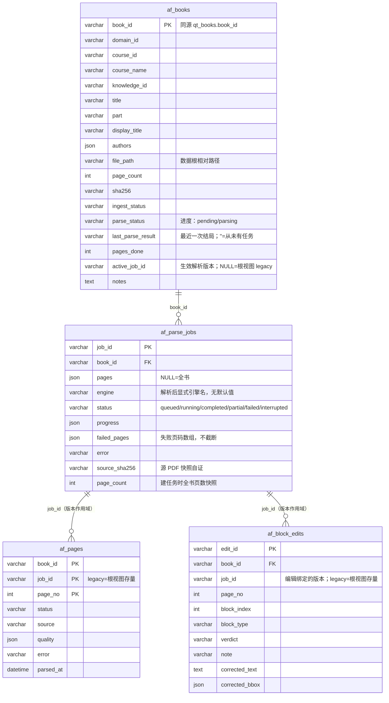

# 数据库设计（Axiom-Flow af_* 命名空间）

设计状态：Accepted
确认状态：暂定
实现状态：Current（四表一次 Alembic 迁移 + 仓储层已实现；任务/页表语义按 PLAN-003 契约修正；**解析版本布局（`af_books.active_job_id` 生效指针 + 页/编辑表 `job_id` 作用域）由迁移 `20260920_0002` 落地，PLAN-004 / REQ-080**；**进度与结局分列（`af_books.last_parse_result` + `af_parse_jobs.failed_pages`）由迁移 `20260921_0001` 落地，PLAN-006 / ADR 0007**）
最后更新：2026-09-21
关联代码：`src/axiom_flow/db/`（models/repositories）、`src/axiom_flow/migrations/`（Alembic 迁移）
关联测试：`tests/unit/test_db.py`、`tests/unit/test_db_migrations.py`、`tests/contract/test_architecture_documents.py`（本文档守护）
关联 ADR：`docs/adr/0001-v2-exploration-direction.md`、`docs/adr/0004-model-boundary-and-pipeline-ownership.md`、根仓库 [ADR 0003](https://github.com/QED-Engine/qed-engine/blob/main/docs/history/adr/v0.1/0003-shared-qed-database-independence.md)（共享 qed 库独立性例外）

> 本文件是 **Axiom-Flow 的固定数据库设计文档**（根仓库 ADR 0010 范本 / REQ-047）：登记
> Axiom-Flow 在共享 MySQL `qed` 库中的私有表（`af_*` 命名空间）设计。根仓库总纲
> （QED-Engine `docs/architecture/database-design.md`）只维护命名空间隔离规则，**不复制本文件
> 的表结构**。**ARCH-020 重构（2026-09-14）**将 af_* 由原两表草案
> （af_books/af_block_reviews）重定义为四表。

## 目的与边界

- MySQL 8，库名 `qed`，三项目共用同一实例与库（根仓库 ADR 0003 独立性铁律的明确例外）。
- 表命名空间隔离：QED-Tracker 使用 `qt_*` 前缀，Axiom-Flow 使用 `af_*` 前缀；**互不读取对方
  表**。共享 `qed_*` 前缀表族（qed_domain/qed_course/qed_llm_calls 等）所有权 QED-Tracker，
  本仓库只读不写（`qed_llm_calls` 例外：三项目均可写入调用记录）。
- af_* 表为 Axiom-Flow **私有**：只从 qt_books 同步已验证书行的只读元数据，任何外部故障/
  变更不影响本表读取；Axiom-Flow 用 Alembic 独立初始化自己的表，不依赖其他项目迁移。
- 凭据与库名唯一事实源：根 `.env` 的 `QED_DB_*` 变量；密码值绝不下发。
- **入库边界**：文件系统承载产物正本（`parsed/` 页图/Markdown/blocks/分块），DB 只存元数据与
  状态；`chunks.json` 为派生文件，**不入库**（可重建）。

## 表清单总览

| 表 | 前缀 | 一行 = | 状态 | 事实源 |
| --- | --- | --- | --- | --- |
| `af_books` | af_*（私有） | 一册已验证书（qt_books 只读快照 + ingest/解析进度 + **生效解析版本指针**，本侧维护） | **已实现**（真机已建表，ARCH-013/014/015 关闭；`active_job_id` 待真机迁移 0002） | 本文档 |
| `af_parse_jobs` | af_*（私有） | 一次解析任务 = **一个解析版本**（逐页/全本、状态、进度、源快照自证） | **已实现**（真机已建表；异步语义收尾于 PLAN-003 W8；版本自证列待真机迁移 0002） | 本文档 |
| `af_pages` | af_*（私有） | 一页**在某个解析版本内**的状态与质量信号 | **已实现**（真机已建表；页级持久化 PLAN-003 W2；`job_id` 作用域待真机迁移 0002） | 本文档 |
| `af_block_edits` | af_*（私有） | 一次块级人工编辑（判定/备注/文字/范围），**绑定其所属解析版本** | **已实现**（真机已建表；编辑键纳入 `job_id` 待真机迁移 0002，REQ-080 关闭该「块下标重映射」缺口） | 本文档 |

> **版本化后的读法**：「哪一版生效」只看 `af_books.active_job_id`（NULL = 根视图 `legacy`）。页表与
> 编辑表都以 `job_id` 为作用域的一分子，因此同一页在不同版本可有各自状态、旧版本的人工编辑不会
> 套到新版本上（块下标 `index` 只在版本内有意义）。产物文件侧对应
> `parsed/…/<book_id>/versions/<job_id>/`，见
> [parsing-pipeline.md](../design/parsing-pipeline.md)。



## af_books（书目表，一行 = 一册已验证书）

```sql
CREATE TABLE af_books (
  book_id       VARCHAR(100) NOT NULL,          -- PK：同源 qt_books.book_id
  domain_id     VARCHAR(32)  NOT NULL DEFAULT '',
  course_id     VARCHAR(64)  NOT NULL DEFAULT '',
  course_name   VARCHAR(200) NOT NULL DEFAULT '',
  knowledge_id  VARCHAR(100) NOT NULL DEFAULT '',
  title         VARCHAR(500) NOT NULL DEFAULT '',
  part          VARCHAR(32)  NOT NULL DEFAULT '',
  display_title VARCHAR(500) NOT NULL DEFAULT '',
  authors       JSON         NOT NULL,          -- list[{name, role}]
  file_path     VARCHAR(512) NOT NULL DEFAULT '',-- 数据根相对路径（同源 qt_books.file_path）
  page_count    INT          NULL,              -- ingest 时计算
  sha256        VARCHAR(64)  NOT NULL DEFAULT '',-- ingest 时计算
  ingest_status VARCHAR(16)  NOT NULL DEFAULT 'none',   -- none/ingesting/ingested/failed
  parse_status  VARCHAR(24)  NOT NULL DEFAULT 'pending',-- 进度：pending/parsing（结局分列）
  last_parse_result VARCHAR(16) NOT NULL DEFAULT '', -- 最近一次任务结局；'' = 从未有任务
  pages_done    INT          NOT NULL DEFAULT 0,
  active_job_id VARCHAR(64)  NULL,              -- 生效解析版本；NULL = 根视图 legacy
  notes         TEXT         NULL,
  synced_at     DATETIME     NOT NULL,
  updated_at    DATETIME     NOT NULL,
  PRIMARY KEY (book_id),
  KEY ix_af_books_course (course_id),
  KEY ix_af_books_status (parse_status)
) ENGINE=InnoDB DEFAULT CHARSET=utf8mb4 COMMENT='书目同步表：QED-Tracker 已验证书目的只读快照 + ingest/解析进度（Axiom-Flow 私有）';
```

### 同步语义

- **幂等**：同步以 `book_id` 为幂等键，重复同步只 upsert 不产生重复行；qt_books 删除/变更
  不影响已同步行（快照语义）。
- **进度自持**：`ingest_status`/`parse_status`/`pages_done` 由 Axiom-Flow 侧维护（ingest 与
  解析任务回写），不依赖 qt_books 之外的上游字段。
- **进度与结局分列（ADR 0007 决定 1/3）**：`parse_status` 只表达进度（`pending`/`parsing`），
  任务结局落在 `last_parse_result`（`completed`/`partial`/`failed`/`interrupted`，`''` = 从未有
  任务）。结局**只在终态写入**，因此运行中刷新列表不会看到结局被进度覆盖（DEFECT-007）。
  重新 ingest 只回置进度，不改结局——`last_parse_result` 记录的是「最近一次任务」的事实。
- **重新 ingest 回置进度**：`POST /books/{id}/ingest` 成功替换产物后，把 `parse_status` 置回
  `pending`、`pages_done` 归零，并清空该书 `af_pages` 行（旧产物已作废，不保留过期页状态）。
- **字段冗余**：课程归属（domain_id/course_id/course_name）冗余进表，前端只消费 8902
  `/books` 即可建树（8901 离线不影响树展示）。

### 生效版本指针语义（V2/V3/V8）

- **`active_job_id` 是「哪一版生效」的唯一事实源**：`af_parse_jobs` 上**不设布尔生效列**，同一事实
  两处存必漂移。切换/清空只经 `BookRepository.set_active_job()` 单列 UPDATE。
- **写入门槛 = `completed` 判据本身**：版本产物齐备（目标页全 `parsed` 且产物在位、清单重算成功）
  才激活指针，同一次判定同时决定 `status=completed`（ADR 0007 决定 5），故「completed 但未激活」
  不可能出现；`partial`/`failed` 或进程中断**不改指针**，因此「回滚到上一版」= 什么都不做
  （自然回滚），旧版本产物始终在盘上。
- **`pages_done` 描述生效版本**：与指针同事务语义下保持一致，避免进度条与所读产物不同版本。
- **`NULL` 不是「无数据」而是「根视图」**：迁移前的存量产物与重新 ingest 后的作废态都落在这里，
  端点按 `NULL` 读书目录根，旧产物不因升级而失明。
- **重新 ingest 只失效根视图（V8）**：`POST /books/{id}/ingest` 把 `active_job_id` 置 NULL、
  `parse_status` 置 `pending`、`pages_done` 归零，并只删除 `job_id='legacy'` 的 `af_pages` 行；
  历史版本（真实 `job_id`）的页行与产物**全部保留**，可经 `GET /books/{id}/versions` 定位。

## af_parse_jobs（解析任务表，一行 = 一次解析任务 = 一个解析版本）

```sql
CREATE TABLE af_parse_jobs (
  job_id        VARCHAR(64)  NOT NULL,            -- PK，同时是版本目录名 versions/<job_id>/
  book_id       VARCHAR(100) NOT NULL,            -- → af_books.book_id
  pages         JSON         NULL,                -- NULL = 全书；否则页码数组
  engine        VARCHAR(24)  NOT NULL,            -- 无默认值：缺引擎名必须报错（ADR 0004）
  status        VARCHAR(16)  NOT NULL,            -- queued/running/completed/partial/failed/interrupted
  progress      JSON         NOT NULL,            -- {"parsed":N,"total":M,"failed":N,"error":""}
  failed_pages  JSON         NOT NULL,            -- 失败页码数组，不截断（ADR 0007 决定 2）
  error         VARCHAR(500) NOT NULL DEFAULT '',
  source_sha256 VARCHAR(64)  NOT NULL DEFAULT '', -- 本版本解析的源 PDF 快照（自证对应）
  page_count    INT          NULL,                -- 建任务时的全书页数快照
  created_at    DATETIME     NOT NULL,
  started_at    DATETIME     NULL,
  finished_at   DATETIME     NULL,
  PRIMARY KEY (job_id),
  KEY ix_af_parse_jobs_book (book_id)
) ENGINE=InnoDB DEFAULT CHARSET=utf8mb4 COMMENT='解析任务表：逐页/全本解析任务状态与进度（Axiom-Flow 私有）';
```

### 任务表语义

- **`engine` 存解析后的实际引擎名，且 DDL 无默认值**：请求体 `engine` 优先、缺省回落
  `AXIOM_OCR_ENGINE`，任务行记录最终执行所用引擎（未实现/未注册名称在提交期即报错，**不会**落行、
  也不回落）。`'mineru'` 的 DDL 兜底曾是静默回落入口，迁移 `20260920_0002` 已 DROP（PLAN-003
  「W7 发现 2」销账）。
- **源快照自证（V7）**：`source_sha256` + `page_count` 在任务开始时写入，使「这一版产物对应哪一份
  源 PDF、当时全书多少页」可独立证明——重新 ingest 后 SHA 变化即可判定旧版本已不匹配当前源文件。
- **错误双载体分工**：`error`（≤500 字符）= 终态摘要；`progress.error`（≤200 字符）= 进行中的
  失败页摘要。两者可同时存在，任务进入终态后以 `error` 为准。**哪些页**失败不再只埋在文本里：
  `failed_pages` 是结构化页码数组且不截断（ADR 0007 决定 2），`error` 摘要截断也不丢页码。
- **`status` 六态与判据同源（ADR 0007 决定 1）**：`queued`/`running` 为活动态；终态
  `completed`（目标页齐备——与版本激活同一判据，故不存在「completed 但未激活」）、
  `partial`（≥1 页 `parsed` 但未齐备）、`failed`（0 页产出或引擎整体异常）、
  `interrupted`（**唯一写入者是启动期归一**，管线自身不产出）。
- **`progress` 与 `status` 分列**：`progress` 只描述做到哪（`parsed`/`total`/`failed`/`error`），
  终态判定不看 `progress`；反之结局也不挤占进度列（DEFECT-007 的根因是旧 `parse_status` 两用）。
- **`progress` 写入节流**：距上次写入 ≥1 秒或每处理满 10 页覆写一次，终态必写一次，单页失败节点
  强制写入；因此运行中 `GET /parse-jobs/{id}` 的 `progress.parsed` 单调不减但可能滞后。
- **提交期 503 不落行**：模型服务探活失败发生在落库之前，故 503 场景不产生 `af_parse_jobs` 行；
  受理后的故障才记为 `failed`。
- **删除保留审计**：`DELETE /books/{id}`（含 `?purge=true`）不清理历史任务行——任务行是版本的
  自证记录，也是 `versions/` 目录名的来源；页行与编辑行则按**全部版本**删除（`?purge=true` 连
  `versions/` 子树一并删）。

## af_pages（页状态表，一行 = 一页在某个解析版本内的状态）

```sql
CREATE TABLE af_pages (
  book_id   VARCHAR(100) NOT NULL,
  job_id    VARCHAR(64)  NOT NULL DEFAULT 'legacy', -- 所属解析版本；'legacy' = 根视图存量
  page_no   INT          NOT NULL,
  status    VARCHAR(16)  NOT NULL DEFAULT 'pending', -- pending/parsed/failed
  source    VARCHAR(24)  NOT NULL DEFAULT '',        -- 实际引擎标识
  quality   JSON         NULL,                       -- 质量信号
  error     VARCHAR(500) NOT NULL DEFAULT '',
  parsed_at DATETIME     NULL,
  PRIMARY KEY (book_id, job_id, page_no)
) ENGINE=InnoDB DEFAULT CHARSET=utf8mb4 COMMENT='页状态表：逐页解析状态与质量信号，按解析版本作用域（Axiom-Flow 私有）';
```

### 页表语义

- **主键纳入 `job_id`（V2/V7）**：同一页在不同解析版本可有各自的状态与质量信号；新版本不覆盖
  旧版本的行，因此历史版本可逐页解释「当时这页成没成」。
- **`pending` 以「无行」表示**：不为未解析页预建占位行；`status` 实际只写 `parsed` / `failed`，
  断点续跑的集合在 **(book_id, job_id) 作用域内**判定 = 该版本无行页 ∪ `failed` 页（且要求产物在盘）。
- **持久化不变式**：每页成功/失败即 `commit`，且**产物写先于页行提交**，故「有 af_pages 行必有
  对应版本目录里的产物文件」；整本失败时已解析页的行与产物保留可重跑。
- **版本与页行同构**：写新版本前把生效视图的页行按 `job_id` 继承一份（`_inherit_page_rows`），使
  `parsed` 计数与版本目录内容一一对应，`pages_done` 不会描述一个已经不读的产物集合。
- **重复 ingest 只清根视图（V8）**：重新 ingest 原子替换**根视图**（`book.json` + `pages/`）并删除
  `job_id='legacy'` 的页行；真实版本作用域的行保留（历史版本仍可读、可列举）。

## af_block_edits（块编辑表，一行 = 一次块级人工编辑）

```sql
CREATE TABLE af_block_edits (
  edit_id        VARCHAR(100) NOT NULL,         -- PK：ed_<md5(book_id:job_id:page_no:block_index)>
  book_id        VARCHAR(100) NOT NULL,         -- → af_books.book_id；索引
  job_id         VARCHAR(64)  NOT NULL DEFAULT 'legacy', -- 编辑绑定的解析版本；'legacy' = 根视图存量
  page_no        INT          NOT NULL,
  block_index    INT          NOT NULL,         -- blocks 数组下标（0 基，仅在该版本内有意义）
  block_type     VARCHAR(24)  NOT NULL DEFAULT '',
  verdict        VARCHAR(8)   NOT NULL DEFAULT '',  -- ''=未判定 / ok / bad
  note           VARCHAR(1000) NOT NULL DEFAULT '',
  corrected_text TEXT         NULL,             -- 文字修正（公式为 LaTeX 源码）
  corrected_bbox JSON         NULL,             -- [x0,y0,x1,y1] 修正范围
  edited_at      DATETIME     NOT NULL,
  updated_at     DATETIME     NOT NULL,
  PRIMARY KEY (edit_id),
  UNIQUE KEY uq_af_block_edits_pos (book_id, job_id, page_no, block_index)
) ENGINE=InnoDB DEFAULT CHARSET=utf8mb4 COMMENT='块编辑表：人工判定/备注/文字与范围修正，绑定其所属解析版本（Axiom-Flow 私有）';
```

- 同版本同块重复编辑 = 覆盖更新（幂等，UNIQUE 键 + upsert）。
- 人工编辑为**覆盖层**：解析产物文件（blocks.json）为模型产物事实源，编辑不入文件，API
  返回时合并。
- **编辑键必须含 `job_id`（V7，REQ-080 的动机）**：块下标 `index` 是「归一化后的数组下标」，映射表
  或归一化规则一变，同页下标含义就变；跨版本共用 `(book_id, page_no, block_index)` 等于把人工核对
  结论套到另一版产物上（污染）。读取生效版本时只合并该 `job_id` 的编辑。
- **定位走唯一键，不重算摘要**：`edit_id` 只是幂等标识；迁移前的存量行保留旧摘要（不含 `job_id`），
  仓储一律按唯一键 upsert/查询，因此旧编辑升级后仍可达（重算历史主键属无收益的破坏性动作）。

## 迁移与维护

- `qed` 库由各项目 Alembic **独立初始化**自己的表，互不影响；`qed_*` 共享表由 QED-Tracker
  Alembic 建表与维护（本仓库只读）。
- 新增表或字段变化：先更新本文档与对应契约测试，再实现迁移（根仓库 REQ-047 数据库设计
  长期任务）。
- **应用不自动迁移**：`api/main.py` 的 lifespan 只做关停，仓库内无 `create_all`/`upgrade` 调用；
  迁移是运维命令（`python -m alembic upgrade head`），因此代码合入对共享 `qed` 库零写入。反过来
  这意味着**模型新增列与真机迁移必须同窗口发布**：ORM 已声明 `active_job_id` 而实例未迁移时，
  读该列会失败。
- 已落地迁移：
  - `20260917_0001`：四表建全（真机 `qed` 已于 2026-09-20 建表，ARCH-013）；
  - `20260920_0002`：解析版本布局（PLAN-004 / REQ-080）——`af_books.active_job_id`、
    `af_parse_jobs.source_sha256`/`page_count`、`af_pages` 主键与 `af_block_edits` 唯一键纳入
    `job_id`、`engine` 去掉死默认值。真机执行前须备份 `af_*` 四表（见
    [operations.md](../guides/operations.md) 单窗口 runbook）。
    **真机状态**：业务库 `qed` 已在 R1 窗口升至 `20260920_0002`；`qed_test`（本仓库自有测试库）
    由集成夹具每次从 base 重建到 head，故新迁移的 MySQL DDL 在门禁里就被真实执行一次。
  - `20260921_0001`：状态语义收口（PLAN-006 / ADR 0007）——`af_books.last_parse_result`
    （存量终态值从旧 `parse_status` **平移一次**，随后进度统一归 `pending`）、
    `af_parse_jobs.failed_pages`（存量回填 `[]`）。**不改写历史 job 状态**：旧 `completed` 行保持
    `completed`，新三态不回溯（回填等于伪造历史）。
- **存量迁移策略（不猜归属）**：升级时按「一本书只有一个 job → 回填该 job；否则回填哨兵
  `legacy`」给页行与编辑行定作用域，且**不把存量产物搬进 `versions/`**：`active_job_id` 保持 NULL，
  端点继续读根视图，旧产物一步不失明。
- **降级有损**：`downgrade` 回 0001 结构时按 `(书, 页)`/`(书, 页, 块)` 只保留 `job_id` 最小的一行
  （旧结构无法表达多版本）；产物文件不随迁移删除（DB 与文件解耦）。

## 敏感字段规则

- 凭据（`QED_DB_PASSWORD` 等）绝不下发到任何接口响应、日志或异常信息；本仓库不暴露数据库
  连接端点，数据库能力由 8900 `/config/database` 启动快照统一呈现（配置域契约归根仓库）。

## 验证

- `tests/contract/test_architecture_documents.py` 全绿（本文档守护：表清单、命名空间声明）。
- `tests/unit/test_db_migrations.py` 全绿：SQLite 临时库上「升级→降级→升级」可重复、0002 的
  主键/唯一键形状、`legacy`/单 job 回填判据、存量 `active_job_id` 恒 NULL、`engine` 无默认值；
  0003 的回填判据（旧终态值平移进 `last_parse_result`、进度归 `pending`、`failed_pages` 回填
  `[]`）与**反向判据**（历史 job 状态一字不改）。
- `tests/integration/test_parse_persistence.py`（`QED_TEST_MYSQL=1`）在真 MySQL 上从 base 升到
  head，证明 0003 的 JSON 列「加可空 → 回填 → 收紧 NOT NULL」顺序在 MySQL 与 SQLite 上都成立。
- `tests/unit/test_db.py` 全绿：sync 幂等（重复同步不产生重复行）、edit upsert 覆盖、
  按版本作用域读写、`delete_for_book` 清全部版本。
- 真机侧（待单窗口）：备份 → `alembic upgrade 20260920_0002` → `GET /books/{id}/versions` 与只读
  端点在生效版本/根视图两态下均可读；8901/8902 离线降级不影响本表读取。
