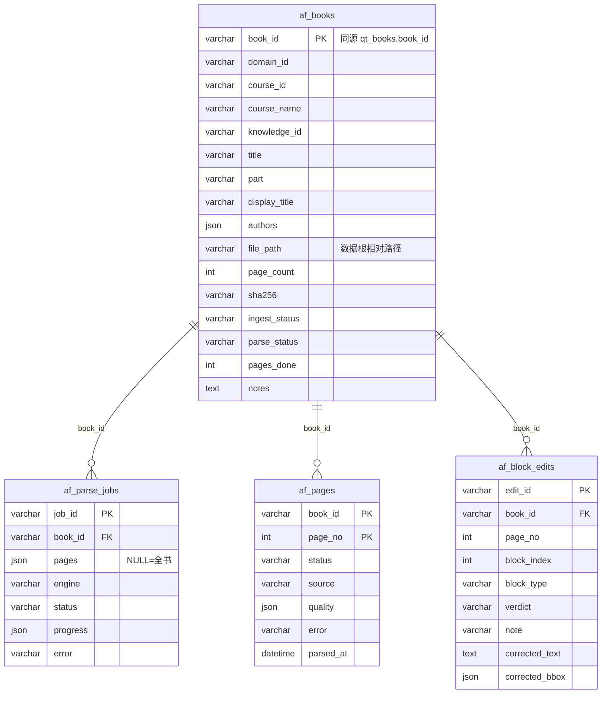

# 数据库设计（Axiom-Flow af_* 命名空间）

设计状态：Accepted
确认状态：暂定
实现状态：Not Started（四表一次 Alembic 迁移与仓储层待实现，PLAN-002）
最后更新：2026-09-17
关联代码：无（ARCH-002 建表后登记 `src/axiom_flow/db/` 对应模块）
关联测试：`tests/contract/test_architecture_documents.py`（本文档守护）
关联 ADR：`docs/adr/0001-v2-exploration-direction.md`、`docs/adr/0004-model-boundary-and-pipeline-ownership.md`、根仓库 [ADR 0003](https://github.com/QED-Engine/qed-engine/blob/main/docs/history/adr/v0.1/0003-shared-qed-database-independence.md)（共享 qed 库独立性例外）

> 本文件是 **Axiom-Flow 的固定数据库设计文档**（根仓库 ADR 0010 范本 / REQ-047）：登记
> Axiom-Flow 在共享 MySQL `qed` 库中的私有表（`af_*` 命名空间）设计。根仓库总纲
> （QED-Engine `docs/architecture/database-design.md`）只维护命名空间隔离规则，**不复制本文件
> 的表结构**。**ARCH-020 重构（2026-09-14）**将 af_* 由原两表草案
> （af_books/af_block_reviews）重定义为四表。

## 目的与边界

- MySQL 8，库名 `qed`，三项目共用同一实例与库（根仓库 ADR 0003 独立性铁律的明确例外）。
- 表命名空间隔离：QED-Tracker 使用 `qt_*` 前缀，Axiom-Flow 使用 `af_*` 前缀；**互不读取对方
  表**。共享 `qed_*` 前缀表族（qed_domain/qed_course/qed_llm_calls 等）所有权 QED-Tracker，
  本仓库只读不写（`qed_llm_calls` 例外：三项目均可写入调用记录）。
- af_* 表为 Axiom-Flow **私有**：只从 qt_books 同步已验证书行的只读元数据，任何外部故障/
  变更不影响本表读取；Axiom-Flow 用 Alembic 独立初始化自己的表，不依赖其他项目迁移。
- 凭据与库名唯一事实源：根 `.env` 的 `QED_DB_*` 变量；密码值绝不下发。
- **入库边界**：文件系统承载产物正本（`parsed/` 页图/Markdown/blocks/分块），DB 只存元数据与
  状态；`chunks.json` 为派生文件，**不入库**（可重建）。

## 表清单总览

| 表 | 前缀 | 一行 = | 状态 | 事实源 |
| --- | --- | --- | --- | --- |
| `af_books` | af_*（私有） | 一册已验证书（qt_books 只读快照 + ingest/解析进度，本侧维护） | **规划**（ARCH-002） | 本文档 |
| `af_parse_jobs` | af_*（私有） | 一次解析任务（逐页/全本，状态与进度） | **规划**（ARCH-003） | 本文档 |
| `af_pages` | af_*（私有） | 一页解析状态与质量信号 | **规划**（ARCH-003） | 本文档 |
| `af_block_edits` | af_*（私有） | 一次块级人工编辑（判定/备注/文字/范围） | **规划**（ARCH-007） | 本文档 |



## af_books（书目表，一行 = 一册已验证书）

```sql
CREATE TABLE af_books (
  book_id       VARCHAR(100) NOT NULL,          -- PK：同源 qt_books.book_id
  domain_id     VARCHAR(32)  NOT NULL DEFAULT '',
  course_id     VARCHAR(64)  NOT NULL DEFAULT '',
  course_name   VARCHAR(200) NOT NULL DEFAULT '',
  knowledge_id  VARCHAR(100) NOT NULL DEFAULT '',
  title         VARCHAR(500) NOT NULL DEFAULT '',
  part          VARCHAR(32)  NOT NULL DEFAULT '',
  display_title VARCHAR(500) NOT NULL DEFAULT '',
  authors       JSON         NOT NULL,          -- list[{name, role}]
  file_path     VARCHAR(512) NOT NULL DEFAULT '',-- 数据根相对路径（同源 qt_books.file_path）
  page_count    INT          NULL,              -- ingest 时计算
  sha256        VARCHAR(64)  NOT NULL DEFAULT '',-- ingest 时计算
  ingest_status VARCHAR(16)  NOT NULL DEFAULT 'none',   -- none/ingesting/ingested/failed
  parse_status  VARCHAR(24)  NOT NULL DEFAULT 'pending',-- pending/parsing/completed/failed
  pages_done    INT          NOT NULL DEFAULT 0,
  notes         TEXT         NULL,
  synced_at     DATETIME     NOT NULL,
  updated_at    DATETIME     NOT NULL,
  PRIMARY KEY (book_id),
  KEY ix_af_books_course (course_id),
  KEY ix_af_books_status (parse_status)
) ENGINE=InnoDB DEFAULT CHARSET=utf8mb4 COMMENT='书目同步表：QED-Tracker 已验证书目的只读快照 + ingest/解析进度（Axiom-Flow 私有）';
```

### 同步语义

- **幂等**：同步以 `book_id` 为幂等键，重复同步只 upsert 不产生重复行；qt_books 删除/变更
  不影响已同步行（快照语义）。
- **进度自持**：`ingest_status`/`parse_status`/`pages_done` 由 Axiom-Flow 侧维护（ingest 与
  解析任务回写），不依赖 qt_books 之外的上游字段。
- **字段冗余**：课程归属（domain_id/course_id/course_name）冗余进表，前端只消费 8902
  `/books` 即可建树（8901 离线不影响树展示）。

## af_parse_jobs（解析任务表，一行 = 一次解析任务）

```sql
CREATE TABLE af_parse_jobs (
  job_id      VARCHAR(64)  NOT NULL,            -- PK
  book_id     VARCHAR(100) NOT NULL,            -- → af_books.book_id
  pages       JSON         NULL,                -- NULL = 全书；否则页码数组
  engine      VARCHAR(24)  NOT NULL DEFAULT 'mineru',
  status      VARCHAR(16)  NOT NULL,            -- queued/running/completed/failed
  progress    JSON         NOT NULL,            -- {"parsed":N,"total":M,"error":""}
  error       VARCHAR(500) NOT NULL DEFAULT '',
  created_at  DATETIME     NOT NULL,
  started_at  DATETIME     NULL,
  finished_at DATETIME     NULL,
  PRIMARY KEY (job_id),
  KEY ix_af_parse_jobs_book (book_id)
) ENGINE=InnoDB DEFAULT CHARSET=utf8mb4 COMMENT='解析任务表：逐页/全本解析任务状态与进度（Axiom-Flow 私有）';
```

## af_pages（页状态表，一行 = 一页解析状态）

```sql
CREATE TABLE af_pages (
  book_id   VARCHAR(100) NOT NULL,
  page_no   INT          NOT NULL,
  status    VARCHAR(16)  NOT NULL DEFAULT 'pending', -- pending/parsed/failed
  source    VARCHAR(24)  NOT NULL DEFAULT '',        -- 实际引擎标识
  quality   JSON         NULL,                       -- 质量信号
  error     VARCHAR(500) NOT NULL DEFAULT '',
  parsed_at DATETIME     NULL,
  PRIMARY KEY (book_id, page_no)
) ENGINE=InnoDB DEFAULT CHARSET=utf8mb4 COMMENT='页状态表：逐页解析状态与质量信号（Axiom-Flow 私有）';
```

## af_block_edits（块编辑表，一行 = 一次块级人工编辑）

```sql
CREATE TABLE af_block_edits (
  edit_id        VARCHAR(100) NOT NULL,         -- PK：ed_<md5(book_id:page_no:block_index)>
  book_id        VARCHAR(100) NOT NULL,         -- → af_books.book_id；索引
  page_no        INT          NOT NULL,
  block_index    INT          NOT NULL,         -- blocks 数组下标（0 基）
  block_type     VARCHAR(24)  NOT NULL DEFAULT '',
  verdict        VARCHAR(8)   NOT NULL DEFAULT '',  -- ''=未判定 / ok / bad
  note           VARCHAR(1000) NOT NULL DEFAULT '',
  corrected_text TEXT         NULL,             -- 文字修正（公式为 LaTeX 源码）
  corrected_bbox JSON         NULL,             -- [x0,y0,x1,y1] 修正范围
  edited_at      DATETIME     NOT NULL,
  updated_at     DATETIME     NOT NULL,
  PRIMARY KEY (edit_id),
  UNIQUE KEY uq_af_block_edits_pos (book_id, page_no, block_index)
) ENGINE=InnoDB DEFAULT CHARSET=utf8mb4 COMMENT='块编辑表：对照视图中人工判定/备注/文字与范围修正（Axiom-Flow 私有）';
```

- 同块重复编辑 = 覆盖更新（幂等，UNIQUE 键 + upsert）。
- 人工编辑为**覆盖层**：解析产物文件（blocks.json）为模型产物事实源，编辑不入文件，API
  返回时合并。

## 迁移与维护

- `qed` 库由各项目 Alembic **独立初始化**自己的表，互不影响；`qed_*` 共享表由 QED-Tracker
  Alembic 建表与维护（本仓库只读）。
- 新增表或字段变化：先更新本文档与对应契约测试，再实现迁移（根仓库 REQ-047 数据库设计
  长期任务）。
- 规划边界：本文档登记的表为 **ARCH-001 规划契约**，冻结节点以根仓库 REQ-027 回执为准。

## 敏感字段规则

- 凭据（`QED_DB_PASSWORD` 等）绝不下发到任何接口响应、日志或异常信息；本仓库不暴露数据库
  连接端点，数据库能力由 8900 `/config/database` 启动快照统一呈现（配置域契约归根仓库）。

## 验证

- `tests/contract/test_architecture_documents.py` 全绿（本文档守护：表清单、命名空间声明）。
- ARCH-002 落地后：Alembic 迁移可重复执行（升级→降级→升级）；sync 幂等（重复同步不产生重复
  行）；edit upsert 覆盖；8901/8902 离线降级不影响本表读取。
