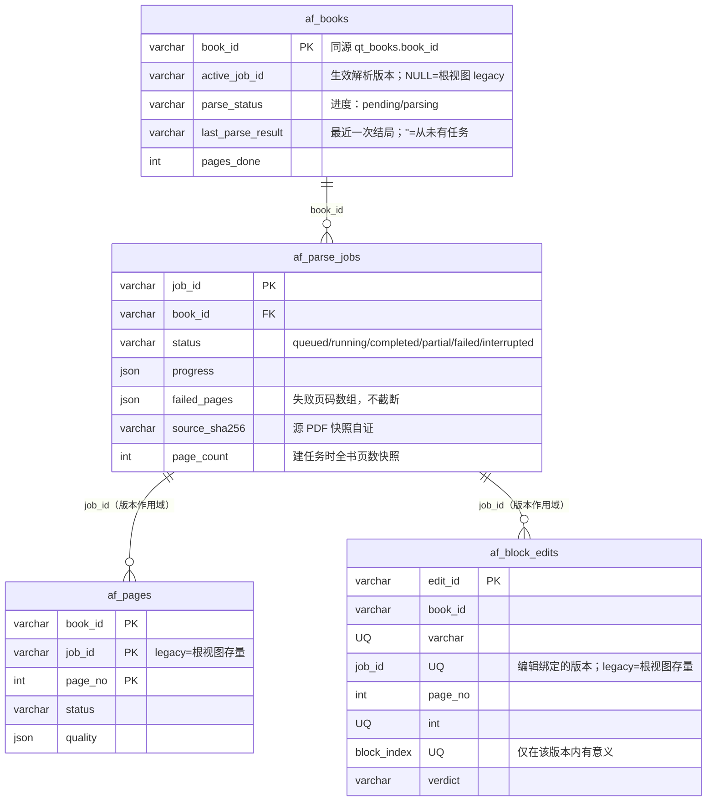

# 数据库设计（Axiom-Flow af_* 命名空间）

设计状态：Accepted
确认状态：已确认
实现状态：Verified（af_* 四表与四条迁移已落地，业务库与测试库均经真机验证）
最后更新：2026-09-26
关联代码：`src/axiom_flow/db/`（models/repositories）、`src/axiom_flow/migrations/`（Alembic 迁移）
关联测试：`tests/unit/test_db.py`、`tests/unit/test_db_migrations.py`、`tests/integration/test_parse_persistence.py`、`tests/contract/test_architecture_documents.py`、`tests/contract/test_fixed_document_form.py`
关联 ADR：[ADR 0001](../adr/0001-v2-exploration-direction.md)、
[ADR 0004](../adr/0004-model-boundary-and-pipeline-ownership.md)、
[ADR 0005](../adr/0005-mysql-integration-test-isolation.md)、
[ADR 0007](../adr/0007-parse-status-semantics.md)、根仓库
[ADR 0003](https://github.com/QED-Engine/qed-engine/blob/main/docs/history/adr/v0.1/0003-shared-qed-database-independence.md)（共享 qed 库独立性例外）

> 本篇回答唯一问题：**af_\* 四表各自存什么、列的语义是什么、结构如何演进**。
> 端点参数与响应结构在 [api.md](api.md)，状态流转与职责分段的判据在
> [design/parsing-management.md](../design/parsing-management.md)（`PM-n`），模块映射在
> [code-map.md](code-map.md)。根仓库总纲只维护命名空间隔离规则，不复制本篇表结构。

## 目的与边界

- MySQL 8，库名 `qed`，三项目共用同一实例与库（根仓库独立性铁律的明确例外）；表命名空间隔离：
  QED-Tracker 用 `qt_*`，Axiom-Flow 用 `af_*`，**互不读取对方表**。共享 `qed_*` 表族所有权
  QED-Tracker，本仓库只读不写（`qed_llm_calls` 例外：三项目均可写入调用记录）。
- `af_*` 为 Axiom-Flow **私有**：只从 `qt_books` 同步已验证书行的只读元数据，任何外部故障或结构
  变更不进入本表读取路径；本仓库用 Alembic 独立初始化自己的表，不依赖其他项目迁移。
- **入库边界**：文件系统承载产物正本（`parsed/` 页图 / Markdown / blocks / 分块），DB 只存元数据与
  状态；`chunks.json` 是派生文件，**不入库**（可重建）。
- 凭据与库名的唯一事实源是根 `.env` 的 `QED_DB_*` 变量；密码值绝不下发。
- **本篇不写**：列的取值域如何被端点暴露（→ [api.md](api.md)）、页与编辑的版本作用域判据
  （→ `PM-3`/`PM-6`/`PM-11`/`PM-16`）、迁移的运维执行步骤（→ [operations.md](../guides/operations.md)）。

## 当前契约

### 表清单

| 表 | 一行 = | 作用域键 | 谁写 | 列清单 |
| --- | --- | --- | --- | --- |
| `af_books` | 一册已验证书（qt_books 只读快照 + ingest/解析进度 + 生效解析版本指针） | `book_id` | 同步、ingest 与解析收尾 | [↓](#af_books-列清单) |
| `af_parse_jobs` | 一次解析任务 = **一个解析版本**（目标页、状态、进度、源快照自证） | `job_id` | 任务生命周期（提交→终态） | [↓](#af_parse_jobs-列清单) |
| `af_pages` | 一页**在某个解析版本内**的状态与质量信号 | (`book_id`, `job_id`, `page_no`) | 逐页持久化（产物写先于页行） | [↓](#af_pages-列清单) |
| `af_block_edits` | 一次块级人工编辑（判定 / 备注 / 文字 / 范围），**绑定其所属解析版本** | (`book_id`, `job_id`, `page_no`, `block_index`) | 人工校验覆盖层 upsert | [↓](#af_block_edits-列清单) |

「哪一版生效」只看 `af_books.active_job_id`（`NULL` = 根视图 `legacy`）。页表与编辑表都以 `job_id`
为作用域的一分子，因此同一页在不同版本可有各自状态、旧版本的人工编辑不会套到新版本上（块下标
`block_index` 只在版本内有意义）。产物文件侧对应 `parsed/…/<book_id>/versions/<job_id>/`，判据见
[parsing-pipeline.md](../design/parsing-pipeline.md)。

ER 图只画关系与主键/唯一键的骨架；**列的完整事实源是下面四张列清单表**（与 ORM 由守护对账）。

### af_books 列清单

| 列 | 类型 | 可空 | 键 | 语义 |
| --- | --- | --- | --- | --- |
| `book_id` | VARCHAR(100) | 否 | PK | 同源 `qt_books.book_id`，同步幂等键 |
| `domain_id` | VARCHAR(32) | 否 | — | 领域归属；空串 = 未归属 |
| `course_id` | VARCHAR(64) | 否 | i | 课程归属；空串 = 未归属 |
| `course_name` | VARCHAR(200) | 否 | — | 课程名（冗余，建树不必读 8901） |
| `knowledge_id` | VARCHAR(100) | 否 | — | 上游知识标识 |
| `title` | VARCHAR(500) | 否 | — | 书名 |
| `part` | VARCHAR(32) | 否 | — | 分册标识 |
| `display_title` | VARCHAR(500) | 否 | — | 展示用标题 |
| `authors` | JSON | 否 | — | `list[{name, role}]` |
| `file_path` | VARCHAR(512) | 否 | — | 源 PDF 的数据根相对路径（同源 `qt_books.file_path`） |
| `page_count` | INT | 是 | — | 全书页数（ingest 写入；`NULL` = 尚未 ingest，页清单枚举域唯一来源） |
| `sha256` | VARCHAR(64) | 否 | — | 源 PDF SHA-256（ingest 写入；根 `book.json` 退役后的唯一事实源） |
| `ingest_status` | VARCHAR(16) | 否 | — | `none` / `ingesting` / `ingested` / `failed` |
| `ingested_at` | DATETIME | 是 | — | ingest 完成时刻（UTC naive）；`NULL` = 从未 ingest |
| `parse_status` | VARCHAR(24) | 否 | i | **只表达进度**：`pending` / `parsing` |
| `last_parse_result` | VARCHAR(16) | 否 | — | 最近一次任务结局：`completed`/`partial`/`failed`/`interrupted`；`''` = 从未有任务 |
| `pages_done` | INT | 否 | — | 生效版本已 `parsed` 页数（描述的是指针所指版本） |
| `active_job_id` | VARCHAR(64) | 是 | — | 生效解析版本；`NULL` = 根视图 `legacy` |
| `notes` | TEXT | 是 | — | 人工备注 |
| `synced_at` | DATETIME | 否 | — | 最近一次同步时刻 |
| `updated_at` | DATETIME | 否 | — | 最近一次本侧写入时刻 |

索引：`ix_af_books_course(course_id)`、`ix_af_books_status(parse_status)`。引擎 InnoDB / utf8mb4。

**同步与进度语义**：同步以 `book_id` 为幂等键，重复同步只 upsert 不产生重复行；qt_books 侧删除或
变更不回写已同步行（快照语义）。`ingest_status` / `ingested_at` / `parse_status` / `pages_done` 由
本侧维护，不依赖 `qt_books` 之外的上游字段；`ingested_at` 每次 ingest 成功即刷新。进度与结局分列：
`parse_status` 只表达做到哪，结局落在
`last_parse_result` 且**只在终态写入**，因此运行中刷新列表不会看到结局被进度覆盖；重新 ingest 只
回置进度（`pending` + `pages_done` 归零）并清空 `job_id='legacy'` 的页行，不改结局列。

**生效版本指针语义**：`af_parse_jobs` 上**不设布尔生效列**（同一事实两处存必漂移），切换与清空只经
`BookRepository.set_active_job()` 单列 UPDATE。写入门槛就是 `completed` 判据本身，同一次判定同时
决定任务终态与是否激活指针，所以「`completed` 但未激活」不可能出现；`partial`/`failed`/中断一律
不改指针，「回滚到上一版」= 什么都不做。`NULL` 不是「无数据」而是「根视图」，迁移前的存量产物与
重新 ingest 后的作废态都落在这里。

### af_parse_jobs 列清单

| 列 | 类型 | 可空 | 键 | 语义 |
| --- | --- | --- | --- | --- |
| `job_id` | VARCHAR(64) | 否 | PK | 同时是版本目录名 `versions/<job_id>/` |
| `book_id` | VARCHAR(100) | 否 | i | → `af_books.book_id` |
| `pages` | JSON | 是 | — | `NULL` = 全书；否则页码数组 |
| `engine` | VARCHAR(24) | 否 | — | 解析后**实际**引擎名；DDL 无默认值 |
| `status` | VARCHAR(16) | 否 | — | `queued`/`running`/`completed`/`partial`/`failed`/`interrupted` |
| `progress` | JSON | 否 | — | `{"parsed":N,"total":M,"failed":N,"error":""}`，只描述做到哪 |
| `failed_pages` | JSON | 否 | — | 失败页码数组，**不截断** |
| `error` | VARCHAR(500) | 否 | — | 终态摘要 |
| `source_sha256` | VARCHAR(64) | 否 | — | 本版本解析的源 PDF 指纹（版本与文件对应可自证） |
| `page_count` | INT | 是 | — | 建任务时的全书页数快照 |
| `created_at` | DATETIME | 否 | — | 受理时刻 |
| `started_at` | DATETIME | 是 | — | 进入 `running` 时刻 |
| `finished_at` | DATETIME | 是 | — | 终态时刻 |

索引：`ix_af_parse_jobs_book(book_id)`。

**任务表语义**：请求体 `engine` 优先、缺省回落配置项，任务行记录最终执行所用引擎；未实现或未注册
名称在提交期即报错，**不落行、不回落**（早先 `'mineru'` 的 DDL 兜底正是静默回落入口，已 DROP）。
错误分双载体：`error`（≤500 字符）是终态摘要，`progress.error`（≤200 字符）是进行中的失败摘要，
两者可并存，进入终态后以 `error` 为准；**哪些页**失败由 `failed_pages` 结构化承载，摘要截断不丢页码。
`status` 六态与激活判据同源：`completed` = 目标页齐备，`partial` = 至少一页产出但未齐备，
`failed` = 零产出或引擎整体异常，`interrupted` 的**唯一写入者是启动期归一**。`progress` 写入节流
（距上次 ≥1 秒或每满 10 页覆写，终态必写，单页失败节点强制写入），因此运行中读到的
`progress.parsed` 单调不减但可能滞后。提交期模型服务探活失败发生在落库之前，故 503 场景不产生任务行。
`DELETE /books/{id}`（含 `?purge=true`）**不清理历史任务行**——任务行是版本的自证记录，也是版本目录名的
来源；页行与编辑行则按**全部版本**删除。

### af_pages 列清单

| 列 | 类型 | 可空 | 键 | 语义 |
| --- | --- | --- | --- | --- |
| `book_id` | VARCHAR(100) | 否 | PK | → `af_books.book_id` |
| `job_id` | VARCHAR(64) | 否 | PK | 所属解析版本；`'legacy'` = 根视图存量 |
| `page_no` | INT | 否 | PK | 1 基页码 |
| `status` | VARCHAR(16) | 否 | — | `pending`（默认值）/ `parsed` / `failed` |
| `source` | VARCHAR(24) | 否 | — | 实际引擎标识 |
| `quality` | JSON | 是 | — | 页级质量信号（与产物文件内的度量同源） |
| `error` | VARCHAR(500) | 否 | — | 该页失败原因 |
| `parsed_at` | DATETIME | 是 | — | 该页产物落盘并提交的时刻 |

**页表语义**：主键纳入 `job_id`，新版本不覆盖旧版本的行，因此历史版本可逐页解释「当时这页成没成」。
`pending` 以「无行」表示——不为未解析页预建占位行，`status` 实际只写 `parsed` / `failed`；断点续跑
的集合在 (`book_id`, `job_id`) 作用域内判定 = 该版本无行页 ∪ `failed` 页，且要求产物在盘。
持久化不变式：**产物写先于页行提交**且每页成功/失败即提交，故「有页行必有对应版本目录里的产物文件」。
写新版本前把生效视图的页行按 `job_id` 继承一份，使 `parsed` 计数与版本目录内容一一对应。

### af_block_edits 列清单

| 列 | 类型 | 可空 | 键 | 语义 |
| --- | --- | --- | --- | --- |
| `edit_id` | VARCHAR(100) | 否 | PK | `ed_<md5(book_id:job_id:page_no:block_index)>`，仅幂等标识 |
| `book_id` | VARCHAR(100) | 否 | UQ | → `af_books.book_id` |
| `job_id` | VARCHAR(64) | 否 | UQ | 编辑绑定的解析版本；`'legacy'` = 根视图存量 |
| `page_no` | INT | 否 | UQ | 页码 |
| `block_index` | INT | 否 | UQ | 版面块下标（0 基，**仅在该版本内有意义**） |
| `block_type` | VARCHAR(24) | 否 | — | 编辑时的版面块类型 |
| `verdict` | VARCHAR(8) | 否 | — | `''` = 未判定 / `ok` / `bad` |
| `note` | VARCHAR(1000) | 否 | — | 人工备注 |
| `corrected_text` | TEXT | 是 | — | 文字修正（公式为裸 LaTeX 源码） |
| `corrected_bbox` | JSON | 是 | — | `[x0,y0,x1,y1]` 修正范围 |
| `edited_at` | DATETIME | 否 | — | 首次编辑时刻 |
| `updated_at` | DATETIME | 否 | — | 最近一次覆盖时刻 |

唯一键：`uq_af_block_edits_pos(book_id, job_id, page_no, block_index)`。

**编辑表语义**：同版本同块重复编辑 = 覆盖更新（唯一键 + upsert，幂等）。人工编辑是**覆盖层**——
产物文件是模型事实源，编辑不入文件，API 返回时按生效版本合并。编辑键必须含 `job_id`：映射表或
归一化规则一变，同页下标含义就变，跨版本共用位置等于把人工核对结论套到另一版产物上。仓储一律按
唯一键 upsert/查询，不重算摘要，因此迁移前的旧编辑（`edit_id` 不含 `job_id`）升级后仍可达。

### 迁移序列

| 迁移 | 结构变化 | 存量处置判据 |
| --- | --- | --- |
| `20260917_0001` | `af_*` 四表一次建全 | 无（首建）；不触碰共享 `qed_*` 表 |
| `20260920_0002` | 解析版本布局：`af_books.active_job_id`、`af_parse_jobs.source_sha256`/`page_count`、`af_pages` 主键与 `af_block_edits` 唯一键纳入 `job_id`、`engine` 去掉死默认值 | 页行与编辑行按「一本书只有一个 job → 回填该 job；否则回填哨兵 `legacy`」定作用域；**不把存量产物搬进 `versions/`**，`active_job_id` 保持 `NULL`；主键/唯一键走「建新表 + 拷贝 + 改名」，同一份 DDL 兼容 SQLite 与 MySQL |
| `20260921_0001` | 状态语义分列：`af_books.last_parse_result`、`af_parse_jobs.failed_pages` | 旧终态值从 `parse_status` **平移一次**、进度统一归 `pending`、`failed_pages` 回填 `[]`；**不改写历史 job 状态**（回填等于伪造历史）。JSON 列走「加可空 → 回填 → 收紧 NOT NULL」以避开 MySQL 不支持 JSON 字面量 DEFAULT |
| `20260926_0001` | ingest 元数据：`af_books.ingested_at`（纯加列） | **不回填**：存量行 `NULL` 如实表示「本列规则确立之前 ingest」，不猜值；源文件指纹复用既有 `sha256` 列，不新增重复的 ingest 指纹列（偏差登记在承载计划） |

结构现状 = head 迁移之后的形状，也就是上面四张列清单表。业务库 `qed` 已升到 head；测试库
`qed_test` 由集成夹具每次从 base 重建到 head，因此新迁移的 MySQL DDL 在门禁里就被真实执行一次。
迁移的运维执行步骤与备份要求是操作事实源，见 [operations.md](../guides/operations.md)。

### 凭据与敏感字段

凭据（`QED_DB_PASSWORD` 等）绝不下发到任何接口响应、日志或异常信息；本仓库不暴露数据库连接端点，
数据库能力由 8900 的启动快照统一呈现（配置域契约归根仓库）。列里不存产物正文与大字段——页内容、
分块与图像全在文件系统。

## 失败与兼容语义

- **应用不自动迁移**：服务启动只做关停与状态归一，仓库内无 `create_all` / `upgrade` 调用，因此代码
  合入对共享 `qed` 库零写入。反向含义必须记住：**ORM 新增列与真机迁移必须同窗口发布**，否则读该列
  即失败。
- **双栈一致**：同一份迁移 DDL 必须同时通过 SQLite（临时库）与 MySQL（`qed_test`）的升降级往返；
  任何只对单一方言成立的写法都算缺陷。
- **降级有损且显式**：`downgrade` 回更早结构时按位置只保留 `job_id` 最小的一行（旧结构无法表达多
  版本），产物文件不随迁移删除（DB 与文件解耦）。
- **读取端如实报错**：生效版本目录缺失即 404，页行 `parsed` 而产物不在位在逐页清单里原样暴露，
  不静默回落根视图——与「无自动兜底」同源（[ADR 0004](../adr/0004-model-boundary-and-pipeline-ownership.md)）。
- **管理面清除是 DML-only 例外**：`af_*` 四表行都在清除范围内（含任务行），但**无 DDL、无
  `DROP DATABASE`**——共享库里另有其他项目的表；默认不挂载、须管理 token 与逐字确认，作用域内有
  活动态任务时拒绝执行。`af_books` 行同样可清：书目是同步来的快照，可经同步重建，不是持久资产。
- **外部故障不传导**：8901 离线只影响同步动作，不影响本表读取。读取面**纯 DB 驱动**：
  `af_books` 为空即空列表 / 404，不回落文件系统 `book.json`（根视图只剩 `pages/p*.png`，元数据
  唯一事实源是本表）。

## 验证与追溯

- **结构对账守护**：`tests/contract/test_fixed_document_form.py` 把本篇四张列清单表与
  `src/axiom_flow/db/models.py` 的 SQLAlchemy 表定义双向比对（列名集合、可空、主键/唯一键标记），
  因此本篇不可能声明一个 ORM 里不存在的列，也不可能漏掉 ORM 新增的列。
- **迁移守护**：`tests/unit/test_db_migrations.py`——SQLite 临时库上升降级可重复、主键与唯一键形状、
  `legacy` 与单 job 回填判据、存量 `active_job_id` 恒 `NULL`、`engine` 无默认值、终态值平移与
  `failed_pages` 回填，以及**反向判据**（历史 job 状态一字不改）。
- **真 MySQL 层**：`tests/integration/test_parse_persistence.py`（显式 opt-in）从 base 升到 head，
  证明 JSON 列的「加可空 → 回填 → 收紧」顺序在 MySQL 上成立；隔离边界按
  [ADR 0005](../adr/0005-mysql-integration-test-isolation.md)。
- **行为守护**：`tests/unit/test_db.py`（同步幂等、编辑 upsert 覆盖、按版本作用域读写、按书删除全部
  版本）。
- **来源**：四表重设计与命名空间规则来自 `docs/history/plans/` 的 ARCH-020 轮（已归档）；解析版本
  布局来自 PLAN-004 / REQ-080（已归档，去处见 [plans/index.md](../plans/index.md)）；进度与结局分列
  的裁决是 [ADR 0007](../adr/0007-parse-status-semantics.md)，实施轮为 PLAN-006（已归档）；管理面
  清除例外为 PLAN-010 / PLAN-011（已归档）。逐日过程与真机读数在
  [trackers/completed.md](../trackers/completed.md)。
