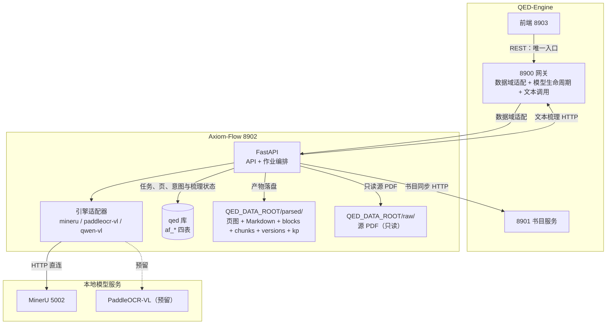

# 系统概览

设计状态：Accepted
确认状态：已确认
实现状态：Verified（8902 服务面、解析版本与梳理通路已实现）
最后更新：2026-11-27
关联代码：`src/axiom_flow/api/main.py`（应用装配与生命周期）、`src/axiom_flow/config.py`（端口、数据根、引擎地址）、`scripts/axiom_flow_service.py`（8902 启停入口）
关联测试：`tests/contract/test_architecture_documents.py`、`tests/contract/test_fixed_document_form.py`
关联 ADR：[ADR 0001](../adr/0001-v2-exploration-direction.md)、
[ADR 0004](../adr/0004-model-boundary-and-pipeline-ownership.md)、
[ADR 0008](../adr/0008-fixed-doc-form-and-metadata-genres.md)

> 本篇只回答：**这套系统由哪些进程组成、各段职责归谁、边界画在哪里**。
> 端点字段见 [api.md](api.md)，模块映射见 [code-map.md](code-map.md)，全库列级设计见根文档
> `../../../docs/architecture/database-design.md`；本篇不复制字段或 DDL。

## 目的与边界

Axiom-Flow 是运行在 **8902** 的独立后端解析服务，把已登记的 PDF 资料转化为可对照、可复核、可继续梳理的
结构化产物。它负责：

- **PDF ingest**：校验源文件、计算哈希、渲染 150 DPI 页图并登记 ingest 元数据。
- **解析与 OCR**：经引擎适配器调用 MinerU，归一化为 Markdown、LaTeX 与结构化版面块，完成公式、表格和
  图片还原的前后处理。
- **质量审阅**：产出页级质量信号、失败页清单与可追溯错误，支持人工块编辑、页确认和结构意图。
- **解析版本**：一次解析作业产生一个版本，支持同版本续跑、生效指针切换和按版本读取。
- **知识点梳理与长文产物**：从生效版本生成章、节、知识点、关系与来源锚点，长叙述写入 `kp/` 文件。

边界按服务职责划分：

| 边界 | 归属 |
| --- | --- |
| 前端展示与学习交互 | QED-Engine 前端 8903；浏览器只连 8900，不直连 8902 |
| 网关、配置、服务托管与模型生命周期 | QED-Engine 后端 8900 |
| 资料发现、下载、校验与书目登记 | QED-Tracker 8901；Axiom-Flow 只消费其已验证书目 |
| 解析管线、版本编排、归一化与产物落盘 | Axiom-Flow 8902 |
| 模型文件、启停、探针与调参 | 8900；Axiom-Flow 经适配器直连模型服务，不经 8900 转发解析流量 |
| API 契约与产物格式稳定 | Axiom-Flow 本仓库；跨项目只经 HTTP、共享数据根和隔离表族协作 |

解析引擎分派是显式的：未实现或未知引擎直接报错，不静默回落。预处理恒在 `ingest/`，后处理恒在
`normalize/`，不把本仓库职责转成引擎侧调参开关。

### 架构事实源

| 范围 | 入口 |
| --- | --- |
| 三项目四服务总体边界 | `../../../docs/architecture/four-service-architecture.md` |
| 8900 对外契约 | `../../../docs/architecture/api-contracts.md` |
| 全库 16 表列级设计 | `../../../docs/architecture/database-design.md` |
| Axiom-Flow 端点 | [api.md](api.md) |
| Axiom-Flow 数据库迁移与实现镜像 | [database-design.md](database-design.md) |
| 模块、设计与测试映射 | [code-map.md](code-map.md) |
| 解析、模型与梳理判据 | [design/](../design/index.md) |

## 当前契约

### 进程与端口

| 角色 | 地址 | 生命周期 | 与 8902 的关系 |
| --- | --- | --- | --- |
| Axiom-Flow API 与作业执行器 | `127.0.0.1:8902/api/v1` | 本仓库服务脚本 | 对外 REST 与后台单 worker |
| QED-Engine 后端 | `127.0.0.1:8900` | 根仓库 | HTTP 网关、模型生命周期、文本梳理中转 |
| QED-Tracker | `127.0.0.1:8901` | 子仓库 | 8902 经 HTTP 同步已验证书目 |
| QED-Engine 前端 | `127.0.0.1:8903` | 根仓库 | 只经 8900 消费 8902 数据 |
| MinerU 推理服务 | `127.0.0.1:5002` | 8900 托管 | 8902 引擎适配器 HTTP 直连 |
| MySQL 业务库 | `qed` | 环境侧 | 8902 写 `af_*`，按契约消费共享 `qed_*` |



### 运行约束

- API 受理后由单 worker 串行执行解析与梳理；同一时刻只允许一个解析占用模型服务，避免叠加 GPU 负载。
- 模型占用探针每 5 秒复看，最长等待 900 秒；“被占用”与“服务不可用”分列，不互相冒充。
- 服务启动不要求 8900 或模型在线；数据根、数据库配置和管理面开关仍须显式满足。
- 8902 离线时 8900 返回 503 并降级展示；8901 离线只影响同步，已同步书目照常可读。
- 模型提交期探活失败返回 503 且不创建任务行；受理后的故障落入任务终态，不伪造从未运行的任务。

### 程序设计架构

### 分层

程序按 **API → 作业/版本服务 → 解析引擎/模型客户端 → 产物仓储** 分层，依赖只向下：

| 层 | 主要落点 | 职责 |
| --- | --- | --- |
| API | `src/axiom_flow/api/` | REST v1、参数校验、同步/ingest/解析/梳理受理、只读投影、人工编辑与确认、非公开管理面 |
| 作业与版本服务 | `src/axiom_flow/orchestrator/` | 单 worker 调度、受理门、版本播种与续跑、终态与激活、启动期归一、梳理批次与长文生成 |
| 解析引擎与模型客户端 | `src/axiom_flow/engines/`、`normalize/`、`schemas.py` | MinerU 协议、文本网关客户端、统一页结果、坐标/类型/公式归一、质量信号与分块 |
| 产物仓储 | `src/axiom_flow/ingest/artifacts.py`、`src/axiom_flow/db/repositories.py` | 数据根内原子落盘、路径闸、清单与哈希；`af_*` 元数据、状态、事件与意图持久化 |

API 不直接拼装引擎协议；作业服务不绕过仓储写文件或写库；引擎差异在适配层消化，归一化层只认统一
`PageResult` 与 `Block` 形状。

### 版本作用域

- 一次解析作业对应 `af_operations` 的 parse 事件行，`op_id` 即 `job_id`，产物落在
  `parsed/<domain>/<course>/<book>/versions/<job_id>/`。
- `af_books.active_job_id` 是唯一生效指针；`NULL` 表示根视图 `legacy`，不是“无数据”。
- `af_pages` 以 `(book_id, job_id, page_no)` 隔离页状态；同 job 重放时，已 `parsed` 且产物在位的页跳过引擎。
- 块编辑意图绑定版本；页级结构意图不带版本坐标、跨版本存活；`af_kp.job_id` 只记录取证版本，不参与节点作用域。
- 目标页齐备且清单重算成功后，任务终态与版本激活使用同一判据；`partial`、`failed` 不切生效指针。

### 事件与人工意图

`af_operations` 用 `lifecycle` 分开两类行：

- `event` 记录发生过什么，包括解析版本生命周期与梳理批次流水；非 parse 事件只插入不改写。
- `intent` 保存人工当前意图，块编辑按 `intent_key` 幂等 upsert，结构意图按书行锁整批替换。
- 机器路径不替人置 `af_kp.confirmed`；页确认与知识确认都是人工位，不能被批次收尾或启动归一覆盖。

知识点梳理从生效版本读取页产物，经文本网关生成目录与知识点，写入 `af_kp` 和 `kp/<node_id>.md`；
人工复核只更新人工域与确认位，跨仓提升仍走 8900 的契约通路。

### 数据与资源边界

### 数据库所有权

Axiom-Flow 只拥有 `af_*` 四张私有表：

| 表 | 边界职责 |
| --- | --- |
| `af_books` | 书目快照、ingest/解析进度、生效版本指针与梳理结局 |
| `af_operations` | 解析版本事件、梳理批次流水与人工意图 |
| `af_pages` | 一个版本内一页的状态、质量、产物索引与确认态 |
| `af_kp` | 章、节、知识点、关系、锚点、批次与人工确认 |

共享 `qed_*` 不归本仓库改结构：`qed_domain`/`qed_course` 是只读坐标，`qed_knowledge_point` 按根契约消费与
提升，`qed_llm_calls` 是统一调用账，生产账由 8900 写，本服务不重复记账。全库 16 表列级设计正本只在根文档
`../../../docs/architecture/database-design.md`；本仓库 [database-design.md](database-design.md) 只承载迁移链、
运行约束与实现镜像。

### HTTP 边界

- 8903 → 8900 → 8902 是唯一前端数据链；8900 消费 `af_*` 只经 8902 API。
- 8902 → 8901 只取已验证书目；不直连 `qt_*`，不把对方表结构复制进本仓库。
- 8902 → MinerU 是解析直连；8902 → 8900 只承载文本梳理中转与契约消费。
- 跨仓库不存在 Python 代码依赖；模型容器不挂载 Windows 盘，产物由 Windows 编排层落盘。

### 数据根产物

`QED_DATA_ROOT` 必须显式配置且为既有目录，不静默回退到仓库内路径。本服务只读 `raw/`，只写 `parsed/`，
不写数据根 `tmp/`；正常服务路径也不写 `backups/`。

<!-- data-root-whitelist:start -->
- `raw/` — 源 PDF 只读输入区（QED-Tracker 写入，本服务只读不写）
- `tmp/` — 临时区（本服务不写）
- `parsed/` — 解析产物区（本服务唯一写入区）
- `backups/` — D 类数据操作的备份留痕例外区
<!-- data-root-whitelist:end -->

```text
<QED_DATA_ROOT>/
├── raw/<domain_id>/<course_id>/*.pdf
└── parsed/<domain_id>/<course_id>/<book_id>/
    ├── pages/p<NNNN>.png
    ├── versions/<job_id>/
    │   ├── book.json
    │   ├── pages/p<NNNN>.png|md|blocks.json
    │   ├── manifest.json
    │   └── chunks.json
    └── kp/<node_id>.md
```

产物路径必须位于数据根内，路径段由统一构造器校验；写入采用同目录临时件加原子替换。页图、Markdown、
版面块、分块与长文是文件正本，数据库只存元数据、状态、索引与指针，不存大字段正文。

### 资源与安全边界

- 模型文件、启停、探针、资源互斥与调参归 8900；8902 只持有调用协议与必要地址。
- 密钥只从环境或 `.env` 读取，不进入响应、日志、异常或数据库自由文本。
- 默认测试不访问公网、不调用外部模型、不写运行数据库；MySQL 集成测试仅在显式 opt-in 时使用 `qed_test`。
- 本服务不隐式扫描用户数据根；测试与运维动作使用临时目录或显式批准的人工窗口。

## 失败与兼容语义

- **失败隔离**：逐页路径单页最多重试一次；窗口级失败不重试，同 job 续跑恢复。已成功页先落产物再提交页行，
  后续异常不回滚已交付页。
- **重启归一**：服务在受理首个请求前把遗留 `queued`/`running` 改为 `interrupted`，书目进度收回 `pending`；
  该规则以单实例部署为前提。
- **600s 墙是单次调用预算，不是整本作业总墙**：OCR 的一个窗口或一页共享 600 秒 deadline，梳理单次文本
  调用同为 600 秒。全本最坏挂钟随窗口数增长，约为“窗口数 × 600 秒”加处理开销；900 秒模型占用等待是另一道闸。
- **不静默回落**：生效版本目录缺失返回 404；页行称已解析而产物缺失时逐页披露，不改判为根视图。
- **兼容基线**：SQLite 与 MySQL 双栈共用契约；旧版本产物按 `versions/<job_id>/` 保留，不被自动删除。

## 验证与追溯

### 守护面

- 架构契约测试守护元数据、拓扑图边界标签、数据库表族与文档结构。
- 固定文档测试守护正文去过程化、端点表和列清单与运行真源双向对账。
- 单元测试覆盖 ingest、引擎适配、归一化、编排、仓储、迁移和启动归一；集成测试覆盖显式隔离的 MySQL
  提交与并发语义。
- 跨仓联调只通过 8900/8901/8902 的 HTTP 契约与共享数据根布局，不以代码共享替代服务边界。

### 维护规则

- 迁移链只线性追加，唯一 base 不改写；ORM、迁移与本仓库数据库实现镜像必须同窗口同步。
- 服务启动不自动迁移；生产 `qed` 库 DDL 属人工窗口，须先备份留指纹、批准、执行并复核。
- 解析版本、事件/意图、确认位和保留裁剪口径变更时，同步设计、实现镜像、code-map 与对应测试。
- 跨项目端口、HTTP 契约、数据根布局和共享表设计以根仓库架构文档为准；本仓库只维护自身实现事实。
