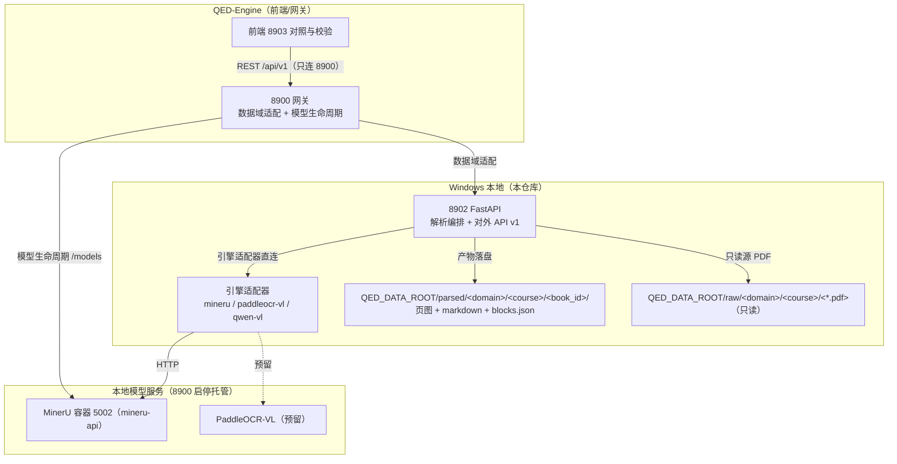

# 系统概览（v2）

设计状态：Accepted
确认状态：暂定
实现状态：In Progress
最后更新：2026-09-17
关联代码：无（新包结构实现中，见 [code-map](code-map.md)）
关联测试：`tests/contract/test_architecture_documents.py`
关联 ADR：[ADR 0001](../adr/0001-v2-exploration-direction.md)、
[ADR 0004](../adr/0004-model-boundary-and-pipeline-ownership.md)

## 定位

Axiom-Flow 是 QED-Engine 的**后端解析组件**：把 PDF 教材完整解析为统一格式（Markdown/LaTeX/
结构化块），支撑 QED-Engine 前端做高还原对照展示与人工校验。**模型生命周期归 8900、
解析管线归本仓库**（[ADR 0004](../adr/0004-model-boundary-and-pipeline-ownership.md)）；前端由
QED-Engine 负责，本仓库只保证 API 契约与产物格式稳定。

## 运行拓扑

## 边界原则

- **模型生命周期与应用层分离**：模型文件、启停、探针与资源互斥由根仓库 8900 管理；本仓库
  只经引擎适配器消费模型服务端点，不感知具体模型。
- **解析直连**：Axiom-Flow 直连本地模型服务（不经 8900 网关），保证解析管线在本仓库一端可
  完整调试（[ADR 0004](../adr/0004-model-boundary-and-pipeline-ownership.md)）。
- **数据边界**：源 PDF 在 `<QED_DATA_ROOT>/raw/` 只读；产物落
  `<QED_DATA_ROOT>/parsed/<domain_id>/<course_id>/<book_id>/`（根仓库
  [dataset 约定](https://github.com/QED-Engine/qed-engine/blob/main/docs/design/dataset-conventions.md)）。
- **元数据入 DB**：书目/任务/页状态/人工编辑落 `qed` 库 `af_*` 四表
  （见 [database-design](database-design.md)）。
- WSL 推理服务只经 HTTP 交互，容器不挂载 Windows 盘；产物一律由 Windows 编排层落盘。

## 第一版范围

解析 + 渲染数据供给 + 人工校验修改（书目同步 → ingest → 引擎解析 → 归一化 → 产物落盘 →
对照供给 → 块编辑）。Milvus 检索、知识图谱、数学解析器为后续探索项，仅预留字段。
