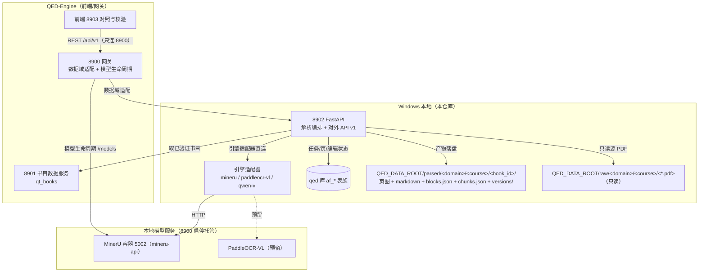

# 系统概览

设计状态：Accepted
确认状态：已确认
实现状态：Verified（v2 拓扑与 8902 服务面已落地并真机取证）
最后更新：2026-09-24
关联代码：`src/axiom_flow/api/main.py`（应用装配与生命周期）、`src/axiom_flow/config.py`（端口、数据根、引擎地址）、`scripts/axiom_flow_service.py`（8902 唯一启停入口）
关联测试：`tests/contract/test_architecture_documents.py`、`tests/contract/test_fixed_document_form.py`
关联 ADR：[ADR 0001](../adr/0001-v2-exploration-direction.md)、
[ADR 0004](../adr/0004-model-boundary-and-pipeline-ownership.md)、
[ADR 0008](../adr/0008-fixed-doc-form-and-metadata-genres.md)

> 本篇只回答一个问题：**这套系统由哪些进程组成、各段职责归谁、边界画在哪里**。
> 端点字段、表结构、模块映射、流程判据都不在这里——它们各有唯一事实源，见下方「读者路径」。

## 目的与边界

Axiom-Flow 是 QED-Engine 的**后端解析组件**：把 PDF 教材完整解析为统一格式（Markdown/LaTeX/
结构化块），支撑前端做高还原对照展示与人工校验。**模型生命周期归 8900、解析管线归本仓库**
（[ADR 0004](../adr/0004-model-boundary-and-pipeline-ownership.md)）；前端由 QED-Engine 负责，
本仓库只保证 API 契约与产物格式稳定。

本篇**不管**的内容与其事实源：

| 不管 | 唯一事实源 |
| --- | --- |
| 端点参数、响应结构、错误码 | [api.md](api.md) |
| 表结构与列语义、迁移序列 | [database-design.md](database-design.md) |
| 模块 ↔ 设计 ↔ 测试的映射 | [code-map.md](code-map.md) |
| 解析流程、状态流转、引擎协议、质量门槛与验收判据 | [design/](../design/index.md) 三篇的「确定规范」条文（`PP-n` / `PM-n` / `MI-n`） |
| 工程治理规则 | [standards/](../standards/index.md) |
| 当前进度、排期、阻塞与遗留 | [trackers/](../trackers/index.md)（`project-status.md` 与 `todo.md`） |

**读者路径**：

| 读者 | 顺序 |
| --- | --- |
| 新接手的开发者 | 本篇 → [code-map.md](code-map.md) → [design/parsing-pipeline.md](../design/parsing-pipeline.md) → [guides/development.md](../guides/development.md) |
| 8903 前端 / 8900 网关 | [api.md](api.md) 全文 → [design/parsing-management.md](../design/parsing-management.md) 的状态语义 → 产物布局（本篇） |
| 运维与数据操作 | [guides/operations.md](../guides/operations.md) → 本篇「失败与兼容语义」 → [database-design.md](database-design.md) 迁移节 |
| 模型/引擎侧 | [design/model-integration.md](../design/model-integration.md)（配置、适配器契约、失败语义） |

## 当前契约

### 版本与纪元

- **文档与架构纪元＝v2**（推倒重来后的新序列，[ADR 0001](../adr/0001-v2-exploration-direction.md)；
  v1 资料整体在 `docs/history/v1-20260814/`，只解释背景，不覆盖当前设计）。纪元是**文档与决策
  序列**，不随产品版本改写，因此不出现在文档标题里。
- **产品版本＝v0.1**（跑通完整服务），登记在 [ADR 索引](../adr/index.md)；版本切换由用户确认，
  当前版本的已交付/未交付判据见本篇「能力矩阵」，逐任务进度只在
  [`trackers/project-status.md`](../trackers/project-status.md)。
- **包版本与 HTTP 自报版本**是第三个独立坐标（`pyproject.toml` 与 `axiom_flow.__version__`，
  经 FastAPI 的 `version` 字段自报），与上面两者都不等价；三者关系变化时须同步
  [api.md 的服务信息](api.md)。

### 进程与端口

| 角色 | 地址 | 归属仓库 | 生命周期由谁管 | 谁消费 |
| --- | --- | --- | --- | --- |
| Axiom-Flow API（8902） | `http://127.0.0.1:8902/api/v1` | **本仓库** | 本仓库 `scripts/axiom_flow_service.py`（根仓库可黑盒调用） | 8900 网关 |
| MinerU 推理服务（5002） | `http://127.0.0.1:5002` | 根仓库 `scripts/image-model/`（WSL 容器） | 根仓库 8900 | 8902 的引擎适配器**直连** |
| 网关与模型生命周期（8900） | 根仓库 | QED-Engine | 根仓库 | 8903 前端 |
| 书目数据服务（8901） | 根仓库 | QED-Engine | 根仓库 | 8902 的 `POST /books/sync` |
| 对照与校验前端（8903） | 根仓库 | QED-Engine | 根仓库 | 人 |
| MySQL `qed` 库 | 本机 | 共享实例（`af_*` 表族为本方私有命名空间） | 建表与结构＝本仓库 Alembic；实例＝环境侧 | 8902 |
| 集成测试库 `qed_test` | 本机 | 本方自有 `af_*` 表族 + `alembic_version` | 测试夹具（显式 opt-in） | `tests/integration/` |

**只经 HTTP 与数据库交互，跨仓库不存在代码依赖**：模型文件、启停、探针、资源互斥与调参全在根仓库
一侧；本仓库不感知具体模型，也不暴露调参入口。

### 运行拓扑



一次请求的完整时序（含 8900 透传与作业轮询形状）事实源在
[api.md 的服务信息节](api.md)，本篇不重复。

### 数据边界与产物布局

数据根顶层是**白名单登记制**（[ADR 0009](../adr/0009-data-root-must-be-explicit.md)）：顶层只允许
下列目录，白名单之外一律为野生区，发现即登记处置；条目的增删权限在根仓库 ADR 0018，本仓库不自行
扩张。本服务在该骨架里的位置是**唯一写入 `parsed/`**。

<!-- data-root-whitelist:start -->
- `raw/` — 源 PDF 只读输入区（QED-Tracker 写入，本服务只读不写）
- `tmp/` — 临时区（**本服务不写**，见 `PP-6`）
- `parsed/` — 解析产物区（**本服务唯一写入区**）
- `backups/` — D 类数据操作的备份留痕例外区
<!-- data-root-whitelist:end -->

```text
<QED_DATA_ROOT>/
├── raw/<domain_id>/<course_id>/*.pdf          # 源 PDF，只读、不复制
└── parsed/<domain_id>/<course_id>/<book_id>/
    ├── book.json                              # ingest 元数据（page_count / sha256 / source_file）
    ├── pages/p<NNNN>.png|md|blocks.json       # 根视图（active_job_id 为 NULL 时的生效作用域）
    ├── manifest.json  chunks.json             # 根视图清单与知识块
    └── versions/<job_id>/                     # 一个解析版本 = 一次解析任务，内部布局与根视图同构
        ├── pages/…  manifest.json  chunks.json
```

> 上图只展开本服务读写的两区（`raw/` 只读、`parsed/` 唯一写入）；白名单里的 `tmp/` 与
> `backups/` 不在产物布局内，本服务不写它们（`PP-6`）。

- **数据根必须显式配置**：`QED_DATA_ROOT` 缺失即在启动期报错，不静默回退到仓库内目录，任何仓内
  路径都不得当数据根（[ADR 0009](../adr/0009-data-root-must-be-explicit.md)）。
- **仓库工作区目录卫生**（[ADR 0012](../adr/0012-workspace-directory-hygiene.md)）：仓库根 `tmp/` 是仓内
  唯一临时与留档区（一次性窗口脚本、取证留档、备份件；`.gitignore` 排除、不入库、可随手清理）；
  仓内 `data/` 留档区已退役、不得复现；`scripts/` 只放长期受管脚本；`logs/` 只写本项目日志且文件数
  ≤3；本仓库不含前端（`web/` 已删除，UI 归 QED-Engine 根仓库）。注意仓库根 `tmp/` 与数据根
  `<QED_DATA_ROOT>/tmp/`（本服务不写，`PP-6`）是两个不同位置。
- **写入与清除同域**：产物路径一律经 `ingest/artifacts.py` 的两个构造器生成（自带 `parsed/`
  前缀与单段名校验），清除作用域同样限 `parsed/` 子树（[api.md](api.md) 管理端点节）。
- 路径唯一格式与原子落盘判据是 [parsing-pipeline.md 的 `PP-3`/`PP-4`](../design/parsing-pipeline.md)；
  「哪一版生效」的唯一事实源是 `af_books.active_job_id`，切版＝单列 UPDATE，不搬文件（`PP-14`/`PP-15`）。
- 全部落盘路径必须位于数据根之内，`domain_id`/`course_id`/`book_id`/`job_id` 必须是安全单段（`PP-5`）。
- 引擎中间产物只存在于内存，数据根下不出现作业临时目录（`PP-6`）。

### 边界原则

- **模型生命周期与应用层分离**：模型文件、启停、探针、资源互斥与**模型调参**由根仓库 8900 管理；
  本仓库只经引擎适配器消费模型服务端点（[ADR 0004](../adr/0004-model-boundary-and-pipeline-ownership.md)）。
- **解析直连、无自动兜底**：Axiom-Flow 直连本地模型服务，不经 8900 网关，保证解析管线在本仓库
  一端可完整调试；引擎分派是显式的，未实现或未知即报错，不静默切换引擎。
- **预处理与后处理恒在本仓库**：输入整形只落 `ingest/`，结果修补只落 `normalize/`，不靠引擎侧
  新增调参开关（[model-integration.md 的 `MI-15`](../design/model-integration.md)）。
- **数据边界**：源 PDF 只读；产物落 `QED_DATA_ROOT/parsed/`，目录布局沿用根仓库 dataset 约定
  （只链接不复制）。
- **元数据入 DB**：书目 / 任务 / 页状态 / 人工编辑落 `qed` 库 `af_*` 表族
  （[database-design.md](database-design.md)），产物正本在文件系统，DB 不存大字段。
- **WSL 只经 HTTP**：容器不挂载 Windows 盘，产物一律由 Windows 编排层落盘。
- **测试隔离**：默认测试不访问公网、不调用外部模型服务、不写运行数据库；MySQL 层只在显式 opt-in
  时启用，且只用 `qed_test` 内本方自有的四张表（[ADR 0005](../adr/0005-mysql-integration-test-isolation.md)）。

### 能力矩阵（v0.1）

| 能力 | 状态 | 判据事实源 |
| --- | --- | --- |
| 书目同步与 af_* 私有表族读写 | 已交付 | `PM-1`~`PM-5` |
| PDF ingest（150 DPI 页图 + 元数据 + 原子落盘） | 已交付 | `PP-2`~`PP-4` |
| MinerU 适配（窗口串行提交、逐页提交、坐标与公式归一） | 已交付 | `PP-8`~`PP-12`、`MI-5`~`MI-10` |
| 知识块切分与质量信号 | 已交付 | `PP-19`、`PP-20` |
| 解析版本作用域（写时复制播种、续跑认产物、生效指针） | 已交付 | `PP-14`~`PP-18`、`PM-6` |
| 状态语义（结局三态、进度/结局分列、启动期归一） | 已交付 | [ADR 0007](../adr/0007-parse-status-semantics.md)、`PM-8`~`PM-15` |
| 只读对照数据供给（清单 / 逐页状态 / 页图 / 分块 / 版本 / 作业列表） | 已交付 | [api.md](api.md) ③ 类 |
| 块级人工编辑落库与回显 | 已交付 | `PM-3`、`PM-5` |
| 非公开一键清除（先清后建） | 已交付 | [api.md 管理面节](api.md)、`PM-17` |
| PaddleOCR-VL / qwen-vl 引擎槽位 | 预留，未实现 | `MI-11`~`MI-13` |
| 8903 端到端联调与重建产物后的真机校验写入 | 未交付（等根侧排期与产物重建窗口） | 只在 `trackers/` 登记 |
| 检索 / 知识图谱 / 数学解析器 / 学习交互 | 非 v0.1 目标 | [roadmap](../trackers/roadmap.md) |

## 失败与兼容语义

- **谁离线时谁降级**：8902 离线 → 8900 返回 503 并降级展示，不影响其他界面；8901 离线 → 同步
  取数失败（503），已同步行照常可读；模型服务离线 → 提交期探活 503 且**不创建任务行**。逐条
  错误码定义在 [api.md](api.md)，本仓库侧的完整失败面在
  [parsing-management.md](../design/parsing-management.md) 的「失败与质量语义」段。
- **如实报错，不静默回落**：生效版本目录缺失即 404；页行标 `parsed` 而产物不在位，在逐页清单里
  原样暴露，不改判、不回落根视图。静默改判会让磁盘事故从台账上消失。
- **契约稳定性承诺**：切版不改 URL 与响应结构；归一化映射表版本与产物必须成对，修复前落盘的产物
  与其版面块下标不回溯修正（`PP-9`）；`af_*` 是本方私有命名空间，不改根仓库的表。
- **并发与资源边界**：同一时刻只允许一个解析占用模型服务（编排层占用闸门在提交之前，占用与
  「服务不可用」两种原因分列文案，`MI-9`/`MI-10`）；窗口大小与超时是配置项而非自适应值。
- **兼容基线**：SQLite 与 MySQL 双栈同一份 DDL，迁移必须升降级可往返；旧版本产物按
  `versions/<job_id>/` 保留，不被自动删除。

## 验证与追溯

- **本篇的守护**：`tests/contract/test_architecture_documents.py`（目录集合、拓扑图边界标签、
  `实现状态` 取值与单行有界）与 `tests/contract/test_fixed_document_form.py`（元数据体裁、
  H2 骨架白名单、契约正文段零任务编号与日期）。
- **决策依据**：[ADR 0001](../adr/0001-v2-exploration-direction.md)（v2 纪元与后端解析定位）、
  [ADR 0004](../adr/0004-model-boundary-and-pipeline-ownership.md)（模型边界与管线归属）、
  [ADR 0005](../adr/0005-mysql-integration-test-isolation.md)（测试隔离）、
  [ADR 0007](../adr/0007-parse-status-semantics.md)（状态语义三分）、
  [ADR 0008](../adr/0008-fixed-doc-form-and-metadata-genres.md)（体裁化元数据与可对账契约）。
- **来源**：跨项目契约（端口号、`.env` 键、dataset 布局）以 QED-Engine 根仓库 `docs/` 为准，
  本仓库只链接不复制；「能力矩阵」各行对应的实现轮次与真机取证记录在
  [trackers/completed.md](../trackers/completed.md)。
