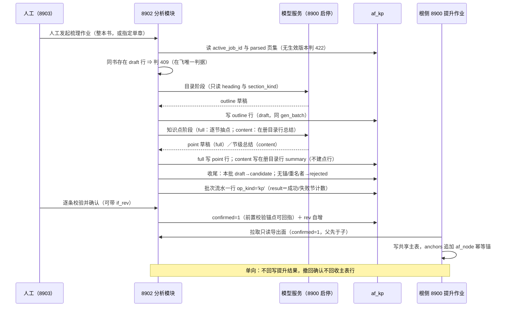

# 知识点梳理与提升设计（knowledge-analysis）

设计状态：Accepted
确认状态：已确认
实现状态：Verified（本侧通路已实现并分项验收；根侧提升作业未交付）
最后更新：2026-11-26

关联代码：`src/axiom_flow/db/`、`src/axiom_flow/orchestrator/`、`src/axiom_flow/engines/`、`src/axiom_flow/api/`
关联测试：`tests/unit/test_db.py`、`tests/unit/test_db_knowledge.py`、`tests/unit/test_knowledge_pipeline.py`、`tests/unit/test_db_llm_ledger.py`、`tests/unit/test_engine_factory.py`、`tests/contract/test_api_v1_contract.py`、`tests/integration/test_llm_call_ledger.py`
关联 ADR：[ADR 0004](../adr/0004-model-boundary-and-pipeline-ownership.md)、[ADR 0015](../adr/0015-db-single-source-for-readiness.md)、[ADR 0016](../adr/0016-af-family-rebuild-into-four-tables.md)、[ADR 0010](../adr/0010-page-regions-are-parse-inputs.md)、[ADR 0020](../adr/0020-shared-table-write-and-llm-accounting-boundary.md)（共享表业务写入与调用记账边界）

> **本篇回答的唯一问题**：在一册书的**已生效解析版本**之上，章／节／知识点**怎样被梳理出来、由谁写、
> 人怎么背书、背完给谁用**。列语义与键的事实源是 [database-design.md](../architecture/database-design.md)
> 第五章（本篇一处不复制）；端点参数与响应形状归 [api.md](../architecture/api.md)（本篇只写时序与
> 判据）；产物文件的布局与合格判据归 [parsing-pipeline.md](parsing-pipeline.md)（`PP-n`）。

## 目标与非目标

**目标**：

1. 给「谁产生 `draft`/`candidate`」一个唯一答案：机器梳理作业写来源，人工路径写背书，系统写归一与作废。
2. 让**批次**这个概念在没有批次表的前提下仍然可判据化——在飞、收尾、中断三态全部由列自身表达。
3. 把梳理结论**钉回产物**：每个知识点必须能回指到第几页哪几个版面块，否则它只是模型的又一次幻觉。
4. 让机器永远不与人工结论争同一身份：重跑梳理不得覆盖人已背书的结论，判据在写入路径而不是读侧。
5. 定死分析模块与检索面（向量／知识库）与根侧主表的分工，防止三条线互相伸手。
6. 把「并发」这一核心判据拆成**两条各自成立的轴**并都给出条文：关系侧的 `co_requisite` 对称语义   （结构轴）与写入侧的「先读后判再写」禁形（通路轴，判据正本在   [database-design.md](../architecture/database-design.md)「键与并发写入形态」）。两条轴都算，不因   只讲其一而把另一条降级。

**非目标（各归其主）**：

- 提示词工程与梳理质量配方：章腿检索增强与点总结定位已由 `KA-72`／`KA-73` 收口；其余质量配方仍按 C 类实验另行冻结与评审。
- 检索配方、向量索引与知识图谱：章腿的确定性定义检索由 `KA-72` 承载（`af_kp` 不是它的替代品）；向量索引与知识图谱仍属独立评审线。
- 8903 界面与 8900 提升作业的实现（根侧另批；本篇只到通路与时序）。
- 表结构与域值变更（→ [database-design.md](../architecture/database-design.md)；本篇只给消费判据）。
- 端点参数与响应字段（→ [api.md](../architecture/api.md)）。

## 边界与事实源

| 事项 | 本篇管 | 不管（事实源） |
| --- | --- | --- |
| `af_kp` 的列 | 谁写哪一列、写入时机、可见后果 | 列语义、键与索引：[database-design.md](../architecture/database-design.md) 的 `af_kp` 列清单 |
| 梳理作业 | 发起面、受理门、批次三态、失败语义、进度读法 | 端点形状：[api.md](../architecture/api.md) |
| 锚点 | 锚点怎样被解释、失效时怎么办 | 版面块结构与 `index` 含义：[PP-7~PP-10](parsing-pipeline.md)、页行与产物：[PP-3、PP-4](parsing-pipeline.md) |
| 长文叙述 | 落点路径、写入次序、孤儿文件处置 | 数据根白名单与逐本清除：[operations.md](../guides/operations.md)「数据目录」、[PP-4](parsing-pipeline.md) |
| 提升与共享表写入 | 本侧导出面的读判据、幂等锚与课程级直写契约 | 主表结构与写者：[database-design.md](../architecture/database-design.md) 的共享表登记面（跨项目可读写；既有提升单向，课程级章腿直写） |
| 模型 | 「谁调用、调用账记哪张表」 | 模型生命周期与调用协议：[model-integration.md](model-integration.md)（`MI-n`）、根仓库 8900 |
| 检索／图谱 | 不管（只声明边界） | [roadmap](../trackers/roadmap.md) 与独立评审轮 |

## 核心设计

一条批次从发起到提升只经过七个动作：**人工发起 → 受理门 → 目录阶段 → 知识点阶段 → 收尾 → 人工确认 → 根侧拉取**。
两条点腿的写面不同：`full` 保留“生成目录 → 生成知识点行”的完整路径；当前基本路径 `content` 不重生成目录，
只在册目录行上补节级总结与取材区间，不新增知识点行。习题集走自身目录与题目腿，教材的 `exercise` 阶段只按题号成行。
每一跳都只有一个判据位，读侧不得另立判据；下表逐条给出「结论 ＋ 判据」。

### 通路总览（一条批次的一生）

`stage='content'` 在同一条链上多四步（`KA-63`~`KA-66`）：**P0 种类审校**（点腿前，按规则把知识点段内的大块习题拆成并列习题行，判不出的行进点名面）→ **P1 点梳理**（块取材、单次正文 ≤ 10,000 汉字、超预算切窗、小节合批）→ **P2 章文件夹**（子点总结齐后才发章腿，章前材料止于首点锚页之前）→ **P3 详情**（点行 `meta.material_ranges` 记取材块区间，正文公式／表格／图片原样透传）。四步都在 `content` 这一个阶段内，`stage` 闭集与端点形状不变。

### 确定规范

> 一行一条：**结论 ＋ 判据** ｜ **理由／例外／边界** ｜ **实现落点 → 守护测试**。编号 `KA-n` 在本篇内解析。

#### 取证输入与作业受理

| 编号 | 守则（结论 ＋ 判据） | 理由／例外／边界 | 实现落点 → 守护测试 |
| --- | --- | --- | --- |
| KA-1 | **梳理只针对生效版本**：受理时读 `af_books.active_job_id`，把它写进本批每行的 `job_id`；无生效版本即在受理前判 422，零写入。发起面唯一＝人工提交（`KA-24`） | 例外：人工直填不取证，落 `job_id=''`（与结构意图的哨兵同形）。为什么禁「对着不存在的版本梳理」：锚点将无处解释，结论无从复核 | `orchestrator/knowledge.py:accept_kp_job`（四道门全排在写任何行之前）＋ `api/main.py` 的 `POST /api/v1/kp-jobs` → `tests/unit/test_knowledge_pipeline.py::TestAcceptanceGate`（404／422 零写入／409 点名既有批次／发号形状）、`tests/contract/test_api_v1_contract.py`（无生效版本判 422） |
| KA-2 | **取证页集＝该版本内 `af_pages.status='parsed'` 的页**，正文经文件通路逐页读 `pages/p<NNNN>.md` 与 `p<NNNN>.blocks.json`（批量、单次多页） | 边界：**不读 `chunks.json`**——知识块（chunk）是检索单元、按 [PP-19](parsing-pipeline.md) 为切分预算服务，且它是可重建的派生文件；知识点是教学结构单元，两者的唯一交集只有坐标空间。缺页不建半批：缺文件的页剔出取证集并在批次流水里计数披露（`KA-27`）。边界：[PP-13](parsing-pipeline.md) 已承诺「有 `parsed` 页行即有版本内产物」，文件仍缺时说明磁盘被外部清退（重建窗口或人工清理），本模块只按缺页处理，**不改判 DB 状态**——就绪的唯一事实源仍是 DB | `orchestrator/knowledge.py:build_evidence_set`（`status='parsed'` ∩ 请求区间 ∩ `.md` 与 `.blocks.json` 成对在位；标题序列先按 [PM-5](parsing-management.md) 的覆盖层回放人工类型改判再筛 `heading`——改判出 `heading` 的块（如被判成 `header` 的页眉）不进目录阶段，改判进 `heading` 的块（如漏判成正文的标题）进） → `tests/unit/test_knowledge_pipeline.py`（缺页剔除且计数可见、`TestHumanRelabelIsReplayed` 四形含两条反向断言、`TestCurationStripsFurniture` 五形＝逐页家具读数与取材剔除面，判据本体在 `KA-29`） |
| KA-3 | **确认门不是梳理的门槛，而是外发的门槛**：梳理可取证未确认页；但 `confirmed` 置位的前置校验含「该行锚点所指页在取证版本内已 `confirmed` 或全书页确认门尚未启用」，导出面对锚点页未确认的行给复核提示 | 为什么分开：页确认门（每页人工确认后才进知识块）落地前若把梳理也锁上，分析模块就没有可跑的现场；但结论外发给主表必须踩在已校验的产物上。代价：未确认页的结论会带 warning 出现在导出面 | `orchestrator/knowledge.py:validate_endorsement_links` 与 `unconfirmed_anchor_flags`（确认腿与导出腿分列） → `tests/unit/test_knowledge_pipeline.py`（未确认锚点不阻断确认、但导出可见标记） |
| KA-4 | **同书同时至多一个在飞批次**：在飞判据＝该书存在 `gen_status='draft'` 的行；命中即判 409。跨书不并发，沿用单 worker 串行队列与单实例部署前提（[PM-13](parsing-management.md)） | 为什么判据落在 `af_kp` 而不是流水行：事件行只答「发生过什么」、永不参与当前态判据（[database-design.md](../architecture/database-design.md)「服务端不变式」），用它表达「跑没跑完」会当场造出第二事实源。例外：`draft` 残留超一个进程生命周期时由启动期归一处置（`KA-9`）。边界：单章批次同样受本条约束——在飞唯一性按书算，不按章算（`KA-25`） | `db/repositories.py:KpRepository.find_draft_batch` ＋ `run_knowledge_job` 的执行期复查（他人 `draft` 当场 409、同批不自我否决） → `tests/contract/test_api_v1_contract.py`（双批次 409） |

#### 结构生产：先目录、后知识点

| 编号 | 守则（结论 ＋ 判据） | 理由／例外／边界 | 实现落点 → 守护测试 |
| --- | --- | --- | --- |
| KA-5 | **一个批次内固定两阶段：先目录（outline）后知识点（point）**。目录阶段的输入＝每页的 heading 版面块序列 + `section_kind` + 页序，**再加一条书自身目录页的条目腿**（`KA-33`＝拆条目 → 印刷页码偏移标定 → 名称回正文定位，条目读数与真 heading 走同一套行格式：`page`／`block_index`／`level`）；**目录行由「模型整理出的条目 → 单页失败该页回落条目腿 → 全书零条目才退到 heading 块」三档成行**（`KA-35`＝正腿是模型判页与逐页整理、条目腿降为回落面，层级取读数自带的 level）；产出 `depth∈{1,2}` 的两层目录；知识点阶段按节的页区间读正文逐节抽点，且只在本批 `stage='full'` 时发起（`KA-34`） | 为什么先目录：知识点必须挂父，父不存在会产出成堆未归档行；且目录阶段的输入全是结构化读数，失败面与吞吐都小。代价：正文被读两遍（一遍取 heading，一遍抽点）。为什么条目腿开在取材层而不是改写 prompt：现网存在整本零 `heading` 块的教材——「若某页是书自身的目录页就把条目按层级认下来」这条规则早已在册，缺的是**输入**而不是指令，改指令只会让同一条规则有两处口径 | `orchestrator/knowledge.py:build_outline` / `extract_points`（`run_knowledge_job` 内目录行按 `KA-40` **边整理边落库**、全部先于点行）＋ `normalize/toc.py`（条目腿三条纯函数，判据正文见 `KA-33`） → `tests/unit/test_knowledge_pipeline.py`（目录先于点写入的次序断言、`TestTocEntryLeg` 五条（回落面）、`TestModelLedOutline`（正腿＝模型逐页整理出的条目，单页故障只坏那一页） |
| KA-6 | **目录最多两层，深度越界即拒**：`depth=1` 章、`depth=2` 节，第三层不进 `af_kp`（`KA-62`：`§` 节下的纯编号细目折入所属二级的显示段），第四层及更深按越界丢弃并计数 | 与共享主表的 outline→point 两层口径一致（提升零转换）。为什么不留三层：一旦留，提升面就要在根侧再造一层，跨仓语义分叉 | `orchestrator/knowledge.py:build_outline`（`OUTLINE_MAX_DEPTH` 封顶两层，越界单列计数、不进节点） → `tests/unit/test_knowledge_pipeline.py`（第三层标题不落节点） |
| KA-7 | **未归档池是一等公民**：`node_kind='point'` 且 `parent_id IS NULL` 的行＝未归档池；「重新编排目录」只改 `parent_id` 与 `order_hint`，**不删不重建** | 为什么：抽点时归属不确定是常态，硬挂父会造出假结构。未归档行照样可确认、可提升（根侧自行归位）。收敛责任归人工，机器不得自动补挂父（`KA-26`） | `api/main.py` 的 `PATCH /api/v1/kp/nodes/{node_id}` 与 `PUT /api/v1/books/{book_id}/kp/outline` ＋ `KpRepository.detach_draft_parent` → `tests/contract/test_api_v1_contract.py`（重排只改两列、行数不变） |
| KA-8 | **目录整批声明的「缺席即撤销」只降级、不删除**：全量声明 outline 集合时，缺席的 outline 行不下线，其子 point 退入未归档池（`parent_id=NULL`），并在同一事务内对同一把 `af_books` 行锁完成（判据同 [database-design.md](../architecture/database-design.md)「键与并发写入形态」的整批声明行锁条） | 为什么：outline 行可能被别的 point 的 `links` 引用，删行就造出悬空边（「删除必须清引用边」不变式的代价面）。代价：盘上留着人已看过但当前不在目录里的节 | `KpRepository.replace_outline`（`lock_book` 的 `af_books` 行锁内「读现有 → 算差异 → 写全部」） → `tests/unit/test_db_knowledge.py`（缺席 outline 的子点退池、零删除） |

#### 批次、写者与状态机

| 编号 | 守则（结论 ＋ 判据） | 理由／例外／边界 | 实现落点 → 守护测试 |
| --- | --- | --- | --- |
| KA-9 | **批次三态全由 `gen_status` 自身表达**：在飞＝该书存在 `draft` 行；收尾＝作业最后一步单语句条件 UPDATE 把本批全部 `draft→candidate`；中断＝启动期归一把残留 `draft` 整批判 `rejected`。人工新建行的 `gen_batch=''`（不属任何批次） | 为什么不需要批次表：「保留最新 2 批」（[database-design.md](../architecture/database-design.md)「保留与裁剪」）的分组键、裁剪管辖范围、在飞判据都只读这一列就够。改写方向唯一（`draft→candidate` 或 `draft→rejected`），与 parse 行「只向更终方向回写」同构。例外：`rejected` 由人判不可用与系统归一共用，靠 `actor` 分列 | `orchestrator/knowledge.py:finalize_batch`（翻面是作业末步）、`KpRepository.reconcile_draft_on_startup`（装配点＝`api/main.py` 的 lifespan，首次响应之前） → `tests/unit/test_knowledge_pipeline.py`（收尾翻转、重启归一各一例） |
| KA-10 | **批次身份 `gen_batch` 值形 `afkp-<hex12>`，服务端随机发放、一经写入同批同值不可变**；「最新」按行内 `created_at` 分组取，不要求批次名可排序 | 与 `node_id`／`op_id` 的发放方式一致（内容摘要会把「重跑」变成「同批」这类意外）。代价：批次名单看不出先后，读侧必须靠时间 | `db/repositories.py:new_batch_id`（与 `new_node_id` 同形而不同 namespace） → `tests/unit/test_knowledge_pipeline.py`（同批同值） |
| KA-11 | **四个写者，各自的列域不重叠**：机器写来源域（身份、结构、锚点、`summary`、`gen_batch`、`model_ref`、`gen_status`），`confirmed` 恒写 0；人工写背书域（名称、结构挂载、`links`、`anchors`、`role`/`type`、`summary`）与 `confirmed` 位；系统写归一与裁剪两条路径，外加**长文指针一条**——UPDATE 通路上 `narrative_ref` 只由 `set_narrative_ref` 落（`KA-30`；机器 `create` 只在插入时给值，梳理通路恒给空串） | 机器与人工分列互不覆据（「人工位只有人工可写」不变式的推广，见 [database-design.md](../architecture/database-design.md)「服务端不变式」）；「谁做的」是裁决不是细节，所以分列而非塞 `meta`。为什么长文指针归系统而不进背书域白名单：它记的是「正文文件叫什么」，不是人的结构结论——放进白名单等于让人可以把行指向任意文件名。代价：这一列同样 `rev+1`，与归一各条同形，导出面按 `rev` 增量时一次详解写入表现为一次前移 | `db/repositories.py:KpRepository` 四条腿分别收口＝`create`（机器来源域，`confirmed` 恒 0）／`update`＋`confirm`（人工背书域，白名单 `_KP_ENDORSEMENT_WRITABLE`）／`set_narrative_ref`（UPDATE 通路上这一列的唯一写者）／系统若干条归一语句 → `tests/unit/test_db_knowledge.py`（自动批次跑完 `confirmed` 计数不变、背书域白名单不含 `narrative_ref`） |
| KA-12 | **人工修改不改 `gen_batch` 也不改 `model_ref`**，只 `rev+1`；行的来源（哪一批、哪个模型产的）保持原值 | 为什么：改 `model_ref` 就把「产出者」与「最后编辑者」挤进同一列，两者都要时必漂移；来源是审计事实，人工修订是另一个事实。代价：逐次修改史不保留（与解析模块同口径，非回归） | `db/repositories.py:KpRepository.update`（背书域白名单，来源两列在语句发出前拒绝） → `tests/unit/test_db_knowledge.py`（人工改写后两列原值不变） |
| KA-13 | **机器永远不与人工结论争同一身份**：收尾时对「同父同 `norm_key` 且已存在 `confirmed=1` 行」的新机器行判 `rejected`（不合并、不覆盖、不新增），并在批次流水里计数（`KA-27`） | 判据的唯一形式＝让位方向固定。为什么不是「人工行被机器更新」：那等于机器有权撤销人的背书，`confirmed` 就成了装饰 | `orchestrator/knowledge.py:finalize_batch` 的让位分支（身份三元组 `(node_kind, parent_id, norm_key)`；跨批重跑时「同父」几乎恒不成立——未确认旧行的取代面另立 `KA-36`，本条只管与已确认行同身份的让位） → `tests/unit/test_knowledge_pipeline.py`（重跑不碰已确认行、新行判 rejected） |

#### 人工背书与提升通路

| 编号 | 守则（结论 ＋ 判据） | 理由／例外／边界 | 实现落点 → 守护测试 |
| --- | --- | --- | --- |
| KA-14 | **确认的前置校验＝可回指**：置 `confirmed=1` 要求 `anchors` 非空、每条锚点页在取证版本的页集内、且 `links[].to` 全部存在；不满足即 422 并点名缺失项 | 为什么：回指是「梳理结论」与「模型幻觉」的唯一分界；无锚的点一旦进主表，后续无人能复核。例外：`role`/`type`/`summary` 允许空，它们是描述不是证据 | `KpRepository.confirm` ＋ `POST /api/v1/kp/nodes/{node_id}/confirm`（422 正文与 200 同形、`rev` 不自增） → `tests/contract/test_api_v1_contract.py`（无锚判 422） |
| KA-15 | **导出面＝`confirmed=1` 的行，一次给全一册，按 outline 先于 point 的拓扑序输出**，每行带 `rev` 与 `updated_at` 供拉取方做增量与幂等 | 用户的裁决口径是「确认后同步到共享知识点表」，外发判据只有人工确认位一个。代价：无确认行的进度不在导出面里，靠批次流水披露（`KA-27`） | `api/main.py` 的 `GET /api/v1/books/{book_id}/kp/export` ＋ `order_for_export`（父先于子、成环时每行仍出一次） → `tests/contract/test_api_v1_contract.py`（导出集恰为 confirmed=1 且父先于子） |
| KA-16 | **既有 `af_kp` 提升是 8900 拉取式单向，本组件不为该腿直写共享主表、不回写提升结果**；`anchors` 追加 `{kind:'af_node', ref_id:<node_id>}` 由拉取方写，是重复提升的幂等锚。共享 `qed_knowledge_point` 允许跨项目读写，8900 不是唯一写者；课程级章腿由 AF 按显式 `kp_id` 直接更新明确目标行 | 为什么锚落 `anchors` 而非 `meta`：`meta` 禁进 WHERE，无法反查。代价：工作区侧看不出「哪条已进了主表」，要看得读主表。课程级腿另守证据哈希幂等与 confirmed／rejected 保护，不改变既有提升方向 | `api/main.py` 的 `POST /api/v1/kp/merge/chapter-text`（既有 `GET …/kp/export` 仍只读）＋ `orchestrator/chapter_text.py`（显式目标、确认保护、证据哈希幂等、完整快照复核与同事务写）＋ `db/shared_knowledge.py`（raw SQL 读锁与三列条件更新） → `tests/unit/test_shared_chapter_text.py`、`tests/contract/test_chapter_text_api_contract.py` |
| KA-17 | **撤回确认不回收主表行**：`confirmed` 1→0 只影响本侧导出面，本组件不发删除、不发消息；已提升行由根侧自行处置 | 为什么：跨仓做反向删除会造出第二条写路径与分布式一致性问题，收益不成比例。代价：主表可能留旧行，导出面的响应必须如实写明「本侧已撤回」 | `KpRepository.set_confirmed`（`if_rev` 乐观并发；置位才跑可回指校验，撤回永远可执行） → `tests/unit/test_db_knowledge.py`（撤回只改本侧列，零外部调用） |

#### 与解析模块的衔接（锚点与长文）

| 编号 | 守则（结论 ＋ 判据） | 理由／例外／边界 | 实现落点 → 守护测试 |
| --- | --- | --- | --- |
| KA-18 | **锚点一律按行上的 `job_id` 那一版解释**：`anchors[].page` 是 PDF 页序（与 `af_pages.page_no` 同域），`block_indexes` 是该版 `blocks.json` 的块序空间；生效版本换了**不改写**锚点读数 | 这是「`job_id` 不进作用域键」的对应代价（见 [database-design.md](../architecture/database-design.md)「跨版本存活」）：结论跨版本存活，证据固定在取证版本。例外：`job_id=''` 的人工直填行无锚可解释，只可靠 `summary` | `KpRepository.list_by_evidence_version`（分桶键取行自身 `job_id`，不跟生效指针） → `tests/unit/test_db_knowledge.py`（换生效版本后锚点读数不变） |
| KA-19 | **换版或重新 ingest 后锚点越界＝可见保留，不静默改写、不静默删**：读侧带「锚点待复核」标记，处置动作交人工（重挂锚点或撤确认） | 与结构意图行的越界判据同形（[ADR 0010](../adr/0010-page-regions-are-parse-inputs.md) 决定 1 的先例），族内只有一种「失效怎么办」 | `orchestrator/knowledge.py:anchor_review_flags`（按行自身取证版本解释，`anchors` 逐字不改） → `tests/contract/test_api_v1_contract.py`（越界行仍 200 且带标记） |
| KA-20 | **长文落书目产物目录内、`narrative_ref` 只存单段文件名**：完整路径派生为 `<book_dir>/kp/<node_id>.md`，写在行提交之后；写入用「临时文件 → 校验 → 原子替换」（[PP-4](parsing-pipeline.md)） | 为什么不存数据根相对路径：书目录含 `domain_id/course_id`，重新同步可能带回新值，存全路径会让长文一夜之间指向不存在。为什么落书目录内：逐本删除与管理面清除天然覆盖它，不留孤儿。代价：文件名即节点身份，节点不能改名换身份（`node_id` 本来就不可变） | `orchestrator/knowledge.py:write_narrative`／`narrative_file_name`／`list_narrative_orphans`（路径按行所属书现算派生、不读 `narrative_ref`） → `tests/unit/test_knowledge_pipeline.py`（原子写 + 删行后无孤儿文件，或孤儿被只读清单点名） |
| KA-21 | **删除节点与清引用边同事务**（「删除必须清引用边」不变式），长文文件在事务提交后清；清理失败只告警，残留下一次由「只读清单先行」的裁剪流程收口（[database-design.md](../architecture/database-design.md)「保留与裁剪」） | 为什么不在事务里删文件：文件删除不可回滚，事务回滚会把已删正文变成数据丢失。代价：瞬态孤儿文件可见 | `KpRepository.delete_node` ＋ `remove_node`（行提交之后才清文件，清理失败只告警） → `tests/unit/test_db_knowledge.py`（引用边清空 + 孤儿只告警） |

#### 模型调用与调用账

| 编号 | 守则（结论 ＋ 判据） | 理由／例外／边界 | 实现落点 → 守护测试 |
| --- | --- | --- | --- |
| KA-22 | **梳理调用与解析调用同走适配层，编排层不感知模型地址、参数与服务生命周期**（模型生命周期归根仓库 8900）；引擎名缺配即受理报错，不静默回落。默认槽位名就是登记好的那枚适配器名——**起服即接通，不需要为梳理配任何环境变量** | [PM-7](parsing-management.md) 与 [MI-2~MI-5](model-integration.md) 原样延长：分析模块是新增的调用方，不是新增的边界。代价：解析后的槽位名为空或配成闭集外名字时该作业种类判 503（探活语义同提交期；探活?网关在听，不是模型在听）。环境变量或 `.env` 的显式空值当前不覆盖文件值或默认值，不构成停用路径。三键为 `AXIOM_KP_ENGINE`／`QED_ENGINE_GATEWAY_URL`／`AXIOM_KP_TIMEOUT`，梳理侧超时**与网关自身的调用预算同值**（统一为 600s，不留余量差；两侧谁先改都要一起改，否则慢模型的合法回复会被一侧先挤掉） | `engines/factory.py:TEXT_ENGINE_NAMES`／`resolve_text_engine_name`／`build_text_engine`（登记面一枚 `qed-gateway`＝`engines/kp_gateway.py`：prompt 在本仓组装、出站唯一）＋ `orchestrator/knowledge.py:LedgeredKnowledgeEngine` → `tests/unit/test_engine_factory.py`（闭集外拒绝＋按配置构造）、`tests/unit/test_engine_kp_gateway.py`（出站形状／四类故障归一／空回复不折算成零产出）、`tests/unit/test_knowledge_pipeline.py`（空槽位判 503）、`tests/unit/test_config.py`（默认值与退役键不回活） |
| KA-23 | **生产调用账由 8900 在 `qed_llm_calls` 统一写，AF 不重复直写同一笔**：一次调用只落一行，归因随请求体上送（服务／作业／阶段／批次）；文本网关适配器声明 `accounts_externally=True`，本侧包装器不启用。既有本地账本只保留给显式隔离测试与历史兼容验证，不构成生产写入授权 | 为什么绑在一起：调用账是花费与执行归因的唯一证据；把账目推到下一批等于永久欠账。共享表允许跨项目读写，但 `qed_llm_calls` 的记账治理统一收口到 8900，避免同一笔调用被 AF 与 8900 各写一行。根网关当前无幂等键，不确定重试先查账并核对原请求，不声称 exactly-once | `engines/kp_gateway.py`（外部记账声明与四键归因）＋ `orchestrator/jobs.py:JobRunner._accounted`（自报者不包包装器）＋ 既有 `db/llm_ledger.py:LlmCallLedger`（隔离测试／历史兼容，非生产） → `tests/unit/test_engine_kp_gateway.py`、`tests/unit/test_knowledge_pipeline.py`、`tests/unit/test_db_llm_ledger.py`；课程级腿由 `engines/kp_gateway.py:bind_chapter_text`／`_post_text` 以 `task='kp-merge-chapter-<hash前缀>'`、`step='chapter'`、完整 `prompt_template` 归因，并在出站不确定时按原请求唯一精确查账恢复；`orchestrator/chapter_text.py` 不挂本地记账包装器 → `tests/unit/test_engine_kp_gateway.py::TestCourseChapterOutbound`／`TestCourseChapterLedgerRecovery`、`tests/unit/test_shared_chapter_text.py`（零、多条、不可达与 prompt 不符均拒发） |

#### 发起面与批次流水（结构请求与开放裁决了结后的补充条文）

| 编号 | 守则（结论 ＋ 判据） | 理由／例外／边界 | 实现落点 → 守护测试 |
| --- | --- | --- | --- |
| KA-24 | **梳理只由人工发起**：受理门的唯一入口是人工提交（8903 按书点「梳理这本书」，或指定单章）；版本激活、解析终态落库、启动期归一**都不排批**。判据＝一次版本激活后 `af_kp` 行数与 `op_kind='kp'` 流水行数逐本不变 | 为什么默认关：自动梳理会在每个新版本上重跑一批机器结论，把「最新 2 批」的名额花在没人看的批次上，且 LLM 花费直接挂账（`KA-23` 是同一门）。边界：发起是「一册书一次决定」而不是「一版一次义务」——结论跨版本存活（`KA-18`），换版不产生重跑责任 | `api/main.py` 的 `POST /api/v1/kp-jobs`（唯一受理入口；版本激活与启动期归一都不排批） → `tests/contract/test_api_v1_contract.py`（激活版本后 `af_kp` 与 kp 流水计数不变） |
| KA-25 | **批次粒度＝整本书为默认，人工发起时可指定单章范围**：一个批次仍只有一个 `gen_batch`；给定范围时取证集只含该范围内的页（`KA-2` 的构造接一个可选页区间），目录阶段按该范围成树。**「保留最新 2 批」按 `book_id` 计数、不按章计数**（分组键 `book_id + gen_batch` 不变）。**发起时人工按目录行选两端**：「重新解析」＝先选队头知识点、再选队尾知识点，两枚选择分别放在选择面的最前与最后，提交的仍是起止两页（由所选行的锚页换算），入参形状不变；**只有已定位到正文页的行可作端点**，未定位行（锚指目录页）在选择面上标注不可选，避免用目录页页号去解释正文区间 | 为什么按书算：批次表不建，名额只能按书读——若按章计数，同书各章批次互相挤占，判据就变成「每章各自最新 2 批」，读侧必须再造一份批次归属（即批次表复活）。边界：单章批次不自动续排（`KA-24`），也不给整本批次让路；跨章的次序边仍按**全节点集**做 DAG 校验，不因范围缩小而放宽 | `orchestrator/knowledge.py:accept_kp_job` 的页区间参数 ＋ `build_evidence_set`／`build_outline` 各自接区间（`gen_batch` 仍单值） → `tests/unit/test_knowledge_pipeline.py::TestInFlightJudge::test_in_flight_uniqueness_is_per_book_not_per_chapter`（在飞唯一性按书不按章）。**裁剪清单尚未实现**＝「保留最新 2 批」属系统「裁剪」一路、写者未交付，本条后半句的取证待该写者落地 |
| KA-26 | **未归档池的收敛只由人工做**：机器不得为了给散点找父而新增一次挂父写入。point 行的 `parent_id` 只有两种合法来源——本批目录阶段给出的、能在同批 outline 行里回指的父，或 `NULL`（入池）；`stage='content'` 批次把「同批」换成「在册」（改判见 `KA-43`），除此之外机器不补父。判据＝重跑批次后人已挂父的行 `parent_id` 读数逐行不变 | 为什么：机器「猜父」会把 `KA-7` 的未归档池从一等公民降成兜底，且假结构比空结构更难发现。与 `KA-13` 同轴——机器不改人的结构结论，也不替人补结构结论。边界：本批新生成的 point 行仍可由机器挂本批 outline 父，这正是 `KA-5` 先目录后知识点的存在理由，不在禁止之列 | `orchestrator/knowledge.py:finalize_batch` 的挂父来源校验 ＋ `_resolve_parent`（合法来源只有同批目录行与 `NULL`） → `tests/unit/test_knowledge_pipeline.py`（重跑不改人工 `parent_id`、机器新父必属同批目录） |
| KA-27 | **批次流水的持久落点＝`af_operations` 一行 `op_kind='kp'`**：`lifecycle='event'`、`job_id`＝该批取证版本、`target_id`＝批次号（整批一行：失败节计数没有节点可挂）、`payload`＝本批入参八键闭集 `{gen_batch, page_start, page_end, review_note, stage, only_failed, target_book_id, retry_node_ids}`、`result`＝成功/失败节计数；整批一行还是逐节点一行由实现批按「一次能读全批做了什么」定，判据位不变（只有 `result` 与计数）。**禁作当前态判据**：三态只由 `gen_status` 表达（`KA-9`），流水只答「发生过什么」。写者已到齐⇒ 本条守护由「计数恒 0」改判为正向断言（有行且 `result` 为闭集四十二键，第十五键 `failed_section_details` 的判据见 `KA-32`、第十六键 `unlocated_outline_entries` 与第十七键 `dropped_toc_pages` 见 `KA-33`、第十八键 `superseded_rows` 见 `KA-36`、第十九键 `outline_toc_pages`／第二十键 `outline_fallback_pages` 见 `KA-37`、第二十一键 `verified_outline_entries` 见 `KA-38`、第二十二键 `reference_rows` 见 `KA-39`、第二十三键 `outline_summary_rows` 见 `KA-43`、第二十四键 `chapter_rows`／第二十五键 `chapter_summary_rows`／第二十六键 `chapter_narrative_rows`／第二十七键 `failed_chapters`／第二十八键 `failed_chapter_details` 见 `KA-45`、第二十九～三十三键 `exercise_item_rows`／`exercise_pack_rows`／`merged_exercise_rows`／`unmatched_solutions`／`unmatched_solution_details` 见 `KA-53`、第三十四键 `outline_judged_pages` 见 `KA-59`、第三十五键 `duplicate_outline_rows` 见 `KA-61`、第三十六键 `folded_sub_items` 见 `KA-62`、第三十七～三十九键 `type_review_rows`／`type_review_flags`／`split_exercise_rows` 见 `KA-63`、第四十～四十一键 `point_windows`／`point_merges` 见 `KA-64`、第四十二键 `material_ranges_rows` 见 `KA-66`；`payload` 的第五键 `stage` 见 `KA-34`，第六～八键见 `KA-52`／`KA-53`），其余四个未交付种类仍按计数恒 0 守 | 为什么必须有这一行：裁决前明细只能进 `logs/`，而日志文件数 ≤3 且明文不作为事实源，失败节计数无法被 8903 读出；导出面又只给已确认集（`KA-15`），两头都看不见「这一批做了什么」。代价：形状封闭，写入必须与节点失败计数同批，未交付操作种类仍按计数恒 0 守 | `db/repositories.py:OperationRepository.create_kp_batch`（整批一行，发出点＝`JobRunner._record_kp_batch` 的单独会话）＋ `orchestrator/knowledge.py:kp_batch_row`（`KP_RESULT_KEYS` 与 `db/repositories.py:KP_PAYLOAD_KEYS` 两枚闭集） → `tests/unit/test_db.py::TestKpLedgerRow`（四条正向断言）与同文件的「未交付种类计数恒 0」四条 |
| KA-28 | **`gen_status` 域内不设第二个人工终态位**：闭集＝`draft`/`candidate`/`rejected` 三值且只有机器写；人工终态的唯一判据位是 `confirmed`（`KA-11`、`KA-14`）。任何路径写出域外值即守护转红 | 为什么删旧值：「人已采纳」与 `confirmed=1` 是同一事实两处存，必漂移——这是族内红线，也是不可裁剪判据只读 `confirmed` 的原因。代价：「人看过但没采纳」这类中间态在工作区侧**没有列**，只能由 `rev`/`updated_at` 与人工界面自己的读数表达 | `db/models.py:GEN_STATUSES` → `tests/unit/test_db.py`（域外值计数恒 0） |
| KA-29 | **梳理取材默认剔除页眉页脚，两阶段各一处出口**：取证集为每页给出「本页家具文本」读数（人工改判的类型维 ∪ [PM-19](parsing-management.md) 的跨页重复线线维），目录阶段据此筛掉落在家具线上的标题，知识点阶段据此把正文**副本**里整行相同的家具行删掉再送模型。判据＝磁盘产物与 `GET /api/v1/pages/{page_no}` 的 `markdown` 逐字不变，而送进模型的正文里没有家具行 | 需求方改判的落点：原计划给 `af_pages.section_kind` 造写手，改为「默认剔除」——写手要新增一份逐页页域当前态事实源，而「这行是页眉」在梳理通路上只需要在读取时成立一次；该列维持在册无写者（[database-design.md](../architecture/database-design.md)「本轮只建列」）。为什么剔在取材面而不是改写产物：产物是解析版本的自证，改 `.md` 就把「引擎当时怎么判的」擦掉，`KA-19` 的复核失去对照。边界：两腿合取——页码各页文本不同，线维判不出它，只有类型维（人工判成 `page_number`）能接走；判据只有「整行折叠相等」一条，正文里引用同一串书名的句子不剔，多行家具块也不在本页内 | `normalize/furniture.py:furniture_texts`／`strip_furniture`（`FURNITURE_TYPES` 三值与页级 Markdown 的跳过集同源）＋ `orchestrator/knowledge.py:build_evidence_set`（两趟：整本判线、逐页出读数）／`_heading_evidence`／`_page_bodies` → `tests/unit/test_normalize.py::TestFurnitureTexts`、`::TestStripFurniture`（含两条反向断言：包含不剔、无家具即逐字）、`tests/unit/test_knowledge_pipeline.py::TestCurationStripsFurniture`（五形：线维不进目录、线维不进正文、类型维按页生效不传染、产物与取证面逐字不变、无家具时逐字取证） |
| KA-30 | **长文的两条腿成对开在节点路径上，`narrative_ref` 在 UPDATE 通路上只由写腿落**：`PUT /api/v1/kp/nodes/{node_id}/narrative` 收一篇**已成文**的正文，按 `KA-20` 的派生式落 `<book_dir>/kp/<node_id>.md` 并把单段文件名写进该列；`GET` 同路径按同一条派生式读回，**读文件而不读列**。判定序＝422（正文空或超 `NARRATIVE_MAX_CHARS`：形状闸在请求模型里，**先于查行**）→ 404（行不存在）→ 409（`if_rev` 不符，**先于任何磁盘写入**）→ **先落盘再落列** → 200 回显正文 | 为什么 409 排在落盘之前：磁盘写入不可回滚，旧表单先把文件改了再被序号拒，就留下一份没人认领的正文。为什么先落盘再落列：反过来会留一个指不到文件的列值——落盘成功而提交失败时事务回滚，磁盘上多出的那份按 `KA-21` 的孤儿判据**不算孤儿**（行仍在），重发一次即收敛，因为文件名由 `node_id` 派生、同名覆盖，写腿天然幂等。为什么超限判 422 而不是截断：长文被砍掉一半不会报错，只会让人对着一篇缺尾的详解讲不下去——这与 `summary` 的入库截断是**故意相反**的两条口径。为什么文件不在位仍回 200 带 `exists=false`：判 404 会把「节点存在但正文缺」谎报成「节点不存在」，而这个矛盾正是读侧要显示出来的东西；本端点既不修列也不删文件，两处都不是它的职权。边界：写腿不生成正文——prompt 组装与调用属生成腿（`KA-22`），本条只给「已有正文」一个落点；`node_kind` 两种都能写（章与点各有长文）；jail 与产物通路同一条且不放宽（`ensure_safe_segment` ＋ `ensure_within`，调用方给不了文件名也给不了路径）；整册工作区（`KA-7`）不带正文，长文逐篇取，一次一篇是形状决定 | `api/main.py` 的 `put_kp_narrative`／`get_kp_narrative` ＋ `db/repositories.py:KpRepository.set_narrative_ref`（UPDATE 通路上该列唯一写者，见 `KA-11`）＋ `orchestrator/knowledge.py:write_narrative`／`read_narrative`（成对的文件腿：写不碰列、读按派生式） → `tests/contract/test_api_v1_contract.py::TestKpNarrativeLegs`（判定序逐形、超限不落盘、缺文件出 `exists=false` 且不改列、整册不带正文）、`tests/unit/test_db_knowledge.py::TestNarrativeRefSystemLeg`（该列只由这条腿写、背书域白名单不含它） |
| KA-31 | **人工评审备注是一条通道两半**：`POST /api/v1/kp-jobs` 的可选 `review_note`（≤`KP_REVIEW_NOTE_MAX_CHARS`＝2000，超限判 422 且零写入，**形状闸在请求模型里，先于七道受理门**）随批次身份一起交给适配器（`bind_batch`），注入该轮两阶段 prompt 的「人工评审意见」上下文段，并原样进批次流水的 `payload.review_note`；读侧 `ledger.review_note` **恒发**（缺省空串而不是缺键） | 为什么超限不截断：备注被砍半会静默改变这一轮梳理的取向，与 `KA-30`「超限不落盘」是同一条口径。为什么不进 `note` 实体列：`note` 是「读这一行的人留下的话」，本键是「这一批的输入」，落在 `payload` 才与 `page_start`/`page_end` 同类，而 JSON 列不受列宽约束、全文可存。为什么备注不进归因 `meta`：它是给模型读的上下文，账目维仍只有身份与取材事实。边界：空备注时上下文段整段不出现（留一枚空标题等于叫模型服从一条不存在的意见）；备注不改变取材范围，范围仍由 `KA-25` 的起止两键决定；一枚适配器实例只服务一批，重绑即换主人，备注跟着一起换 | `schemas.py:KP_REVIEW_NOTE_MAX_CHARS`／`KpJobCreate.review_note`／`KpLedgerOut.review_note` ＋ `orchestrator/knowledge.py:accept_kp_job`／`kp_batch_row`／bind 调用 ＋ `engines/kp_gateway.py:_review_note_block` → `tests/contract/test_api_v1_contract.py`（提交→202、进度面回显、`payload` 存档、无备注回空串、超长 422 且流水行数不变）、`tests/unit/test_engine_kp_gateway.py::TestReviewNoteGoesIntoThePrompt`（两阶段都注入、不进 `meta`、请求体闭集不变、空备注不留标题）、`tests/unit/test_knowledge_pipeline.py::TestCallLedger::test_the_review_note_reaches_the_binding_and_the_ledger_row`（绑定与流水两半同批）、`tests/unit/test_db.py::TestKpLedgerRow`（`payload` 闭集，键数以 `KA-27` 为准） |
| KA-32 | **坏在一枚反斜杠上的回复不算零产出，被吃掉的节必须在账面点名**：模型回复解析失败时先过一条**非法转义补计**腿（`_repair_json_escapes` 只把 JSON 字符串字面量**内部**不合法的单枚反斜杠加倍，合法转义连同 `\uXXXX` 整对逐字节不动，串外一概不碰）；补后可解析即照常产出，并留一条不带正文的 warning，补后仍不可解析才归一 `EngineError`，且文案说出「补过非法转义仍不可解析」。同批一条：按节失败的明细（`title`／`page_start`／`page_end`／`reason` 四键，`reason` 截 200 字符）随 `failed_sections` **同序**进批次流水的 `result.failed_section_details`，零失败节的批次出**空数组**而不是缺键 | 真机原证＝一笔 `status=success`、3617 字符的回复因 `Invalid \escape: line 75 column 99` 让**一整节知识点静默丢失**，而数学教材正文里 `$\mu$`、`$\,$` 这类单反斜杠是常态，整本跑必高频复发。为什么补计在适配器而不是编排层：只有它知道「同一份回复的第二种合法形状」，编排层看到的是故障信号，把补计塞进 `extract_points` 等于让失败域去解释模型语法。为什么账面必须点名而不是只有计数：日志会滚走，而 `af_kp` 里**没有失败节的行可回读**——「哪一节被吃掉」若只能翻服务日志，8903 就永远读不到，人工补跑也无从圈定页区间。代价：多一条容错腿就多一种「模型在乱写」的沉默形态，故补计只在解析失败后触发、不改写任何合法字节（过修比不修更坏：`\n` 被补成 `\\n` 就成了字面反斜杠加 n，正文从此不可信）。边界：不补引号、不猜缺失的括号、不修结构；空回复与「对象不是数组」两条判据一字不动（`success=true` 但正文为零仍按空回复判故障）；`reason` 截 200 字符只为账面有界，完整异常文本在服务日志里 | `engines/kp_gateway.py:_repair_json_escapes`／`_drafts` ＋ `orchestrator/knowledge.py:extract_points`／`PointBuild.failed_section_details`／`KnowledgeOutcome.failed_section_details`／`kp_batch_row` ＋ `db/repositories.py:KP_RESULT_KEYS`（闭集键数以 `KA-27` 为准） → `tests/unit/test_engine_kp_gateway.py::TestInvalidJsonEscapeTolerance`（四形：LaTeX 回复照常出草稿且反斜杠保留、合法转义逐字节不动、只加倍孤立那一枚、补完仍坏判故障）、`tests/unit/test_knowledge_pipeline.py::TestFailureDomain`（失败节三键点名、账面条数与计数相等、干净批次出空数组不出缺键） |
| KA-33 | **书自身目录页的条目是目录阶段的第二输入源，锚点只认「偏移标定后的窗口内命中」**：取证集里同一块内 ≥`TOC_MIN_ENTRIES` 行、且多数行以阿拉伯数字结尾的段落块判为目录页；逐行拆条目，**行末**的引导点（`…`／`·`／`.`／空白）与印刷页码一律剔离，名字中间的数字一概不碰；**行末没有页码的行不丢弃，先与前一条条目拼回再判**（一条条目折成两行是产物常态，直接丢会吃掉整个章号——与根侧显示层清洗同则，此处是取材正本）；**行内出现第二处「引导点＋页码」时以那处为界拆成多条再逐条解析**（产物把两条条目黏成一行同样是常态；不拆则整条名字在正文里永不命中，`第4章 连续性 …… 73函数的极限` 即此形）。印刷页码**永不进锚点**，只用来标定偏移：先对每条条目名在正文做去空白前缀命中，取 (命中页 − 印刷页) 的**众数**为本书偏移（**众数的支持数不足 `TOC_MIN_OFFSET_SUPPORT` 条即标定不出**——一枚候选自己就是自己的众数，只有一枚命中时把它当偏移就是在造假锚，此时全书条目一律走未定位披露），再逐条只接受落在 `印刷页＋偏移 ± TOC_LOCATE_SLACK` 窗口内的命中。窗口内命中 ⇒ 产出条目读数（真实绝对页＋命中块序＋层级由条目行形状给：`第N章` 或**单级**编号（`^\d+[ ．.]` 之后不再接数字）起头＝章，`N.M` 多级编号与其余＝节）；窗口外 ⇒ 偏移标定成功的书里该条目**不成行**（把目录页当成它的正文页，等于把书自己的目录抄进目录），条目名原文进批次流水 `result.unlocated_outline_entries`（零未定位＝空数组不出缺键）；偏移整本标定不出时条条都查不中，此时丢行就是整本零目录，仍按旧读数**落回目录页自保**（真机 b12 的「及其应用」碎片即前一种：标定成功却查不中，曾以目录页为锚成行，现改判为只披露）。**目录页还要过一次页级复核**：偏移标定成功时，某页条目过半回定位不中 ⇒ 该页整页不算目录页（条目不成行，页码进 `result.dropped_toc_pages`）——符号表／索引页与目录页的行形状相同（条目都带页码），区别只在「条目名能不能在正文里起头命中」；偏移标定不出时不做这一步（宁可多行，不可丢目录）。本条是 `KA-35` 的**回落腿**：模型判页与整理成功时条目腿不发起，页级复核只作用于回落页。判据＝一本整本零 `heading` 块的教材出两层目录且章行锚点在正文页内，未定位条目在账面上可逐条指认，符号表页整页剔出且页码在账面上点名 | 为什么开这条腿：现网存在整本零 `heading` 的教材——章名与节名一律落 `paragraph`，`_heading_evidence` 与产物不相交，目录阶段零输入，而 prompt 里「书自身目录页的条目按层级认下来」的规则早已在册；本仓持这条腿的正本（拆分算法与偏移标定），读侧要的是已成形的目录行，两处各写一份必漂移。为什么宁缺毋滥把命中收进窗口：目录页里的条目名有大量正文回声（同一短语在别处出现），首枚命中实测只有少数落在同一偏移上，放开窗口就是把整节的锚指到别的章——**假锚比缺锚难发现得多**，与 `KA-26`「机器不替人补结构结论」同轴：未定位不是失败而是披露。代价：条目腿要整本扫一遍块文本，与家具线判据同趟进行、不额外读盘；未定位条目在标定成功的书里不进库、只在账面点名（偏移标定不出时才带着指向目录页的锚进 `af_kp`），人工在屏上补页即可（`KA-19` 的复核标记会把它标出来）。边界：无目录页的书本腿零输出，取证面与改判前逐字相同；层级只由条目行形状给，机器不改名、不补层级（拆行只按条目行内部的页码边界发生，不改任何字）；**这把行清洗是行清洗的唯一正本，模型整理腿交来的条目名同样过它**（`KA-41`：真机 b07 那 31 行「名字＋引导点残留」就是从整理腿逐字入册才锚回目录页的）；目录页正文本身照旧过家具腿（`KA-29`）；`depth` 直接取条目行形状给的层级（`KA-35`），两层上限不动（`KA-6`）；合成读数只补「页与块」两个坐标，不进 `af_pages` 的任何列、不改磁盘产物 | `normalize/toc.py:toc_entries`／`estimate_print_offset`／`locate_entries`（三条纯函数，去空白口径与 `norm_key_for` 同源）＋ `orchestrator/knowledge.py:_toc_pages`／`build_evidence_set`（第三趟把定位结果并进 `toc_entries`，并做页级复核）／`kp_batch_row` ＋ `db/repositories.py:KP_RESULT_KEYS`（第十六、十七键） → `tests/unit/test_normalize.py::TestTocEntries`（拆分／只剥行末／名字中间数字不碰／行内第二条目再拆／窗口外命中不认／偏移众数取哪枚）、`tests/unit/test_knowledge_pipeline.py::TestTocEntryLeg`（零 heading 书出两层目录、章行锚在正文页、标定成功时未定位条目不成行且账面点名（标定不出时仍落回目录页）、命中率过低的页整页剔除并进 `dropped_toc_pages`、偏移标定不出时不剔页、无目录页时逐字同旧行为、产物与页数据读面逐字不变） |
| KA-34 | **一批跑几条腿由受理时的 `stage` 决定，缺省＝两腿全跑**：`POST /api/v1/kp-jobs` 的可选 `stage∈{full, outline, content}`（`KpStage` 闭集，第三值只跑知识点腿、判据见 `KA-43`，第四值 `exercise` 见 `KA-53`，域外值判 422 且零写入，**形状闸在请求模型里、先于七道受理门**）随批次身份进 `KpAcceptance` 与流水 `payload`（四键闭集扩为五键）；`outline` ⇒ 只跑目录阶段，`extract_points` 整条不发起（零点次调用、零点行），目录行照常落库、收尾翻面与批次流水照跑；`full` ⇒ 现行为一字不动。判据＝同一本书以 `stage=outline` 提交 ⇒ 调用账**只含目录步**（判页与整理，`KA-35`／`KA-37`）、知识点腿零笔、`af_kp` 只有 outline 行、进度面 `counts.point_rows=0` 且 `draft=0`、`ledger.payload.stage` 指认得出本批跑了哪条腿 | 为什么要它：目录是人工在屏上唯一能先审的结构，而知识点阶段每节一次调用（真机读数 137~205 秒／节、整本按 80~120 节估＝一轮数小时）——没有只目录入参，人工要看目录就必须等整本跑完，或把页区间划窄，而划窄得到的是一份**不完整的目录**，正是要审的东西先看不清。为什么不新建一枚端点：`stage` 是同一件事的范围参数，与 `page_start`／`page_end` 同类；另开端点会把「这一批做了什么」拆成两处读，`KA-27` 的整批一行判据也就此分叉。为什么缺省 `full`：既有调用方与契约用例不该因一枚可选键改期望，向后兼容是唯一不返工的加法。代价：`outline` 批次的目录行同样翻到 `candidate`（三态不因 stage 分叉，`KA-9`），下一批 `full` 重跑时旧目录行按 `KA-13` 的让位判据处理、不新增第三条状态。边界：`stage` 不改变取材范围，范围仍由起止两键决定（`KA-25`）；发起面仍唯一＝人工提交，解析终态落库与版本激活都不排批（`KA-24` 一字不动）；「保留最新 2 批」的分组键不变，只目录批次不另一名额 | `schemas.py:KpStage`／`KpJobCreate.stage` ＋ `orchestrator/knowledge.py:accept_kp_job`／`KpAcceptance.stage`／`run_knowledge_job`（points 腿条件发起）／`kp_batch_row` ＋ `db/repositories.py:KP_PAYLOAD_KEYS`（五键） → `tests/contract/test_api_v1_contract.py`（`stage=outline` 提交→202、点行零落库、`payload` 五键存档、域外值 422 且流水行数不变）、`tests/unit/test_knowledge_pipeline.py::TestOutlineOnlyStage`（points 腿不发起、收尾照跑、缺省 `full` 逐字同旧行为） |
| KA-35 | **目录阶段以模型判页与整理条目为正腿，确定性条目腿退为回落**：判页与整理的输入面见 `KA-37`，成行后的定锚见 `KA-38`。正本优先级＝模型整理出的条目 → 单页整理失败时该页回落条目腿 → 全书零条目时退到 heading 块。层级＝整理行给出的层级再过确定性书级归一（仅明写章号触发；顶级名归 `1`、其余一／二级归 `2`、显式三级及以上保留；回落腿取条目行形状），`=3` 折入所属二级（`KA-62`）、`>3` 计入 `dropped_depth` 不进节点（`KA-6` 不动）；排序＝目录页内的出现次序（heading 腿按 `(页号, 块序)`）；`depth=2` 挂它前面最近的一条 `depth=1`，前面没有章则不造章（`KA-26` 同轴）；`summary` 恒空串、`model_ref` 记 `llm:toc`／`rule:toc`／`rule:heading`；正文前后的附件页各成一枚顶级行并带 `KA-39` 的身份位。判据＝同一本书提交只目录批次 ⇒ 目录行按书自己的章次成行、符号表整页不再冒充 49 枚章行、附件行在屏上指认得出「非知识点」，且模型不可用时仍有回落产出（不出现目录零行） | 为什么改回模型：真机两轮读数的失败面全部落在**形状判据分辨不出语义**这一条上——凡「文字＋数字」的行都算目录条目，于是重要符号表整页收成 49 行，且这些行的 `parent_id` 为空＝顶级行，屏上直接长出 49 枚假章；而「这一页是不是目录」是人眼一眼能判的事，模型一次小输出就判得准。为什么仍留回落腿：目录是整条梳理通路的第一块多米诺，模型不可用或单页超时若让目录零行，后面人工连重解析的端点都选不出来；回落保证「有目录可看」而不是「什么都没有」。为什么整理用竖线行而不是 JSON：109 条条目的 JSON 包装成本比内容还长，本机吞吐下直接顶到超时墙——这是把模型请回来的同时必须守住的代价。代价：只目录批次**不再是零调用**（判页 1 次＋逐页整理＋坏行核对，真机目录文本仅约 1.5 KB／3 枚块，按页分次后单页输出千字符级）；新生成的目录行 `summary` 为空串，屏上呈空态 | `orchestrator/knowledge.py:build_outline`（收引擎参数，判页与整理两段式）＋ `engines/kp_gateway.py`（三枚目录腿的 prompt 组装）＋ `normalize/toc.py`（回落腿） → `tests/unit/test_knowledge_pipeline.py::TestModelLedOutline`（模型条目为正本、单页失败该页回落、判页空集退条目腿、层级越界计数、条目序、无前置章不造父）、`tests/unit/test_engine_kp_gateway.py`（三枚目录腿的请求体闭集与竖线行解析容错） |
| KA-36 | **「重新解析」＝按范围重做：本批收尾时同书、锚点页落在本批页区间内的旧候选行判 `rejected`**：判据取四元合取——`book_id` 相同、`gen_batch` 不是本批、`gen_status='candidate'`、`confirmed=0`，且行的任一锚点页落在 `[page_start, page_end]` 内；命中行翻 `rejected` 并在流水 `result.superseded_rows` 计数。**作废面按 `node_kind` 与本批 `stage` 收口**：`stage='content'` 的批次只作废区间内的旧**点**候选行与旧拆分行（`node_kind='outline'` ∧ `model_ref='rule:exercise_split'`，`KA-63`），其余在册目录行零触碰（`KA-43`——内容解析重做的是这一段的知识点，目录行不是它的过期读数；在册目录结构仍承载节级与章级总结，重跑只更新对应目录行的总结与取材区间，不新增点行）；`stage='exercise'` 只作废 `model_ref='rule:exercise_item'` 的旧题行（`KA-53`）；习题集（`doc_kind='exercise'`）的 `stage='outline'` 只作废旧目录行、`llm:exercise` 题行零触碰（`KA-6`）`confirmed=1` 行零触碰（`KA-13` 的让位面不重叠）、区间外的行零触碰（窄范围重解析只重做那一段）、`draft` 行不在此列（在飞判据自止）、本批零行时不作废（没有新结论就不抹旧的） | 为什么不能让旧候选留着：`KA-13` 的让位判据要求「同父同 `norm_key` 且已确认」，跨批重跑时「同父」几乎恒不成立——旧候选不受任何约束地留在册，屏上同一目录出双份，人工分不清哪份是新结论。为什么翻 `rejected` 而不是删除：删除不可逆，`KA-9` 的三态已经给「已被取代」留了一个位；拒绝行留在库内可回读，与「机器不与人工争身份」同轴。代价：人工在编排面改过 `parent_id`／`order_hint` 的候选行也落在作废面内——重解析的语义就是这一段重做，要保留改动就不该重跑这一段。边界：不改 `confirmed` 列、不改任何行的名字与锚点、不收窄也不放大页区间的解释 | `orchestrator/knowledge.py:finalize_batch`（翻面前一步）＋ `db/repositories.py:KpRepository.reject_superseded_candidates` ＋ `KP_RESULT_KEYS`（第十八键） → `tests/unit/test_knowledge_pipeline.py::TestRerunSupersede`（区间内旧候选翻 rejected 且计数、区间外零触碰、已确认行零触碰、本批零行时不作废、两次提交后读面活行只剩第二批）、`TestExerciseBookStage::test_an_outline_rerun_only_replaces_the_chapter_skeleton`（习题集目录重跑只作废目录行、题行 `rev` 零变化） |
| KA-37 | **判页与整理是两次有界调用，输入面按页封顶**：判页＝一次调用，输入＝取证页集里**前 `TOC_PAGE_SCAN_LIMIT`(10) 页与末同数页**的页文本样本（每页取前 `TOC_PAGE_SAMPLE_MAX_CHARS`(400) 字符并带块类型），输出＝目录页号集 ＋ 正文前后的附件页集（页号＋名）；模型给出的页号必须落在样本页集内，**域外页号整条弃用并披露**。整理＝逐页一次调用（至多 10 页），输入＝该页段落块原文，输出＝逐行三段式（层级、印刷页码、名字以 ASCII 竖线相连（层级认 1／2／3，三级由 `KA-62` 折入二级；页码只认阿拉伯数字，罗马页码行按无名行处理）；单页整理失败或超时 ⇒ 该页回落 `KA-33` 条目腿并把页号进 `result.outline_fallback_pages`，判页失败或返回空 ⇒ 全书回落条目腿、零条目再退 heading。判据＝目录步的模型调用数上界＝1＋目录页数＋核对 1 次，且任一失败形态都不产生「目录零行」 | 为什么要上限：目录在一本书里是**局部事实**——现网两本书的目录都在前九页内，扫整本只是把 300 页块文本喂进一次请求；为什么要末若干页：附录、索引与参考文献在书尾，它们与前言同类（`KA-39` 的非知识点行），不给样本就永远进不了目录。为什么逐页而不是一次整本：一页一次＝单页失败域，一页坏了其它页照出，与知识点阶段的按节失败同形；它同时把单次回复长度压到千字符级——本机吞吐下这是唯一能过超时墙的形状。为什么弃用域外页号：模型报一枚不在样本里的页号，下游就把锚指到没读过的页上，那是假锚。边界：判页与整理都不改取证面、不写 `af_pages` 任何列、不改磁盘产物 | `orchestrator/knowledge.py:build_outline`（判页→逐页整理→回落）＋ `engines/kp_gateway.py:toc_pages`／`toc_entries`＋ `normalize/toc.py:TOC_PAGE_SCAN_LIMIT`／`TOC_PAGE_SAMPLE_MAX_CHARS`／`page_sample_text`（**按预算逐块截字**而不是整块丢弃：一枚 ≥400 字符的块若整块丢掉会出**空样本**，判页腿于是把这本书读成「没有目录页」，整本被推回回落腿） ＋ `db/repositories.py:KP_RESULT_KEYS`（`outline_toc_pages`／`outline_fallback_pages` 两键） → `tests/unit/test_engine_kp_gateway.py::TestTocPageSelectionAndOrganizeLegs`（域外页号弃用、竖线行三种畸形容错、样本截断）、`tests/unit/test_knowledge_pipeline.py::TestModelLedOutline`（单页失败该页回落并进账面、判页空集全书回落、调用次数上界、判页样本＝首尾各 `TOC_PAGE_SCAN_LIMIT` 页）、`tests/unit/test_normalize.py::TestPageSampleAndIdentityBits`（取材面：块类型标注与空块跳过、一枚超长块仍出非空样本且逐字不越封顶、两枚常量数值钉死） |
| KA-38 | **印刷页码只用来定锚，查不中的条目才交模型核对**：整理出的条目按印刷页码走 `KA-33` 的偏移标定（众数法与 `TOC_MIN_OFFSET_SUPPORT` 支持数下限一字不动），再在 `印刷页＋偏移 ± TOC_LOCATE_SLACK` 窗口内查前缀命中（比对口径＝`KA-41` 的「NFKC＋去空白＋折标点异形」，不是只去空白）——命中即定锚，**零调用**；此处「查不中」＝第一遍与容错趟（`KA-49`）两遍都不中——容错趟排在核对之前，确定性判据先跑一次才轮到模型，窗口内查不中的条目**攒成一批一次核对**，输入＝坏行名＋该条候选页（偏移页 ±2）的标题行序列，输出＝每条给一个页号或「正文里没有这一行」；核对判出的页号仍必须在取证页集内，命中行把锚落该页首块并把条目名进 `result.verified_outline_entries`，判「不存在」或仍对不上 ⇒ 按未定位披露（锚落目录页、名进 `unlocated_outline_entries`）。核对只改「落在哪一页」，**不改名字、不改层级**。**坏行面同时收进没有印刷页码的行**（Q5 甲）：这类行没有「印刷页＋偏移」可用，候选面由上下各一枚**已定锚**邻居夹出——第一遍前缀命中或容错趟救回的行才算邻居，未定位行自己不能当边界；两侧都有时取两端之间**含两枚锚页**的页（两条目录行挤同页是常态，严格开区间会让它永远核不中），区间宽过 `2 × TOC_VERIFY_PAGE_SLACK + 1` 时只取两端各 `TOC_VERIFY_PAGE_SLACK + 1` 页的窄条（中段没有判据可依，全量喂模型等于让它在大段正文里猜），只有一侧时以那一页为界取 `TOC_VERIFY_PAGE_SLACK + 1` 页，两侧皆无 ⇒ 这一行不发起。**前缀命中即定锚、不做第二道逐行复核**（Q6 乙）：判据就是「对应页里有这个标题名称」，已定位的行不进坏行面；这一名若是假锚，处置归下一轮重新整理（`KA-24`），不在核对腿里逐行追 | 为什么先查后核：偏移稳定成书时绝大多数条目一次就查得中（真机读数 109 条里 5 条失手），逐条问模型等于把上百次调用花在已经知道答案的事上；坏行才是模型的价值面——真机失手的三类形状（黏行、OCR 拆词、目录与正文异形）里后两类要靠语义比对才认得出，前一类已由 `KA-33` 的内层拆分解决。为什么核对批量一次：坏行通常个位数，一次请求就能全核完，逐行请求让目录步耗时随坏行数线性膨胀。为什么模型不许改名：名字是书自己写的话，改了就和人工在屏上看到的那份分叉，也污染 `norm_key` 查重。为什么无页码的行也要核：书自己的目录常有一条不带页码的节（跨页续行或印刷时省略），旧面只把「有印刷页码却没查中」当坏行，这类行永远不动，屏上就留着一条锚在目录页的行。为什么前缀命中不再复核：Q6 乙的判据是「对应页里有这一行」——再问模型一遍是把已经知道的答案交给概率，且逐行复核让核对腿随条目数线性膨胀，而重新整理本来就能整批纠正。代价：偏移标定不出的书走不到核对——此时全书条目按未定位披露，与 `KA-33`「宁可多行，不可丢目录」同向 | `orchestrator/knowledge.py:build_outline`／`_verify_outline_entries`／`_clamped_candidate_pages`／`_resolved_pages`（无页码行的候选面与已定锚邻居）＋ `normalize/toc.py:locate_entries`／`estimate_print_offset`（复用，判据不改）＋ `engines/kp_gateway.py:toc_verify` ＋ `db/repositories.py:KP_RESULT_KEYS`（`verified_outline_entries`） → `tests/unit/test_knowledge_pipeline.py::TestPrintPageAnchorAndVerify`（查得中的零调用、坏行攒批一次核、核对页号域外不认、判不存在走未定位披露、无印刷页码行由上下已定锚邻居夹出候选、只有上一枚锚时窗口止于取证末页）、`tests/unit/test_engine_kp_gateway.py::TestTocVerifyLeg`（请求体闭集与「每条一形」的回复解析） |
| KA-39 | **目录行带一枚知识点身份位，正文前后的附件页照常成行但注明非知识点**：outline 行的 `meta.toc_role∈{knowledge, reference}`（缺省 `knowledge`），`meta.toc_kind` 给出类别（`front_matter`／`back_matter`／`symbol_table`／`appendix`／`bibliography`／`index`／`exercise`）；来源＝判页与整理两步由模型给出，回落腿按名字集合判（前言／引言／序言／译名表／重要符号表／附录／参考文献／索引／习题）。**零 ALTER**：两枚键只进 `meta` JSON 列，不建列、不进 WHERE 判据。读面原样带出，屏上按该位显示「非知识点」标识；导出面（`KA-15`）照带该位交拉取方自判，本组件不因它删行、也不因它拒确认 | 为什么要这一位：符号表页的真机形状与目录页行相同，页级复核能整页剔掉它，但**前言与符号表本身是该进目录的**——它们是这本书的结构性部分，人工要看「这本书前面有什么」；不给身份位就只剩「收 49 行假章」与「一行都不留」两种坏选择。为什么走 `meta` 而不是新列：加列要开 ALTER 窗口且跨仓对齐，而这一位今天是展示与提升的过滤提示、未必是明天的判据位，代价不值得。为什么机器只打标不改名：与 `KA-26` 同轴——机器给结构性事实，结论给人。代价：`meta` 不能进 WHERE，按身份位做库侧统计要另立条文。边界：附件行的成行位置判据不变（`KA-40` 的逐页落行只提前**知识点行**，附件行仍在末批成行——它在序里的前后要全书知识点页才知道）；这里的「知识点页」只认 `toc_role=knowledge` 的行——目录里自带的参考书目／习题行虽在条目面里，但不参与定尾巴，否则书尾附件页会被整批判成正文前 | `normalize/toc.py:reference_role_for_name`（回落腿的名字集合）＋ `orchestrator/knowledge.py:build_outline`（两枚 `meta` 键与附件行成行） → `tests/unit/test_knowledge_pipeline.py::TestFrontMatterRows`（前言／符号表各成一枚顶级行且标 `reference`、正文章节标 `knowledge`、回落腿按名字判、零 ALTER 由表族守护复验；目录页自带的「参考书目／习题」条目不成尾巴，书尾附件页不被拉回章序之前）、`tests/unit/test_normalize.py::TestPageSampleAndIdentityBits`（`reference_role_for_name` 七类判名与判序：`附录 习题解答` 归 `appendix` 而非 `exercise`、认不出与空白名折回 `knowledge`） |
| KA-40 | **目录行边整理边落库，定稿时同批改写一次**：每枚**由模型整理成功**的目录页，用「此刻已收到的条目」标定偏移并定锚，立刻成批落 `draft` 行、一批一提交——落库序不必等于屏上序，屏上序由定稿步统一给。回落条目腿的页不在逐页落行面内（`KA-33` 的页级复核要全书偏移，先落再删等于造出一批没人认领的行），它与附件行、heading 回落行一起在**末批**成行，而末批就是 `KA-35` 那次成行、`KA-39` 的位置判据一字不动。收尾前的定稿步照旧跑一次全局标定与核对腿（`KA-38` 的判据与调用次数一字不动），命中行的 `node_id` 沿用早落那一行，读数不一致时由**同批定稿写手**改写：`WHERE` 四条件＝`book_id` ∧ `gen_batch` ∧ `gen_status='draft'` ∧ `confirmed=0`（补 `confirmed=0` 这一道不可省：`set_confirmed` 不做前置校验，`draft ∧ confirmed=1` 是可达状态，只写 `draft` 挡不住人已背书的行），逐条再钉 `node_id` 认行；只动 `anchors`／`order_hint`／`parent_id`／`depth`，不改名字、不碰别的批，且**不递增 `rev`**——同批改写不是新一轮背书：早落行与定稿行是同一批的两次读数，序号加上去，人工的 `if_rev` 就把「机器自己把锚修准了」读成「有人改过这行」而平白撞一次 409。判据＝同一本书提交只目录批次 ⇒ 首枚目录页整理完成后 `GET /api/v1/books/{book_id}/kp-jobs/{gen_batch}` 即回 200 且 `counts.draft>0`、`in_flight=true`；批次跑完时本批逐行的锚与序等于定稿读数；写手对「非本批／非 `draft`／已确认」三种行的影响逐列零变化；刚受理、行未落的窗口内进度面**不判 404**（批次号由受理方认得，`runner` 的在途登记即凭据），`ledger` 仍为 `null` | 为什么逐页落：真机一轮目录段的读数是判页 152s ＋每页整理 291s（p8 那页 300s 超时）＋核对 168s，合计约 10 分钟——「整段跑完才落行」在这 10 分钟里既给不出行也给不出在飞凭据，8903 每 1.5s 轮一次就连吃 19 枚 404，人工据此判链路已死并重复点钮，而批次其实活着且最后产出 119 行（`afkp-8d5978d985eb` 原证）。在飞判据（`KA-4`）只看 `draft` 行，所以早落行同时把「这一批在跑」的凭据提前立起来，读面与凭据是同一批行、不是第二事实源。为什么允许锚被改一次：偏移是**全书**事实，逐页手里只有前缀——用前缀标定给出的锚是「当时能给的最好读数」而不是终值；为了终值推迟落行，就是把可读性换成一个 10 分钟的黑箱，与 `KA-19`「先可见、后可复核」同向。为什么附件行仍等末批：它在序里的前后要全书知识点页才判得出（`KA-39`），提前落只能靠猜。代价三条，都写在账面上：① 早落行在定稿前的锚可能指向目录页或偏一页——前缀支持数不足时偏移根本标不出，此时全部按未定位落，屏上这段时间里的跳页以定稿后为准；② 一次落行一次提交，批次中途死时在库的 `draft` 残留比旧形状多，处置仍归启动期归一（`KA-9`），本条不开第四条读法；③ 混合形态（前一页失败、后一页成功）下失败页的行整体后移到末批。边界：三态方向不变（`draft→candidate` 仍只在收尾，`KA-9`）、流水行的发出点不变（`KA-27` 整批一行，仍在批末）、核对腿的调用次数与判据不变（`KA-38`）、受理门的六道门不变（`KA-24`），本条不新增列也不新增端点 | `orchestrator/knowledge.py:build_outline`（可选 `sink`：`land` 交新一批行、`repoint` 交定稿时读数变了的已在册行）／`run_knowledge_job`（把 sink 接到 `KpRepository`，每批一次提交）＋ `db/repositories.py:KpRepository.repoint_draft_outline`（同批定稿写手）＋ `orchestrator/jobs.py:JobRunner`（受理到落库之间的在途登记，唯一读者是进度面）＋ `api/main.py` 的 `get_kp_job`（404 判据＝行、流水、在途登记三者全无） → `tests/unit/test_knowledge_pipeline.py::TestProgressiveOutlineLanding`（逐页落行且每批落库即可读、回落页不进逐页落行面、定稿写手只改本批 `draft` 行的四列（锚／序／父／层级）、三种零触碰）、`tests/contract/test_api_v1_contract.py`（刚受理未落行时进度面 200 且 `in_flight` 判据不变、`ledger=null`；行未落且无在途登记的批次号仍判 404） |
| KA-41 | **整理腿交来的条目行与确定性条目腿走同一把行清洗，比对口径再折一枚标点异形**：`build_outline` 里模型整理成功的每一行都先过 `normalize/toc.py` 的同一把清洗（黏行按行内第二处「引导点＋页码」拆分 → 行末引导点与印刷页码一律剔离 → 无页码的碎片先与前一条拼回再判），清洗后的名字才进 `TocEntry`、才派生 `norm_key`、才是屏上看到的那份名字；行末回收出的阿拉伯数字**填进模型所给 `printed_page` 的缺位**（模型把页码留在名字里时以回收值为准，两值都有则取模型值）；一枚黏行拆成两条时，**模型报的那一格只属第一段**——拆出的后续段一律取自己行末回收出的印刷页码，层级也只由它自己的名字形状给（`entry_level`），沿用第一段的页码会让偏移标定失去支持数，全书条目一起退回目录页锚。比对口径 `_squash` 由「NFKC＋删全部空白＋小写」扩为再加一步**闭集标点折算**（`。`→`.`、`、`→`,`），除此之外不删任何标点、不折数字与编号（`2.10` 与 `210` 必须是两个名字）。判据＝真机 b07 第 3 章那批条目（形如 `§ 2. 有理函数的积分法 ……`）经整理腿入册后名字与条目腿逐字相同（不带引导点与页码），偏移标定命中的是 p150 的正文块而不是 p8 的目录页；`anchors` 落在目录页的行数在下一次目录腿重跑后按 `result.unlocated_outline_entries` 的条数可判地下降，未定位条目照旧逐条披露；行首的选学标记（印刷 `\*`，排版器抄成带反斜杠的一枚）在成行处先卸掉再算 `norm_key`，名字只留书写的标题，标记语义落 `meta.optional`，带与不带标记的同名读数折成同一行；读面对存量行同口径卸标（零数据修补） | 两处必须同改，只改其一仍锚不上：名字带「……」时 `text.startswith(name)` 对着正文必假；名字干净而原文用 ASCII 句点、模型转写成中文句号时，只去空白的口径照样判成两枚不同名字。真机原证＝b07 整册 92 行里 31 行锚在 p8（书自身目录页），「第四章 定积分」连同 11 枚子行共 12 行全落同一页，屏上选中这些行读到的就是目录页本身——需求方第九令前两件（引导点残留／显示目录页）在库侧是**同一处根因**，不是两枚缺陷。为什么不在读侧或屏侧洗：名字是库里的行，`norm_key` 由它派生，展示层洗一份、取材层洗一份就造出第二处事实源，同父重名与让位判据会各认一套。为什么折算只走闭集而不删全部标点：编号是教材目录的身份，删点等于把不同条目折成同名。代价：改的是**入库的名字**，已在册的旧行不回改（`KA-13`／`KA-18` 都不许机器追改在册行），旧读数只随下一次目录腿重跑刷新，而重跑归人工发令（`KA-24`）。边界：清洗只作用在条目名与印刷页码，`level` 与出现序不动；`_TRAILING_PAGE`／`_INNER_PAGE` 两枚正则不新增也不放宽，`TOC_MIN_ENTRIES`／`TOC_LOCATE_SLACK`／`TOC_MIN_OFFSET_SUPPORT` 三枚常量一字不动；`_squash` 的折算只服务比对，入库的是清洗后的原字而不是折文 | `normalize/toc.py:clean_entry_rows`（新，条目腿与整理腿共用的那一把；`_split_block` 改调它）／`_strip_trailing_leaders`（行末引导点只在含强引导符时剔，`RIEMANN-STIEI.` 的句点是名字的一部分）／`entry_level`（原 `_level_of` 转公开：拆出的后续段层级由它给）／`_squash`（闭集标点折算）＋ `orchestrator/knowledge.py:build_outline`／`_cleaned_model_entries`（整理腿逐行入册那一段改走同一把清洗） → `tests/unit/test_normalize.py::TestTocEntries`（模型行同款三形：带引导点／黏行／`。` 异形，各一条且 `norm_key` 由清洗后的名字给）、`tests/unit/test_knowledge_pipeline.py::TestModelLedOutline`（整理腿交来的脏名入册前被洗净、偏移命中的是正文页而非目录页）、同文件 `TestPrintPageAnchorAndVerify`（`。` 异形在窗口内命中即零调用） |
| KA-42 | **读面每行的 `page_start`／`page_end` 是「显示段」，与点腿的取证区间是两条算式**：两键为可空 `int`，读时算、不落列、零 DDL。显示段的算式正本＝纯函数 `display_spans_of(rows, *, last_page)`（见 `KA-60`，D-3~D-9）：DFS 展示序（父先于子，同级按 `(锚页, order_hint)`），有子的行止于首子锚页（首子块序 `k>0` 时止于 `k−1` 块、否则退一页），点段止于下一知识点标题块之前（标题落在页首块时退一页；`DisplaySpan.end_block` 记终点页上属于本行的最后一块，`None`＝整页），书前件单页，同页由先到者占页（后到者顺延、越界发空段）；按块分读的页游标停在前一页，下一行仍从这页自己的块起重读。取证区间仍由 `section_spans_of` 按树序切（正本＝`_section_spans`：章含自己的知识点页、附件行单页退化、习题段例外；下一同级行落在起始页第 `k>0` 块时本节延到那一页、止于 `k−1` 块——跨页续写的那一页不再整页丢掉），点腿取材走它，**本条不改它一个字**。参与显示段的只有 `gen_status='candidate'` 的目录行与点行（`rejected`／`draft`／锚点缺页的行不给段）；`last_page`＝`af_books.page_count`（`None` ⇒ 尾行只发起点、终点为空）。三面（整册工作区、单行回显、导出面）共用 `_kp_node_out` 同一份投影，两键逐字相同；导出面先折存量重影再切段、最后过滤 `confirmed=1`（`KA-61`）。判据＝整册工作区逐行带两枚键；任意两行的显示段不相交且按页序排列；章与首节同页时章段只占这一页；点段覆盖它到下一知识点之前，而不是它自己的锚点 min／max | 需求方第九令给了「可以直接拼到下一个节点-1页这样」的切法，第十令把「同一页只显示一次、章不超过第一个知识点、知识点不重合」定成显示口径——而取证区间恰好要**相反**的一件事：章级总结的材料必须含首个知识点的正文（`KA-45` 的章首正文），所以取证面的章段要含自己的知识点页。两件需求方向相反，共用一条算式必有一边错，故拆成两条算式、各自一个纯函数。为什么由服务端发而不是屏侧自算：展示序要沿 `parent_id` 走树、同页占位要全局游标、顺延越界要发空段，这些边角屏侧要整份复制才判得出，那是第二处事实源；更要紧的是屏侧切出的段与点腿实际喂给模型的正文会不一致——人工据屏圈的重解析范围就会圈错（点腿读的是取证区间）。为什么同页先到者占页：两条目录行挤同一页是常态（章与其首节、两个短节），屏上按页切片时同一页只能显示一次；后到者顺延而不是覆盖，顺延越过本章末时如实发空（与 `KA-38` 的未定位披露同轴：不编页）。代价：显示段与取证区间在两处不一致是**有意读数**，屏侧不得拿显示段反推「模型读了哪些页」；`page_count` 缺的书尾段只有起点。边界：两键不改 `anchors` 列也不改 `review_flags`（`KA-18`／`KA-19` 的锚点解释一字不动）；不发 `norm_key` 与整槽 `meta` 的既有禁则不变（`KA-39` 的两枚身份位仍是 `meta` 唯一例外）；`exercise` 段在显示面同样走真区间（`KA-46` 的例外）；更深一层（点行有子）按同一算式递归，本期目录只有两层故不触发（D-8）；根侧 8900 是字节转发，新键在它那里零改码透传 | `orchestrator/knowledge.py:section_spans_of`／`_section_spans`（取证区间正本，一字不改）／`DisplaySpan`／`display_spans_of`／`SpanRow.parent_id`（显示段，`KA-60`）＋ `api/main.py:_kp_page_spans`（改调 `display_spans_of`；参与行＝在册目录行与点行、带 `parent_id`）／`_page_range_of`／`_kp_node_out`（三面同一投影）／`get_kp_workspace`／`export_kp_book`／`declare_kp_outline`（切段输入＝整册折叠后的在册行，再投影各自子集）＋ `schemas.py:KpNodeOut`（两枚可空键） → `tests/unit/test_knowledge_pipeline.py::TestDisplaySpansOf`（13 形）与同文件对 `section_spans_of` 的取证读数（章含知识点页逐行不变）、`tests/contract/test_api_v1_contract.py::TestDerivedPageRange`（三面一致、章首点同页、同页两点顺延、书前件单页、书尾附件、缺 `page_count`、拒收行与无锚行出空键） |
| KA-43 | **`stage='content'`＝拿在册目录做知识点，本批不重做目录**：`run_knowledge_job` 在该值下**跳过 `build_outline`**（目录步零调用、零目录行插入），`outline_nodes` 由库内在册目录行重构（`node_kind='outline'` ∧ `gen_status='candidate'`、锚点页最小值给 `page`、`order_hint` 给序；`meta.toc_role='reference'` 的附件行照旧不进点腿，`extract_points` 的零调用豁免沿用）。知识点腿**同批为每枚被处理的目录行写节级 `summary`**：该节那次调用的回复多带一枚节级总结，写手是第五条系统腿（`summary` 本在机器来源域内，`KA-11`），`WHERE` 四条件＝`book_id` ∧ `node_kind='outline'` ∧ `confirmed=0` ∧ 原 `summary` 为空串，逐条再钉 `node_id`，只动这一列、**不递增 `rev`**；计数进流水 `result.outline_summary_rows`（第二十三键）。受理门在页区间之后、在飞之前插一道：**在册目录行零枚 ⇒ 422 点名「先解析目录」，零写入**。区间筛选的判据＝**本行起点页 ∈ `[page_start,page_end]`**（区间是一段重写范围，不跨边界去替上一节重读它的后半段；被滤掉的节归它自己的下次批次）；锚仍停在目录页的行在 `content` 下**整节跳过**并把名字并入 `result.unlocated_outline_entries`——这一批不跑目录腿，没有核对腿把坏锚救回正文页，照发只会把目录行抄成知识点（目录页的认法＝确定性条目腿 `toc_entries`，一次模型调用都不发）。节级与章级 `summary` 同批落在对应在册目录行，屏侧展示口径＝章「总结＋导读」、在册知识点目录行只「总结」。**本批允许新增一类目录行**：`KA-63` 的种类审校在点腿之前按规则把知识点段内的大块习题段拆成并列的 `depth=2` 行（父＝所属章、`model_ref='rule:exercise_split'`、`meta.toc_kind='exercise'`＋`toc_role='reference'`、`summary` 空串、零模型调用），既有在册目录行的列仍逐列不变；点腿取材改由块选择与预算给（`KA-64`，单次正文 ≤ 10,000 汉字、超预算切窗、小节合批），章腿在子点总结齐后才发起（`KA-65`），在册目录行详情多一枚 `meta.material_ranges`（`KA-66`）。`KA-26` 的合法父来源与 `KA-36` 的作废面按本条改判。判据＝同一本书在有目录后以 `stage=content` 提交 ⇒ 调用账只含知识点腿与章腿（每节点一笔、目录步零笔）、`af_kp` 只新增拆分习题行（`model_ref='rule:exercise_split'`），不新增 point 行、既有目录行的 `anchors`／`name`／`gen_status`／`rev` 逐列不变、被处理节的目录行 `summary` 由空串变非空、区间外的行与 `confirmed=1` 行零触碰 | 需求方第九令「内容解析在有目录之后一定要能按」——目录是人工刚审过的结构，重跑一轮就是把十分钟模型时间花在没人要求重做的事上（真机目录步＝判页 152s＋逐页整理，p8 那页实测 300s 撞墙），而知识点腿每节 137~205 秒、整本按 80~120 节估＝一轮数小时 ⇒ 只有「目录不动、只补内容」这一种形状能在一轮里跑完。为什么跳过目录腿而不是跑完再弃用：`build_outline` 会落 `draft` 行并触发 `KA-40` 的同批定稿改写，弃用等于把在册行的锚与序再追改一次，还白付上百秒。为什么总结搭着节调用而不是另开一次：另开＝每节再付一次百秒级调用，而节正文此刻已经在手上。为什么只在原值为空时写：`summary` 是人工也写的列（`KA-11`），覆盖人已写的那份就违反「机器不与人工结论争同一身份」；不递增 `rev` 的理由与 `KA-40` 同一条——机器自己补一份读数不该让人工的 `if_rev` 平白撞一次 409。代价三条：① 节级总结的成文规格与章级总结同源（prompt 正体在本仓适配器内，`KA-22`），改一次两处；② `content` 批次不新增点行，旧点候选的「保留最新 2 批」分组键仍按 `KA-25`；被裁目录行的旧点候选由 `KA-18` 的可见保留承接，本条不开第二条读法；③ 受理门多一道 ⇒ `stage` 不再是纯范围参数，它有库侧前置。边界：零 DDL、零新端点、`payload` 五键闭集不变（只扩值域）；`full` 与 `outline` 两值逐字不动；翻面仍只碰本批 `draft` 行（`KA-9`），`content` 批次没有目录 `draft` 行故目录面整体不动 | `schemas.py:KpStage`（第三值）＋ `orchestrator/knowledge.py:accept_kp_job`（在册目录行门）／`_outline_nodes_from_book`（重构在册目录行）／`run_knowledge_job`（条件跳目录腿）／`_extract_content_points`（节级总结、`material_ranges` 与计数）／`extract_points`（`content` 分流）／`finalize_batch`（作废面按 `stage` 收口）＋ `db/repositories.py:KpRepository.reject_superseded_candidates`（加 `node_kind` 收口）／`set_outline_summary`（第五条系统腿）／`set_material_ranges`（详情取材区间）／`KP_RESULT_KEYS`（第二十三、四十二键）＋ `engines/kp_gateway.py:_points_prompt`（回复多带节级总结一段） → `tests/contract/test_api_v1_contract.py`（`stage=content` 提交→202、无在册目录行 422 且流水行数不变、`payload.stage` 存档）、`tests/unit/test_knowledge_pipeline.py::TestContentOnlyStage`（目录腿零发起、在册行重构成区间、目录行四列逐列不变、`confirmed=1` 与 `summary` 非空行零触碰、作废面只覆点行、不新增点行、`material_ranges` 只挂已写总结行） |
| KA-44 | **四值 `node_type` 是读时派生的第三枚键，零列零写口，读面与生成腿共用同一处判据**：`KpNodeOut.node_type∈{chapter, point, exercise, other}`，按序首中——本行或任一祖先 `meta.toc_kind='exercise'` ⇒ `exercise`；其余 `meta.toc_role='reference'` ⇒ `other`；剩下的 knowledge 行 `depth<=1` ⇒ `chapter`、`>=2` ⇒ `point`，而没有任何内容子行的一级知识行记 `other`（第二趟，`KA-68`）。正本＝`node_type_of` 单行判＋`node_types_of` 批量包装（沿父链取祖先 `toc_kind`；父不在这一批时只按本行判、不猜）；读面三处（整册工作区／导出／目录声明的回显）与生成腿三处（点腿只对 `point` 发问、章腿只取 `chapter`、单点总结重生成只收 `chapter`／`point`，习题与其他 422）都调它 | 为什么 exercise 先判：习题段里的子行（「1.2 习题 3」）自己可能没有 `toc_kind`，只有祖先那一枚认得出；而习题行在 `KA-39` 里同时带 `toc_role='reference'`，先判 `reference` 会把它们标成「其他」——屏上少一种标签、点腿也认不出该跳过。为什么派生而不落列：四值由 `depth` 与 `meta` 两枚既有事实完全决定，落列就多一份要跟着追改的当前态（与 `KA-39` 的零 ALTER 同轴），也正因为不落列，人工不需要一条写键，四值永远与结构一致。为什么一处判而不在屏侧自算：屏侧要自己走父链，「父不在本屏」这类边角各写一份必漂移，标签迟早与批次实际走的腿分叉。边界：`depth` 只有 1／2 两值（`KA-6` 封顶两层），第三层不进库；`full` 是 M5 旧通路（界面已不发起），它的草稿仍照旧落点行，`content` 才是基本版本通路且**不落点行**——四值读键只描述行，不改变任一通路的写入面 | `normalize/toc.py:node_type_of`／`node_types_of` ＋ `schemas.py:KpNodeOut.node_type`（`Literal` 四值）＋ `api/main.py:_kp_node_out`／`get_kp_workspace`／`declare_kp_outline`／`export_kp_book` ＋ `orchestrator/knowledge.py:extract_points`（`content` 只问 `point`）／`extract_chapters`（只取 `chapter`）／`regenerate_section_summary`（非 `point` 判 422） → `tests/unit/test_knowledge_pipeline.py::TestNodeTypeOf::test_the_whole_book_maps_to_the_four_values`（章／节／习题含子行／符号表四值，遗留点行按自身身份位判）、`tests/contract/test_api_v1_contract.py::test_the_read_face_reports_the_four_value_type`（整册工作区逐行四值） |
| KA-45 | **章总结与导读由内容批次的两遍制产出，章／点总结另有一条同步的单点重生成腿；课程级多证据章腿另按 `KA-74` 走独立端点**：内容批次先逐节、后逐章——节腿把节级总结写回在册目录行（`KA-43`），**章腿再跑一遍**，材料三块＝章首正文（章起点页到首个子行起点页之前，与首节同页时为空）＋章标题页（前一块为空时的兜底）＋其下各在册知识点目录行刚写下的 `summary` 逐条；每章一次调用，同一次回复出**总结＋导读两段**：总结走 `set_outline_summary`（原值为空才写、不递增 `rev`），导读走 `write_narrative`＋`set_narrative_ref`（`KA-30`，已有指针或文件时不覆盖）。单点总结重生成＝`POST /api/v1/kp/nodes/{node_id}/summary`（请求体＝`if_rev`＋可选 `revision_note`（`KA-48`）），**知识点与章节各走一条取材**：在册知识点目录行复用单节取材（同一 `section_spans_of` 区间与同一条眉脚剔除）；章复用章腿的 `_chapter_material` 三块并一次 `engine.chapter` 调用（回复里的导读丢弃）。两条都**覆盖**该行 `summary` 并 `rev+1`，不碰 `narrative_ref`；判定序＝404 → 409（`if_rev` 不符）→ 422（非章／点，习题与其他）→ 409（同书在飞批次）→ 422（无取证版本／无可用锚点页／章区间内无可读页产物）→ 502（模型失败）→ 422（模型没给总结）→ 200 回显新 `rev`。同批一条容错（#129）：回复整体不可解析时先从残缺 JSON 里抢回已读完的字段（节腿抢 `section_summary`、章腿抢 `chapter_summary`／`chapter_narrative`；只认已写到收尾引号的那段字面量，不补括号、不猜缺失字段），一个字段都抢不到才按原故障判该节／该章失败 | 为什么要两遍：章材料要读的是**这一批刚写下的**节总结，而批次开头的行快照里它们是空串——章腿按列现读一次再组装材料，这就是两遍制的全部意义（按旧快照组装，每章的「其下知识点总结」恒为空）。为什么材料要加章首正文与标题页：章行与首节同页是常态（b05 第 1 章与「导引」同在 p9），只拿节总结拼出来的「章总结」没有一个字来自书本身；标题页是章首正文为空时的兜底，两样都不必再调一次模型。为什么导读不覆盖：同一份导读重跑一次内容批不该把人改过的那篇冲掉，对齐正文要显式重发。为什么单点重生成挡在飞批次：它是同步请求、不走 `KA-4` 的单 worker 队列，本机模型服务多为单并发，两路并跑只让两边都超时。为什么 422 类型闸排在在飞 409 之前、两条取材 422 排在模型调用之前：类型不合是请求本身的形状问题，不必等一批跑完才告诉人「这一行不是知识点」；取材不够也不该付一次百秒级调用。为什么只救字段不救半个数组：被截断的点数组若放行就是半份草稿，而总结是完整的一段话（真机原证＝6/98 节有总结，其余多是这种截断）。为什么章总结也开同步单点腿（用户令改判）：三段成品（章总结／章导读／知识点总结）的生成入口全归知识点梳理屏详情面，学习面只展示；人在屏上看到某一章总结不合用时要能就地重写，复用章腿材料让重写与批次产出同源，不另立一份成文规格（`KA-22`）。边界：章腿只由 `content` 批次发起（`full` 旧通路不追加章调用）；章腿失败按章计数并点名（`failed_chapters`／`failed_chapter_details`），不拖累同批其他章，也不拖累整批；重生成只改 `summary` 一列，不碰 `confirmed`／`narrative_ref`／来源三列，模型失败或空回复时旧总结原样保留，`if_rev` 缺省不比序号（与 `KA-14` 同口径） | `orchestrator/knowledge.py:extract_chapters`（两遍制、`_chapter_material` 三块、按列现读节总结与导读指针）／`regenerate_section_summary`（判定序、点走单节取材／章走 `_chapter_material`、覆盖写、`rev+1`）／`run_knowledge_job`（章腿只在 `content` 后置）＋ `api/main.py` 的 `POST /api/v1/kp/nodes/{node_id}/summary` ＋ `schemas.py:KpSummaryRegenIn`（`if_rev`＋可选 `revision_note`）＋ `engines/kp_gateway.py:_salvage_field`（#129 容错腿；`points` 与 `chapter` 两处故障支调用）＋ `db/repositories.py:KP_RESULT_KEYS`（第二十四～二十八键） → `tests/unit/test_knowledge_pipeline.py::TestChapterLeg`（章材料＝章首正文＋节腿刚写的总结、同页章改用标题页、已有导读不覆盖、失败章计数点名不拖累、只目录批次零章调用）、`::TestRegeneratePointSummary`（覆盖并 `rev+1`、取材走本节树序区间、非章／点 422 且零调用、章走章材料且只写 `summary`、在飞 409、`if_rev` 不符 409 且旧值保留、模型失败 502 旧值保留）、`tests/unit/test_engine_kp_gateway.py::TestTruncatedReplyTolerance`（截断回复保住节／章已读字段、一个字段都抢不到仍判故障、空回复不折算成零产出）、`tests/contract/test_api_v1_contract.py::TestKpCurationEndpoints`（重生成 200 且 `rev+1`、章 200 且只动 `summary`、习题 422、未知节点 404） |

| KA-46 | **章末习题段由确定性规则成行，不给它 summary、不生成正文**：`build_outline` 的成行阶段追加一趟纯规则腿——在每一章的行区间内扫描取证集里已装载的页面块，命中**整块短标签**（`习题`／`练习`／`Exercises?`／`Problems?` 四种形态，后接可选编号，**整块就此收尾**——整块匹配故带题干的段落、`习题解答`、`本章习题` 都不会命中）即以该块为锚成一枚 `depth=2` 行：父＝所属章行（`KA-6` 封顶两层，挂到节下属第三层故不挂该节）、`meta.toc_kind='exercise'`、`meta.toc_role='reference'`、`summary` 空串、`model_ref='rule:exercise'`；含 `解答`／`答案`／`提示` 的标签与目录页跳过，**同页已有习题行**（正腿已抄进的那枚或本趟先识出的一枚）的页不再造第二枚——其他身份的行不影响，节标题与习题段同页是常态。**章尾判据**：一章内命中多页（每节后面各挂一枚习题标签，真机 b18 形）⇒ 本腿零行；单页命中时该页必须在章内最后一枚 `depth=2` 行之后，早于最后一节（那是某一节自己的习题段，不是章尾）同样零行；一章内一枚都识别不出即零行，不猜、不回落模型。正腿与回落腿抄进来的整块习题标签同样归 `reference`／`exercise`：身份位由 `_outline_identity` 一处给，逐页早落与定稿重算两趟共用同一份（`KA-40` 的改写面只有锚、序、挂父三列，身份两趟不一致就永久留在行里）。`section_spans_of` 对 `toc_kind='exercise'` 的行发给**真区间**（与知识行同一树序算式），这是 `KA-42` 单页退化的一处例外。判据＝b05／b07 重跑目录腿后 `reference_rows` 里出现 `model_ref='rule:exercise'` 的行且每行父是本批章行；一章内多页命中标签或单页命中早于末节 ⇒ 本腿零行（b18 每节后各挂习题的形不再被抄成位置错误的章末行）；同页原有的两枚「习题」行不产生第二枚重复行；一本没有习题段的书该趟零行且目录行集合与改造前逐行相等；本趟零模型调用（调用账只含既有各腿） | 为什么由规则而不是模型：现网两本书的习题行产出是 0~2 枚（b05 在册 140 行里 2 枚、b07 92 行 0 枚），而习题段在教材里是**固定形状**——章末、标题短、位置可判；继续等模型等于把一件可判的事交给概率。为什么不挂到节下：`KA-6` 封顶两层，第三层不进库；习题归属哪一节由根侧按编号唯一命中判，结构调整只留一份。为什么不写 `summary`：需求方明令「只需要梳理习题属于哪个知识点，不需要 summary」——习题的内容是题本身，摘要会与题面争同一身份。为什么多页命中要整章零行：章末习题只有一处；每节后各挂一枚的书（b18）里，取章区间内第一枚标签会把第一节自己的习题段抄成章尾行，锚落在整章开头——真机 b18 的「出现了目录中没有的习题部分、位置明显不对」正是这一形，而修法只能是「判不出唯一章尾就不发」。为什么单页命中还要求晚于末节：唯一一枚标签若在最后一节之前，那一节自己的习题段仍不是章末，发出去同样错位。为什么只与习题行同页去重：b05 那两枚「习题」行正是模型腿给的，重复成行会让屏上同一段正文出现两次（与「遗留 point 行重复同一页」是同一类毛病）；而按「同页有任一行」去重会把与节标题同页的习题段整段吞掉。为什么区间要开例外：`KA-42` 的单页退化是为前置后置定的（其物理正文不在条目页），照搬到习题段会让根侧只抽到标题那一页。边界：只读取证集内已装载的页面读数，零额外 IO；不改 `af_kp` 任何列、不加 `toc_kind` 新值（七值闭集不变）、`KP_RESULT_KEYS` 二十八键不扩（习题行计入既有 `reference_rows`）；`rejected` 行与 `confirmed=1` 行零触碰（`KA-13`／`KA-18`）；识别面不跨章（章区间外不扫）；**本条只属目录腿**（`full`／`outline`）：`content` 批次不跑目录腿，段内习题由 `KA-63` 的种类审校按节拆出，b18 形（每节后各挂习题）在 `content` 下不再整章零行 | `normalize/toc.py:is_exercise_label`／`exercise_entries`（新，纯函数；`TOC_REFERENCE_KINDS` 与 `_REFERENCE_NAME_SHAPES` 复用不新增）＋ `orchestrator/knowledge.py:_outline_identity`（两趟共用的身份位）/`_exercise_readings`（章尾判据：多页命中或早于末节即零行）／`_merge_exercise_readings`（成行阶段追加一趟）/`SpanRow.toc_kind`／`section_spans_of`（`toc_kind='exercise'` 例外分支）＋ `api/main.py:_kp_page_spans`（读面同样按 `toc_kind` 判例外） → `tests/unit/test_normalize.py::TestExerciseLabels`（四形命中／整块排除／块下标与空页）、`tests/unit/test_knowledge_pipeline.py::TestExerciseRows`（父＝章、两枚身份位、同页去重、无习题书零行且行数不变、区间是真区间、每节后各挂习题⇒零行、唯一标签早于末节⇒零行）、`tests/contract/test_api_v1_contract.py::TestDerivedPageRange`（习题行真区间与符号表单页并存） |
| KA-47 | **章导读另有一条同步的单点生成腿：只写导读、覆盖已有、取材复用内容批次的章腿**：`POST /api/v1/kp/nodes/{node_id}/narrative/generate`（请求体＝`if_rev`＋可选 `revision_note`（`KA-48`））只接受 `node_type='chapter'`（`KA-44`）；材料与提示词与内容批次章腿同一条（`_chapter_material` 三块＋`engine.chapter`），回复里的 `summary` 丢弃；写面只有两处＝`write_narrative` 落盘＋`set_narrative_ref` 落指针（`KA-30`），**覆盖**已有导读并 `rev+1`。**消费面（用户令改判）＝知识点梳理屏详情面「生成本章学习导读」**：三段成品的生成入口全归梳理屏，学习面转纯展示、零生成入口，不再调用本腿。判定序＝404 → 409（`if_rev`）→ 422（非章节）→ 409（同书在飞批次）→ 422（无取证版本／无可用锚点页／区间内无可读页产物）→ 503（模型服务探活失败／引擎未接线）→ 502（模型失败）→ 422（模型没给导读）→ 409（指针未落库）→ 200 回显正文 | 为什么不与内容批次同口径「已有就不覆盖」：内容批次的重跑是机器行为，冲掉人改过的那篇是净损失；本端点由人对这一章显式发起，语义就是「按现在这版材料重写一遍」——两条通路发起人不同，写入口径因此不同。为什么不新写一枚导读专用提示词：章级提示词已经要求两段（总结＋导读），复用同一份让屏上读到的那篇与批次产出同源；单开一份 prompt 就多一处要跟着改的成文规格（`KA-22`）。为什么只收章节：点与习题没有章材料可拼，点的总结走 `POST …/summary`（`KA-45`）。为什么挡在飞批次：本腿同步、不走单 worker 队列，本机模型服务多为单并发，两路并跑只会让两边都超时。边界：不碰本行 `summary`／`confirmed`／来源三列；章总结仍只由内容批次与 `summary` 重生成腿写；jail 与 `PUT …/narrative` 同一条（`KA-20`、`KA-30`）；空回复不落盘不落库，旧导读原样保留；指针落库失败时正文已落盘，重发同名覆盖即收敛 | `orchestrator/knowledge.py:regenerate_chapter_narrative`（判定序、复用 `_chapter_material`／`engine.chapter`、覆盖写）＋`api/main.py` 的 `POST /api/v1/kp/nodes/{node_id}/narrative/generate` ＋`schemas.py:KpNarrativeGenerateIn`（`if_rev`＋可选 `revision_note`） → `tests/contract/test_api_v1_contract.py::TestKpNarrativeGeneration`（取材＝章材料三块、覆盖旧文件、非章 422 且零调用、`if_rev` 不符 409、未知节点 404、空导读 422 且旧文件保留） |
| KA-48 | **单点重写的「修改建议＋现有成品」单独成一条输入，与批次级评审备注不共用提示词段**：两条单点生成腿（`POST …/summary` 与 `POST …/narrative/generate`）的请求体各多一枚可选 `revision_note`（上限与 `POST /kp-jobs` 的 `review_note` 同一枚常量，超限 422、不截断）。它是**人对这一行这一次重写**的写法要求；`review_note` 是批次级、注入该轮所有调用、说的是取材面哪里错了——两者语义不同轴，提示词段也各占一段。编排层把建议与这一行当前的成品装进 `RevisionContext` 交给引擎：`note`＝建议原文，`previous`＝底稿（总结腿取该行 `summary`，导读腿取盘上现读的导读正文），`previous_kind` 只决定底稿在提示词里的称呼（「现有总结」／「现有导读」）。提示词里两者成对出现：「本次修改建议（按它调整写法与详略；事实与结论以正文材料为准）」＋「现有总结／导读（这次重写以它为底稿，可以增删改写）」；两样都空则整段不出现，单点重发与加字段前的提示词逐字相同 | 为什么不用 `review_note` 兼收：批次备注那一段的口径是「上一轮人工在原文块上的修订与批注，本轮据此避错」，指向取材面的错误；把「简化、通俗化」塞进去会让模型以为正文需要改。为什么把现有成品一起送：屏上默认建议是「参照已有内容，做简化和通俗化处理」，没有底稿这句话无从执行；底稿从列上／盘上现读，保证与屏上所见同源（导读取盘上是 `KA-20` 的派生路径）。为什么每次重绑都重置：单点腿与批次腿共用同一引擎实例，残留上一次的建议会让一次无建议的重发悄悄带上上下文。为什么提示词整体改成正面引导：给出可执行的要求（第一句落到对象与问题、结论带条件与适用范围、先给结论再给依据、术语首次给白话解释、长句拆短）比罗列禁区更能决定输出；禁令只在会破坏形状时保留（回复 JSON 形状与字段闭集）。边界：`revision_note` 只调写法与详略、不改事实与结论；不随批次走、不写库、不落流水账；归因三键与 `meta` 白名单不变（该键不进 `meta`）；无建议时请求体与回包形状逐字不变 | `engines/base.py:RevisionContext` ／ `engines/kp_gateway.py:_revision_block`／`_points_prompt`／`_chapter_prompt`／`bind_batch(revision=…)` ／ `orchestrator/knowledge.py:regenerate_section_summary`／`regenerate_chapter_narrative` ／ `schemas.py:KpSummaryRegenIn.revision_note`／`KpNarrativeGenerateIn.revision_note` ／ `api/main.py` 两腿 → `tests/unit/test_engine_kp_gateway.py::TestRevisionContextGoesIntoThePrompt`（建议与底稿进两条提示词、空上下文零新增）、`tests/contract/test_api_v1_contract.py::TestKpCurationEndpoints`／`TestKpNarrativeGeneration`（两腿的建议与当前成品到引擎、超限 422 且零模型调用） |
| KA-49 | **第一遍前缀查不中的条目，再过一趟容错比对（零模型调用，仍受窗口约束）**：容错口径 `_fold_math`＝NFKC＋剥数学宏壳（`\mathscr{}`／`\mathcal{}`／`\mathfrak{}`／`\mathbf{}`／`\bb`／`\text{}`／`\operatorname{}`／`\pmb{}` 等，嵌套到不动点）＋希腊宏名折其字符（`\Gamma`→`Γ`）＋只留字母与数字（删全部标点与符号）＋casefold。候选行＝正文块序列里**非家具块**（`FURNITURE_TYPES` 三型不进候选）的**首行**，三条命中形状：① 折叠后与某块首行**完全同串**；② 折叠后与**同页相邻两块首行拼接**同串（正文标题折成两块是产物常态）；③ 折叠后**近似**——两串长度差在一成以内且 `SequenceMatcher.ratio ≥ TOC_TOLERANT_SIMILARITY`(0.85)，且条目折叠名长 ≥`TOC_TOLERANT_MIN_CHARS`(6)（OCR 断词掉字那一形：`RIEMANN-STIEI. TJES`↔`RIEMANN-STIELTJES`）；③ 只在**单块首行**上判，②的拼接候选不进这一把——标题后面接着的那一行是正文句子，拿它去近似等于让任何一枚长名都撞上「标题＋一句正文」，近似腿的鉴别力就没了。命中仍只接受 `印刷页＋偏移 ± TOC_LOCATE_SLACK` 窗口内的最早一枚；**偏移只由第一遍标定，容错趟不进标定、也不改页级复核（`KA-33`）的读数**；容错趟排在核对腿（`KA-38`）之前，救不回的坏行才交模型。判据＝真机在册的六枚目录页脏锚里，`数 e`（`$e$`）／`Γ函数`（`\Gamma`）／`$\mathscr{L}^2$ 类的函数`（`\mathcal{L}^2`）／`第6章 RIEMANN-STIEI. TJES积分`（断词）与 b07 的 `§ 2. 反函数的导数…隐函数的导数`（跨两块）五枚由本趟命中正文页，b05 第 4 章 `习题`（正文根本没有该标题块，实测 p92–p98 全块转储）照旧未定位并逐条点名 | 为什么开第二遍而不是放宽第一遍：去空白前缀是 `KA-33`／`KA-41` 的既有判据，它的守护用例逐条在册，把宏壳与断词折进同一把口径等于让「`2.10` 与 `210` 必须是两个名字」那条边界失守——分两遍就只对新读的松，旧读一字不动。为什么只认整行同形而不认前缀：前缀是正文**段落起头**的形状，`习题` 前缀命中会把题干那一整段抄成名字；整行同形才是「这一行就是这个标题」的读数。为什么近似腿设长度与比值双下限：短名（`数 e`、`习题`）没有鉴别力，放开近似等于让任意两枚短名互认。为什么偏移与页级复核都不吃容错读数：偏移是全书结论，一枚近似命中就能把整本书的偏移拖走；符号表页的条目在正文里全是回声，容错趟若进复核，`KA-33` 整页剔掉的 49 枚假章会成批复活。为什么排在核对腿前：核对腿真机 168 秒一次，确定性判据先跑一次是把模型调用花在机器真的判不出的形状上（`KA-38`「先查后核」的同一条次序）。代价：容错趟要整本扫一遍块首行并建索引（两枚字典＋首字符分桶），目录步多花秒级；近似是概率判据，故窗口照旧收紧、家具块照旧排除、救不回的仍走未定位披露。边界：本条只改「落在哪一页哪一块」，不改层级、不改出现序、不新增列、不碰 `af_pages` 与磁盘产物；跨块命中的锚块下标取拼接的**第一块**（标题起头那块）；第一遍已命中的行不经本条（读数逐字不变） | `normalize/toc.py:_fold_math`／`BodyNameIndex.find`／`pick_in_window`（新，纯函数；`TOC_TOLERANT_SIMILARITY`／`TOC_TOLERANT_MIN_CHARS` 两枚常量）＋ `orchestrator/knowledge.py:build_outline`（逐页与定稿两趟共用 `_anchor_from_body`）／`_verify_outline_entries`（只收容错趟仍不中的坏行） → `tests/unit/test_normalize.py::TestTolerantBodyMatch`（宏壳／希腊宏名／断词近似／跨块拼接四形命中，短名不近似、窗口外不认、家具块不认、前缀不算整行同形、第一遍读数不变）、`tests/unit/test_knowledge_pipeline.py::TestTolerantRelocate`（脏锚行进正文页、核对腿调用面收窄、仍不中的照旧点名且锚回目录页） |
| KA-50 | **成行名字以正文为准：正文里有折叠同形的标题行时，名字取那一行而不是目录那一行**（`_fold_math` 同串或近似都算，判据与 `KA-49` 同一把）；跨块拼接取两块首行以一枚空格相连；多条候选按 `(页号, 块序)` 取最早那一枚。取来只 `strip()` 并按既有 `KA-6` 的 500 字封顶，**不过** `KA-41` 的行清洗（正文标题行按构造没有引导点与行末页码，把那一把套上去反而会把名字尾部的数字剥掉）。**名字判据不读偏移、不读窗口**，是「条目名 ＋ 正文块序列」的纯函数——两趟（逐页早落与定稿重算）因此必然给同一份名字，`KA-40` 的「同批改写面只有锚、序、挂父三列」一字不动。第一遍前缀命中而正文行更长（目录没抄后半截）时**不改名**：整行同形才是同一个名字的两种拼法，前缀是两条不同的话。判据＝真机在册脏名 `第6章 RIEMANN-STIEI. TJES积分`／`数 e`／`$\mathscr{L}^2$ 类的函数`／`第5章 微分法`（CJK 间空格）与 b07 的 `§ 2. 反函数的导数。用参数形式给出的函数的导数.隐函数的导数` 在下一次目录腿重跑后写成正文拼法，`norm_key` 由净名派生；同一本书不重跑时旧行逐字不改 | 为什么取正文而不取目录：目录是小字多栏的 OCR 重灾区，正文标题行才是学习者跳转之后与锚同页读到的那一行——名字与锚点指的应该是同一句话。为什么脏名必须在此处修而不是读侧或屏侧洗：名字是库里的行，`norm_key` 由它派生，`KA-13` 的让位判据与跨批认行都读 `norm_key`；展示层洗一份、取材层洗一份就造出第二处事实源（与 `KA-41`「清洗只有一把正本」同轴，本条只是把那一把的**输入**从目录行换成正文行）。为什么名字不跟窗口走：窗口是位置结论，逐页趟只有前缀、定稿趟才有全书偏移，名字若跟着趟变，两趟身份位就会漂移并永久留在行里（`KA-40` 明令禁止的那种不一致）。代价三条，都写在账面上：① 已在册旧行不回改（`KA-13`／`KA-18` 都不许机器追改在册行），只随下一次目录腿重跑刷新，而重跑归人工发令（`KA-24`）；② 名字变则 `norm_key` 变，脏名批与净名批之间认不出同一枚章，跨批让位判据在重跑那一轮不生效——`KA-36` 的整段作废正是这一轮的兜底；③ 近似同形也改名，模型核对腿交来的名字若与正文近似则一并取正文。边界：只作用**目录行的条目名**，`level`、出现序、`meta` 两枚身份位与 `summary` 一律不动；heading 回落腿与附件行不经本条（它们的名字不来自目录条目）；正文那一行取原文，不折文、不删宏、不补字——入库的是书自己写的拼法而不是比对键 | `normalize/toc.py:BodyNameIndex.find`（返回候选读数序列，`BodyReading.name` 即净名）＋ `orchestrator/knowledge.py:_anchor_from_body`（同一处同时给「锚」与「名」）／`build_outline`（两趟成行的 `text=` 由正文名替换） → `tests/unit/test_normalize.py::TestTolerantBodyMatch`（同串／近似／跨块三形各给正文拼法，前缀命中不改名、无候选时原名不动）、`tests/unit/test_knowledge_pipeline.py::TestBodyNameWins`（脏名进册即净名、`norm_key` 随净名、逐页早落与定稿两趟名字逐字相同） |

#### 分流、重试与习题梳理

| 编号 | 守则（结论 ＋ 判据） | 理由／例外／边界 | 实现落点 → 守护测试 |
| --- | --- | --- | --- |
| KA-51 | **梳理只对两类书成立，种类由同步腿派生、受理门按「种类 × 阶段」闭集当场判**：`doc_kind∈{textbook, exercise}` 两值，由同步行的 `roles` 派生；`roles` 同时含 `textbook` 与 `exercises`（或 `solutions`）时**先按教材梳理**（`doc_kind='textbook'`，其习题内容由 `KA-53` 的教材侧成行；习题集另在本书成行与题包，不跨书合并写入）；`roles` 缺位或落不出这两值 ⇒ `doc_kind` 为空，受理门当场拒绝（422）、回显告警、零写入（码位取裁）。`stage∈{full, outline, content, exercise}` 与种类的合法组合＝教材四种全开、习题集开 `outline` 与 `exercise`（`exercise` 必须带目标教材），其余组合当场拒、零写入 | 为什么混合作品按教材走：同一本书「正文＋习题」是常态（普通教材也有习题），按习题集走会把整本正文当题面读、目录阶段整条不发，混合书先按教材梳理正文，习题集再按配对键从教材取题面、从本书取解答并落在本书章下；先教材不是优先级排序，而是题面来源（`KA-53`）。为什么不给未声明者一条容错路：根侧 `_is_textbook` 的「空即教材」是显示面的容错，本侧照抄就意味着每一本未同步的书都会跑一轮目录与逐节调用并把花费挂账（`KA-23`），且产出的行没有一条能与习题集按配对键读回；两侧口径有意不同，差异写在此处。为什么组合闭集判在受理面而不是执行体里分支：习题集跑 `content`／`full` 会在没有正文梳理的书上白付逐节调用与章总结（`KA-45`），判在受理面才是「零调用、零写入」的拒；其 `outline` 腿只产切题的父行、与 `exercise` 同开（`KA-53`），故不在拒绝面。边界：`doc_kind` 只由同步腿派生写、无人工写口；`stage` 只决定发起哪几条腿，不改变取材范围（`KA-25` 不动）；`full`／`outline`／`content` 三值对教材的行为逐字不动（`KA-34`／`KA-43`） | `schemas.py:KpStage`／`KpJobCreate` ＋ `db/models.py:DOC_KINDS`／`db/repositories.py:BookRepository.upsert`（派生写，不碰 `meta`）＋ `orchestrator/knowledge.py:accept_kp_job`（种类闸两分支：未声明、非法组合） → `tests/unit/test_knowledge_pipeline.py::TestKindGate`（未声明拒且零写入、闭集外角色同样落未声明、混合按教材、习题集收 `outline` 与 `exercise`、种类门排在既有五道之后；`exercise` 腿交付前受理面另判 422）、`tests/unit/test_db.py`（同步 upsert 只写两值） |
| KA-52 | **重试面只有两条路，且都发新批次号**：① 目录阶段**没有页子集重跑**——「重跑这一段目录」＝同范围（整本或同一页区间）重发一枚新批次，旧行按 `KA-36` 的作废面在收尾处翻 `rejected`；② 按**失败节点**重跑只对按节跑的腿成立（`content`——`exercise` 的教材侧零模型调用、习题集侧按题配对，两级都不产生「失败节」这一类读数），`only_failed` 与 `content` 之外的 `stage` 组合即 422 且零写入；执行时只对上一批 `result.failed_section_details` 里点名过的节点发起该节调用，**取证集仍按原页区间读全**（区间是取材范围，不是重跑名单）。判据位三处：`failed_section_details` 每项多一枚 `node_id`；`payload` 增第六键 `only_failed`；`only_failed=true` 而上一批无失败节 ⇒ 422 点名「上一批没有失败节」 | 为什么目录不能按页子集重跑：目录是**树**，`depth=2` 行的父由「本批里排在它前面的 `depth=1` 行」给出；只重跑中间一段页，段内的节行找不到同批的章行，按 `KA-26` 一律入池，而收尾的 `KA-36` 又会把区间内旧候选整批判 `rejected`——人工刚审过的整章结构会在一条「只重跑这一段」的路径上被拆掉，这不是重试而是净损失。目录阶段的失败本来也不是「某节失败」：单页整理失败回落条目腿（`KA-33`／`KA-37`），判页失败回落全书，降级都在批内消化完了，账面留下的是未定位与回落页，不是可圈定的失败节。为什么知识点阶段反过来必须按节点：`content` 批次每节一笔百秒级调用（真机 137~205 秒／节），一笔坏在形状上的回复会让该节零行，整本重发等于为几节重付数小时；而这一级的失败在账面上有节点可回指，按节点重跑是唯一不重复付费的形状。为什么取证集不跟着名单收窄：节级切片要读它后面到下一行起点之前的那段正文（`section_spans_of`），只按节点取一页会把节尾切掉。边界：批次号一律新发（`KA-10`），无「续跑」通路、无增量状态；`only_failed` 不改 `page_start`／`page_end` 的解释；旧批次的行按 `KA-36` 在收尾处作废，本条不新增第三条状态（`KA-9`／`KA-28` 不动）；`only_failed` 批次的作废面在 `node_kind`／`model_ref` 之外再按 `parent_ids` 收窄——只作废名单内节点的旧候选点行，名单外节点的候选行保持原状（否则重跑一节会把其他节此前的候选一并判死）；`failed_section_details` 的既有四键（`title`／`page_start`／`page_end`／`reason`）与 `KA-32` 的补计腿一字不动 | `schemas.py:KpJobCreate.only_failed` ＋ `orchestrator/knowledge.py:accept_kp_job`（组合门与前一批失败节的读取）／`extract_points`（按节点过滤发起面）／`kp_batch_row` ＋ `db/repositories.py:KP_PAYLOAD_KEYS`（六键）／`KP_RESULT_KEYS`（明细项多 `node_id`） → `tests/unit/test_knowledge_pipeline.py::TestFailedNodeRetry`（按节点发起且取证集仍读全区间、名单外节点零调用且旧候选不判死、空名单 422、与 `full`／`outline`／`exercise` 组合逐一 422 零写入）、`tests/unit/test_db.py::TestKpLedgerRow`（`payload` 六键） |
| KA-53 | **`stage='exercise'` 是习题梳理腿：教材侧先把题按「章 → 题号」成行，习题集侧再按同一把键从教材取题面、从本书取解答，成行落本书自己的章下**：教材侧在既有习题段行（`KA-46` 的 `toc_kind='exercise'`）下逐题成 `node_kind='point'` 行——`name`＝书自己写的题号（只做空白与全半角折叠），`summary` 空串（`KA-46` 同则），`anchors`＝该题起头块（页＋块序），`meta.toc_kind='exercise'` 使 `node_type` 派生为 `exercise`（`KA-44`），`model_ref='rule:exercise_item'`；分题只认**行首题号**的闭集形状（`1.`／`(1)`／`1、`／`1-3` 一类），识别不出即零行（该段仍只有习题段那一行，不猜、不回落模型）。习题集侧（`doc_kind='exercise'`，必须带目标教材）：题号边界先由规则按页切出（`normalize/exercise.py:split_exercise_items`），回复只给题号与切分点（正文由程序按原文拼接，`KA-56`）；独立模式在本书成题行并按三段格式写题包（`KA-20` 长文通路、`narrative_ref` 指题包）；配套模式（带目标教材）的题面取目标教材本章习题段、按**本书本章的页产物**重切定题（教材页产物缺该章即整章跳过并披露），解答取本书同章切分，配对键＝章号＋章内题号（`7-1` 与 `1.` 同键，章号由目标教材章行给），配对键只用于匹配与读面派生，不表示跨书合并写入；行与题包落**本书自己的章下**、锚点只指本书本版，**教材零写入**；来源书与来源页进 `meta` 闭集键（`source_book_id`／`source_pages`），配对读数另记 `pair_state`（三态）与 `pair_reason`——教材有题无解成行留占位并点名（「习题集未收录本题」／「本章解答读取失败」）、本书有解教材无题成尾行（「教材本章未收录本题」），**都不进共享主表**。行数计入流水 `result.exercise_item_rows`（第二十九键）；读面 `exercise_workspace` 在配套模式下把 `items[].parent_id` 按章号改挂**目标教材**的同号章（读时派生、库行不动）：屏上目录列的是目标书那套章，直接透传本书父行会让整册题行投影成悬空；目标书缺同号章时保留本书章号（该行如实落待梳理）。 | 为什么教材侧必须先行：合并键（章＋题号）只有教材侧能给——习题集的题号是它自己的编号体系，`1.2` 是章号还是题号只有教材的章结构解释得了；没有「章 → 题号」骨架，习题集的行只能平铺成一堆无父的题，按 `KA-26` 整批入池。为什么题行落在点层而不是第三层：`KA-6` 封顶两层，第三层不进 `af_kp`；题行与点行同形（父＝目录行、`node_kind='point'`），`KA-44` 的 `exercise` 派生照旧成立。为什么题面不复制进 `summary`：题面是书的正文，锚点已经指到它（`KA-18`），复制一份就多一处会漂移的正文；`summary` 是梳理结论的列（节级总结也写它，`KA-43`），题面占据它就把「习题只需归属、不需摘要」的口径冲掉。为什么分题用规则：题号是书自己写的、闭集形状可判，模型分题会把「(1)(2)」小问读成题；识别不出时零行是披露不是失败（与 `KA-46` 同轴）。为什么配对结论只披露、不否决：题面与解答来自两本书，配错与否是读数而不是事实——`pair_state` 只标配上／未配上并点名原因，校验腿（`KA-70`）再标切得对不对，两步都不删行、不改锚，人与后续批次在同一批行上继续走（`KA-13` 同轴）。边界：教材侧零模型调用、零 DDL；`KP_RESULT_KEYS` 由二十八扩为二十九、`KP_META_KEYS` 扩两键（`KA-27` 的键数随本条交付时改判）；习题集侧是真模型腿、每笔调用照旧进账（`KA-23`）；共享主表红线不放宽（根侧 ADR 0028 两级闸）；`content` 与 `exercise` 两值互不替代：前者是节级内容与总结，后者是题的结构。为什么目录页锚也要跳过：`KA-46` 给习题段的真区间是「目录页起、到本章末」，而 `stage=exercise` 这一批不跑目录腿、坏锚救不回正文页——照发就会把前几章的题行按同一批题号重复挂到本段父行下。判法与内容腿同源（`KA-43`：`toc_entries` 认出的目录页，`span.page_start` 落在其上即整段不发），跳过的段点名进 `unlocated_outline_entries`，零模型调用不变。为什么读面按目标章改挂：屏上目录取自目标教材（根侧目录的一层章），而配套行按本条所定落在本书自己的章下——两套章号各自正确，父行直接透传就会把全部题行投影成悬空；改挂只在读时派生，库行与「教材零写入」不变，目标书缺同号章时退回本书章号让缺口可见。 | `schemas.py:KpStage`（第四值）／`KpJobCreate.target_book_id` ＋ `normalize/toc.py:exercise_item_entries`（教材侧行首题号闭集纯函数）＋ `normalize/exercise.py:split_exercise_items`（习题集侧按页切题，闭集＋单调序）＋ `orchestrator/knowledge.py:extract_exercise_items`（教材侧成行）／`extract_exercise_book_items`／`extract_companion_exercise_items`（配套提取，取代跨书合并）／`retry_exercise_book_items`／`exercise_workspace`（习题集侧成行、配套提取、选中重解析与读面）＋ `engines/base.py`／`engines/kp_gateway.py`（题面与解答两段读出）＋ `db/repositories.py:KP_RESULT_KEYS`（第二十九键）／`KP_META_KEYS`（来源两键） → `tests/unit/test_normalize.py::TestExerciseItemEntries`（闭集四形保留印刷题号、不往前走的号不算题、闭集外形状零行）、`tests/unit/test_knowledge_pipeline.py::TestExerciseStage`（教材侧已交付：题行父＝习题段行、逐段重新起号、认不出零行、重跑只作废旧题行且不碰模型点、确认行不覆盖、教材放行而习题集照旧 422；`TestSplitExerciseItems`、习题集侧 `TestExerciseBookStage`／`TestExerciseBookAcceptance`／`TestExerciseIndexAndReadFace`／`TestKpExerciseFace` 全绿） |

| KA-54 | **`af_books.last_curation_result` 只由批次收尾与启动期归一写，「完成」的判据写在收尾处**：闭集＝`''`／`completed`／`partial`／`failed`／`interrupted`（与 `last_parse_result` 同形同轴，ADR 0019）。三个写者：① 执行体收尾（`run_knowledge_job` 在 `finalize_batch` 之后、同一次提交）——本批**无失败节、无失败章，且取证面无缺页与未解析页** ⇒ `completed`，其余跑完的批次 ⇒ `partial`；② 执行体异常腿（`JobRunner._run_knowledge` 记失败流水行的同一次提交）⇒ `failed`；③ 启动期归一（`reconcile_draft_on_startup` 翻 `rejected` 的同一次提交）⇒ `interrupted`，**只对没有 kp 流水行的批次**——有流水行说明那一批已经记过结局（成功批次收尾即无 `draft` 残留，留下的只能是异常腿写下的 `failed`），拿中断覆盖失败就是把「跑了但坏了」谎报成「被重启打断」。任何端点与人工腿都不写这一列。判据＝干净批次读 `completed`；一节失败／一章失败／一页缺产物／一页未解析任一成立读 `partial`；抛异常的批次读 `failed` 且重启后仍读 `failed`；进程被杀留下的 `draft` 重启后读 `interrupted`；从未跑过批次的书恒 `''` | 为什么与流水分列：流水答「这一批做了什么」（`KA-27` 的闭集计数），本列只答「上一次怎么结束」——屏侧与告警读一枚即可，不必自己从计数里判「算不算跑完」，而「流水禁作当前态判据」在这条上同样成立。为什么缺页与未解析页算进 `partial`：它们不是失败节，但那是「这一批要读的页面没读到」；判成 `completed` 会让屏上亮出「梳理完成」而区间里有一段正文从未被读过。为什么 `interrupted` 让位给 `failed`：结局跟随最新一次批次，异常腿已经写下比「被打断」更准确的读数。边界：不定义「梳理到哪一步」（那是读时派生，见 `KA-55`）；不改 `last_parse_result`、不改流水 `result` 键闭集；`partial` 不自动排批（`KA-24` 一字不动） | `orchestrator/knowledge.py:curation_result_for`（纯函数）／`run_knowledge_job`（收尾写）＋ `orchestrator/jobs.py:_run_knowledge`（异常写）＋ `db/repositories.py:BookRepository.mark_curation_result`／`KpRepository.reconcile_draft_on_startup`（中断写，跳过有流水的批次） → `tests/unit/test_knowledge_pipeline.py::TestCurationResult`（干净／失败节／缺页／异常四形读数，以及「重启不覆盖已记下的 failed」）、`tests/contract/test_api_v1_contract.py`（跑完一批后书目读面读 `completed`） |
| KA-55 | **书目列表一次读全三段，第三枚读数是读时派生的 `curation_in_flight`（零列）**：`BookOut` 加 `curation_in_flight: bool`——「解析完成」＝`last_parse_result`（在册）、「开始梳理」＝该书是否存在 `gen_status='draft'` 行（与 `KA-4` 同一把判据）、「梳理完成」＝`last_curation_result`（批次结局，见 `KA-54`；它答「上一批怎么结束」，**不**答「内容是否逐行确认完毕」——后者归并行壳的 `stage.done`，本期不裁徽章取哪一枚）。`GET /books` 用**一条分组查询**取全表在飞书集合（`select distinct book_id from af_kp where gen_status='draft'`），逐行组装、不做 N+1；`GET /books/{book_id}` 单书一查。判据＝有 `draft` 行的书 `true`、其余 `false`（含从未梳理与已收尾两类），列表的查询次数与书数无关 | 为什么不另立列：在飞是 `draft` 行的存在性，落列就多一份要跟着追改的当前态（`KA-9` 的三态只由 `gen_status` 表达）。为什么列表不吃进程内登记（`KA-40`）：那是「受理到第一行落库」那一窗的凭据，只属于本进程、只服务单批进度面；书目列表是跨进程读面，按进程内登记会给别的实例撒谎。代价：受理到第一行之间列表读 `false`，这一窗由批次进度面的 `in_flight` 承接。边界：`curation_in_flight` 不参与受理门（受理门只读库里的行）；不改 `BookOut` 既有字段含义；不新增端点、不改迁移链 | `db/repositories.py:KpRepository.curating_book_ids` ＋ `api/main.py:list_books`／`get_book`／`_book_out` ＋ `schemas.py:BookOut.curation_in_flight` ＋ `api.md` → `tests/unit/test_knowledge_pipeline.py::TestCurationResult`（`draft` 命中、`candidate`／`rejected` 不命中）、`tests/contract/test_api_v1_contract.py`（有 `draft` 的书 `true`、收尾后 `false` 且结局可读） |
| KA-56 | **题面与解答的正文不由模型输出：模型只确认切分点，程序按原文拼接**：题腿输入把每题正文按 1 起逐行编号；回复只给每题一枚 `{"item_no", "solution_start"}`——`solution_start`＝解答第一行的行号（`0`＝这一题没有解答，`1`＝题面为空、直接从解答起）。适配层按行号切该题输入正文，拼成 `problem`／`solution` 两段，行与行之间以换行连接、首尾空白照旧剔除；行号越界或非整数＝这一题的切分点没确认，两段都取空串（走既有「题面未取到」披露与待重解析），不猜、不回退到让模型抄正文。判据＝同一节输入下回复体积从 O(正文) 降到 O(题数)，且拼接出的两段与输入切片逐字相等 | 为什么不让模型抄正文：抄录是纯搬运，模型每次输出全部题面与解答，输出量随节正文线性增长，延迟与花费都在等模型重打一遍原文；而原文已经在输入里、也已经在页数据里，程序按模型给的行号切一刀就能原样取出——模型只需回答「解答从第几行开始」这一件判断题。为什么仍让模型判切分点：题面与解答的边界不是闭集形状（「解：」「证明：」各式各样，题面还带小问），规则切不准；题号边界仍由规则给（`KA-53`），模型只在这一题自己的正文内判第二刀。为什么不回退成「整段当题面」：那样失败会静默变成「本书没有解答」，把没读出的解答伪装成题面；取空两段走既有待重解析读数才是披露。为什么拼接不重排：题面与解答都按输入行序原样保留（含公式与换行），程序只做切片与连接。边界：题号闭集与单调序不动（`KA-53`）；`ExerciseDraft` 形状不变（仍是 `problem`／`solution` 两串），编排层、合并腿与题包格式零改动；`KA-23` 的调用账与 `KA-31` 的形状闸不变；两段读出后的对读校验见 `KA-70`（可选腿，只披露不否决） | `engines/kp_gateway.py:_EXERCISE_PROMPT`／`_exercise_prompt`（逐行编号）／`exercise`（按行号切片） → `tests/unit/test_engine_kp_gateway.py::TestExerciseSplitPointReply`（回复只带 `solution_start`、切出的两段与输入逐字相等、`0`／`1`／越界三形、旧「抄正文」键不再被采信） |
| KA-57 | **知识点详情是两枚结构化读数，走 `meta` 闭集键、零新列**：点腿回复的每个点除 `summary` 外再给 `must_master`（2~4 条「学完这个点要能做到什么」，每条一句）与 `key_definitions`（2~6 条 `{term, definition}`，`term` 照正文、`definition` 一句话）。`_point_row` 逐项净化后写进 `meta`：`must_master` 只收非空字符串、去首尾空白、每条截 120 字、至多 6 条；`key_definitions` 只收 `term` 与 `definition` 都非空的条目、两段各截 120／500 字、至多 8 条；两枚都为空则这两键不写（`meta` 不因空表而变 `{}`→非 `None`）。形状不合的条目**丢弃而不是丢行**——它们是详情增强位，点行的成立判据仍是 `name`＋`anchors`＋`type`＋`role` 四件（`KA-32`）。读面 `KpNodeOut` 增两枚派生键 `must_master`／`key_definitions`，与 `toc_role`／`toc_kind`／`source_*` 同一条「从槽里逐键取出」的口径，整槽 `meta` 仍不外发；工作区、单行回显与导出面共用同一份投影，自动透传。章行的「本章学习内容」＝`chapter_summary`（`KA-45`），「导读」＝`narrative`（`KA-30`／`KA-47`），章侧不加键；章与点的单点总结重生成只覆盖 `summary`，不碰这两枚键 | 为什么走 `meta` 而不建列：屏侧要把清单稳定渲染出来，而 `af_kp` 已封闭、加列要真库窗口（ADR 0016／0019）；两枚读数只有叙述性用途、不进 WHERE，正是扩展槽的适用面。为什么不并进 `summary`：`summary` 在人工背书域白名单里（人可以改），把机器读数混进去就分不开「人改的」与「机器给的」。为什么坏条目丢弃而不是整行丢：详情是增强面，宁可少两条也不要因一处格式错让一个知识点整行消失。为什么不给章行加同形键：章级「学什么」本质是一段连贯的话，已由 `chapter_summary` 承担，再加清单会与它重复并分叉。边界：零新列、零 DDL、零新端点；`summary` 的截断口径（1000 字）与人工背书域不动；这两枚键不参与去重、比对、确认位与任何受理判据 | `engines/kp_gateway.py:_POINTS_PROMPT`（要求两枚读数并限定条数与字数）／`orchestrator/knowledge.py:_point_row`（净化与落 `meta`）／`schemas.py:KpNodeOut`＋`api/main.py:_kp_node_out`（两枚派生键）／`db/repositories.py:KP_META_KEYS`（闭集登记） → `tests/unit/test_engine_kp_gateway.py::TestPointsDetailPrompt`、`tests/unit/test_knowledge_pipeline.py::TestPointDetailReads`、`tests/contract/test_api_v1_contract.py::TestKpDetailReads`（工作区与单行读面透传两键、坏值归空表） |
| KA-58 | **整本「梳理完成」是读时派生的一枚 `stage`（五键、零列），`done` 取三条件合取**：整册工作区 `KpWorkspaceOut.stage`＝`{rows, endorsed_rows, blank_summaries, unlocated_rows, done}`。统计域＝本书 `gen_status='candidate'` 的活行里读时派生类型为章或点的行；`rejected`／`draft` 与 `exercise`／`other` 两类附件不计（后者不产出总结，计入就使任何带章末习题的书永不完成；习题书的完成读数归 `KpExerciseOut.done`）。`done`＝`rows>0 ∧ endorsed_rows==rows ∧ blank_summaries==0 ∧ unlocated_rows==0`。未定位＝锚点非空且**全部**落在本书**本版**目录页集合内（与 `KA-33` 同义）：集合取 `job_id` 与生效版本一致、且流水带 `outline_toc_pages` 的那一批，取不到时计数零、`done` 恒 `false`；锚为空的人工直填行不计（那是「没有条目光凭」）。既有 `nodes`／`in_flight_batch`／`review_flags` 读数逐字不变 | 为什么读时派生而不落列：总结与确认位是逐行写的当前态，落列就多一份要跟每次写入一起追改的派生值，且与 `KA-54` 的批次结局、`KA-55` 的三段读数不是同一维——批次结局答「上一批怎么结束」，本枚答「人是否已逐行确认完毕」，不可互替。为什么目录页集合限本版：旧版目录页拿来判新版本的行会把正文页误判成目录页。为什么取不到集合宁可不绿：根侧消费这一枚点亮完成徽章，假绿比黄更难被发现。为什么 `exercise`／`other` 不计：两类按 `KA-39`／`KA-43` 不产出总结，计入会让任何书永不完成。边界：零新列、零 DDL、零新端点、不写库；不改 `_endorsement_missing` 的宽窄（空总结仍可确认，本条只把它计进 `blank_summaries`）；不改批次流水 `result` 键闭集；不新增「列批次」读面 | `schemas.py:KpStageOut`／`KpWorkspaceOut.stage` ＋ `orchestrator/knowledge.py:book_stage_reading`／`book_toc_pages` ＋ `api/main.py:get_kp_workspace` → `tests/unit/test_knowledge_pipeline.py::TestBookStageReading`（零行／空总结／确认齐但有未定位／三条件齐／目录页集合只认本版）、`tests/contract/test_api_v1_contract.py::TestKpStageReading`（五键与零行 `false`、三条件齐 `true`、空总结与目录页锚各挡一次） |
| KA-59 | **判页是逐页整页判定：目录区间的右边界只由判定给，条目与判定同一次读数**：候选面＝前 `TOC_PAGE_SCAN_LIMIT`(10) 页里带独立「目录／Contents」标记行的页（`is_toc_marker_line`：整行只写标记，续页可带括号后缀；正文句子里提到的「目录」不算）；前 10 页没有标记时按页序扫全书（`toc_marker_pages`，确定性文本扫描、零模型调用）。从候选页起逐页把**整页全部非空块**（带块类型、**不截断**，`page_full_text`）交 `toc_page` 腿问「这一页是不是目录页」；判为目录页时**同一次读数**按行返回本页条目（名字、层级、印刷页码），下一页照判，**直到第一张判为非目录页的页为止**，该页一条也不接。候选被判非目录页 ⇒ 顺延到下一候选；候选耗尽仍无目录起点 ⇒ 退整本条目腿（`KA-33`）。单页 `EngineError` 只坏那一页：该页回落确定性条目腿并计数，后续页照判；连续两页失败按「这条腿不可用」收手。三处读数进批次流水：`outline_toc_pages`（判出的目录页，含失败但仍属目录区间的页）、`outline_fallback_pages`（回落页）、`outline_judged_pages`（实判过的页，按判定序去重；空数组＝这一轮没有逐页判定）。判据＝一本书的判页调用次数恰等于「从首枚标记页起到第一张非目录页为止」的页数，逐页整理腿（`toc_entries`）在逐页腿可用时零发起，判页样本是整页原文而不是 400 字截样 | 为什么要换掉采样判页：旧面把两件事绑在一次调用里——首尾各取 10 页、每页截 400 字、一次问全书页集，再用事后区间扩展猜「目录到哪里结束」。结果有两处靠猜：中部目录进不了候选面，连续目录页的右边界只能向外扩；而 400 字里看不到整页形状（多栏小字、目录书眉、条目的列宽），判「这一页是不是目录」本来是人眼一眼能判的整页事实。改成逐页判之后，右边界由第一张非目录页给出，单页失败域与知识点阶段的按节失败同形（一页坏了别的页照出），单次回复也压到千字符级——本机吞吐下这是能过超时墙的形状。代价：目录页有 k 页就是 k 次调用（不再是 1 次），连续目录页越多花得越多；整本条目腿则完全不再发起。边界：附件页（前言／书尾附件）仍走既有的采样判页腿——它认的是书首／书尾那几页的附件，与目录区间是两件事，两条腿并存、各记各的账；逐页腿判出的目录页同样从正文面排除，不留在 `body_pages` 里当回声；全书无标记时逐页腿零调用、读数与改判前逐字相同 | `normalize/toc.py:toc_marker_pages`／`is_toc_marker_line`／`page_full_text` ＋ `orchestrator/knowledge.py:_sequential_toc_readings`／`build_outline`／`OutlineBuild.judged_pages` ＋ `engines/base.py:TocPageReading` ＋ `engines/kp_gateway.py:toc_page` ＋ `db/repositories.py:KP_RESULT_KEYS`（第三十四键 `outline_judged_pages`） → `tests/unit/test_knowledge_pipeline.py::TestSequentialTocPages`（判到第一张非目录页即收住且该页未被接条、整页带块类型不截断、前 10 页无标记时向后递推、无标记零调用退条目腿、单页失败只回落该页且下一页照判、`judged_pages` 读数）、`tests/unit/test_engine_kp_gateway.py::TestSequentialPageLeg`（判定与条目同一次读数、整页不截断进提示词、非目录判定无行、坏判定行与「行全坏」判该页失败） |
| KA-60 | **显示段由 `display_spans_of` 一枚纯函数给出：四段规则＋一枚全局游标**：输入＝在册行（`SpanRow`：锚页、`order_hint`、`depth`、`toc_role`、`toc_kind`、`parent_id`）与 `last_page`，零 IO、零 SQL。① 展示序＝DFS：顶级行按 `(锚页, order_hint)` 排序后先出父再出子；`parent_id` 指向不在册的父、自指与环上的行按顶级行处理并补在末尾（显示面不吞行）。② 自然终点：有子的行止于**首子锚页 − 1**（章与首节同页 ⇒ 章只占这一页）；无子行止于下一同级或更浅行锚页 − 1；末行到 `page_count`。③ 三段特例：书前件（`toc_role='reference'`、非习题、锚页早于首枚知识点行）＝单页；书尾附件与章末习题段到下一行／章末（习题段不套附件单页，`KA-46` 的例外在显示面同样成立）；锚页超出 `page_count` 的行两键为空。④ 同页占位：起点抬到「上一段末页 ＋ 1」的全局游标上，先到者占页、后到者顺延；顺延越过该行作用域末时两键为空，不编造页。`page_count` 为 `None` 时尾行只发起点（终点 `null`）。判据＝同一份行集的 13 形单测逐形给出预期段（章首点同页、同页两点、顺延空段、无子章、末章、书前件、书尾附件、习题段、三层、乱序输入、缺 `page_count`、超出书末、空目录） | 为什么把显示段做成纯函数：读面三处（整册工作区、单行回显、导出回显）与将来的屏侧消费都读同一份行集，算式若长在 API 层，任何一处想「顺手改一点」就分叉；纯函数让判据只有一处、用例可逐形钉死。为什么用全局游标而不是逐行各自算：同页占位的语义是「这一页已经归前面那一行了」——它天然是书序上的前缀事实，逐行独立算时每行都要回看全部前驱，既要重复算也容易在乱序输入下互不一致；游标走一趟就同时给出「段不重合」与「按页序」两条不变式。为什么书前件退回单页：前言、符号表这类行在目录里只有一条目，物理正文可能只有一页，按树序拼出去会造出跨章巨区间（「重要符号表」曾读成 5-310）；不精确处如实给单页，不猜。代价：显示段与取证区间不一致是设计内读数（`KA-42`），屏侧不能反推模型读了哪些页；`page_count` 缺失时书尾段终点为空。边界：零新列、零 DDL、零新端点、零写库；不改 `section_spans_of` 的任何一条判据；只给在册行（`candidate`）发段，`rejected`／`draft`／锚点缺页的行两键为空 | `orchestrator/knowledge.py:DisplaySpan`／`display_spans_of`／`SpanRow.parent_id` ＋ `api/main.py:_kp_page_spans`（参与行＝在册目录行与点行，带 `parent_id`）／`_page_range_of`／`_kp_node_out` ＋ `schemas.py:KpNodeOut`（两枚可空键） → `tests/unit/test_knowledge_pipeline.py::TestDisplaySpansOf`（13 形）、`tests/contract/test_api_v1_contract.py::TestDerivedPageRange`（工作区／导出／声明回显三面同值、同页章点、点段、书前件、书尾附件、缺 `page_count`、拒收行、无锚行） |
| KA-61 | **目录行去重：写时治根、读时兼容，两处同一把键**：键＝`_outline_row_key(parent_id, norm_key, toc_role, toc_kind)`——`(父, norm_key)` 相等即同键；`toc_role='reference'` 且 `toc_kind` ∈ 六类书级附件（`front_matter`／`back_matter`／`symbol_table`／`appendix`／`bibliography`／`index`）时父位不参与、`norm_key` 全书唯一；`exercise` 不走全书唯一。**写时**：`_OutlineAssembler.add` 先算键，键已在册则连 `node_id` 都不占并计入 `dropped_duplicates`，经批次流水 `result.duplicate_outline_rows`（第三十五键）披露；逐页早落与定稿重算共用同一把键，定稿折掉的早落行必须在 `draft→candidate` 翻面**之前**删除（翻面无条件，留下的重影会以候选身份进屏）。**读时**：`collapse_outline_duplicates` 在书序（`order_for_export`）上按同一把键折叠存量行，工作区／导出／目录声明回显三处都在切段前折，同键多枚时**未作废（非 `rejected`）的一枚胜出**、都未作废才取书序第一枚；落选行的 `node_id` 进落选表，子行与被折行的父引用逐层改指胜出行（父位嵌在键里，故按落选表迭代到不动点），点行随父改指——只改读面投影（`set_committed_value`），不写库。判据＝同一父下两个同名行（空白差异折成同键也算）只出一行且流水计数为 1；跨章同名（每章的「习题」）保留两行；书前件同名不论挂在深度 1 还是 2 只出一行（真机「一个前言两行」不再发生）；重跑后屏上活行只剩新批那一枚 | 为什么两处都要折：写时管新批次（不让重影进库），读时管存量（旧批次已在库，`KA-13`／`KA-18` 不许机器追改在册行）；只写时折，旧行永远留在屏上；只读时折则同一本书每批都在库里攒重影，导出与裁剪各要多一份判据。为什么要先把早落的重影行删掉再翻面：`KA-40` 的逐页早落会在定稿前就把行写进库，而翻面是整批无条件 `draft→candidate`——不删就翻面，重影行会以候选身份留下来，读面再折也只是遮住它。为什么书级附件要全书唯一：真机两枚「前言」来源不同——目录页条目行一枚（父＝前件行）与附件页行一枚（父＝空），父位不同故 `(父, norm_key)` 折不住；两行说的是同一段书前件，屏上切片会出现两段重叠。为什么 `exercise` 除外：每章的「习题」各自一行是结构事实（`KA-46`），按全书唯一折会把第 2 章以后的习题段整段吞掉。代价：读面折叠只看身份键、不看 `confirmed`（三面同一判据）；导出面**先折后过滤** `confirmed=1`，被折掉的第二枚即使已确认也不导出——两枚说的是同一行，要换留哪一枚得先把第一枚确认掉。边界：只折 `node_kind='outline'` 的行，点行不在面内；`model_ref='rule:exercise_split'` 的拆分行（`KA-63`）按 `(父, norm_key, 锚页)` 成键——同一章下的多段习题各占一行，读面折叠同样带锚页；折叠不改任何在册行的名字、锚、层级、`summary` 与 `confirmed`；六类闭集与 `TOP_LEVEL_REFERENCE_KINDS` 同源，不新增第七类 | `orchestrator/knowledge.py:_outline_row_key`／`_OutlineAssembler.add`／`OutlineBuild.dropped_duplicates`／`collapse_outline_duplicates`／`run_knowledge_job`（翻面前删早落重影行）／`kp_batch_row` ＋ `normalize/toc.py:TOP_LEVEL_REFERENCE_KINDS` ＋ `db/repositories.py:KP_RESULT_KEYS`（第三十五键 `duplicate_outline_rows`）＋ `api/main.py:get_kp_workspace`／`export_kp_book`／`declare_kp_outline` → `tests/unit/test_knowledge_pipeline.py::TestOutlineRowDedup`（同父同名折叠且计数、跨章同名保留、书级附件全书唯一、习题不唯一、流水计数键、定稿折掉的早落行被删除）、`tests/contract/test_api_v1_contract.py::TestDerivedPageRange`（存量重影读面只出第一枚、跨章同名仍在、导出面同样折叠） |
| KA-62 | **三级细目折入二级，不进节点表**：整理腿允许回三级行（`KA-37` 的层级集合扩为 1／2／3）；`§` 节行之后的**纯编号条目**（`^[0-9]+[ \t.．·]` 之后不再接数字，即不带 `§` 的单级编号）由确定性纯函数 `fold_numbered_sub_items` 降为 `level=3`，成行阶段整条丢弃（不占 `node_id`、不落库），只把总数计入批次流水 `result.folded_sub_items`（第三十六键；零折入＝`0` 而不是缺键）。二级行的显示段因此覆盖它自身的细目页（`display_spans_of` 到下一同级行 − 1），点腿的取证区间同理由树序给——这就是「第二级内容显示完全」。`§` 节之外的行、`N.M` 多级编号与 heading 回落腿的行不动；heading 腿若给出三级同样折入，四级及更深仍按 `KA-6` 计入 `dropped_depth`。判据＝b12 形（章 → `§` 节 → 节下纯编号细目）重跑后节点只有章与 `§` 节两层、`folded_sub_items` 等于细目条数、`§` 节行的 `page_end` 覆盖到下一节之前；无 `§` 节的书（b05 形）目录行集合与改造前逐行相等 | 为什么要折：`KA-6` 封顶两层，第三层没有落点；而把子细目当知识点切成行，会让真正的二级内容只显示到第一枚细目起头那一页——需求方实测 b12「子知识点被当作知识点切分、二级显示不全」，定义上本仓没有三级概念，细目是二级的内部结构。为什么折法是确定性函数而不是改 prompt：模型给 1／2／3 是形状读数，折到哪一层是结构判据，判据必须一处、可逐形钉死（与 `KA-41` 行清洗同轴）；模型漏标三级时这把折法照样认得出纯编号行。为什么只折 `§` 节后的纯编号：`1. 引言` 这类单级编号在无 `§` 节的书里本来就由 `entry_level` 判成章／节，整本一刀切会把 b05 与现有书的两层结构折平。代价：`§` 节下的细目在屏上不可单独选中（本来就没有三级概念），要重做细目只能整节重跑；`folded_sub_items` 是纯计数、不点名。边界：不改任何行的名字、层级与锚点，不改 `OUTLINE_MAX_DEPTH`；`level>3` 的丢弃计数（`dropped_depth`）与三级折入（`folded_sub_items`）是两枚不同读数，不得合并 | `normalize/toc.py:fold_numbered_sub_items`／`_PLAIN_NUMBER_PREFIX` ＋ `engines/kp_gateway.py`（整理腿 prompt 收三级、`_outline_row` 回显剔 1／2／3）＋ `orchestrator/knowledge.py:build_outline`（条目腿与模型整理腿同过这把折法）／`_OutlineAssembler.add`（`depth == OUTLINE_MAX_DEPTH + 1` 计入 `folded_sub_items`；更深计入 `dropped_depth`）／`kp_batch_row` ＋ `db/repositories.py:KP_RESULT_KEYS`（第三十六键） → `tests/unit/test_normalize.py::TestFoldNumberedSubItems`（六形：`§` 后折、无 `§` 不折、`N.M` 不折、非编号行收折、章重置、模型三级直通）、`tests/unit/test_knowledge_pipeline.py::TestModelLedOutline::test_numbered_sub_items_under_a_section_fold_into_its_display_span`（b12 形：节点只有两层、折入计数、`§` 显示段覆盖细目页） |

#### 内容解析：种类审校、块取材与详情

| 编号 | 守则（结论 ＋ 判据） | 理由／例外／边界 | 实现落点 → 守护测试 |
| --- | --- | --- | --- |
| KA-63 | **`stage='content'` 开跑前先过一次种类审校，零新阶段、零新端点**：本批在点腿之前对区间内每一枚在册目录行按两条判据定它的类——① 行自身是整块习题短标签（`is_exercise_label`）⇒ 它是习题段而不是知识点；② 行的取证区间内出现整块习题短标签 ⇒ 这一段里混着习题区。①只披露不改写：行名进 `result.type_review_flags`（第三十八键），该行不发起点腿；②按规则拆出并列的习题行——`node_kind='outline'`、`depth=2`、父＝该行所属章行、`anchors`＝该标签块的（页，块序）、`meta.toc_kind='exercise'` ＋ `meta.toc_role='reference'`、`summary` 空串、`model_ref='rule:exercise_split'`，`gen_status` 随本批三态（`draft`→`candidate`），键（父, `norm_key`, 锚页，`KA-61`）已在册则不重复造，零模型调用。**拆分不缩本批的取证区间**（`section_spans_of` 逐行不变）：习题段从此有了自己的行，归属由行的锚点表达；但**点腿的材料在同批内就止于该行的锚块之前**（`KA-69`），点总结不会读到题面。审校行数进 `result.type_review_rows`（第三十七键）、新增行数进 `result.split_exercise_rows`（第三十九键），三键恒发（零值出 `0`／空数组）。判据＝b18 形（每节后各挂习题）走 `content` 批次后每段被拆成「节行＋自己的习题行」、点腿调用数不变、拆出行零模型调用、既有行 `name`／`anchors`／`gen_status`／`rev` 逐列不变；规则判不出的行照走原腿并点名；重跑只作废旧拆分行（`KA-36` 改判） | 为什么在 `content` 里做而不是加第五个 `stage`：`stage` 是四值闭集（`KA-51`），加值要重排受理门与既有批次的读法；而审校读的页、块的序列本来就是这一批要读的那一份，零新增调用。为什么用规则定类：习题段标签是闭集短块（与 `KA-46` 同一把 `is_exercise_label`），位置就是那一块；交给模型等于把闭集事实交给概率，并给每节再付一次调用。为什么①只披露不改写：改 `meta.toc_kind` 等于改写人工正在用的树，与本批「目录不动」的语义（`KA-43`）冲突；判错的方向也要人能一眼看到（点名面）。为什么拆分不缩点腿区间：区间是取证范围不是归属（`KA-52` 同轴），当场收窄会让这一批读不到节的尾段；收窄随下一批按新行重算。边界：零新阶段、零新端点、零 DDL、`payload` 闭集不变；不改任何既有行的列，不改 `section_spans_of`；习题集开不了 `content`（`KA-51`），本节只对教材成立 | `normalize/toc.py:kind_review`（纯函数：拆分行读数＋点名清单，复用 `is_exercise_label`）＋ `orchestrator/knowledge.py:_kind_review_pass`（点腿前一趟）／`extract_points` ＋ `db/repositories.py:KP_RESULT_KEYS`（第三十七～三十九键） → `tests/unit/test_normalize.py::TestKindReview`（段内标签拆出、标签行点名、判不出零行、`exercise` 行不重复造）、`tests/unit/test_knowledge_pipeline.py::TestKindReviewPass`（拆出行父＝章且带两枚身份位、点腿调用数不变、既有四列不变、重跑只作废旧拆分行）、`tests/unit/test_db.py::TestKpLedgerRow`（三键读数） |
| KA-64 | **点腿取材＝块选择，单次输入正文 ≤ 10,000 汉字**：材料由节取证区间内逐页块构成——按页序与块 `index` 排序，只收正文类型的块（段落／标题／公式／表格／图片／列表／题注七类），`header`／`footer`／`page_number` 与已判目录页的块零入（`KA-29` 的家具剔除在这一层复用），块间以空行连接、提示词约定每块带「p{页}·b{序}」前缀。同一次调用的材料正文上限＝`CONTENT_INPUT_BUDGET_CHARS`(10000) 个字符（按字符近似、不引分词器），提示词与回复形状另计。超预算的节点在块边界切窗：窗口不切断块、尽量落在段落块收尾；单块自身超预算时按句界切到预算内。相邻同级点行若各自材料低于 `CONTENT_MERGE_FLOOR_CHARS`(1500) 且合计不超预算，合成一次调用，回复按点逐条给节级总结（详情由 `meta.material_ranges` 回指，`KA-66`），缺项的点记失败节。读数：`point_windows`（第四十键）＝同一节点第二枚起的追加窗口数合计、`point_merges`（第四十一键）＝合并调用组数。判据＝超长节切窗后每笔材料正文不超预算且每个逻辑知识点的在册目录行都有独立总结；合批后每个在册知识点目录行落独立节级总结；任一窗口失败则该节总结不更新、旧值保留，并入 `failed_section_details`（`only_failed` 只重跑该节）；`full`／`outline` 两通路取材与调用数逐字不变 | 为什么按块而不是按页：解析产物是块（`PP-7`~`PP-10`），整页 markdown 会把书眉页脚、目录回声与栏间串行都带进输入，模型要先花注意力剥一遍；块选择是零模型的确定性动作，也把「材料」变成可复核的坐标集合（`KA-66`）。为什么是 10,000 汉字：本机槽位加载上下文 40,960 token（根仓库 8900 的口径），9B 模型带思维链时隐式输出不可控，按 1 汉字≈1~1.5 token 计，10,000 字加提示词与思维链仍留余量；精确分词会引入依赖与漂移，快速为主。为什么切窗不切断块：切断的块让模型读到半句公式或半张表，产出的总结无法回指；句界只作单个超大块的退路。为什么合并小节：真机小节常只有几百字，逐节一问等于把百秒级固定开销付成主体；合并到预算内是一笔答多点，判据是「每点仍有独立输出」。代价：合批让调用账的节点粒度变粗，归因改由 `point_merges` 与失败清单给出。边界：两枚常量不进请求体；本条只作用于 `content`，`full` 与 `outline` 逐字不动（`KA-43`）；章腿取材另归 `KA-65` | `normalize/toc.py:plan_point_calls`（纯函数：切窗与合批计划）／`select_material_blocks`（纯函数：块选择）＋ `orchestrator/knowledge.py:_extract_content_points`（按计划发问、逐节收总结与取材区间）／`extract_points`（`content` 分流）＋ `db/repositories.py:KP_RESULT_KEYS`（第四十～四十一键） → `tests/unit/test_normalize.py::TestPlanPointCalls`（预算内单窗、块边界切窗、单块超预算句界切、合批组、低于下限不单发）、`tests/unit/test_normalize.py::TestSelectMaterialBlocks`（材料只含七类非家具块、家具与目录页零入）、`tests/unit/test_knowledge_pipeline.py::TestPointBudget`（超长节多窗口、合批每点有行、窗口失败整节零行并入失败清单且 `only_failed` 只重跑该节） |
| KA-65 | **章行是文件夹：章自己的材料只到首个知识点之前，正文归子点**：`content` 批次在**区间内子点总结写入完成之后**单独发起章腿，材料＝章锚页到首个点子行锚页之前的块（首点更后页时取 `[章锚页, 首点页)`；章与首点同页时只取首点标题块之前的块），加上各在册知识点目录行已写入的 `summary`（按 `order_hint` 一行一点），不含任何子点的正文块；「知识点前的内容归章」由「首点子行锚页 − 1」这一条给出，与 `KA-60` 的显示段同一判据（章段止于首点锚页 − 1）。回复给 `chapter_summary` ＋ `narrative`，写目录行 `summary` 与导读文件，沿用 `KA-45`／`KA-47` 的写手与「不覆盖 `confirmed=1` 与非空 `summary`」的判据；子点有失败节时章腿照发并只读已成功写入的在册目录行总结。屏上的子点列表由整册工作区的 `parent_id` 归组得到，**不新增读键**。判据＝章行总结的取材只含章前材料与子点总结、本批未写总结的子点不出现在章材料里、章腿调用数＝本批页段内有子点锚页的章数（无子点或子点全在页段外的章零调用）、重跑不覆盖已确认或非空的行 | 为什么章是文件夹：需求方口径是「章包含知识点，本质像文件夹，最多有些标注，末尾显示其下知识点列表」；章前导语留在章里、知识点正文留在点里，两层的分工才与教学结构一致。为什么章腿排在点腿之后：章总结的输入是子点总结，点总结没写完就发起只能读旧值或空串；这是同批内的次序约束，不另开批次。为什么边界取「首点锚页之前」：同一页常是「章标题＋章前言＋首点标题」，按整页切会把章前言丢掉；按锚页切则同页内容归章、点从自己的标题块起重读，两边不重叠（与 `KA-60` 同一口径）。代价：章前言若与首点同页且块序在点标题之后，会归到点里——宁可让点多读一句，也不让章取走点的正文。边界：不改章腿已有写手与不覆盖判据；章腿调用上界＝有子点的章数＋失败重试，不因本条增加 | `normalize/toc.py:chapter_material_blocks`（纯函数：章前材料按块取）＋ `orchestrator/knowledge.py:_chapter_material`（改成块选择）／`extract_chapters`（排在点腿之后、只读已落库点总结）＋ `api.md`（工作区 `parent_id` 归组一句） → `tests/unit/test_normalize.py::TestChapterMaterialBlocks`（章前材料止于首点锚页之前、同页只取首点标题块之前的块、无子点章零块）、`tests/unit/test_knowledge_pipeline.py::TestChapterFolder`（章材料只含章前与子点总结、章腿在点腿之后、无子点章零调用、不覆盖已确认行） |
| KA-66 | **在册目录／知识点行详情再记一枚取材区间，正文按块原样透传**：`meta` 登记 `material_ranges`（数组，每项 `{page, block_indexes}`，覆盖本次调用实际送入的块），只挂在本批**确实写成节级总结**的在册行上：人已写总结或 `confirmed=1` 的行没有机器详情，不写机器读数（`set_outline_summary` 未改写则区间一并跳过）。与 `KA-57` 的 `must_master`／`key_definitions` 同一条净化口径：空表不写该键、坏项丢弃而对应在册行照留。读面 `KpNodeOut` 增 `material_ranges` 派生键，工作区／单行回显／导出三面同值；写入行数进 `result.material_ranges_rows`（第四十二键，零写入出 `0`）。**正文格式契约**：公式块原样保留 LaTeX 定界符（`$…$`／`$$…$$` 与块内 `latex` 原文不重写、不转义）；表块保留解析产物的 HTML 原文（`html` 字段逐字透传，不转 markdown 表格）；图块只给 `path` 与 `caption`，后端不重编码、不裁剪、不缩放。屏侧显示口径（图片等比、不放大、`max-width: 100%`；公式按定界符渲染；表格 HTML 容器横向滚动）由消费方按此契约实施，`api.md` 只登记「内容原样、尺寸由屏侧定」。判据＝写成总结的在册目录行 `material_ranges` 与本次调用的块集合逐块相等、三面同值；本批未写成总结（人已写或已背书）的行零枚；含公式／表／图的节重跑后总结引用到的公式与表格在源块里逐字可查；坏区间丢弃不丢行；`full`／`exercise` 通路不写该键（零枚） | 为什么记取材区间：详情是结论，结论要能回到「读了哪几块」；不记就只能凭同批日志，而日志会滚走（`KA-27` 同一条动机）。为什么走 `meta`：零列、零迁移，与 `KA-57` 同一条扩展槽判据。为什么不重写公式与表格：解析产物里的 LaTeX 与 HTML 是模型读到的原文，重写一遍就造出第二份正文（`KA-50` 同轴：书自己写的拼法入库）；尺寸与滚动是显示问题，后端缩放会丢像素且不可逆。为什么图不缩放：等比不放大是需求方的显示口径，后端一旦缩放，屏侧再缩放就是二次插值。边界：零 DDL、零新端点；`material_ranges` 不参与去重、确认位与受理判据；屏侧样式不在本仓 | `orchestrator/knowledge.py:_extract_content_points`（材料块集合随调用带走、只为写成总结的行挂区间）／`extract_points`（`content` 分流）／`kp_batch_row` ＋ `db/repositories.py:set_material_ranges`（落 `meta`）／`sanitize_material_ranges`（共用净化）／`KP_RESULT_KEYS`（第四十二键）／`KP_META_KEYS`（`material_ranges`） ＋ `schemas.py:KpNodeOut.material_ranges` ＋ `api/main.py:_kp_node_out` → `tests/unit/test_knowledge_pipeline.py::TestMaterialRanges`（区间与调用块集合相等、坏项丢弃、空表不写键、`full`／`exercise` 零枚）、`tests/contract/test_api_v1_contract.py::TestKpDetailReads`（三面同值）、`tests/unit/test_engine_kp_gateway.py`（材料块带坐标前缀、公式与表格原文进提示词） |
| KA-67 | **按块切点两枚读键 `start_block`／`end_block` 与显示段同源，三面共用一份投影，屏侧只按这两枚切正文**：`KpNodeOut` 增两枚可空 `int`（零 DDL、零新列）：`start_block`＝起点页上属于本行的首块（取该行锚在起点页的块序；起点被同页游标抬到别的页时不发）、`end_block`＝终点页上属于本行的末块（含；取自 `display_spans_of` 的 `DisplaySpan.end_block`）。两端 `null`＝整页起／整页止（含顺延越界、锚点缺页与 `page_count` 缺失的尾行）。三面（整册工作区、单行回显、导出面）共用 `_kp_node_out` 同一份投影，两键逐字相同。屏侧消费＝`bodyCutOf`（起点页号＋`start_block`）与 `bodyTailOf`（终点页号＋`end_block`）两刀，由 `cutBody` 在**原页块号空间**里先算起止下标、最后只切一刀；`sectionStatsOf` 的读数与中栏 `flowByPage` 的渲染共用这一枚原语。判据＝同一份行集上两键与 `display_spans_of` 的段读数逐块相等；同页两点各读各的块段、前一点不含后一点的标题与正文；缺键（在飞 `draft` 行、旧读面）退回整页，读数与改造前逐字相同 | 为什么外发而不是屏侧自算：块号来自锚 `block_indexes`，同页两点还要止于下一行标题块之前、同页占位要全局游标——这些边角屏侧要整份复制 `display_spans_of` 才判得出（与 `KA-42` 同一条理由）；更要紧的是屏上切出的段与内容腿实际取材（`KA-64` 的块选择）必须同源，否则人工据屏判断「这一知识点读了哪些块」会判错。为什么两刀要一枚原语：先切起点、再切终点时，终点块号落在**原页**空间而数组已经被起点切过，同页两点会多算一块（首版实测起止同为 b1 时出 2 块 44 字，应为 1 块 17 字）；`cutBody` 先算两枚下标再切一次，才与显示段逐块相等。为什么 `null` 不翻译成 0 或末块：块号 0 在起点是真切点（只从首块起读）而在终点是整页止，两端语义不对称，编一个具体值就会在边界上多读或少读；`null` 让屏侧退回整页，与旧读面同路。边界：不改 `display_spans_of` 的算式（`KA-42`／`KA-60`）、不改 `section_spans_of` 的取证区间、不改 `anchors` 列与 `meta` 白名单；两键不进 WHERE、不参与去重与确认位；根侧 8900 是字节转发，零改码透传 | `orchestrator/knowledge.py:DisplaySpan.end_block`（算式已由 `KA-60` 给出，本条只外发）＋ `api/main.py:_kp_page_spans`（`start_block`＝锚在起点页的块序、`end_block`＝段读数）／`_display_range_of`／`_kp_node_out` ＋ `schemas.py:KpNodeOut.start_block`／`end_block` ＋ `web-ui/src/stores/kpReview.ts:anchorRange`／`bodyCutOf`／`bodyTailOf`／`cutBody`／`sectionStatsOf`、`pages/KpReview.tsx:flowByPage`、`api/kp.ts:KpNode.start_block`／`end_block` → `tests/contract/test_api_v1_contract.py::test_a_same_page_pair_carries_its_cut_blocks_on_the_read_face`（同页两点前一点止于后一点标题块前、后一点从自己标题块起）、`tests/unit/test_knowledge_pipeline.py::TestDisplaySpansOf`（段读数含 `end_block`）、`web-ui/src/stores/kpReview.test.ts`（`cutBody` 矩阵、同页两点读数、`bodyTailOf` 判据）、`web-ui/src/pages/KpReview.test.tsx`（同页两点中栏分读） |
| KA-68 | **四值派生的第二趟：一级知识行只有装得下内容才算章**：`node_types_of` 在逐行基础判之后补一趟——基础类型为 `chapter` 的行若没有任何内容子行，记 `other`。内容子行＝在册二级知识目录行（`node_kind='outline'`、派生类型 `point`），或 `node_kind='point'` 的题行；`content` 不新建点行，逻辑知识点仍由其在册目录行承载；`toc_kind='exercise'` 的目录行（`KA-46` 的章末习题段、`KA-63` 拆出的段行）不算——附录 A 的唯一子行就是一枚习题段行。判据是结构不是名字：b18 的「附录 A」只有一枚习题段子行 ⇒ `other`；b12 的「绪论 实数」有四个在册二级知识目录行 ⇒ 仍是 `chapter`；习题集（`exercise_book=True`）跳过第二趟。读面三面（整册工作区／导出／目录声明回显）与 `book_stage_reading` 的统计域、点腿与章腿的分流、单点重生成的类型闸全读同一份 `node_types_of` | 为什么要这一趟：预备知识、附录这类书前件／书后件在目录里与章同层，但没有子行可装内容——章腿对它们零调用，屏上却发章级「总结＋导读」的入口，人按下去只能得到一份凭章标题页拼的空话。为什么按结构而不按名字：按名字认（「第X章」）会把 b12 的「绪论 实数」判错，它有四个知识点子行；结构判据也是「章是文件夹」（`KA-65`）的同一句话——文件夹没有东西就不是文件夹。为什么拆分习题段行不算内容子行：`KA-63` 把段拆成行是为归属与展示，不是给章装内容；算进去会让任何带章末习题的一级行都保住章身份。为什么在批量包装里补而不改单行判：单行看不到子行（父链只向上走）；读面、批次与重生成三处各补一趟必漂移（`KA-44` 同一理由）。边界：不改 `node_type_of` 的三条判序、不改 `depth`／`meta` 任何列、不改读面键形状；`other` 行不启动点腿与章腿（`CONTENT_LEGS_BY_NODE_TYPE` 为空集），单点重生成对它们 422 | `normalize/toc.py:node_types_of`（第二趟）＋ `api/main.py` 三处读面（在整册行上派生：声明回显与导出先取全册行再投影）＋ `orchestrator/knowledge.py:book_stage_reading`／`regenerate_section_summary`／`regenerate_chapter_narrative` → `tests/unit/test_knowledge_pipeline.py::TestNodeTypeOf::test_a_first_level_row_without_point_children_is_other`／`::test_a_point_kind_child_keeps_its_first_level_row_a_chapter`（无子行一级行与只有习题段子行的行记 `other`、有知识点子行或题行子行的章保住章身份）、`TestBookStageReading::test_a_first_level_row_without_point_children_stays_out_of_the_count`（不进统计域）、`tests/contract/test_api_v1_contract.py::TestKpStageReading`（章下的点行撑起章身份） |
| KA-69 | **点腿材料在同批内止于习题段锚块之前**：`content` 批次取材前先由在册目录行（含本批种类审校刚拆出的行，`KA-63`）收集习题段止点——`depth=2`、`toc_kind='exercise'` 的行取其锚的（页，块序）。点行取证的起点若在某个止点之前，终点收到该止点之前：止点块序为 0 时止于前一页末、否则止于同页「块序 − 1」；起点本身在止点之后或区间不含止点的不动。只改**点腿材料**：`section_spans_of` 的取证区间、`display_spans_of` 的显示段、习题集题腿与 `full` 通路逐字不变。判据＝b18 形（每节后各挂习题）的节行重跑 `content` 后，点腿材料不含习题标签块及其后的题面块，`meta.material_ranges` 与材料逐块相等；`point_windows`／`point_merges` 的算法与合批判据不变；`kind_review` 的章区间审校照旧覆盖习题段，重跑仍拆得出同一行 | 为什么要收窄：点腿产出的是「这一节讲了什么」，题面不是讲解内容，混进材料会让总结去概述题目。为什么不在 `section_spans_of` 里收：同一把区间还喂给种类审校（`_section_spans` 的章区间要盖住章尾习题才拆得出）与习题集题腿（题行自己的区间就是习题段本身）；在算式上收会把「识别习题段」与「不读习题段」两件事绑死，重跑时拆分行反而认不出。为什么止点取自历行而不是现场扫块：行是审校的结论、锚点即止点，现场再扫等于把 `is_exercise_label` 的判据写成第二份。边界：零新列、零新端点、零 DDL；收窄排在切窗与合批之前，`CONTENT_INPUT_BUDGET_CHARS`／合批下限两枚常量不动 | `orchestrator/knowledge.py:_exercise_cut_anchors`／`_clamp_span_at_exercise`（纯函数）／`_extract_content_points`（取材前收窄）／`kind_review_pass`（`KindReviewBuild.nodes` 把同批拆出行交给点腿当止点） → `tests/unit/test_knowledge_pipeline.py::TestKindReviewPass::test_the_point_material_stops_before_the_exercise_segment`（同批拆出的段行让点腿材料止于其锚块前、`material_ranges` 不含题面块） |
| KA-70 | **题对的切分、对应、正确性与完整性由可选校验腿逐题对读，三态只披露、不否决成行**：配套提取（`KA-53` 习题集侧）与独立提取（`extract_exercise_book_items`）成行后各走一次同一腿；同章题对按题面＋解答累计字符分轮（`EXERCISE_VERIFY_TEXT_BUDGET`＝12000）交 `exercise_verify`，一题一问四件事——切分是否正确（解答段是否从本题解答起、有没有夹带下一题或把题面算进解答）、题面与解答是否同一题、数学结论是否正确、解答是否完整需要补全；英文题面与解答先在内部译成中文再判，`note` 用中文写。回复逐题一枚 `{item_no, verdict, note}`，`verdict` 闭集 `ok`／`suspect`／`reject`，闭集外的一律钳成 `suspect`（不静默判合格），空回复与缺 `items` 数组按调用失败抛。回复题号与书名一侧先折到同一把键再比（`exercise_item_key`：NFKC 全半角折叠、剥 `[]（）【】` 外层包装、去尾随标点；折不出键或域外题号丢弃）；坏轮——调用抛错，或回了但一枚域内读数都没有——同轮原样重试一次，两次都坏才记 `failed`；输出样例是裸题号（输入 `[2.5]` → 输出 `"2.5"`），prompt 明说外层括号不要带回。读数随题行 `meta` 三键：`verify_state`∈{`done`,`failed`}、`verify_verdict`（仅 `done` 时有意义）、`verify_note`（截 300 字）；调用失败或该题没给结论＝`failed`（只记失败、不补假结论）；引擎没有这条腿＝三键一个不写（旧形状逐字不变）。独立模式在 `_fill_textbook_answers` 之后跑，已确认行不碰。配对与校验五键（`pair_state`／`pair_reason`／`verify_state`／`verify_verdict`／`verify_note`）由 `exercise_item_ref` 与 `KpExerciseItemOut` 同一口径透传，缺省空串；屏侧只读不重算，`ok`→确认／`suspect`→存疑／`reject`→否认（用户令）。判据＝成行后每题至多一枚读数、`pair_state` 与成行不因校验结果改变、校验失败不计进 `failed_sections`（批次结局不受影响） | 为什么只披露不否决：校验回答的是「这一刀切得对不对、结论对不对」，不是「这题存不存在」；模型拿不准的比例不低，按 `suspect` 交人看（右侧栏批量确认与批量重梳），若据此删行或改配对，一次不可靠的判断就会吞掉原文里真实存在的题；`reject` 同理只标疑点。为什么加正确性与完整性：只判切分和对应只能发现搬运错误，发现不了「解答算错了」与「解答只写了一半」，而这两种正是人最需要先看的地方。为什么英文先译后判：模型直接用英文判数学结论时判据与中文不一致，译后再判让同一套 prompt 对中英书给同一把尺；译文不进库、不进题包，只作判断的中间层。为什么与 `pair_state` 分列：`pair_state` 答「题面与解答配没配上」、由合并腿写，本条答「配上之后对不对」、由校验腿写，判据与写者都不同。为什么缺结论判 `failed` 而不默认 `ok`：默认合格会让「模型没回答这一题」伪装成已核过。为什么坏轮重试一次：坏 JSON 与空回复是模型侧的偶发截断，重发同一批材料即可回收，不必人工整批重跑；两次都坏仍按失败披露，不默认合格。为什么两侧折键再比：模型抄回的题号常带输入里的方括号包装，逐字比会把整批读数误判成「没判」（b07 的失败里 570 笔是纯包装差异）。为什么分轮：一章题量可达百道，一次问全会把输出与上下文双双推过超时墙（`KA-56` 同轴）。边界：零新列、零 DDL、零新端点；不改 `ExerciseDraft` 形状、题包格式、合并键与确认位（`ok` 不自动确认、`suspect`／`reject` 不自动退回，确认仍只由人写）；「补全」只作人工「重新梳理」的信号，不自动写库 | `engines/base.py:ExerciseVerifyInput`／`ExerciseVerifyItem`／`ExerciseVerifyReading`／`ExerciseVerifyReply`（可选腿与闭集注释）＋ `engines/kp_gateway.py:_EXERCISE_VERIFY_PROMPT`／`_VERIFY_VERDICTS`（三值）／`exercise_verify`（越界结论钳 `suspect`、空回复与缺数组抛错）＋ `orchestrator/knowledge.py:EXERCISE_VERIFY_TEXT_BUDGET`／`EXERCISE_VERIFY_VERDICTS`／`_verify_pair_rounds`／`_verify_readings`（回复题号折键与域内过滤）／`_exercise_verify_fragments`（坏轮重试一次）／`extract_companion_exercise_items`／`extract_exercise_book_items`（独立模式在答案回填后调用）／`exercise_item_ref` ＋ `db/repositories.py:set_exercise_verify`（按题行写三键、`confirmed=0` 守卫）＋ `LedgeredKnowledgeEngine.exercise_verify`（一调用一行账） → `tests/unit/test_knowledge_pipeline.py::TestExerciseBookAcceptance`（逐题读数落 `meta`、调用失败只记 `failed` 不动成行与配对、无该腿零 `verify_` 键、长章分轮、独立模式回填后跑校验）、`tests/unit/test_engine_kp_gateway.py::TestExerciseVerifyLeg`（题号／题面／解答进提示词、英文先译后判的提示词段、越界结论钳 `suspect`、空回复按失败、题号包装折算命中、坏轮恰重试一次）、`tests/unit/test_normalize_exercise.py::TestExerciseItemKey`（带包装／全角／尾点的回复题号折到同一把键） |
| KA-71 | **习题书先判配套、再判独立，两者皆无才红灯；配套按书名同族或章覆盖 ≥80% 放行，单候选不得自动命中；红灯是全局门——配套命中后同样要过「习题＋解答」证据门**（用户令；后经用户裁决红灯扩为全局）：预处理顺序＝① 结构门（`KA-53` 的 A1~A4）先读出章骨架；② **配套型**——候选教材中，书名同族（习题书名包含教材书名，规范后教材书名 ≥4 字；或去掉「习题集／题解／答案／解答／辅导」后缀后归一相等）或章覆盖 ≥80%（有章号的本书章至少 80% 能在同号教材章上对出同名或包含关系）即判配套；书名不同族且覆盖低于 80% 交模型按范围语义判，模型失败或判不一致转独立型；0% 覆盖＋明确章名＋无书名同族直接判独立，不交模型；③ **独立型**——本书或同套题解本能配出题目＋解答（`KA-70` 的证据判据）即成立；④ **全局证据门**——任何命中（配套或独立）只要拿不出题目＋解答证据（本书行首详解／书末答案段／同套题解本三选一）＝`match.state='red'`，零目录行、内容钮全灰，不得回退教材目录腿；`evidence` 缺席（无取证面的批次）不判红，避免无取证面误杀。**单候选教材不再自动命中**：现行 `match_exercise_outline` 在单候选时直接按章号配对并改名，是把 b07／b11 错配到 b05 的根因，必须过上面的门。判据＝b17「数学分析原理（英文版）习题完整答案」书名含 b05「数学分析原理」⇒ 配套；b07「数学分析习题集」、b11「吉米多维奇数学分析习题集题解」书名不含 b05 且章名集合不同 ⇒ 独立型且不判红；三本均有解答证据（b07 中文行首 945 处、b11 答案段 p348-400、b17 英文 `Solution/Proof` 221 处）。 | 为什么先配套后独立：配套决定题面来源（教材本章习题段）与读时可派生的同号章显示父，存储仍归习题集本册章；独立只按本书章收录。先判配套能对齐同一门课的题面与解答，不产生跨书写入。为什么 80% 而不是 100%：解析噪声会让个别章名读不出或错字，要求全中会把可用书判死；用户原话「万一解析有一点问题就失败实际效果肯定很差」。为什么书名同族可以跳过章覆盖：书名已经把「同一套」说清楚，章名差异常是版本与译名差异，逐章比对反而误杀。为什么单候选也要过门：候选唯一不等于内容匹配，b05 与 b07／b11 同套但范围不同，自动命中会改写章名并吞页。为什么红灯是全局门：配套命中或独立命中都必须有题目＋解答证据；范围不一致只影响题面来源与读时派生父，不影响按本书章独立收录。边界：零 DDL、零新端点；`match.state` 五值（`hit`／`miss`／`failed`／`skipped`／`red`）；红灯不删已有行、不写题行；教材目录腿逐字不动。 | `orchestrator/knowledge.py:match_exercise_outline`（去单候选自动命中、加书名／覆盖门）／`_exercise_title_family`／`_exercise_chapter_coverage`（纯函数）／`ExerciseOutlineMatch.state`（五值）／`build_exercise_outline`（红灯零行）／`run_knowledge_job`（红灯不回退教材腿）／`write_exercise_meta`（持久化 match 五态） ＋ `normalize/toc.py:_squash`／`chapter_number`（覆盖比对复用） → `tests/unit/test_knowledge_pipeline.py::TestExerciseOutlineMatch`（书名同族命中、80% 命中、79% 交模型、0% 独立否决、单候选不自动命中、红灯零行且不回退）、`tests/unit/test_normalize.py`（书名归一与章号覆盖纯函数） |

| KA-72 | **章腿在总结与导读之前确定性取一组专业定义作材料第四块，失败不阻断；成文按确定性校验与同模型重试收口**：`content` 批次的章腿在装配 `_chapter_material`（章首正文／章标题页／子点 `summary`，`KA-45`／`KA-65`）之后，另由章标题与子点清单派生查询词（去重后 ≤ 8 条），按中文维基 → 英文维基 → 数学专业源三级回退只取摘要首段（单条 ≤ 400 字、合计 ≤ 3,000 字），进程内缓存、不落库不落盘，失败或无条目即空并照常生成；请求显式带 gzip/deflate 接受头，避免源站按默认编码策略拒答。`ChapterInput` 增检索资料块，只作用于章腿，点腿／习题腿／目录腿零外部请求。章腿请求体不带 `model`，模型由 8900 当前生效文字槽位决定；可选只读探测当前模型名只为落注记，探测失败留空、不切槽位、不阻断。确定性校验挡空段、页数／页区间、全书结构词与后续章节承接句，输出中的定理／定义／准则／公式等具名项须在材料或检索资料中出现；不过则以**同一模型**附修改要求重试一次，两次不过照写并把 `{passed:false, issues, model}` 写进章行 `meta.chapter_check`（只在失败时写，未知模型名写空串），`KP_RESULT_KEYS` 42 键不变、不扩批次账本。判据＝检索仅发生在章腿且三级回退与限长去重可判、失败注入下生成照跑；禁句／页数／无出处具名项各自转红且同模型重试只发一次；两次不过时注记可读回、通过时不写注记；模型名探测失败或携带 `model` 字段均转红 | 为什么章级而不点级：定义校准是章概览的需要，点腿已按块取材且每节一次调用，点级检索会把外部请求乘以节点数，违反零点级检索的口径；教材结论优先，检索只校准术语。为什么 fail-open：公开源不属本链路的可用性域，检索失败挡住生成等于把外部波动变成梳理不可用。为什么只读探测而不下发模型：模型生命周期归 8900（`KA-22`），本仓逐调用点名模型就多一份要跟着追改的当前态；探测只为失败注记可归因。为什么要确定性校验先行：全书结构与页数是形状可判的硬伤，让百秒级调用去赌不如先用零成本闸拦掉；同模型重试而非换强模型，是「只用当前槽位」约束下唯一的升级动作。边界：检索不写库不落盘、不改 `stage` 四值与 `af_kp` 列；`chapter_check` 只进 `KP_META_KEYS` 与章行 `meta`，不进 `result` 与账本；`full`／`outline`／`exercise` 通路与点腿调用数逐字不变；本条只定成文与校验口径，不碰人工背书与确认门 | `src/axiom_flow/reference.py`（取词／三级源／摘要清洗限长／进程内缓存／fail-open）＋ `engines/base.py:ChapterInput` 检索资料块＋ `engines/kp_gateway.py:_CHAPTER_PROMPT`／`current_model_name`／`_post_text`＋ `orchestrator/knowledge.py:extract_chapters`／`_chapter_issues`／`chapter_reply_with_retry`＋ `db/repositories.py:set_chapter_check`／`KP_META_KEYS` → `tests/unit/test_reference.py`、`tests/unit/test_engine_kp_gateway.py`、`tests/unit/test_knowledge_pipeline.py`（检索回退与 fail-open、禁句／页数／无出处具名项、重试三形与注记读写、探测失败不阻断） |
| KA-73 | **点总结定位＝本点核心要点与关键定义的梳理，不是原文压缩，也不写章节位置**：`section_summary` 起于本点对象与问题，给核心结论与成立条件，收在关键定义、记号或公式；不复述推导、不写「本节在所在章的位置」、不以压缩比论好坏。`key_definitions` 仍只收术语规范定义，与 `section_summary` 串要点分工、互不顶替；章总结与导读的成文边界按 `KA-72` 的确定性校验，禁全书结构、页数与后续章节承接句，导读三段只谈本章、收束停在学完本章能做什么。章总结与导读的硬伤经同模型一次重试仍不过时按 `KA-72` 照写并落注记，不因覆盖率不足改句义。判据＝点总结提示词的「压缩／章节位置」两措辞各自缺失即转红，改动后提示词仍给要点＋定义的正向引导；章总结与导读命中全书结构或后续章节句被校验拦下；覆盖不到全部知识点不单独构成失败 | 为什么改判：「压缩本节」让总结跟着原文篇幅走，读者拿到的是缩短的正文而不是可复核的要点；与 `KA-57` 的 `must_master`／`key_definitions` 同为详情增强位但职责不同——这里定的是逐段成文角度，不是新增键。为什么不为凑全改句义：覆盖是尽力目标，为一枚知识点改写已准确的核心结论是因小失大。边界：不改 `section_summary` 列名与写手（`KA-43`）、不递增 `rev` 的规则不变；不新增点级检索或调用；本条只定成文口径，事实与结论仍以正文材料为准 | `engines/kp_gateway.py:_POINTS_PROMPT`／`_CHAPTER_PROMPT` → `tests/unit/test_engine_kp_gateway.py` 的正反向提示词用例与 `tests/unit/test_knowledge_pipeline.py` 的成文与回归用例 |

| KA-74 | **课程级章腿由显式证据包驱动，AF 端到端生成并直接落共享章行**：`POST /api/v1/kp/merge/chapter-text` 收 `course_id`、`chapter_kp_id`、`chapter` 与多本 `sources[]`，课程证据无页块溯源，映射为独立 `ChapterTextInput` 并复用 `KA-45` 两段提示词、`KA-72` 检索与校验、同模型一次重试；请求不带 `model`。目标只认同课程、`plane='course'`、`node_kind='outline'`、`confirm_state='unconfirmed'` 的既有行，不按名字猜、不建点。证据哈希由提示词版本、显式目标与序列规范化证据确定；正文按 UTF-8 原始字节原子写 `parsed/course/<course_id>/<kp_id>/<hash>.md`，已有文件逐字节相同才接受、不同即 409，绝不覆盖历史内容；共享行只更新 `summary`、`narrative_ref`、`meta.chapter_text` 三列，后者仅存证据／提示词版本／两类内容哈希／时刻／`check`。文件写入与三列 UPDATE／提交由编排层同一事务边界处理；UPDATE 失败即回滚并回收本次新写文件，提交异常先回滚再回读目标行，确认未引用本次 `narrative_ref` 才回收，回读也失败则保留文件，避免悬空引用；调用前已存在的同内容文件不删，确认回滚后同一证据可按新正文重跑。生成在锁外，写前在新事务锁行并复核身份、确认态、`summary`／`narrative_ref`／`meta`／`updated_at` 完整快照与旧证据哈希；同秒但内容已变同样 409。同哈希只在引用、文件、内容哈希与 `check` 全有效时按原始 UTF-8 字节回读，损坏即 409；两次校验不过照写并回 `check.passed=false`。课程级重试调用失败直接 503，不吞成首版成功，书籍章腿既有兜底不变。出站不确定时按 `KA-23` 唯一精确查账恢复，否则 503 且不自动重发。判据＝同证据二次请求零新增模型调用、证据变化另建内容寻址文件、同秒并发不覆盖、确认态变化不写文件、DB 失败不半写且确定回滚时回收本次新文件、提交结果不明时保留文件、不删既有同内容文件、损坏不重生成、多行导读跨 Windows 换行复用、A→B→A 不覆盖历史文件、不确定重试零持久化、四值阶段与既有章腿零变化 | 为什么独立于 `ChapterInput`：课程级材料来自多本既有知识点，没有 PDF 页块身份，复用页块输入会迫使调用方伪造 `page=0` 与锚点。为什么正文不入 DB：共享 `meta` 只承担可核验读数，长文按证据哈希寻址可回读且不随摘要列重复存储。为什么锁外生成：百秒级模型调用不能长期占住共享目标行；锁内完整快照复核补回 MySQL `DATETIME` 只有秒精度留下的同秒竞态。为什么查账不重发：根网关没有幂等键，超时后的自动重发可能把一次调用记成两笔；宁可显式 503，也不把不确定出站伪装成 exactly-once。边界：零 DDL、不改既有 `af_kp` 提升单向、不切模型槽位、不重复本地记账；完成记录损坏交人工核对，不自动修复或覆盖 | `schemas.py:ChapterTextRequest`／`ChapterTextOut`／`ChapterTextCheck` ＋ `engines/base.py:ChapterTextInput`／`CHAPTER_TEXT_PROMPT_VERSION` ＋ `orchestrator/knowledge.py:normalize_chapter_text_request`／`chapter_text_evidence_sha256`／`generate_chapter_text` ＋ `orchestrator/chapter_text.py:merge_chapter_text`（目标复核、复用、文件与事务）＋ `db/shared_knowledge.py:SharedKnowledgeRepository` ＋ `engines/kp_gateway.py:bind_chapter_text`／`chapter_text`／`_recover_course_text` ＋ `api/main.py` → `tests/unit/test_chapter_text.py`、`tests/unit/test_shared_chapter_text.py`、`tests/contract/test_chapter_text_api_contract.py`、`tests/unit/test_engine_kp_gateway.py::TestCourseChapterOutbound`／`TestCourseChapterLedgerRecovery` |

## 失败与质量语义

| 场景 | 判据 | 后果与读法 |
| --- | --- | --- |
| 无生效版本就提交梳理 | 受理前判 422，零写入 | 与 legacy 拒绝一切结构操作同形；不给「对着空气建批次」留路径 |
| 版本激活后系统想自动排批 | 不存在这条路径（`KA-24`）：激活只改 `af_books.active_job_id` 一列 | 自动排批的代价是「最新 2 批」花在没人看的批次上、且花费无归因；本条是裁决而不是优化 |
| 单节抽取失败 | `full` 该节不落新点行；`content` 该节 `summary` 不更新、旧值保留；批内继续，失败节在批次流水 `result` 里结构化计数 | 整批不失败——一节坏了不等于这本书坏了（[PP-11](parsing-pipeline.md) 的窗口失败域语义延长到逐节） |

| 模型输出不合形状（`full` 缺点名／锚点／合法边，`content` 缺可用节级总结） | `full` 该节点不写；`content` 该节总结不更新；计数披露 | 形状校验先于写库，宁可保留旧值也不产出无法复核的结论 |

| 进程中途死 | 残留 `draft` 行＝中断批次；启动期归一整批判 `rejected` 并告警，同一次提交把该书的 `last_curation_result` 记 `interrupted`（没有 kp 流水行的批次才写，`KA-54`） | 不删数据、不改 candidate 以上任何行；`rejected` 行不进导出面、不占「最新 2 批」名额 |
| DAG 成环 | 收尾时整批一次 DFS 校验（次序语义只覆盖 `prerequisite` 与 `extends`，见 [database-design.md](../architecture/database-design.md)「服务端不变式」），成环即拒该边并回指环路径 | 次序语义必须由库侧守住，否则根侧的复习序列拿到的是假图；`co_requisite` 允许成环（它不是次序语义） |
| 同父重名 | 服务端按 `ix_af_kp_norm` 查重后 422 并点名既有 `node_id` | 不建唯一键的代价是校验必须在受理门，判据只有一处 |
| 全部批次都未确认 | 导出面返回空集且 200 | 空是事实不是错误——读取面纯 DB 驱动，空列表与报错分得很清 |
| 刚受理、目录一行还没落（判页腿在跑） | 进度面 200、`counts` 全零、`ledger` 为 `null`，**不判 404**（`KA-40`：行 / 流水 / 在途登记三者全无才算查无此批） | 「读不到行」与「批次不存在」是两件事：受理发出批次号就是存在，只是还没有可读的行。把前者报成后者，人工据此重发一轮，同一本书就排了两批（真机原证＝404 连吃 19 次期间三笔调用全 `success`） |
| 整理腿交来的条目名带引导点／页码／标点异形 | 入册前过 `KA-41` 的同一把行清洗；清洗后仍在正文里查不中的按未定位披露（标定成功时不成行、名进 `result.unlocated_outline_entries`；标定不出时锚落目录页成行，`KA-33`），窗口不放宽 | 真机 b07 的 31 行锚在 p8 就是这么来的——名字带「……」时前缀命中永不成立，屏上选中该行读到的是书自身的目录页。脏名同时污染 `norm_key`，同父重名与让位判据会各认一套 |
| 内容解析批次在没有在册目录行时提交 | 受理门判 422 并点名「先解析目录」，零写入、零流水行 | 节级总结与 `KA-63` 拆分习题的父行都由在册目录承载；没有目录就无法落总结与归属，不能在受理后把整批结论丢进未归档池 |

| 未声明种类的书提交梳理 | 受理门当场拒并回显告警（422），零写入、零流水行 | 未声明是书的当前态缺失而不是并发冲突（`KA-51`）：本侧不照抄根侧「空即教材」的容错，否则每本未同步的书都会白跑一轮目录与逐节调用 |
| `stage` 与种类组合非法 | 受理门当场拒、零写入（202 之前就判） | 习题集跑 `full`／`content` 会在没有正文梳理的书上白付逐节调用与章总结（`KA-51`）；判在受理面才有「零调用」 |
| 教材习题段识别不出题号 | 该段零行，整段仍只有习题段那一行 | `KA-53` 的分题只认行首题号闭集；识别不出是披露不是失败，不猜、不回落模型 |

| 种类审校判不出某行的类（大块习题边界不在整块短标签上） | 该行照走原腿，行名进 `result.type_review_flags`，不拆、不改写 | `KA-63` 只把闭集短标签认成习题段；认不出是披露而不是失败，拆错会把正文切成无主行 |
| 单节材料超预算且切窗后任一窗口失败 | 该节 `summary` 不更新、旧值保留，进 `failed_section_details`，`only_failed` 只重跑该节 | 不落半份总结，也不为失败新建点行；账面能点名缺了哪一节（`KA-64`） |

| 合批调用里某个在册知识点目录行缺席总结 | 缺项记失败节，同组其余在册目录行照收 | 合并只为省固定开销，不能因一处缺项把整组结论丢掉（`KA-64`） |

| 章腿在子点有失败时发起 | 章总结只读已落库的点总结，失败点不入材料；章行照写 | 章是文件夹，子点缺一份不等于章不可写；缺口由 `failed_sections` 点名（`KA-65`） |
| 在册目录行 `meta.material_ranges` 形状不合 | 坏项丢弃、空表不写该键，在册行照留 | 取材区间是复核增强位，不是行成立判据（`KA-66`，与 `KA-57` 同轴） |

## 验收判据

1. 受理门三形可判：无生效版本 422／同书在飞批次 409／正常建批并回批次号。
2. 批次状态机闭环：`draft→candidate` 只在收尾发生；重启后残留 `draft` 整批转 `rejected`；`candidate` 及以上行零被触碰。
3. 人工位不可被机器写：自动批次全跑完后 `confirmed` 计数逐本不变（`KA-11` 的反向判据）。
4. 重跑让位：与已确认行同父同 `norm_key` 的新机器行判 `rejected`，已确认行的列值逐列不变。
5. `if_rev` 双会话取证：读 `rev=n` 后他人写到 `rev=m`，带 `if_rev=n` 的提交 409 且响应含最新 `rev`。
6. 目录整批声明的缺席只降级：缺席 outline 的子点 `parent_id` 归 `NULL`，节点总行数不变、无引用边悬空。
7. 导出面判据：行集合恰为 `confirmed=1`，父先于子，逐行带 `rev`；未确认行与 `rejected` 行不出现。
8. 锚点跨版本不变：切换 `active_job_id` 后，同一行的 `anchors` 读数与「按其取证版本解释」的结果一致；越界行带待复核标记且仍可读。
9. 长文通路：写入走原子替换，行删除后无孤儿文件（或有则被只读清单点名）；`narrative_ref` 值恒为单段文件名。
10. 调用账同批：每次生产调用由 8900 在 `qed_llm_calls` 只追加一行，AF 本地写入计数为 0，且该表未被 AF ALTER 或 DROP 重建。
11. 域值收窄可守：`gen_status` 闭集只有三值，任何路径写出域外值（含被删除的旧值）⇒ 计数恒 0 的守护转红；`op_kind='kp'` 的写者已到齐，该条守护已由「计数恒 0」改判为正向断言（见 `KA-27`），其余四个未交付种类仍按计数恒 0 守。
12. 发起面唯一：一次版本激活不产生任何 `af_kp` 行与 `op_kind='kp'` 流水（逐本行数不变）。
13. 单章批次按书计数：同一本书连发三个单章批次后，裁剪清单只保护最近 2 个批次（分组键 `book_id + gen_batch`）；且重跑后人工 `parent_id` 读数逐行不变。
14. 目录逐页落行可判（`KA-40`）：只目录批次在首枚目录页整理完成后，进度面即回 200 且 `counts.draft>0`、`in_flight=true`；跑完时本批逐行的 `anchors`／`order_hint`／`parent_id` 等于定稿读数，而非本批、非 `draft`、`confirmed=1` 三种行的列值逐列零变化。
15. 条目名清洗只有一把（`KA-41`）：模型整理腿交来的脏名（引导点残留／黏行／句号异形）入册前与确定性条目腿逐字同形，`norm_key` 由清洗后的名字给，偏移命中的是正文页；比对口径的标点折算只折闭集那两枚，编号 `2.10` 与 `210` 仍是两个名字；行首选学标记（`\*`）成行时卸掉、语义落 `meta.optional`，读面对存量行同口径卸标。
16. 显示段与取证区间分家（`KA-42`／`KA-60`）：整册工作区逐行带 `page_start`／`page_end`；任意两行的显示段不相交且按页序排列；章与首节同页时章段只占那一页，章首点不同页时章段止于首点锚页 − 1；点段到下一知识点之前而不是锚点 min／max；工作区、单行回显、导出回显三面同值；`page_count` 缺时尾行终点为空、无锚行两键为空；同一点腿使用的取证区间（`section_spans_of`：章含自己的知识点页）逐行不变。
17. 内容解析只补内容（`KA-43`）：`stage=content` 批次目录步零调用、不新增 point 行，只允许新增 `KA-63` 拆分习题目录行；被处理节的总结与 `meta.material_ranges` 写在对应在册目录行，既有目录行的 `anchors`／`name`／`gen_status`／`rev` 逐列不变，`confirmed=1` 与 `summary` 非空的行零触碰，区间外旧点候选之外的行零触碰；无在册目录行时受理判 422 且零流水行。

18. 章末习题段成行（`KA-46`）：重跑目录腿后 `reference_rows` 里出现 `model_ref='rule:exercise'` 的行，父为同批章行、`meta.toc_kind='exercise'`、两枚派生区间键非空且跨页习题段的 `page_end` 大于 `page_start`；正腿自己抄进的整块习题标签同样带两枚身份位；同页已有习题行的页不产生第二枚行；一章内多页命中标签（每节后各挂习题）或唯一命中早于末节 ⇒ 本腿零行；无习题段的书该趟零行且目录行集合与改造前逐行相等；本趟零模型调用（调用账只含既有各腿）、闭集不因本条扩键（键数以 `KA-27` 为准）。
19. 章导读单点生成（`KA-47`）：章节行 POST `…/narrative/generate` 回 200、该篇被覆盖、`rev` 自增，而 `summary`／`confirmed`／来源三列逐列不变；点与习题行 422 且零模型调用；空导读 422 且旧文件与旧指针原样保留。
20. 重写建议与底稿到引擎（`KA-48`）：两条单点腿带 `revision_note` 时，引擎收到的 `RevisionContext.note` 是原文、`previous` 是该行当前成品（总结取 `summary`、导读取盘上正文）；超过上限判 422 且零模型调用；不带建议时提示词不多出修改段；该键不出现在 `meta`。
21. 种类 × 阶段闭集（`KA-51`）：混合角色书的同步行落 `doc_kind='textbook'`；未声明种类的书提交当场拒且零写入、零流水行；习题集提交 `full`／`content` 逐值被拒、`outline` 放行（只产切题父行），提交 `exercise` 且带目标教材则 202。
22. 重试面两条路（`KA-52`）：目录阶段无页子集入参（提交只带起止两页）；`only_failed=true` 除 `content` 之外逐值组合 422，与 `content` 组合时调用账只含账面上点名的失败节点、取证集仍覆盖原页区间；上一批零失败节时 422 并点名。
23. 教材与习题集习题按各自章下成行（`KA-53`）：教材 `stage=exercise` 后每段题行数等于识别出的题号数、父＝该段习题行、`node_type` 为 `exercise`、零模型调用；习题集配套模式从目标教材取题面、从本书取解答，题行与题包只落本书章下、锚点只指本书本版，目标教材零写入；来源书与来源页可读，同号教材章只作读时派生显示父，共享主表零习题行。

24. 知识点详情两枚读数（`KA-57`）：点腿回复经净化后落 `meta` 两枚闭集键，`KpNodeOut` 的 `must_master`／`key_definitions` 在工作区、单行回显与导出面同值透传；坏条目丢弃而点行照留，两枚键都不参与去重与受理判据。
25. 端面判定序（`KA-51`／`KA-52`／`KA-53`）：受理门七道之后依次判组合门（种类×阶段、`only_failed`、目标教材、选中题），任一非法逐值 422 且零写入；④ 类端点总表与运行时路由表双向对账，每条端点都有同名小节。
26. 整本完成读数（`KA-58`）：整册工作区带 `stage` 五键且类型正确；零行、空总结、确认齐但有未定位三种情形 `done=false`，三条件齐 `done=true`；未定位按本版目录页集合复算、集合取不到时 `done` 恒 `false`；同一请求的 `nodes`／`in_flight_batch`／`review_flags` 读数逐字不变。

27. 判页逐页链路（`KA-59`）：一本书的判页调用次数恰等于「从首枚标记页起到第一张非目录页为止」的页数，逐页整理腿零发起；前 10 页无标记时按页序向后递推；全书无标记时逐页腿零调用、整本条目腿接手且 `outline_judged_pages` 为空数组；单页失败只回落该页、后续页照判并进 `outline_fallback_pages`。
28. 目录行去重（`KA-61`）：同父同名只出一行、六类书级附件名全书唯一、跨章同名保留、习题不唯一；流水 `duplicate_outline_rows` 与折叠行数相等；定稿折掉的早落行在翻面前删除（翻面后活行不含重影）；存量重影在工作区、导出与声明回显三处按同一判据折叠：未作废行胜出、子行与点行随落选父改指到胜出行（迭代到不动点），都未作废才取书序第一枚。
29. 三级细目折入二级（`KA-62`）：b12 形（章 → `§` 节 → 节下纯编号细目）重跑后节点只有章与 `§` 节两层，`folded_sub_items` 等于细目条数，`§` 节的显示段覆盖到下一节之前；无 `§` 节的书（b05 形）目录行集合逐行不变；模型整理腿给的三级行同样折入，四级及更深仍进 `dropped_depth`。
30. 未定位条目按标定分支处置（`KA-33` 改判）：偏移标定成功的书里查不中的条目不成行、只在 `unlocated_outline_entries` 点名，库内不出现锚指目录页的行；偏移整本标定不出时仍落回目录页成行（宁多行不丢目录）；两分支可由 `outline_toc_pages` 与未定位清单判定。
31. 种类审校（`KA-63`）：b18 形（每节后各挂习题）走 `content` 批次后每段习题被拆成并列行（父＝章、`model_ref='rule:exercise_split'`、两枚身份位齐），`split_exercise_rows` 等于新增行数、`type_review_rows` 等于区间内审校过的在册行数；判不出类的行照走原腿并进 `type_review_flags`；既有目录行四列逐列不变；重跑只作废旧拆分行、不碰模型点行。
32. 块取材与预算（`KA-64`）：点腿材料只含七类非家具正文块（段落／标题／公式／表格／图片／列表／题注）、家具与目录页块零入；每笔材料正文 ≤ 10,000 字符；超长节按块边界切窗（不切断块），追加窗口数等于 `point_windows`；合批组的每个在册知识点目录行都有独立总结、组数等于 `point_merges`；任一窗口失败该节总结不更新、旧值保留并入 `failed_section_details`，`only_failed` 只重跑该节；`full`／`outline` 的取材与调用数逐字不变。
33. 章文件夹（`KA-65`）：章腿在本批子点总结写入后发起，材料只含章锚页到首个子点目录行锚页之前的块与已成功写入的子点总结；无子点的章零调用；章行 `summary`／导读的写手与不覆盖判据与改造前同值；工作区按 `parent_id` 能归出章下子点列表（零新读键）。
34. 详情与格式（`KA-66`）：在册目录／知识点行 `meta.material_ranges` 与本次调用块集合逐块相等（只为本批写成总结的在册目录行挂，人已写或已背书的行零枚）、坏项丢弃、空表不写键，`KpNodeOut.material_ranges` 在三面同值；公式块保留 `$`／`$$` 定界符原文、表块 `html` 逐字透传、图块只给 `path` 与 `caption`（零重编码、零缩放）；`material_ranges_rows` 等于写入行数，`full`／`exercise` 通路恒 `0`。
35. 按块分读（`KA-67`）：整册工作区、单行回显与导出面逐行带 `start_block`／`end_block`，且与显示段逐块相等；同页两点在中栏与读数各只取本行块段（前一点止于后一点标题块前、后一点从自己标题块起）；缺键（在飞 `draft` 行与旧读面）按整页止，读数与改造前逐字相同；两键不落列、不改 `anchors` 与 `meta`。
36. 四值类型第二趟（`KA-68`）：没有内容子行的一级知识行（预备知识／附录）在读面与统计域都记 `other`，只有习题段子行的一级行同样记 `other`；有在册二级知识目录行或题行子行的章仍是 `chapter`；习题集按书种类跳过第二趟，不因题行尚未落库而全降为 `other`；`stage` 统计域不含被降为 `other` 的行，三条件判据与 `done` 的语义不变。

37. 点腿材料不含习题段（`KA-69`）：同一节的取证区间里有正文也有习题段时，点腿材料止于习题段锚块之前，`meta.material_ranges` 与材料逐块相等且不带题面块；`section_spans_of` 与显示段读数不变，种类审校重跑仍能拆出同一段。

## 追溯

- **唯一事实源指针**：列与键 → [database-design.md](../architecture/database-design.md) 的「af_kp 列清单」「服务端不变式」「键与并发写入形态」「保留与裁剪」「共享表写入与既有提升通路」「流程落点」；
  端点形状 → [api.md](../architecture/api.md)；产物合格判据 → [parsing-pipeline.md](parsing-pipeline.md)；
  任务与书目状态流转 → [parsing-management.md](parsing-management.md)。本篇不复制上述任何一张表。
- **决策依据**：[ADR 0016](../adr/0016-af-family-rebuild-into-four-tables.md)（四表形状与事件／意图分工、
  `links` 越闸的例外与转表触发判据、扩展槽与「建值不建写者」的代价条款）、
  [ADR 0015](../adr/0015-db-single-source-for-readiness.md)（就绪唯一源）、
  [ADR 0010](../adr/0010-page-regions-are-parse-inputs.md)（人工结构意图跨版本存活的先例）。
- **承载沿革**：本篇正文由 `docs/history/plans/2026-10/2026-10-21-af-table-family-rebuild.md` 的「分析模块设计」节晋升而来，
  `KA-1~KA-23` 编号原样保留；`KA-24~KA-28` 是该壳内两项结构请求与四项开放裁决了结后新增的条文，
  裁决原文与判定过程只留在那枚计划壳的「用户裁决」表（⑰⑱ 两行）。本篇正文不引用计划壳条文编号。`KA-42` 的显示段改判与 `KA-59~KA-61` 由 `docs/history/plans/2026-11/2026-11-08-toc-display-flow.md`（PLAN-031，2026-11-08）晋升：判页逐页链路（P-1~P-5）、显示段与去重（D-1~D-13）的规则正文已逐条并入这三条与 `KA-42`，壳内编号只作助记；Q1~Q6 的裁决原文留在该壳的「待确认裁决位」表。
- **实现面**：本侧主链路的十二条 KP 端点（含课程级章总结与导读生成腿，真机 demo 尚未执行）、`af_kp` 三条写腿、受理门与批次身份、两阶段执行体、收尾与启动期归一、批次流水、调用账与长文／删除通路均已实现并分项验收。`content` 基本版本把总结与取材区间写在在册目录行，不新增点行；配套习题的题行与题包落在习题集本册，目标教材零写入。原整本真机梳理窗口不再执行，分项读数不冒充整本读数；8900 拉取式提升作业与「保留最新 2 批」裁剪写者仍未交付。

- **沿革**：`KA-72` 章级检索增强与 `KA-73` 点总结定位／成文校验由已归档壳 `docs/history/plans/2026-11/2026-11-09-chapter-summary-retrieval.md` 的 C-1~C-7 晋升：冻结样本、查询与预算门槛、同模型重试与 b05 第 3 章质量窗口的用户终评原文留在该壳；本篇正文不引用壳内编号。
- **已知欠账（不在本篇解决）**：共享调用账表的真 MySQL 追加与结构未改断言、CW-6 双会话竞态尚未在本侧独立复验（确定性竞态用例已覆盖条件 UPDATE 失败支）；「保留最新 2 批」裁剪写者与 8900 拉取式提升作业未交付。其余梳理质量配方属 C 类实验，须先冻结样本／内容哈希／预算／采纳门槛；知识图谱线与本篇形状无交集，其未来的列请求按 `database-design.md` 的承载力审计节另行评审。
