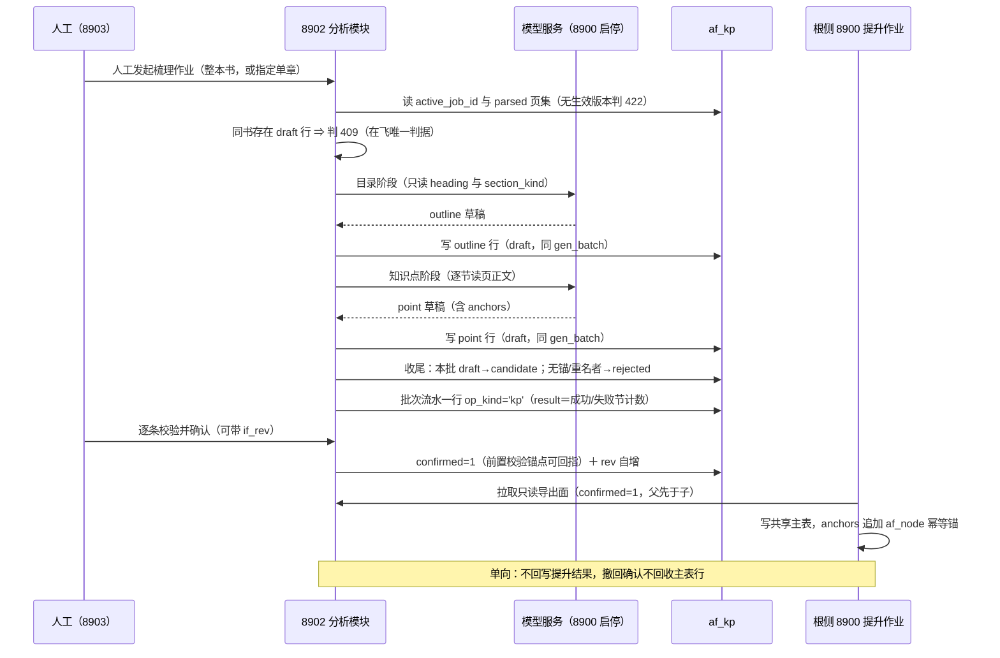

# 知识点梳理与提升设计（knowledge-analysis）

设计状态：Accepted
确认状态：已确认
实现状态：Not Started（af_* 存储形状已交付，梳理与提升通路零实现）
最后更新：2026-10-22
关联代码：`src/axiom_flow/db/`、`src/axiom_flow/orchestrator/`
关联测试：`tests/unit/test_db.py`、`tests/contract/test_api_v1_contract.py`
关联 ADR：[ADR 0004](../adr/0004-model-boundary-and-pipeline-ownership.md)、[ADR 0015](../adr/0015-db-single-source-for-readiness.md)、[ADR 0016](../adr/0016-af-family-rebuild-into-four-tables.md)、[ADR 0010](../adr/0010-page-regions-are-parse-inputs.md)

> **本篇回答的唯一问题**：在一册书的**已生效解析版本**之上，章／节／知识点**怎样被梳理出来、由谁写、
> 人怎么背书、背完给谁用**。列语义与键的事实源是 [database-design.md](../architecture/database-design.md)
> 第五章（本篇一处不复制）；端点参数与响应形状归 [api.md](../architecture/api.md)（本篇只写时序与
> 判据）；产物文件的布局与合格判据归 [parsing-pipeline.md](parsing-pipeline.md)（`PP-n`）。

## 目标与非目标

**目标**：

1. 给「谁产生 `draft`/`candidate`」一个唯一答案：机器梳理作业写来源，人工路径写背书，系统写归一与作废。
2. 让**批次**这个概念在没有批次表的前提下仍然可判据化——在飞、收尾、中断三态全部由列自身表达。
3. 把梳理结论**钉回产物**：每个知识点必须能回指到第几页哪几个版面块，否则它只是模型的又一次幻觉。
4. 让机器永远不与人工结论争同一身份：重跑梳理不得覆盖人已背书的结论，判据在写入路径而不是读侧。
5. 定死分析模块与检索面（向量／知识库）与根侧主表的分工，防止三条线互相伸手。
6. 把「并发」这一核心判据拆成**两条各自成立的轴**并都给出条文：关系侧的 `co_requisite` 对称语义
   （结构轴）与写入侧的「先读后判再写」禁形（通路轴，判据正本在
   [database-design.md](../architecture/database-design.md)「键与并发写入形态」）。两条轴都算，不因
   只讲其一而把另一条降级。

**非目标（各归其主）**：

- 提示词工程与梳理质量配方（C 类实验，须按 AGENTS.md 先冻结样本／内容哈希／预算／采纳门槛，另批）。
- 检索配方、向量索引与知识图谱（[roadmap](../trackers/roadmap.md) 的知识图谱线属独立评审；`af_kp` 不是它的替代品）。
- 8903 界面与 8900 提升作业的实现（根侧另批；本篇只到通路与时序）。
- 表结构与域值变更（→ [database-design.md](../architecture/database-design.md)；本篇只给消费判据）。
- 端点参数与响应字段（→ [api.md](../architecture/api.md)）。

## 边界与事实源

| 事项 | 本篇管 | 不管（事实源） |
| --- | --- | --- |
| `af_kp` 的列 | 谁写哪一列、写入时机、可见后果 | 列语义、键与索引：[database-design.md](../architecture/database-design.md) 的 `af_kp` 列清单 |
| 梳理作业 | 发起面、受理门、批次三态、失败语义、进度读法 | 端点形状：[api.md](../architecture/api.md) |
| 锚点 | 锚点怎样被解释、失效时怎么办 | 版面块结构与 `index` 含义：[PP-7~PP-10](parsing-pipeline.md)、页行与产物：[PP-3、PP-4](parsing-pipeline.md) |
| 长文叙述 | 落点路径、写入次序、孤儿文件处置 | 数据根白名单与逐本清除：[operations.md](../guides/operations.md)「数据目录」、[PP-4](parsing-pipeline.md) |
| 提升 | 本侧导出面的读判据与幂等锚的含义 | 主表结构与写者：[database-design.md](../architecture/database-design.md) 的共享表登记面（本侧只读不写） |
| 模型 | 「谁调用、调用账记哪张表」 | 模型生命周期与调用协议：[model-integration.md](model-integration.md)（`MI-n`）、根仓库 8900 |
| 检索／图谱 | 不管（只声明边界） | [roadmap](../trackers/roadmap.md) 与独立评审轮 |

## 核心设计

一条批次从发起到提升只经过七个动作：**人工发起 → 受理门 → 目录阶段 → 知识点阶段 → 收尾 → 人工确认 → 根侧拉取**。
每一跳都只有一个判据位，读侧不得另立判据；下表逐条给出「结论 ＋ 判据」。

### 通路总览（一条批次的一生）

### 确定规范

> 一行一条：**结论 ＋ 判据** ｜ **理由／例外／边界** ｜ **实现落点 → 守护测试**。编号 `KA-n` 在本篇内解析。

#### 取证输入与作业受理

| 编号 | 守则（结论 ＋ 判据） | 理由／例外／边界 | 实现落点 → 守护测试 |
| --- | --- | --- | --- |
| KA-1 | **梳理只针对生效版本**：受理时读 `af_books.active_job_id`，把它写进本批每行的 `job_id`；无生效版本即在受理前判 422，零写入。发起面唯一＝人工提交（`KA-24`） | 例外：人工直填不取证，落 `job_id=''`（与结构意图的哨兵同形）。为什么禁「对着不存在的版本梳理」：锚点将无处解释，结论无从复核 | `orchestrator/knowledge.py`（待实现）受理门 → `tests/contract/test_api_v1_contract.py`（无生效版本判 422） |
| KA-2 | **取证页集＝该版本内 `af_pages.status='parsed'` 的页**，正文经文件通路逐页读 `pages/p<NNNN>.md` 与 `p<NNNN>.blocks.json`（批量、单次多页） | 边界：**不读 `chunks.json`**——知识块（chunk）是检索单元、按 [PP-19](parsing-pipeline.md) 为切分预算服务，且它是可重建的派生文件；知识点是教学结构单元，两者的唯一交集只有坐标空间。缺页不建半批：缺文件的页剔出取证集并在批次流水里计数披露（`KA-27`）。边界：[PP-13](parsing-pipeline.md) 已承诺「有 `parsed` 页行即有版本内产物」，文件仍缺时说明磁盘被外部清退（重建窗口或人工清理），本模块只按缺页处理，**不改判 DB 状态**——就绪的唯一事实源仍是 DB | `orchestrator/knowledge.py`（待实现）取证集构造 → `tests/unit/test_knowledge_pipeline.py`（缺页剔除且计数可见） |
| KA-3 | **确认门不是梳理的门槛，而是外发的门槛**：梳理可取证未确认页；但 `confirmed` 置位的前置校验含「该行锚点所指页在取证版本内已 `confirmed` 或全书页确认门尚未启用」，导出面对锚点页未确认的行给复核提示 | 为什么分开：页确认门（每页人工确认后才进知识块）落地前若把梳理也锁上，分析模块就没有可跑的现场；但结论外发给主表必须踩在已校验的产物上。代价：未确认页的结论会带 warning 出现在导出面 | `orchestrator/knowledge.py`（待实现）确认前置校验 → `tests/unit/test_knowledge_pipeline.py`（未确认锚点不阻断确认、但导出可见标记） |
| KA-4 | **同书同时至多一个在飞批次**：在飞判据＝该书存在 `gen_status='draft'` 的行；命中即判 409。跨书不并发，沿用单 worker 串行队列与单实例部署前提（[PM-13](parsing-management.md)） | 为什么判据落在 `af_kp` 而不是流水行：事件行只答「发生过什么」、永不参与当前态判据（[database-design.md](../architecture/database-design.md)「服务端不变式」），用它表达「跑没跑完」会当场造出第二事实源。例外：`draft` 残留超一个进程生命周期时由启动期归一处置（`KA-9`）。边界：单章批次同样受本条约束——在飞唯一性按书算，不按章算（`KA-25`） | `db/repositories.py:KpRepository.find_draft_batch`（待实现） → `tests/contract/test_api_v1_contract.py`（双批次 409） |

#### 结构生产：先目录、后知识点

| 编号 | 守则（结论 ＋ 判据） | 理由／例外／边界 | 实现落点 → 守护测试 |
| --- | --- | --- | --- |
| KA-5 | **一个批次内固定两阶段：先目录（outline）后知识点（point）**。目录阶段只读每页的 heading 版面块序列 + `section_kind` + 页序，产出 `depth∈{1,2}` 的两层目录；知识点阶段按节的页区间读正文逐节抽点 | 为什么先目录：知识点必须挂父，父不存在会产出成堆未归档行；且目录阶段的输入全是结构化读数，失败面与吞吐都小。代价：正文被读两遍（一遍取 heading，一遍抽点） | `orchestrator/knowledge.py:build_outline` / `extract_points`（待实现） → `tests/unit/test_knowledge_pipeline.py`（目录先于点写入的次序断言） |
| KA-6 | **目录最多两层，深度越界即拒**：`depth=1` 章、`depth=2` 节，第三层不进 `af_kp`，作为知识点的 `name` 前缀或 `summary` 承载 | 与共享主表的 outline→point 两层口径一致（提升零转换）。为什么不留三层：一旦留，提升面就要在根侧再造一层，跨仓语义分叉 | `orchestrator/knowledge.py`（待实现）目录构造 → `tests/unit/test_knowledge_pipeline.py`（第三层标题不落节点） |
| KA-7 | **未归档池是一等公民**：`node_kind='point'` 且 `parent_id IS NULL` 的行＝未归档池；「重新编排目录」只改 `parent_id` 与 `order_hint`，**不删不重建** | 为什么：抽点时归属不确定是常态，硬挂父会造出假结构。未归档行照样可确认、可提升（根侧自行归位）。收敛责任归人工，机器不得自动补挂父（`KA-26`） | `api/main.py` KP 端点（待实现）+ `KpRepository`（待实现） → `tests/contract/test_api_v1_contract.py`（重排只改两列、行数不变） |
| KA-8 | **目录整批声明的「缺席即撤销」只降级、不删除**：全量声明 outline 集合时，缺席的 outline 行不下线，其子 point 退入未归档池（`parent_id=NULL`），并在同一事务内对同一把 `af_books` 行锁完成（判据同 [database-design.md](../architecture/database-design.md)「键与并发写入形态」的整批声明行锁条） | 为什么：outline 行可能被别的 point 的 `links` 引用，删行就造出悬空边（「删除必须清引用边」不变式的代价面）。代价：盘上留着人已看过但当前不在目录里的节 | `KpRepository.replace_outline`（待实现，锁内） → `tests/unit/test_db_knowledge.py`（缺席 outline 的子点退池、零删除） |

#### 批次、写者与状态机

| 编号 | 守则（结论 ＋ 判据） | 理由／例外／边界 | 实现落点 → 守护测试 |
| --- | --- | --- | --- |
| KA-9 | **批次三态全由 `gen_status` 自身表达**：在飞＝该书存在 `draft` 行；收尾＝作业最后一步单语句条件 UPDATE 把本批全部 `draft→candidate`；中断＝启动期归一把残留 `draft` 整批判 `rejected`。人工新建行的 `gen_batch=''`（不属任何批次） | 为什么不需要批次表：「保留最新 2 批」（[database-design.md](../architecture/database-design.md)「保留与裁剪」）的分组键、裁剪管辖范围、在飞判据都只读这一列就够。改写方向唯一（`draft→candidate` 或 `draft→rejected`），与 parse 行「只向更终方向回写」同构。例外：`rejected` 由人判不可用与系统归一共用，靠 `actor` 分列 | `orchestrator/knowledge.py:finalize_batch`、`KpRepository.reconcile_draft_on_startup`（待实现） → `tests/unit/test_knowledge_pipeline.py`（收尾翻转、重启归一各一例） |
| KA-10 | **批次身份 `gen_batch` 值形 `afkp-<hex12>`，服务端随机发放、一经写入同批同值不可变**；「最新」按行内 `created_at` 分组取，不要求批次名可排序 | 与 `node_id`／`op_id` 的发放方式一致（内容摘要会把「重跑」变成「同批」这类意外）。代价：批次名单看不出先后，读侧必须靠时间 | `orchestrator/knowledge.py`（待实现）批次号发放 → `tests/unit/test_knowledge_pipeline.py`（同批同值） |
| KA-11 | **三个写者，各自的列域不重叠**：机器写来源域（身份、结构、锚点、`summary`、`gen_batch`、`model_ref`、`gen_status`），`confirmed` 恒写 0；人工写背书域（名称、结构挂载、`links`、`anchors`、`role`/`type`、`summary`）与 `confirmed` 位；系统只写归一与裁剪两条路径 | 机器与人工分列互不覆据（「人工位只有人工可写」不变式的推广，见 [database-design.md](../architecture/database-design.md)「服务端不变式」）；「谁做的」是裁决不是细节，所以分列而非塞 `meta` | `db/repositories.py:KpRepository`（待实现，三条写入口分别收口） → `tests/unit/test_db_knowledge.py`（自动批次跑完 `confirmed` 计数不变） |
| KA-12 | **人工修改不改 `gen_batch` 也不改 `model_ref`**，只 `rev+1`；行的来源（哪一批、哪个模型产的）保持原值 | 为什么：改 `model_ref` 就把「产出者」与「最后编辑者」挤进同一列，两者都要时必漂移；来源是审计事实，人工修订是另一个事实。代价：逐次修改史不保留（与解析模块同口径，非回归） | `db/repositories.py:KpRepository`（待实现，人工写入口） → `tests/unit/test_db_knowledge.py`（人工改写后两列原值不变） |
| KA-13 | **机器永远不与人工结论争同一身份**：收尾时对「同父同 `norm_key` 且已存在 `confirmed=1` 行」的新机器行判 `rejected`（不合并、不覆盖、不新增），并在批次流水里计数（`KA-27`） | 判据的唯一形式＝让位方向固定。为什么不是「人工行被机器更新」：那等于机器有权撤销人的背书，`confirmed` 就成了装饰 | `orchestrator/knowledge.py:finalize_batch`（待实现）让位分支 → `tests/unit/test_knowledge_pipeline.py`（重跑不碰已确认行、新行判 rejected） |

#### 人工背书与提升通路

| 编号 | 守则（结论 ＋ 判据） | 理由／例外／边界 | 实现落点 → 守护测试 |
| --- | --- | --- | --- |
| KA-14 | **确认的前置校验＝可回指**：置 `confirmed=1` 要求 `anchors` 非空、每条锚点页在取证版本的页集内、且 `links[].to` 全部存在；不满足即 422 并点名缺失项 | 为什么：回指是「梳理结论」与「模型幻觉」的唯一分界；无锚的点一旦进主表，后续无人能复核。例外：`role`/`type`/`summary` 允许空，它们是描述不是证据 | `KpRepository.confirm`（待实现） → `tests/contract/test_api_v1_contract.py`（无锚判 422） |
| KA-15 | **导出面＝`confirmed=1` 的行，一次给全一册，按 outline 先于 point 的拓扑序输出**，每行带 `rev` 与 `updated_at` 供拉取方做增量与幂等 | 用户的裁决口径是「确认后同步到共享知识点表」，外发判据只有人工确认位一个。代价：无确认行的进度不在导出面里，靠批次流水披露（`KA-27`） | `api/main.py` 只读导出端点（待实现，形状随 [api.md](../architecture/api.md)） → `tests/contract/test_api_v1_contract.py`（导出集恰为 confirmed=1 且父先于子） |
| KA-16 | **提升是 8900 拉取式单向，本组件不直写共享主表、不回写提升结果**；`anchors` 追加 `{kind:'af_node', ref_id:<node_id>}` 由拉取方写，是重复提升的幂等锚 | 唯一写者不变（共享表登记面红线）。为什么锚落 `anchors` 而非 `meta`：`meta` 禁进 WHERE，无法反查。代价：工作区侧看不出「哪条已进了主表」，要看得读主表 | `api/main.py`（只读导出） → 契约测试断言 `src/` 对 `qed_knowledge_point` 的写引用数恒为 0 |
| KA-17 | **撤回确认不回收主表行**：`confirmed` 1→0 只影响本侧导出面，本组件不发删除、不发消息；已提升行由根侧自行处置 | 为什么：跨仓做反向删除会造出第二条写路径与分布式一致性问题，收益不成比例。代价：主表可能留旧行，导出面的响应必须如实写明「本侧已撤回」 | `KpRepository.set_confirmed`（待实现） → `tests/unit/test_db_knowledge.py`（撤回只改本侧列，零外部调用） |

#### 与解析模块的衔接（锚点与长文）

| 编号 | 守则（结论 ＋ 判据） | 理由／例外／边界 | 实现落点 → 守护测试 |
| --- | --- | --- | --- |
| KA-18 | **锚点一律按行上的 `job_id` 那一版解释**：`anchors[].page` 是 PDF 页序（与 `af_pages.page_no` 同域），`block_indexes` 是该版 `blocks.json` 的块序空间；生效版本换了**不改写**锚点读数 | 这是「`job_id` 不进作用域键」的对应代价（见 [database-design.md](../architecture/database-design.md)「跨版本存活」）：结论跨版本存活，证据固定在取证版本。例外：`job_id=''` 的人工直填行无锚可解释，只可靠 `summary` | `KpRepository.list_for_book`（待实现）按行取证版分组 → `tests/unit/test_db_knowledge.py`（换生效版本后锚点读数不变） |
| KA-19 | **换版或重新 ingest 后锚点越界＝可见保留，不静默改写、不静默删**：读侧带「锚点待复核」标记，处置动作交人工（重挂锚点或撤确认） | 与结构意图行的越界判据同形（[ADR 0010](../adr/0010-page-regions-are-parse-inputs.md) 决定 1 的先例），族内只有一种「失效怎么办」 | `orchestrator/knowledge.py`（待实现）锚点校验 → `tests/contract/test_api_v1_contract.py`（越界行仍 200 且带标记） |
| KA-20 | **长文落书目产物目录内、`narrative_ref` 只存单段文件名**：完整路径派生为 `<book_dir>/kp/<node_id>.md`，写在行提交之后；写入用「临时文件 → 校验 → 原子替换」（[PP-4](parsing-pipeline.md)） | 为什么不存数据根相对路径：书目录含 `domain_id/course_id`，重新同步可能带回新值，存全路径会让长文一夜之间指向不存在。为什么落书目录内：逐本删除与管理面清除天然覆盖它，不留孤儿。代价：文件名即节点身份，节点不能改名换身份（`node_id` 本来就不可变） | `orchestrator/knowledge.py:write_narrative`（待实现） → `tests/unit/test_knowledge_pipeline.py`（原子写 + 删行后无孤儿文件，或孤儿被只读清单点名） |
| KA-21 | **删除节点与清引用边同事务**（「删除必须清引用边」不变式），长文文件在事务提交后清；清理失败只告警，残留下一次由「只读清单先行」的裁剪流程收口（[database-design.md](../architecture/database-design.md)「保留与裁剪」） | 为什么不在事务里删文件：文件删除不可回滚，事务回滚会把已删正文变成数据丢失。代价：瞬态孤儿文件可见 | `KpRepository.delete_node`（待实现） → `tests/unit/test_db_knowledge.py`（引用边清空 + 孤儿只告警） |

#### 模型调用与调用账

| 编号 | 守则（结论 ＋ 判据） | 理由／例外／边界 | 实现落点 → 守护测试 |
| --- | --- | --- | --- |
| KA-22 | **梳理调用与解析调用同走适配层，编排层不感知模型地址、参数与服务生命周期**（模型生命周期归根仓库 8900）；引擎名缺配即受理报错，不静默回落 | [PM-7](parsing-management.md) 与 [MI-2~MI-5](model-integration.md) 原样延长：分析模块是新增的调用方，不是新增的边界。代价：梳理需要一个文本类引擎槽位，未接入前该作业种类判 503（探活语义同提交期） | `engines/factory.py` 槽位 + `orchestrator/knowledge.py`（待实现） → `tests/unit/test_engine_factory.py`（闭集外拒绝）、`tests/unit/test_knowledge_pipeline.py`（未接入判 503） |
| KA-23 | **梳理作业必须与 `qed_llm_calls` 写入同批交付**：本组件对该表只写审计行、不改结构（`service='axiom_flow'`），实现状态现为**未实现** | 为什么绑在一起：梳理是本组件第一次真正的文本 LLM 花费，没有调用账就没有「花了多少、哪次跑的」的唯一证据；把账目推到下一批等于永久欠账 | `infrastructure` 侧写入通路（待立项） → `tests/integration/`（真 MySQL 层断言追加一行、且结构未被 ALTER） |

#### 发起面与批次流水（结构请求与开放裁决了结后的补充条文）

| 编号 | 守则（结论 ＋ 判据） | 理由／例外／边界 | 实现落点 → 守护测试 |
| --- | --- | --- | --- |
| KA-24 | **梳理只由人工发起**：受理门的唯一入口是人工提交（8903 按书点「梳理这本书」，或指定单章）；版本激活、解析终态落库、启动期归一**都不排批**。判据＝一次版本激活后 `af_kp` 行数与 `op_kind='kp'` 流水行数逐本不变 | 为什么默认关：自动梳理会在每个新版本上重跑一批机器结论，把「最新 2 批」的名额花在没人看的批次上，且 LLM 花费直接挂账（`KA-23` 是同一门）。边界：发起是「一册书一次决定」而不是「一版一次义务」——结论跨版本存活（`KA-18`），换版不产生重跑责任 | `api/main.py` 梳理提交端点（待实现，形状随 [api.md](../architecture/api.md)） → `tests/contract/test_api_v1_contract.py`（激活版本后 `af_kp` 与 kp 流水计数不变） |
| KA-25 | **批次粒度＝整本书为默认，人工发起时可指定单章范围**：一个批次仍只有一个 `gen_batch`；给定范围时取证集只含该范围内的页（`KA-2` 的构造接一个可选页区间），目录阶段按该范围成树。**「保留最新 2 批」按 `book_id` 计数、不按章计数**（分组键 `book_id + gen_batch` 不变） | 为什么按书算：批次表不建，名额只能按书读——若按章计数，同书各章批次互相挤占，判据就变成「每章各自最新 2 批」，读侧必须再造一份批次归属（即批次表复活）。边界：单章批次不自动续排（`KA-24`），也不给整本批次让路；跨章的次序边仍按**全节点集**做 DAG 校验，不因范围缩小而放宽 | `orchestrator/knowledge.py`（待实现）批次范围参数 → `tests/unit/test_knowledge_pipeline.py`（同书连发三个单章批次后，裁剪清单按书只保护最近 2 批） |
| KA-26 | **未归档池的收敛只由人工做**：机器不得为了给散点找父而新增一次挂父写入。point 行的 `parent_id` 只有两种合法来源——本批目录阶段给出的、能在同批 outline 行里回指的父，或 `NULL`（入池）。判据＝重跑批次后人已挂父的行 `parent_id` 读数逐行不变 | 为什么：机器「猜父」会把 `KA-7` 的未归档池从一等公民降成兜底，且假结构比空结构更难发现。与 `KA-13` 同轴——机器不改人的结构结论，也不替人补结构结论。边界：本批新生成的 point 行仍可由机器挂本批 outline 父，这正是 `KA-5` 先目录后知识点的存在理由，不在禁止之列 | `orchestrator/knowledge.py:finalize_batch`（待实现）挂父来源校验 → `tests/unit/test_knowledge_pipeline.py`（重跑不改人工 `parent_id`、机器新父必属同批目录） |
| KA-27 | **批次流水的持久落点＝`af_operations` 一行 `op_kind='kp'`**：`lifecycle='event'`、`job_id`＝该批取证版本、`target_id`＝节点、`result`＝成功/失败节计数；整批一行还是逐节点一行由实现批按「一次能读全批做了什么」定，判据位不变（只有 `result` 与计数）。**禁作当前态判据**：三态只由 `gen_status` 表达（`KA-9`），流水只答「发生过什么」。本轮**建值不建写者**⇒ 当前任何路径写出的该值计数恒 0 | 为什么必须有这一行：裁决前明细只能进 `logs/`，而日志文件数 ≤3 且明文不作为事实源，失败节计数无法被 8903 读出；导出面又只给已确认集（`KA-15`），两头都看不见「这一批做了什么」。代价：形状封闭但写者缺席，直到实现批交出插入腿——守护断言在此期间恒绿 | `db/repositories.py`（`op_kind='kp'` 的插入腿待实现批） → `tests/unit/test_db.py`（无写者值计数恒 0） |
| KA-28 | **`gen_status` 域内不设第二个人工终态位**：闭集＝`draft`/`candidate`/`rejected` 三值且只有机器写；人工终态的唯一判据位是 `confirmed`（`KA-11`、`KA-14`）。任何路径写出域外值即守护转红 | 为什么删旧值：「人已采纳」与 `confirmed=1` 是同一事实两处存，必漂移——这是族内红线，也是不可裁剪判据只读 `confirmed` 的原因。代价：「人看过但没采纳」这类中间态在工作区侧**没有列**，只能由 `rev`/`updated_at` 与人工界面自己的读数表达 | `db/models.py:GEN_STATUSES` → `tests/unit/test_db.py`（域外值计数恒 0） |

## 失败与质量语义

| 场景 | 判据 | 后果与读法 |
| --- | --- | --- |
| 无生效版本就提交梳理 | 受理前判 422，零写入 | 与 legacy 拒绝一切结构操作同形；不给「对着空气建批次」留路径 |
| 版本激活后系统想自动排批 | 不存在这条路径（`KA-24`）：激活只改 `af_books.active_job_id` 一列 | 自动排批的代价是「最新 2 批」花在没人看的批次上、且花费无归因；本条是裁决而不是优化 |
| 单节抽取失败 | 该节不落行，批内继续；失败节在批次流水的 `result` 里结构化计数（不截断页码/节名） | 整批不失败——一节坏了不等于这本书坏了（[PP-11](parsing-pipeline.md) 的窗口失败域语义延长到逐节） |
| 模型输出不合形状（缺 `name`／`anchors` 为空／`links` 指向不存在的点） | 该节点不写；计数披露 | 受理门的形状校验先于写库，宁可少产出也不产出无法复核的行 |
| 进程中途死 | 残留 `draft` 行＝中断批次；启动期归一整批判 `rejected` 并告警 | 不删数据、不改 candidate 以上任何行；`rejected` 行不进导出面、不占「最新 2 批」名额 |
| DAG 成环 | 收尾时整批一次 DFS 校验（次序语义只覆盖 `prerequisite` 与 `extends`，见 [database-design.md](../architecture/database-design.md)「服务端不变式」），成环即拒该边并回指环路径 | 次序语义必须由库侧守住，否则根侧的复习序列拿到的是假图；`co_requisite` 允许成环（它不是次序语义） |
| 同父重名 | 服务端按 `ix_af_kp_norm` 查重后 422 并点名既有 `node_id` | 不建唯一键的代价是校验必须在受理门，判据只有一处 |
| 全部批次都未确认 | 导出面返回空集且 200 | 空是事实不是错误——读取面纯 DB 驱动，空列表与报错分得很清 |

## 验收判据

1. 受理门三形可判：无生效版本 422／同书在飞批次 409／正常建批并回批次号。
2. 批次状态机闭环：`draft→candidate` 只在收尾发生；重启后残留 `draft` 整批转 `rejected`；`candidate` 及以上行零被触碰。
3. 人工位不可被机器写：自动批次全跑完后 `confirmed` 计数逐本不变（`KA-11` 的反向判据）。
4. 重跑让位：与已确认行同父同 `norm_key` 的新机器行判 `rejected`，已确认行的列值逐列不变。
5. `if_rev` 双会话取证：读 `rev=n` 后他人写到 `rev=m`，带 `if_rev=n` 的提交 409 且响应含最新 `rev`。
6. 目录整批声明的缺席只降级：缺席 outline 的子点 `parent_id` 归 `NULL`，节点总行数不变、无引用边悬空。
7. 导出面判据：行集合恰为 `confirmed=1`，父先于子，逐行带 `rev`；未确认行与 `rejected` 行不出现。
8. 锚点跨版本不变：切换 `active_job_id` 后，同一行的 `anchors` 读数与「按其取证版本解释」的结果一致；越界行带待复核标记且仍可读。
9. 长文通路：写入走原子替换，行删除后无孤儿文件（或有则被只读清单点名）；`narrative_ref` 值恒为单段文件名。
10. 调用账同批：一次梳理作业在 `qed_llm_calls` 留下对应追加行，且该表未被本组件 ALTER。
11. 域值收窄可守：`gen_status` 闭集只有三值，任何路径写出域外值（含被删除的旧值）⇒ 计数恒 0 的守护转红；`op_kind='kp'` 行在实现批交出插入腿之前计数恒 0。
12. 发起面唯一：一次版本激活不产生任何 `af_kp` 行与 `op_kind='kp'` 流水（逐本行数不变）。
13. 单章批次按书计数：同一本书连发三个单章批次后，裁剪清单只保护最近 2 个批次（分组键 `book_id + gen_batch`）；且重跑后人工 `parent_id` 读数逐行不变。

## 追溯

- **唯一事实源指针**：列与键 → [database-design.md](../architecture/database-design.md) 的「af_kp 列清单」「服务端不变式」「键与并发写入形态」「保留与裁剪」「提升通路」「流程落点」；
  端点形状 → [api.md](../architecture/api.md)；产物合格判据 → [parsing-pipeline.md](parsing-pipeline.md)；
  任务与书目状态流转 → [parsing-management.md](parsing-management.md)。本篇不复制上述任何一张表。
- **决策依据**：[ADR 0016](../adr/0016-af-family-rebuild-into-four-tables.md)（四表形状与事件／意图分工、
  `links` 越闸的例外与转表触发判据、扩展槽与「建值不建写者」的代价条款）、
  [ADR 0015](../adr/0015-db-single-source-for-readiness.md)（就绪唯一源）、
  [ADR 0010](../adr/0010-page-regions-are-parse-inputs.md)（人工结构意图跨版本存活的先例）。
- **承载沿革**：本篇正文由 `docs/history/plans/2026-10/2026-10-21-af-table-family-rebuild.md` 的「分析模块设计」节晋升而来，
  `KA-1~KA-23` 编号原样保留；`KA-24~KA-28` 是该壳内两项结构请求与四项开放裁决了结后新增的条文，
  裁决原文与判定过程只留在那枚计划壳的「用户裁决」表（⑰⑱ 两行）。本篇正文不引用计划壳条文编号。
- **实现批**：`af_kp` 的写入路径、只读导出端点、8903 确认界面与 8900 拉取式提升作业为同一批交付
  （`KA-23` 与 `KA-27` 的写者随该批落地）；在此之前本篇全部是设计而非现状，`src/` 内零实现。
- **已知欠账（不在本篇解决）**：`qed_llm_calls` 的本侧写入尚未实现；梳理质量与提示词配方属 C 类实验，
  须先冻结样本／内容哈希／预算／采纳门槛（AGENTS.md 外部模型实验前置）；检索与知识图谱线与本篇形状
  无交集，其未来的列请求按 `database-design.md` 的承载力审计节另行评审。
