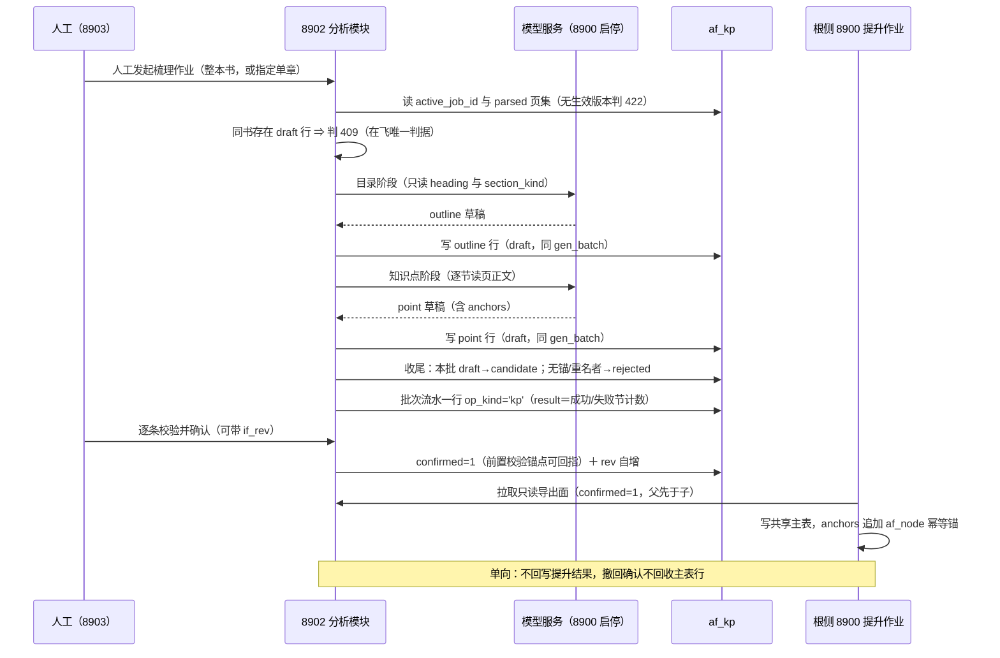

# 知识点梳理与提升设计（knowledge-analysis）

设计状态：Accepted
确认状态：已确认
实现状态：In Progress（本侧通路已交付；真机梳理窗口未落）
最后更新：2026-10-29
关联代码：`src/axiom_flow/db/`、`src/axiom_flow/orchestrator/`、`src/axiom_flow/engines/`、`src/axiom_flow/api/`
关联测试：`tests/unit/test_db.py`、`tests/unit/test_db_knowledge.py`、`tests/unit/test_knowledge_pipeline.py`、`tests/unit/test_db_llm_ledger.py`、`tests/unit/test_engine_factory.py`、`tests/contract/test_api_v1_contract.py`、`tests/integration/test_llm_call_ledger.py`
关联 ADR：[ADR 0004](../adr/0004-model-boundary-and-pipeline-ownership.md)、[ADR 0015](../adr/0015-db-single-source-for-readiness.md)、[ADR 0016](../adr/0016-af-family-rebuild-into-four-tables.md)、[ADR 0010](../adr/0010-page-regions-are-parse-inputs.md)

> **本篇回答的唯一问题**：在一册书的**已生效解析版本**之上，章／节／知识点**怎样被梳理出来、由谁写、
> 人怎么背书、背完给谁用**。列语义与键的事实源是 [database-design.md](../architecture/database-design.md)
> 第五章（本篇一处不复制）；端点参数与响应形状归 [api.md](../architecture/api.md)（本篇只写时序与
> 判据）；产物文件的布局与合格判据归 [parsing-pipeline.md](parsing-pipeline.md)（`PP-n`）。

## 目标与非目标

**目标**：

1. 给「谁产生 `draft`/`candidate`」一个唯一答案：机器梳理作业写来源，人工路径写背书，系统写归一与作废。
2. 让**批次**这个概念在没有批次表的前提下仍然可判据化——在飞、收尾、中断三态全部由列自身表达。
3. 把梳理结论**钉回产物**：每个知识点必须能回指到第几页哪几个版面块，否则它只是模型的又一次幻觉。
4. 让机器永远不与人工结论争同一身份：重跑梳理不得覆盖人已背书的结论，判据在写入路径而不是读侧。
5. 定死分析模块与检索面（向量／知识库）与根侧主表的分工，防止三条线互相伸手。
6. 把「并发」这一核心判据拆成**两条各自成立的轴**并都给出条文：关系侧的 `co_requisite` 对称语义
   （结构轴）与写入侧的「先读后判再写」禁形（通路轴，判据正本在
   [database-design.md](../architecture/database-design.md)「键与并发写入形态」）。两条轴都算，不因
   只讲其一而把另一条降级。

**非目标（各归其主）**：

- 提示词工程与梳理质量配方（C 类实验，须按 AGENTS.md 先冻结样本／内容哈希／预算／采纳门槛，另批）。
- 检索配方、向量索引与知识图谱（[roadmap](../trackers/roadmap.md) 的知识图谱线属独立评审；`af_kp` 不是它的替代品）。
- 8903 界面与 8900 提升作业的实现（根侧另批；本篇只到通路与时序）。
- 表结构与域值变更（→ [database-design.md](../architecture/database-design.md)；本篇只给消费判据）。
- 端点参数与响应字段（→ [api.md](../architecture/api.md)）。

## 边界与事实源

| 事项 | 本篇管 | 不管（事实源） |
| --- | --- | --- |
| `af_kp` 的列 | 谁写哪一列、写入时机、可见后果 | 列语义、键与索引：[database-design.md](../architecture/database-design.md) 的 `af_kp` 列清单 |
| 梳理作业 | 发起面、受理门、批次三态、失败语义、进度读法 | 端点形状：[api.md](../architecture/api.md) |
| 锚点 | 锚点怎样被解释、失效时怎么办 | 版面块结构与 `index` 含义：[PP-7~PP-10](parsing-pipeline.md)、页行与产物：[PP-3、PP-4](parsing-pipeline.md) |
| 长文叙述 | 落点路径、写入次序、孤儿文件处置 | 数据根白名单与逐本清除：[operations.md](../guides/operations.md)「数据目录」、[PP-4](parsing-pipeline.md) |
| 提升 | 本侧导出面的读判据与幂等锚的含义 | 主表结构与写者：[database-design.md](../architecture/database-design.md) 的共享表登记面（本侧只读不写） |
| 模型 | 「谁调用、调用账记哪张表」 | 模型生命周期与调用协议：[model-integration.md](model-integration.md)（`MI-n`）、根仓库 8900 |
| 检索／图谱 | 不管（只声明边界） | [roadmap](../trackers/roadmap.md) 与独立评审轮 |

## 核心设计

一条批次从发起到提升只经过七个动作：**人工发起 → 受理门 → 目录阶段 → 知识点阶段 → 收尾 → 人工确认 → 根侧拉取**。
每一跳都只有一个判据位，读侧不得另立判据；下表逐条给出「结论 ＋ 判据」。

### 通路总览（一条批次的一生）

### 确定规范

> 一行一条：**结论 ＋ 判据** ｜ **理由／例外／边界** ｜ **实现落点 → 守护测试**。编号 `KA-n` 在本篇内解析。

#### 取证输入与作业受理

| 编号 | 守则（结论 ＋ 判据） | 理由／例外／边界 | 实现落点 → 守护测试 |
| --- | --- | --- | --- |
| KA-1 | **梳理只针对生效版本**：受理时读 `af_books.active_job_id`，把它写进本批每行的 `job_id`；无生效版本即在受理前判 422，零写入。发起面唯一＝人工提交（`KA-24`） | 例外：人工直填不取证，落 `job_id=''`（与结构意图的哨兵同形）。为什么禁「对着不存在的版本梳理」：锚点将无处解释，结论无从复核 | `orchestrator/knowledge.py:accept_kp_job`（四道门全排在写任何行之前）＋ `api/main.py` 的 `POST /api/v1/kp-jobs` → `tests/unit/test_knowledge_pipeline.py::TestAcceptanceGate`（404／422 零写入／409 点名既有批次／发号形状）、`tests/contract/test_api_v1_contract.py`（无生效版本判 422） |
| KA-2 | **取证页集＝该版本内 `af_pages.status='parsed'` 的页**，正文经文件通路逐页读 `pages/p<NNNN>.md` 与 `p<NNNN>.blocks.json`（批量、单次多页） | 边界：**不读 `chunks.json`**——知识块（chunk）是检索单元、按 [PP-19](parsing-pipeline.md) 为切分预算服务，且它是可重建的派生文件；知识点是教学结构单元，两者的唯一交集只有坐标空间。缺页不建半批：缺文件的页剔出取证集并在批次流水里计数披露（`KA-27`）。边界：[PP-13](parsing-pipeline.md) 已承诺「有 `parsed` 页行即有版本内产物」，文件仍缺时说明磁盘被外部清退（重建窗口或人工清理），本模块只按缺页处理，**不改判 DB 状态**——就绪的唯一事实源仍是 DB | `orchestrator/knowledge.py:build_evidence_set`（`status='parsed'` ∩ 请求区间 ∩ `.md` 与 `.blocks.json` 成对在位；标题序列先按 [PM-5](parsing-management.md) 的覆盖层回放人工类型改判再筛 `heading`——改判出 `heading` 的块（如被判成 `header` 的页眉）不进目录阶段，改判进 `heading` 的块（如漏判成正文的标题）进） → `tests/unit/test_knowledge_pipeline.py`（缺页剔除且计数可见、`TestHumanRelabelIsReplayed` 四形含两条反向断言、`TestCurationStripsFurniture` 五形＝逐页家具读数与取材剔除面，判据本体在 `KA-29`） |
| KA-3 | **确认门不是梳理的门槛，而是外发的门槛**：梳理可取证未确认页；但 `confirmed` 置位的前置校验含「该行锚点所指页在取证版本内已 `confirmed` 或全书页确认门尚未启用」，导出面对锚点页未确认的行给复核提示 | 为什么分开：页确认门（每页人工确认后才进知识块）落地前若把梳理也锁上，分析模块就没有可跑的现场；但结论外发给主表必须踩在已校验的产物上。代价：未确认页的结论会带 warning 出现在导出面 | `orchestrator/knowledge.py:validate_endorsement_links` 与 `unconfirmed_anchor_flags`（确认腿与导出腿分列） → `tests/unit/test_knowledge_pipeline.py`（未确认锚点不阻断确认、但导出可见标记） |
| KA-4 | **同书同时至多一个在飞批次**：在飞判据＝该书存在 `gen_status='draft'` 的行；命中即判 409。跨书不并发，沿用单 worker 串行队列与单实例部署前提（[PM-13](parsing-management.md)） | 为什么判据落在 `af_kp` 而不是流水行：事件行只答「发生过什么」、永不参与当前态判据（[database-design.md](../architecture/database-design.md)「服务端不变式」），用它表达「跑没跑完」会当场造出第二事实源。例外：`draft` 残留超一个进程生命周期时由启动期归一处置（`KA-9`）。边界：单章批次同样受本条约束——在飞唯一性按书算，不按章算（`KA-25`） | `db/repositories.py:KpRepository.find_draft_batch` ＋ `run_knowledge_job` 的执行期复查（他人 `draft` 当场 409、同批不自我否决） → `tests/contract/test_api_v1_contract.py`（双批次 409） |

#### 结构生产：先目录、后知识点

| 编号 | 守则（结论 ＋ 判据） | 理由／例外／边界 | 实现落点 → 守护测试 |
| --- | --- | --- | --- |
| KA-5 | **一个批次内固定两阶段：先目录（outline）后知识点（point）**。目录阶段的输入＝每页的 heading 版面块序列 + `section_kind` + 页序，**再加一条书自身目录页的条目腿**（`KA-33`＝拆条目 → 印刷页码偏移标定 → 名称回正文定位，条目读数与真 heading 走同一套行格式：`page`／`block_index`／`level`）；**目录行由「模型整理出的条目 → 单页失败该页回落条目腿 → 全书零条目才退到 heading 块」三档成行**（`KA-35`＝正腿是模型判页与逐页整理、条目腿降为回落面，层级取读数自带的 level）；产出 `depth∈{1,2}` 的两层目录；知识点阶段按节的页区间读正文逐节抽点，且只在本批 `stage='full'` 时发起（`KA-34`） | 为什么先目录：知识点必须挂父，父不存在会产出成堆未归档行；且目录阶段的输入全是结构化读数，失败面与吞吐都小。代价：正文被读两遍（一遍取 heading，一遍抽点）。为什么条目腿开在取材层而不是改写 prompt：现网存在整本零 `heading` 块的教材——「若某页是书自身的目录页就把条目按层级认下来」这条规则早已在册，缺的是**输入**而不是指令，改指令只会让同一条规则有两处口径 | `orchestrator/knowledge.py:build_outline` / `extract_points`（`run_knowledge_job` 内目录行按 `KA-40` **边整理边落库**、全部先于点行）＋ `normalize/toc.py`（条目腿三条纯函数，判据正文见 `KA-33`） → `tests/unit/test_knowledge_pipeline.py`（目录先于点写入的次序断言、`TestTocEntryLeg` 五条（回落面）、`TestModelLedOutline`（正腿＝模型逐页整理出的条目，单页故障只坏那一页） |
| KA-6 | **目录最多两层，深度越界即拒**：`depth=1` 章、`depth=2` 节，第三层不进 `af_kp`，作为知识点的 `name` 前缀或 `summary` 承载 | 与共享主表的 outline→point 两层口径一致（提升零转换）。为什么不留三层：一旦留，提升面就要在根侧再造一层，跨仓语义分叉 | `orchestrator/knowledge.py:build_outline`（`OUTLINE_MAX_DEPTH` 封顶两层，越界单列计数、不进节点） → `tests/unit/test_knowledge_pipeline.py`（第三层标题不落节点） |
| KA-7 | **未归档池是一等公民**：`node_kind='point'` 且 `parent_id IS NULL` 的行＝未归档池；「重新编排目录」只改 `parent_id` 与 `order_hint`，**不删不重建** | 为什么：抽点时归属不确定是常态，硬挂父会造出假结构。未归档行照样可确认、可提升（根侧自行归位）。收敛责任归人工，机器不得自动补挂父（`KA-26`） | `api/main.py` 的 `PATCH /api/v1/kp/nodes/{node_id}` 与 `PUT /api/v1/books/{book_id}/kp/outline` ＋ `KpRepository.detach_draft_parent` → `tests/contract/test_api_v1_contract.py`（重排只改两列、行数不变） |
| KA-8 | **目录整批声明的「缺席即撤销」只降级、不删除**：全量声明 outline 集合时，缺席的 outline 行不下线，其子 point 退入未归档池（`parent_id=NULL`），并在同一事务内对同一把 `af_books` 行锁完成（判据同 [database-design.md](../architecture/database-design.md)「键与并发写入形态」的整批声明行锁条） | 为什么：outline 行可能被别的 point 的 `links` 引用，删行就造出悬空边（「删除必须清引用边」不变式的代价面）。代价：盘上留着人已看过但当前不在目录里的节 | `KpRepository.replace_outline`（`lock_book` 的 `af_books` 行锁内「读现有 → 算差异 → 写全部」） → `tests/unit/test_db_knowledge.py`（缺席 outline 的子点退池、零删除） |

#### 批次、写者与状态机

| 编号 | 守则（结论 ＋ 判据） | 理由／例外／边界 | 实现落点 → 守护测试 |
| --- | --- | --- | --- |
| KA-9 | **批次三态全由 `gen_status` 自身表达**：在飞＝该书存在 `draft` 行；收尾＝作业最后一步单语句条件 UPDATE 把本批全部 `draft→candidate`；中断＝启动期归一把残留 `draft` 整批判 `rejected`。人工新建行的 `gen_batch=''`（不属任何批次） | 为什么不需要批次表：「保留最新 2 批」（[database-design.md](../architecture/database-design.md)「保留与裁剪」）的分组键、裁剪管辖范围、在飞判据都只读这一列就够。改写方向唯一（`draft→candidate` 或 `draft→rejected`），与 parse 行「只向更终方向回写」同构。例外：`rejected` 由人判不可用与系统归一共用，靠 `actor` 分列 | `orchestrator/knowledge.py:finalize_batch`（翻面是作业末步）、`KpRepository.reconcile_draft_on_startup`（装配点＝`api/main.py` 的 lifespan，首次响应之前） → `tests/unit/test_knowledge_pipeline.py`（收尾翻转、重启归一各一例） |
| KA-10 | **批次身份 `gen_batch` 值形 `afkp-<hex12>`，服务端随机发放、一经写入同批同值不可变**；「最新」按行内 `created_at` 分组取，不要求批次名可排序 | 与 `node_id`／`op_id` 的发放方式一致（内容摘要会把「重跑」变成「同批」这类意外）。代价：批次名单看不出先后，读侧必须靠时间 | `db/repositories.py:new_batch_id`（与 `new_node_id` 同形而不同 namespace） → `tests/unit/test_knowledge_pipeline.py`（同批同值） |
| KA-11 | **四个写者，各自的列域不重叠**：机器写来源域（身份、结构、锚点、`summary`、`gen_batch`、`model_ref`、`gen_status`），`confirmed` 恒写 0；人工写背书域（名称、结构挂载、`links`、`anchors`、`role`/`type`、`summary`）与 `confirmed` 位；系统写归一与裁剪两条路径，外加**长文指针一条**——UPDATE 通路上 `narrative_ref` 只由 `set_narrative_ref` 落（`KA-30`；机器 `create` 只在插入时给值，梳理通路恒给空串） | 机器与人工分列互不覆据（「人工位只有人工可写」不变式的推广，见 [database-design.md](../architecture/database-design.md)「服务端不变式」）；「谁做的」是裁决不是细节，所以分列而非塞 `meta`。为什么长文指针归系统而不进背书域白名单：它记的是「正文文件叫什么」，不是人的结构结论——放进白名单等于让人可以把行指向任意文件名。代价：这一列同样 `rev+1`，与归一各条同形，导出面按 `rev` 增量时一次详解写入表现为一次前移 | `db/repositories.py:KpRepository` 四条腿分别收口＝`create`（机器来源域，`confirmed` 恒 0）／`update`＋`confirm`（人工背书域，白名单 `_KP_ENDORSEMENT_WRITABLE`）／`set_narrative_ref`（UPDATE 通路上这一列的唯一写者）／系统若干条归一语句 → `tests/unit/test_db_knowledge.py`（自动批次跑完 `confirmed` 计数不变、背书域白名单不含 `narrative_ref`） |
| KA-12 | **人工修改不改 `gen_batch` 也不改 `model_ref`**，只 `rev+1`；行的来源（哪一批、哪个模型产的）保持原值 | 为什么：改 `model_ref` 就把「产出者」与「最后编辑者」挤进同一列，两者都要时必漂移；来源是审计事实，人工修订是另一个事实。代价：逐次修改史不保留（与解析模块同口径，非回归） | `db/repositories.py:KpRepository.update`（背书域白名单，来源两列在语句发出前拒绝） → `tests/unit/test_db_knowledge.py`（人工改写后两列原值不变） |
| KA-13 | **机器永远不与人工结论争同一身份**：收尾时对「同父同 `norm_key` 且已存在 `confirmed=1` 行」的新机器行判 `rejected`（不合并、不覆盖、不新增），并在批次流水里计数（`KA-27`） | 判据的唯一形式＝让位方向固定。为什么不是「人工行被机器更新」：那等于机器有权撤销人的背书，`confirmed` 就成了装饰 | `orchestrator/knowledge.py:finalize_batch` 的让位分支（身份三元组 `(node_kind, parent_id, norm_key)`；跨批重跑时「同父」几乎恒不成立——未确认旧行的取代面另立 `KA-36`，本条只管与已确认行同身份的让位） → `tests/unit/test_knowledge_pipeline.py`（重跑不碰已确认行、新行判 rejected） |

#### 人工背书与提升通路

| 编号 | 守则（结论 ＋ 判据） | 理由／例外／边界 | 实现落点 → 守护测试 |
| --- | --- | --- | --- |
| KA-14 | **确认的前置校验＝可回指**：置 `confirmed=1` 要求 `anchors` 非空、每条锚点页在取证版本的页集内、且 `links[].to` 全部存在；不满足即 422 并点名缺失项 | 为什么：回指是「梳理结论」与「模型幻觉」的唯一分界；无锚的点一旦进主表，后续无人能复核。例外：`role`/`type`/`summary` 允许空，它们是描述不是证据 | `KpRepository.confirm` ＋ `POST /api/v1/kp/nodes/{node_id}/confirm`（422 正文与 200 同形、`rev` 不自增） → `tests/contract/test_api_v1_contract.py`（无锚判 422） |
| KA-15 | **导出面＝`confirmed=1` 的行，一次给全一册，按 outline 先于 point 的拓扑序输出**，每行带 `rev` 与 `updated_at` 供拉取方做增量与幂等 | 用户的裁决口径是「确认后同步到共享知识点表」，外发判据只有人工确认位一个。代价：无确认行的进度不在导出面里，靠批次流水披露（`KA-27`） | `api/main.py` 的 `GET /api/v1/books/{book_id}/kp/export` ＋ `order_for_export`（父先于子、成环时每行仍出一次） → `tests/contract/test_api_v1_contract.py`（导出集恰为 confirmed=1 且父先于子） |
| KA-16 | **提升是 8900 拉取式单向，本组件不直写共享主表、不回写提升结果**；`anchors` 追加 `{kind:'af_node', ref_id:<node_id>}` 由拉取方写，是重复提升的幂等锚 | 唯一写者不变（共享表登记面红线）。为什么锚落 `anchors` 而非 `meta`：`meta` 禁进 WHERE，无法反查。代价：工作区侧看不出「哪条已进了主表」，要看得读主表 | `api/main.py`（只读导出） → 契约测试断言 `src/` 对 `qed_knowledge_point` 的写引用数恒为 0 |
| KA-17 | **撤回确认不回收主表行**：`confirmed` 1→0 只影响本侧导出面，本组件不发删除、不发消息；已提升行由根侧自行处置 | 为什么：跨仓做反向删除会造出第二条写路径与分布式一致性问题，收益不成比例。代价：主表可能留旧行，导出面的响应必须如实写明「本侧已撤回」 | `KpRepository.set_confirmed`（`if_rev` 乐观并发；置位才跑可回指校验，撤回永远可执行） → `tests/unit/test_db_knowledge.py`（撤回只改本侧列，零外部调用） |

#### 与解析模块的衔接（锚点与长文）

| 编号 | 守则（结论 ＋ 判据） | 理由／例外／边界 | 实现落点 → 守护测试 |
| --- | --- | --- | --- |
| KA-18 | **锚点一律按行上的 `job_id` 那一版解释**：`anchors[].page` 是 PDF 页序（与 `af_pages.page_no` 同域），`block_indexes` 是该版 `blocks.json` 的块序空间；生效版本换了**不改写**锚点读数 | 这是「`job_id` 不进作用域键」的对应代价（见 [database-design.md](../architecture/database-design.md)「跨版本存活」）：结论跨版本存活，证据固定在取证版本。例外：`job_id=''` 的人工直填行无锚可解释，只可靠 `summary` | `KpRepository.list_by_evidence_version`（分桶键取行自身 `job_id`，不跟生效指针） → `tests/unit/test_db_knowledge.py`（换生效版本后锚点读数不变） |
| KA-19 | **换版或重新 ingest 后锚点越界＝可见保留，不静默改写、不静默删**：读侧带「锚点待复核」标记，处置动作交人工（重挂锚点或撤确认） | 与结构意图行的越界判据同形（[ADR 0010](../adr/0010-page-regions-are-parse-inputs.md) 决定 1 的先例），族内只有一种「失效怎么办」 | `orchestrator/knowledge.py:anchor_review_flags`（按行自身取证版本解释，`anchors` 逐字不改） → `tests/contract/test_api_v1_contract.py`（越界行仍 200 且带标记） |
| KA-20 | **长文落书目产物目录内、`narrative_ref` 只存单段文件名**：完整路径派生为 `<book_dir>/kp/<node_id>.md`，写在行提交之后；写入用「临时文件 → 校验 → 原子替换」（[PP-4](parsing-pipeline.md)） | 为什么不存数据根相对路径：书目录含 `domain_id/course_id`，重新同步可能带回新值，存全路径会让长文一夜之间指向不存在。为什么落书目录内：逐本删除与管理面清除天然覆盖它，不留孤儿。代价：文件名即节点身份，节点不能改名换身份（`node_id` 本来就不可变） | `orchestrator/knowledge.py:write_narrative`／`narrative_file_name`／`list_narrative_orphans`（路径按行所属书现算派生、不读 `narrative_ref`） → `tests/unit/test_knowledge_pipeline.py`（原子写 + 删行后无孤儿文件，或孤儿被只读清单点名） |
| KA-21 | **删除节点与清引用边同事务**（「删除必须清引用边」不变式），长文文件在事务提交后清；清理失败只告警，残留下一次由「只读清单先行」的裁剪流程收口（[database-design.md](../architecture/database-design.md)「保留与裁剪」） | 为什么不在事务里删文件：文件删除不可回滚，事务回滚会把已删正文变成数据丢失。代价：瞬态孤儿文件可见 | `KpRepository.delete_node` ＋ `remove_node`（行提交之后才清文件，清理失败只告警） → `tests/unit/test_db_knowledge.py`（引用边清空 + 孤儿只告警） |

#### 模型调用与调用账

| 编号 | 守则（结论 ＋ 判据） | 理由／例外／边界 | 实现落点 → 守护测试 |
| --- | --- | --- | --- |
| KA-22 | **梳理调用与解析调用同走适配层，编排层不感知模型地址、参数与服务生命周期**（模型生命周期归根仓库 8900）；引擎名缺配即受理报错，不静默回落。默认槽位名就是登记好的那枚适配器名——**起服即接通，不需要为梳理配任何环境变量** | [PM-7](parsing-management.md) 与 [MI-2~MI-5](model-integration.md) 原样延长：分析模块是新增的调用方，不是新增的边界。代价：槽位名被显式清空或配成闭集外名字时该作业种类判 503（探活语义同提交期；探活＝网关在听，不是模型在听）。出站网关地址与超时各内置默认，环境变量键名为 `QED_ENGINE_GATEWAY_URL`／`AXIOM_KP_TIMEOUT`，梳理侧超时**必须长于**网关自身的调用预算，否则长回复恒在门外被切 | `engines/factory.py:TEXT_ENGINE_NAMES`／`resolve_text_engine_name`／`build_text_engine`（登记面一枚 `qed-gateway`＝`engines/kp_gateway.py`：prompt 在本仓组装、出站唯一）＋ `orchestrator/knowledge.py:LedgeredKnowledgeEngine` → `tests/unit/test_engine_factory.py`（闭集外拒绝＋按配置构造）、`tests/unit/test_engine_kp_gateway.py`（出站形状／四类故障归一／空回复不折算成零产出）、`tests/unit/test_knowledge_pipeline.py`（空槽位判 503）、`tests/unit/test_config.py`（默认值与退役键不回活） |
| KA-23 | **梳理作业必须与 `qed_llm_calls` 写入同批交付**：本组件对该表只写审计行、不改结构（`service='axiom_flow'`）。一次调用只落一行——**经网关的适配器自报「记账在门外」，该通路不启用本侧包装器，行由 8900 写**，归因随请求体上送（服务／作业／阶段／批次）；不经网关的适配器仍走本侧包装器，接线不全当场拒跑、不静默跑一批无账的调用。判据取自适配器自身的声明而不是引擎名 | 为什么绑在一起：梳理是本组件真正的文本 LLM 花费，没有调用账就没有「花了多少、哪次跑的」的唯一证据；把账目推到下一批等于永久欠账。为什么按声明而不是名字判：名字是配置面可读的字符串，拿它当记账判据等于让环境变量决定「一次调用落几行账」 | `db/llm_ledger.py:LlmCallLedger`（对该表只有一条 `INSERT`、不建 ORM、不进 `Base.metadata`）＋ `orchestrator/knowledge.py:LedgeredKnowledgeEngine` ＋ `orchestrator/jobs.py:JobRunner._accounted` → `tests/unit/test_db_llm_ledger.py`、`tests/contract/test_api_v1_contract.py`、`tests/unit/test_knowledge_pipeline.py`（自报者不包包装器且批次身份先交给适配器；未声明者照旧要求本侧账）、`tests/integration/test_llm_call_ledger.py`（真 MySQL 层断言追加一行且结构未被 ALTER；该层要求显式开启本机隔离测试库） |

#### 发起面与批次流水（结构请求与开放裁决了结后的补充条文）

| 编号 | 守则（结论 ＋ 判据） | 理由／例外／边界 | 实现落点 → 守护测试 |
| --- | --- | --- | --- |
| KA-24 | **梳理只由人工发起**：受理门的唯一入口是人工提交（8903 按书点「梳理这本书」，或指定单章）；版本激活、解析终态落库、启动期归一**都不排批**。判据＝一次版本激活后 `af_kp` 行数与 `op_kind='kp'` 流水行数逐本不变 | 为什么默认关：自动梳理会在每个新版本上重跑一批机器结论，把「最新 2 批」的名额花在没人看的批次上，且 LLM 花费直接挂账（`KA-23` 是同一门）。边界：发起是「一册书一次决定」而不是「一版一次义务」——结论跨版本存活（`KA-18`），换版不产生重跑责任 | `api/main.py` 的 `POST /api/v1/kp-jobs`（唯一受理入口；版本激活与启动期归一都不排批） → `tests/contract/test_api_v1_contract.py`（激活版本后 `af_kp` 与 kp 流水计数不变） |
| KA-25 | **批次粒度＝整本书为默认，人工发起时可指定单章范围**：一个批次仍只有一个 `gen_batch`；给定范围时取证集只含该范围内的页（`KA-2` 的构造接一个可选页区间），目录阶段按该范围成树。**「保留最新 2 批」按 `book_id` 计数、不按章计数**（分组键 `book_id + gen_batch` 不变）。**发起时人工按目录行选两端**：「重新解析」＝先选队头知识点、再选队尾知识点，两枚选择分别放在选择面的最前与最后，提交的仍是起止两页（由所选行的锚页换算），入参形状不变；**只有已定位到正文页的行可作端点**，未定位行（锚指目录页）在选择面上标注不可选，避免用目录页页号去解释正文区间 | 为什么按书算：批次表不建，名额只能按书读——若按章计数，同书各章批次互相挤占，判据就变成「每章各自最新 2 批」，读侧必须再造一份批次归属（即批次表复活）。边界：单章批次不自动续排（`KA-24`），也不给整本批次让路；跨章的次序边仍按**全节点集**做 DAG 校验，不因范围缩小而放宽 | `orchestrator/knowledge.py:accept_kp_job` 的页区间参数 ＋ `build_evidence_set`／`build_outline` 各自接区间（`gen_batch` 仍单值） → `tests/unit/test_knowledge_pipeline.py::TestInFlightJudge::test_in_flight_uniqueness_is_per_book_not_per_chapter`（在飞唯一性按书不按章）。**裁剪清单尚未实现**＝「保留最新 2 批」属系统「裁剪」一路、写者未交付，本条后半句的取证待该写者落地 |
| KA-26 | **未归档池的收敛只由人工做**：机器不得为了给散点找父而新增一次挂父写入。point 行的 `parent_id` 只有两种合法来源——本批目录阶段给出的、能在同批 outline 行里回指的父，或 `NULL`（入池）；`stage='content'` 批次把「同批」换成「在册」（改判见 `KA-43`），除此之外机器不补父。判据＝重跑批次后人已挂父的行 `parent_id` 读数逐行不变 | 为什么：机器「猜父」会把 `KA-7` 的未归档池从一等公民降成兜底，且假结构比空结构更难发现。与 `KA-13` 同轴——机器不改人的结构结论，也不替人补结构结论。边界：本批新生成的 point 行仍可由机器挂本批 outline 父，这正是 `KA-5` 先目录后知识点的存在理由，不在禁止之列 | `orchestrator/knowledge.py:finalize_batch` 的挂父来源校验 ＋ `_resolve_parent`（合法来源只有同批目录行与 `NULL`） → `tests/unit/test_knowledge_pipeline.py`（重跑不改人工 `parent_id`、机器新父必属同批目录） |
| KA-27 | **批次流水的持久落点＝`af_operations` 一行 `op_kind='kp'`**：`lifecycle='event'`、`job_id`＝该批取证版本、`target_id`＝批次号（整批一行：失败节计数没有节点可挂）、`payload`＝本批入参五键闭集 `{gen_batch, page_start, page_end, review_note, stage}`、`result`＝成功/失败节计数；整批一行还是逐节点一行由实现批按「一次能读全批做了什么」定，判据位不变（只有 `result` 与计数）。**禁作当前态判据**：三态只由 `gen_status` 表达（`KA-9`），流水只答「发生过什么」。写者已到齐⇒ 本条守护由「计数恒 0」改判为正向断言（有行且 `result` 为闭集二十八键，第十五键 `failed_section_details` 的判据见 `KA-32`、第十六键 `unlocated_outline_entries` 与第十七键 `dropped_toc_pages` 见 `KA-33`、第十八键 `superseded_rows` 见 `KA-36`、第十九键 `outline_toc_pages`／第二十键 `outline_fallback_pages` 见 `KA-37`、第二十一键 `verified_outline_entries` 见 `KA-38`、第二十二键 `reference_rows` 见 `KA-39`、第二十三键 `outline_summary_rows` 见 `KA-43`、第二十四键 `chapter_rows`／第二十五键 `chapter_summary_rows`／第二十六键 `chapter_narrative_rows`／第二十七键 `failed_chapters`／第二十八键 `failed_chapter_details` 见 `KA-45`；`payload` 的第五键 `stage` 见 `KA-34`），其余三个未交付种类仍按计数恒 0 守 | 为什么必须有这一行：裁决前明细只能进 `logs/`，而日志文件数 ≤3 且明文不作为事实源，失败节计数无法被 8903 读出；导出面又只给已确认集（`KA-15`），两头都看不见「这一批做了什么」。代价：形状封闭但写者缺席，直到实现批交出插入腿——守护断言在此期间恒绿 | `db/repositories.py:OperationRepository.create_kp_batch`（整批一行，发出点＝`JobRunner._record_kp_batch` 的单独会话）＋ `orchestrator/knowledge.py:kp_batch_row`（`KP_RESULT_KEYS` 与 `db/repositories.py:KP_PAYLOAD_KEYS` 两枚闭集） → `tests/unit/test_db.py::TestKpLedgerRow`（四条正向断言）与同文件的「未交付种类计数恒 0」四条 |
| KA-28 | **`gen_status` 域内不设第二个人工终态位**：闭集＝`draft`/`candidate`/`rejected` 三值且只有机器写；人工终态的唯一判据位是 `confirmed`（`KA-11`、`KA-14`）。任何路径写出域外值即守护转红 | 为什么删旧值：「人已采纳」与 `confirmed=1` 是同一事实两处存，必漂移——这是族内红线，也是不可裁剪判据只读 `confirmed` 的原因。代价：「人看过但没采纳」这类中间态在工作区侧**没有列**，只能由 `rev`/`updated_at` 与人工界面自己的读数表达 | `db/models.py:GEN_STATUSES` → `tests/unit/test_db.py`（域外值计数恒 0） |
| KA-29 | **梳理取材默认剔除页眉页脚，两阶段各一处出口**：取证集为每页给出「本页家具文本」读数（人工改判的类型维 ∪ [PM-19](parsing-management.md) 的跨页重复线线维），目录阶段据此筛掉落在家具线上的标题，知识点阶段据此把正文**副本**里整行相同的家具行删掉再送模型。判据＝磁盘产物与 `GET /api/v1/pages/{page_no}` 的 `markdown` 逐字不变，而送进模型的正文里没有家具行 | 需求方改判的落点：原计划给 `af_pages.section_kind` 造写手，改为「默认剔除」——写手要新增一份逐页页域当前态事实源，而「这行是页眉」在梳理通路上只需要在读取时成立一次；该列维持在册无写者（[database-design.md](../architecture/database-design.md)「本轮只建列」）。为什么剔在取材面而不是改写产物：产物是解析版本的自证，改 `.md` 就把「引擎当时怎么判的」擦掉，`KA-19` 的复核失去对照。边界：两腿合取——页码各页文本不同，线维判不出它，只有类型维（人工判成 `page_number`）能接走；判据只有「整行折叠相等」一条，正文里引用同一串书名的句子不剔，多行家具块也不在本页内 | `normalize/furniture.py:furniture_texts`／`strip_furniture`（`FURNITURE_TYPES` 三值与页级 Markdown 的跳过集同源）＋ `orchestrator/knowledge.py:build_evidence_set`（两趟：整本判线、逐页出读数）／`_heading_evidence`／`_page_bodies` → `tests/unit/test_normalize.py::TestFurnitureTexts`、`::TestStripFurniture`（含两条反向断言：包含不剔、无家具即逐字）、`tests/unit/test_knowledge_pipeline.py::TestCurationStripsFurniture`（五形：线维不进目录、线维不进正文、类型维按页生效不传染、产物与取证面逐字不变、无家具时逐字取证） |
| KA-30 | **长文的两条腿成对开在节点路径上，`narrative_ref` 在 UPDATE 通路上只由写腿落**：`PUT /api/v1/kp/nodes/{node_id}/narrative` 收一篇**已成文**的正文，按 `KA-20` 的派生式落 `<book_dir>/kp/<node_id>.md` 并把单段文件名写进该列；`GET` 同路径按同一条派生式读回，**读文件而不读列**。判定序＝422（正文空或超 `NARRATIVE_MAX_CHARS`：形状闸在请求模型里，**先于查行**）→ 404（行不存在）→ 409（`if_rev` 不符，**先于任何磁盘写入**）→ **先落盘再落列** → 200 回显正文 | 为什么 409 排在落盘之前：磁盘写入不可回滚，旧表单先把文件改了再被序号拒，就留下一份没人认领的正文。为什么先落盘再落列：反过来会留一个指不到文件的列值——落盘成功而提交失败时事务回滚，磁盘上多出的那份按 `KA-21` 的孤儿判据**不算孤儿**（行仍在），重发一次即收敛，因为文件名由 `node_id` 派生、同名覆盖，写腿天然幂等。为什么超限判 422 而不是截断：长文被砍掉一半不会报错，只会让人对着一篇缺尾的详解讲不下去——这与 `summary` 的入库截断是**故意相反**的两条口径。为什么文件不在位仍回 200 带 `exists=false`：判 404 会把「节点存在但正文缺」谎报成「节点不存在」，而这个矛盾正是读侧要显示出来的东西；本端点既不修列也不删文件，两处都不是它的职权。边界：写腿不生成正文——prompt 组装与调用属生成腿（`KA-22`），本条只给「已有正文」一个落点；`node_kind` 两种都能写（章与点各有长文）；jail 与产物通路同一条且不放宽（`ensure_safe_segment` ＋ `ensure_within`，调用方给不了文件名也给不了路径）；整册工作区（`KA-7`）不带正文，长文逐篇取，一次一篇是形状决定 | `api/main.py` 的 `put_kp_narrative`／`get_kp_narrative` ＋ `db/repositories.py:KpRepository.set_narrative_ref`（UPDATE 通路上该列唯一写者，见 `KA-11`）＋ `orchestrator/knowledge.py:write_narrative`／`read_narrative`（成对的文件腿：写不碰列、读按派生式） → `tests/contract/test_api_v1_contract.py::TestKpNarrativeLegs`（判定序逐形、超限不落盘、缺文件出 `exists=false` 且不改列、整册不带正文）、`tests/unit/test_db_knowledge.py::TestNarrativeRefSystemLeg`（该列只由这条腿写、背书域白名单不含它） |
| KA-31 | **人工评审备注是一条通道两半**：`POST /api/v1/kp-jobs` 的可选 `review_note`（≤`KP_REVIEW_NOTE_MAX_CHARS`＝2000，超限判 422 且零写入，**形状闸在请求模型里，先于七道受理门**）随批次身份一起交给适配器（`bind_batch`），注入该轮两阶段 prompt 的「人工评审意见」上下文段，并原样进批次流水的 `payload.review_note`；读侧 `ledger.review_note` **恒发**（缺省空串而不是缺键） | 为什么超限不截断：备注被砍半会静默改变这一轮梳理的取向，与 `KA-30`「超限不落盘」是同一条口径。为什么不进 `note` 实体列：`note` 是「读这一行的人留下的话」，本键是「这一批的输入」，落在 `payload` 才与 `page_start`/`page_end` 同类，而 JSON 列不受列宽约束、全文可存。为什么备注不进归因 `meta`：它是给模型读的上下文，账目维仍只有身份与取材事实。边界：空备注时上下文段整段不出现（留一枚空标题等于叫模型服从一条不存在的意见）；备注不改变取材范围，范围仍由 `KA-25` 的起止两键决定；一枚适配器实例只服务一批，重绑即换主人，备注跟着一起换 | `schemas.py:KP_REVIEW_NOTE_MAX_CHARS`／`KpJobCreate.review_note`／`KpLedgerOut.review_note` ＋ `orchestrator/knowledge.py:accept_kp_job`／`kp_batch_row`／bind 调用 ＋ `engines/kp_gateway.py:_review_note_block` → `tests/contract/test_api_v1_contract.py`（提交→202、进度面回显、`payload` 存档、无备注回空串、超长 422 且流水行数不变）、`tests/unit/test_engine_kp_gateway.py::TestReviewNoteGoesIntoThePrompt`（两阶段都注入、不进 `meta`、请求体闭集不变、空备注不留标题）、`tests/unit/test_knowledge_pipeline.py::TestCallLedger::test_the_review_note_reaches_the_binding_and_the_ledger_row`（绑定与流水两半同批）、`tests/unit/test_db.py::TestKpLedgerRow`（`payload` 闭集，键数以 `KA-27` 为准） |
| KA-32 | **坏在一枚反斜杠上的回复不算零产出，被吃掉的节必须在账面点名**：模型回复解析失败时先过一条**非法转义补计**腿（`_repair_json_escapes` 只把 JSON 字符串字面量**内部**不合法的单枚反斜杠加倍，合法转义连同 `\uXXXX` 整对逐字节不动，串外一概不碰）；补后可解析即照常产出，并留一条不带正文的 warning，补后仍不可解析才归一 `EngineError`，且文案说出「补过非法转义仍不可解析」。同批一条：按节失败的明细（`title`／`page_start`／`page_end`／`reason` 四键，`reason` 截 200 字符）随 `failed_sections` **同序**进批次流水的 `result.failed_section_details`，零失败节的批次出**空数组**而不是缺键 | 真机原证＝一笔 `status=success`、3617 字符的回复因 `Invalid \escape: line 75 column 99` 让**一整节知识点静默丢失**，而数学教材正文里 `$\mu$`、`$\,$` 这类单反斜杠是常态，整本跑必高频复发。为什么补计在适配器而不是编排层：只有它知道「同一份回复的第二种合法形状」，编排层看到的是故障信号，把补计塞进 `extract_points` 等于让失败域去解释模型语法。为什么账面必须点名而不是只有计数：日志会滚走，而 `af_kp` 里**没有失败节的行可回读**——「哪一节被吃掉」若只能翻服务日志，8903 就永远读不到，人工补跑也无从圈定页区间。代价：多一条容错腿就多一种「模型在乱写」的沉默形态，故补计只在解析失败后触发、不改写任何合法字节（过修比不修更坏：`\n` 被补成 `\\n` 就成了字面反斜杠加 n，正文从此不可信）。边界：不补引号、不猜缺失的括号、不修结构；空回复与「对象不是数组」两条判据一字不动（`success=true` 但正文为零仍按空回复判故障）；`reason` 截 200 字符只为账面有界，完整异常文本在服务日志里 | `engines/kp_gateway.py:_repair_json_escapes`／`_drafts` ＋ `orchestrator/knowledge.py:extract_points`／`PointBuild.failed_section_details`／`KnowledgeOutcome.failed_section_details`／`kp_batch_row` ＋ `db/repositories.py:KP_RESULT_KEYS`（闭集键数以 `KA-27` 为准） → `tests/unit/test_engine_kp_gateway.py::TestInvalidJsonEscapeTolerance`（四形：LaTeX 回复照常出草稿且反斜杠保留、合法转义逐字节不动、只加倍孤立那一枚、补完仍坏判故障）、`tests/unit/test_knowledge_pipeline.py::TestFailureDomain`（失败节三键点名、账面条数与计数相等、干净批次出空数组不出缺键） |
| KA-33 | **书自身目录页的条目是目录阶段的第二输入源，锚点只认「偏移标定后的窗口内命中」**：取证集里同一块内 ≥`TOC_MIN_ENTRIES` 行、且多数行以阿拉伯数字结尾的段落块判为目录页；逐行拆条目，**行末**的引导点（`…`／`·`／`.`／空白）与印刷页码一律剔离，名字中间的数字一概不碰；**行末没有页码的行不丢弃，先与前一条条目拼回再判**（一条条目折成两行是产物常态，直接丢会吃掉整个章号——与根侧显示层清洗同则，此处是取材正本）；**行内出现第二处「引导点＋页码」时以那处为界拆成多条再逐条解析**（产物把两条条目黏成一行同样是常态；不拆则整条名字在正文里永不命中，`第4章 连续性 …… 73函数的极限` 即此形）。印刷页码**永不进锚点**，只用来标定偏移：先对每条条目名在正文做去空白前缀命中，取 (命中页 − 印刷页) 的**众数**为本书偏移（**众数的支持数不足 `TOC_MIN_OFFSET_SUPPORT` 条即标定不出**——一枚候选自己就是自己的众数，只有一枚命中时把它当偏移就是在造假锚，此时全书条目一律走未定位披露），再逐条只接受落在 `印刷页＋偏移 ± TOC_LOCATE_SLACK` 窗口内的命中。窗口内命中 ⇒ 产出条目读数（真实绝对页＋命中块序＋层级由条目行形状给：`第N章` 或**单级**编号（`^\d+[ ．.]` 之后不再接数字）起头＝章，`N.M` 多级编号与其余＝节）；窗口外 ⇒ 该条目**仍成目录行**（读数落回目录页自身），并把条目名原文进批次流水 `result.unlocated_outline_entries`（零未定位＝空数组不出缺键）。**目录页还要过一次页级复核**：偏移标定成功时，某页条目过半回定位不中 ⇒ 该页整页不算目录页（条目不成行，页码进 `result.dropped_toc_pages`）——符号表／索引页与目录页的行形状相同（条目都带页码），区别只在「条目名能不能在正文里起头命中」；偏移标定不出时不做这一步（宁可多行，不可丢目录）。本条是 `KA-35` 的**回落腿**：模型判页与整理成功时条目腿不发起，页级复核只作用于回落页。判据＝一本整本零 `heading` 块的教材出两层目录且章行锚点在正文页内，未定位条目在账面上可逐条指认，符号表页整页剔出且页码在账面上点名 | 为什么开这条腿：现网存在整本零 `heading` 的教材——章名与节名一律落 `paragraph`，`_heading_evidence` 与产物不相交，目录阶段零输入，而 prompt 里「书自身目录页的条目按层级认下来」的规则早已在册；本仓持这条腿的正本（拆分算法与偏移标定），读侧要的是已成形的目录行，两处各写一份必漂移。为什么宁缺毋滥把命中收进窗口：目录页里的条目名有大量正文回声（同一短语在别处出现），首枚命中实测只有少数落在同一偏移上，放开窗口就是把整节的锚指到别的章——**假锚比缺锚难发现得多**，与 `KA-26`「机器不替人补结构结论」同轴：未定位不是失败而是披露。代价：条目腿要整本扫一遍块文本，与家具线判据同趟进行、不额外读盘；未定位行带着指向目录页的锚进 `af_kp`，人工在屏上补页即可（`KA-19` 的复核标记会把它标出来）。边界：无目录页的书本腿零输出，取证面与改判前逐字相同；层级只由条目行形状给，机器不改名、不补层级（拆行只按条目行内部的页码边界发生，不改任何字）；**这把行清洗是行清洗的唯一正本，模型整理腿交来的条目名同样过它**（`KA-41`：真机 b07 那 31 行「名字＋引导点残留」就是从整理腿逐字入册才锚回目录页的）；目录页正文本身照旧过家具腿（`KA-29`）；`depth` 直接取条目行形状给的层级（`KA-35`），两层上限不动（`KA-6`）；合成读数只补「页与块」两个坐标，不进 `af_pages` 的任何列、不改磁盘产物 | `normalize/toc.py:toc_entries`／`estimate_print_offset`／`locate_entries`（三条纯函数，去空白口径与 `norm_key_for` 同源）＋ `orchestrator/knowledge.py:_toc_pages`／`build_evidence_set`（第三趟把定位结果并进 `toc_entries`，并做页级复核）／`kp_batch_row` ＋ `db/repositories.py:KP_RESULT_KEYS`（第十六、十七键） → `tests/unit/test_normalize.py::TestTocEntries`（拆分／只剥行末／名字中间数字不碰／行内第二条目再拆／窗口外命中不认／偏移众数取哪枚）、`tests/unit/test_knowledge_pipeline.py::TestTocEntryLeg`（零 heading 书出两层目录、章行锚在正文页、未定位条目保留成行且账面点名、命中率过低的页整页剔除并进 `dropped_toc_pages`、偏移标定不出时不剔页、无目录页时逐字同旧行为、产物与页数据读面逐字不变） |
| KA-34 | **一批跑几条腿由受理时的 `stage` 决定，缺省＝两腿全跑**：`POST /api/v1/kp-jobs` 的可选 `stage∈{full, outline, content}`（`KpStage` 三值闭集，第三值只跑知识点腿、判据见 `KA-43`，域外值判 422 且零写入，**形状闸在请求模型里、先于七道受理门**）随批次身份进 `KpAcceptance` 与流水 `payload`（四键闭集扩为五键）；`outline` ⇒ 只跑目录阶段，`extract_points` 整条不发起（零点次调用、零点行），目录行照常落库、收尾翻面与批次流水照跑；`full` ⇒ 现行为一字不动。判据＝同一本书以 `stage=outline` 提交 ⇒ 调用账**只含目录步**（判页与整理，`KA-35`／`KA-37`）、知识点腿零笔、`af_kp` 只有 outline 行、进度面 `counts.point_rows=0` 且 `draft=0`、`ledger.payload.stage` 指认得出本批跑了哪条腿 | 为什么要它：目录是人工在屏上唯一能先审的结构，而知识点阶段每节一次调用（真机读数 137~205 秒／节、整本按 80~120 节估＝一轮数小时）——没有只目录入参，人工要看目录就必须等整本跑完，或把页区间划窄，而划窄得到的是一份**不完整的目录**，正是要审的东西先看不清。为什么不新建一枚端点：`stage` 是同一件事的范围参数，与 `page_start`／`page_end` 同类；另开端点会把「这一批做了什么」拆成两处读，`KA-27` 的整批一行判据也就此分叉。为什么缺省 `full`：既有调用方与契约用例不该因一枚可选键改期望，向后兼容是唯一不返工的加法。代价：`outline` 批次的目录行同样翻到 `candidate`（三态不因 stage 分叉，`KA-9`），下一批 `full` 重跑时旧目录行按 `KA-13` 的让位判据处理、不新增第三条状态。边界：`stage` 不改变取材范围，范围仍由起止两键决定（`KA-25`）；发起面仍唯一＝人工提交，解析终态落库与版本激活都不排批（`KA-24` 一字不动）；「保留最新 2 批」的分组键不变，只目录批次不另一名额 | `schemas.py:KpStage`／`KpJobCreate.stage` ＋ `orchestrator/knowledge.py:accept_kp_job`／`KpAcceptance.stage`／`run_knowledge_job`（points 腿条件发起）／`kp_batch_row` ＋ `db/repositories.py:KP_PAYLOAD_KEYS`（五键） → `tests/contract/test_api_v1_contract.py`（`stage=outline` 提交→202、点行零落库、`payload` 五键存档、域外值 422 且流水行数不变）、`tests/unit/test_knowledge_pipeline.py::TestOutlineOnlyStage`（points 腿不发起、收尾照跑、缺省 `full` 逐字同旧行为） |
| KA-35 | **目录阶段以模型判页与整理条目为正腿，确定性条目腿退为回落**：判页与整理的输入面见 `KA-37`，成行后的定锚见 `KA-38`。正本优先级＝模型整理出的条目 → 单页整理失败时该页回落条目腿 → 全书零条目时退到 heading 块。层级＝整理行给出的层级（回落腿取条目行形状），`>2` 计入 `dropped_depth` 不进节点（`KA-6` 不动）；排序＝目录页内的出现次序（heading 腿按 `(页号, 块序)`）；`depth=2` 挂它前面最近的一条 `depth=1`，前面没有章则不造章（`KA-26` 同轴）；`summary` 恒空串、`model_ref` 记 `llm:toc`／`rule:toc`／`rule:heading`；正文前后的附件页各成一枚顶级行并带 `KA-39` 的身份位。判据＝同一本书提交只目录批次 ⇒ 目录行按书自己的章次成行、符号表整页不再冒充 49 枚章行、附件行在屏上指认得出「非知识点」，且模型不可用时仍有回落产出（不出现目录零行） | 为什么改回模型：真机两轮读数的失败面全部落在**形状判据分辨不出语义**这一条上——凡「文字＋数字」的行都算目录条目，于是重要符号表整页收成 49 行，且这些行的 `parent_id` 为空＝顶级行，屏上直接长出 49 枚假章；而「这一页是不是目录」是人眼一眼能判的事，模型一次小输出就判得准。为什么仍留回落腿：目录是整条梳理通路的第一块多米诺，模型不可用或单页超时若让目录零行，后面人工连重解析的端点都选不出来；回落保证「有目录可看」而不是「什么都没有」。为什么整理用竖线行而不是 JSON：109 条条目的 JSON 包装成本比内容还长，本机吞吐下直接顶到超时墙——这是把模型请回来的同时必须守住的代价。代价：只目录批次**不再是零调用**（判页 1 次＋逐页整理＋坏行核对，真机目录文本仅约 1.5 KB／3 枚块，按页分次后单页输出千字符级）；新生成的目录行 `summary` 为空串，屏上呈空态 | `orchestrator/knowledge.py:build_outline`（收引擎参数，判页与整理两段式）＋ `engines/kp_gateway.py`（三枚目录腿的 prompt 组装）＋ `normalize/toc.py`（回落腿） → `tests/unit/test_knowledge_pipeline.py::TestModelLedOutline`（模型条目为正本、单页失败该页回落、判页空集退条目腿、层级越界计数、条目序、无前置章不造父）、`tests/unit/test_engine_kp_gateway.py`（三枚目录腿的请求体闭集与竖线行解析容错） |
| KA-36 | **「重新解析」＝按范围重做：本批收尾时同书、锚点页落在本批页区间内的旧候选行判 `rejected`**：判据取四元合取——`book_id` 相同、`gen_batch` 不是本批、`gen_status='candidate'`、`confirmed=0`，且行的任一锚点页落在 `[page_start, page_end]` 内；命中行翻 `rejected` 并在流水 `result.superseded_rows` 计数。**作废面按 `node_kind` 与本批 `stage` 收口**：`stage='content'` 的批次只作废区间内的旧**点**候选行，在册目录行零触碰（`KA-43`——内容解析重做的是这一段的知识点，目录行不是它的过期读数；让它位就等于把人工正在用的树拆掉，新点行再无父可挂）`confirmed=1` 行零触碰（`KA-13` 的让位面不重叠）、区间外的行零触碰（窄范围重解析只重做那一段）、`draft` 行不在此列（在飞判据自止）、本批零行时不作废（没有新结论就不抹旧的） | 为什么不能让旧候选留着：`KA-13` 的让位判据要求「同父同 `norm_key` 且已确认」，跨批重跑时「同父」几乎恒不成立——旧候选不受任何约束地留在册，屏上同一目录出双份，人工分不清哪份是新结论。为什么翻 `rejected` 而不是删除：删除不可逆，`KA-9` 的三态已经给「已被取代」留了一个位；拒绝行留在库内可回读，与「机器不与人工争身份」同轴。代价：人工在编排面改过 `parent_id`／`order_hint` 的候选行也落在作废面内——重解析的语义就是这一段重做，要保留改动就不该重跑这一段。边界：不改 `confirmed` 列、不改任何行的名字与锚点、不收窄也不放大页区间的解释 | `orchestrator/knowledge.py:finalize_batch`（翻面前一步）＋ `db/repositories.py:KpRepository.reject_superseded_candidates` ＋ `KP_RESULT_KEYS`（第十八键） → `tests/unit/test_knowledge_pipeline.py::TestRerunSupersede`（区间内旧候选翻 rejected 且计数、区间外零触碰、已确认行零触碰、本批零行时不作废、两次提交后读面活行只剩第二批） |
| KA-37 | **判页与整理是两次有界调用，输入面按页封顶**：判页＝一次调用，输入＝取证页集里**前 `TOC_PAGE_SCAN_LIMIT`(10) 页与末同数页**的页文本样本（每页取前 `TOC_PAGE_SAMPLE_MAX_CHARS`(400) 字符并带块类型），输出＝目录页号集 ＋ 正文前后的附件页集（页号＋名）；模型给出的页号必须落在样本页集内，**域外页号整条弃用并披露**。整理＝逐页一次调用（至多 10 页），输入＝该页段落块原文，输出＝逐行三段式（层级、印刷页码、名字以 ASCII 竖线相连（层级只认 1／2，页码只认阿拉伯数字，罗马页码行按无名行处理）；单页整理失败或超时 ⇒ 该页回落 `KA-33` 条目腿并把页号进 `result.outline_fallback_pages`，判页失败或返回空 ⇒ 全书回落条目腿、零条目再退 heading。判据＝目录步的模型调用数上界＝1＋目录页数＋核对 1 次，且任一失败形态都不产生「目录零行」 | 为什么要上限：目录在一本书里是**局部事实**——现网两本书的目录都在前九页内，扫整本只是把 300 页块文本喂进一次请求；为什么要末若干页：附录、索引与参考文献在书尾，它们与前言同类（`KA-39` 的非知识点行），不给样本就永远进不了目录。为什么逐页而不是一次整本：一页一次＝单页失败域，一页坏了其它页照出，与知识点阶段的按节失败同形；它同时把单次回复长度压到千字符级——本机吞吐下这是唯一能过超时墙的形状。为什么弃用域外页号：模型报一枚不在样本里的页号，下游就把锚指到没读过的页上，那是假锚。边界：判页与整理都不改取证面、不写 `af_pages` 任何列、不改磁盘产物 | `orchestrator/knowledge.py:build_outline`（判页→逐页整理→回落）＋ `engines/kp_gateway.py:toc_pages`／`toc_entries`＋ `normalize/toc.py:TOC_PAGE_SCAN_LIMIT`／`TOC_PAGE_SAMPLE_MAX_CHARS`／`page_sample_text`（**按预算逐块截字**而不是整块丢弃：一枚 ≥400 字符的块若整块丢掉会出**空样本**，判页腿于是把这本书读成「没有目录页」，整本被推回回落腿） ＋ `db/repositories.py:KP_RESULT_KEYS`（`outline_toc_pages`／`outline_fallback_pages` 两键） → `tests/unit/test_engine_kp_gateway.py::TestTocPageSelectionAndOrganizeLegs`（域外页号弃用、竖线行三种畸形容错、样本截断）、`tests/unit/test_knowledge_pipeline.py::TestModelLedOutline`（单页失败该页回落并进账面、判页空集全书回落、调用次数上界、判页样本＝首尾各 `TOC_PAGE_SCAN_LIMIT` 页）、`tests/unit/test_normalize.py::TestPageSampleAndIdentityBits`（取材面：块类型标注与空块跳过、一枚超长块仍出非空样本且逐字不越封顶、两枚常量数值钉死） |
| KA-38 | **印刷页码只用来定锚，查不中的条目才交模型核对**：整理出的条目按印刷页码走 `KA-33` 的偏移标定（众数法与 `TOC_MIN_OFFSET_SUPPORT` 支持数下限一字不动），再在 `印刷页＋偏移 ± TOC_LOCATE_SLACK` 窗口内查前缀命中（比对口径＝`KA-41` 的「NFKC＋去空白＋折标点异形」，不是只去空白）——命中即定锚，**零调用**；窗口内查不中的条目**攒成一批一次核对**，输入＝坏行名＋该条候选页（偏移页 ±2）的标题行序列，输出＝每条给一个页号或「正文里没有这一行」；核对判出的页号仍必须在取证页集内，命中行把锚落该页首块并把条目名进 `result.verified_outline_entries`，判「不存在」或仍对不上 ⇒ 按未定位披露（锚落目录页、名进 `unlocated_outline_entries`）。核对只改「落在哪一页」，**不改名字、不改层级** | 为什么先查后核：偏移稳定成书时绝大多数条目一次就查得中（真机读数 109 条里 5 条失手），逐条问模型等于把上百次调用花在已经知道答案的事上；坏行才是模型的价值面——真机失手的三类形状（黏行、OCR 拆词、目录与正文异形）里后两类要靠语义比对才认得出，前一类已由 `KA-33` 的内层拆分解决。为什么核对批量一次：坏行通常个位数，一次请求就能全核完，逐行请求让目录步耗时随坏行数线性膨胀。为什么模型不许改名：名字是书自己写的话，改了就和人工在屏上看到的那份分叉，也污染 `norm_key` 查重。代价：偏移标定不出的书走不到核对——此时全书条目按未定位披露，与 `KA-33`「宁可多行，不可丢目录」同向 | `orchestrator/knowledge.py:build_outline`／`_verify_outline_entries`＋ `normalize/toc.py:locate_entries`／`estimate_print_offset`（复用，判据不改）＋ `engines/kp_gateway.py:toc_verify` ＋ `db/repositories.py:KP_RESULT_KEYS`（`verified_outline_entries`） → `tests/unit/test_knowledge_pipeline.py::TestPrintPageAnchorAndVerify`（查得中的零调用、坏行攒批一次核、核对页号域外不认、判不存在走未定位披露）、`tests/unit/test_engine_kp_gateway.py::TestTocVerifyLeg`（请求体闭集与「每条一形」的回复解析） |
| KA-39 | **目录行带一枚知识点身份位，正文前后的附件页照常成行但注明非知识点**：outline 行的 `meta.toc_role∈{knowledge, reference}`（缺省 `knowledge`），`meta.toc_kind` 给出类别（`front_matter`／`back_matter`／`symbol_table`／`appendix`／`bibliography`／`index`／`exercise`）；来源＝判页与整理两步由模型给出，回落腿按名字集合判（前言／引言／序言／译名表／重要符号表／附录／参考文献／索引／习题）。**零 ALTER**：两枚键只进 `meta` JSON 列，不建列、不进 WHERE 判据。读面原样带出，屏上按该位显示「非知识点」标识；导出面（`KA-15`）照带该位交拉取方自判，本组件不因它删行、也不因它拒确认 | 为什么要这一位：符号表页的真机形状与目录页行相同，页级复核能整页剔掉它，但**前言与符号表本身是该进目录的**——它们是这本书的结构性部分，人工要看「这本书前面有什么」；不给身份位就只剩「收 49 行假章」与「一行都不留」两种坏选择。为什么走 `meta` 而不是新列：加列要开 ALTER 窗口且跨仓对齐，而这一位今天是展示与提升的过滤提示、未必是明天的判据位，代价不值得。为什么机器只打标不改名：与 `KA-26` 同轴——机器给结构性事实，结论给人。代价：`meta` 不能进 WHERE，按身份位做库侧统计要另立条文。边界：附件行的成行位置判据不变（`KA-40` 的逐页落行只提前**知识点行**，附件行仍在末批成行——它在序里的前后要全书知识点页才知道） | `normalize/toc.py:reference_role_for_name`（回落腿的名字集合）＋ `orchestrator/knowledge.py:build_outline`（两枚 `meta` 键与附件行成行） → `tests/unit/test_knowledge_pipeline.py::TestFrontMatterRows`（前言／符号表各成一枚顶级行且标 `reference`、正文章节标 `knowledge`、回落腿按名字判、零 ALTER 由表族守护复验）、`tests/unit/test_normalize.py::TestPageSampleAndIdentityBits`（`reference_role_for_name` 七类判名与判序：`附录 习题解答` 归 `appendix` 而非 `exercise`、认不出与空白名折回 `knowledge`） |
| KA-40 | **目录行边整理边落库，定稿时同批改写一次**：每枚**由模型整理成功**的目录页，用「此刻已收到的条目」标定偏移并定锚，立刻成批落 `draft` 行、一批一提交——落库序不必等于屏上序，屏上序由定稿步统一给。回落条目腿的页不在逐页落行面内（`KA-33` 的页级复核要全书偏移，先落再删等于造出一批没人认领的行），它与附件行、heading 回落行一起在**末批**成行，而末批就是 `KA-35` 那次成行、`KA-39` 的位置判据一字不动。收尾前的定稿步照旧跑一次全局标定与核对腿（`KA-38` 的判据与调用次数一字不动），命中行的 `node_id` 沿用早落那一行，读数不一致时由**同批定稿写手**改写：`WHERE` 四条件＝`book_id` ∧ `gen_batch` ∧ `gen_status='draft'` ∧ `confirmed=0`（补 `confirmed=0` 这一道不可省：`set_confirmed` 不做前置校验，`draft ∧ confirmed=1` 是可达状态，只写 `draft` 挡不住人已背书的行），逐条再钉 `node_id` 认行；只动 `anchors`／`order_hint`／`parent_id`，不改名字、不改层级、不碰别的批，且**不递增 `rev`**——同批改写不是新一轮背书：早落行与定稿行是同一批的两次读数，序号加上去，人工的 `if_rev` 就把「机器自己把锚修准了」读成「有人改过这行」而平白撞一次 409。判据＝同一本书提交只目录批次 ⇒ 首枚目录页整理完成后 `GET /api/v1/books/{book_id}/kp-jobs/{gen_batch}` 即回 200 且 `counts.draft>0`、`in_flight=true`；批次跑完时本批逐行的锚与序等于定稿读数；写手对「非本批／非 `draft`／已确认」三种行的影响逐列零变化；刚受理、行未落的窗口内进度面**不判 404**（批次号由受理方认得，`runner` 的在途登记即凭据），`ledger` 仍为 `null` | 为什么逐页落：真机一轮目录段的读数是判页 152s ＋每页整理 291s（p8 那页 300s 超时）＋核对 168s，合计约 10 分钟——「整段跑完才落行」在这 10 分钟里既给不出行也给不出在飞凭据，8903 每 1.5s 轮一次就连吃 19 枚 404，人工据此判链路已死并重复点钮，而批次其实活着且最后产出 119 行（`afkp-8d5978d985eb` 原证）。在飞判据（`KA-4`）只看 `draft` 行，所以早落行同时把「这一批在跑」的凭据提前立起来，读面与凭据是同一批行、不是第二事实源。为什么允许锚被改一次：偏移是**全书**事实，逐页手里只有前缀——用前缀标定给出的锚是「当时能给的最好读数」而不是终值；为了终值推迟落行，就是把可读性换成一个 10 分钟的黑箱，与 `KA-19`「先可见、后可复核」同向。为什么附件行仍等末批：它在序里的前后要全书知识点页才判得出（`KA-39`），提前落只能靠猜。代价三条，都写在账面上：① 早落行在定稿前的锚可能指向目录页或偏一页——前缀支持数不足时偏移根本标不出，此时全部按未定位落，屏上这段时间里的跳页以定稿后为准；② 一次落行一次提交，批次中途死时在库的 `draft` 残留比旧形状多，处置仍归启动期归一（`KA-9`），本条不开第四条读法；③ 混合形态（前一页失败、后一页成功）下失败页的行整体后移到末批。边界：三态方向不变（`draft→candidate` 仍只在收尾，`KA-9`）、流水行的发出点不变（`KA-27` 整批一行，仍在批末）、核对腿的调用次数与判据不变（`KA-38`）、受理门的六道门不变（`KA-24`），本条不新增列也不新增端点 | `orchestrator/knowledge.py:build_outline`（可选 `sink`：`land` 交新一批行、`repoint` 交定稿时读数变了的已在册行）／`run_knowledge_job`（把 sink 接到 `KpRepository`，每批一次提交）＋ `db/repositories.py:KpRepository.repoint_draft_outline`（同批定稿写手）＋ `orchestrator/jobs.py:JobRunner`（受理到落库之间的在途登记，唯一读者是进度面）＋ `api/main.py` 的 `get_kp_job`（404 判据＝行、流水、在途登记三者全无） → `tests/unit/test_knowledge_pipeline.py::TestProgressiveOutlineLanding`（逐页落行且每批落库即可读、回落页不进逐页落行面、定稿写手只改本批 `draft` 行的三列、三种零触碰）、`tests/contract/test_api_v1_contract.py`（刚受理未落行时进度面 200 且 `in_flight` 判据不变、`ledger=null`；行未落且无在途登记的批次号仍判 404） |
| KA-41 | **整理腿交来的条目行与确定性条目腿走同一把行清洗，比对口径再折一枚标点异形**：`build_outline` 里模型整理成功的每一行都先过 `normalize/toc.py` 的同一把清洗（黏行按行内第二处「引导点＋页码」拆分 → 行末引导点与印刷页码一律剔离 → 无页码的碎片先与前一条拼回再判），清洗后的名字才进 `TocEntry`、才派生 `norm_key`、才是屏上看到的那份名字；行末回收出的阿拉伯数字**填进模型所给 `printed_page` 的缺位**（模型把页码留在名字里时以回收值为准，两值都有则取模型值）；一枚黏行拆成两条时，**模型报的那一格只属第一段**——拆出的后续段一律取自己行末回收出的印刷页码，层级也只由它自己的名字形状给（`entry_level`），沿用第一段的页码会让偏移标定失去支持数，全书条目一起退回目录页锚。比对口径 `_squash` 由「NFKC＋删全部空白＋小写」扩为再加一步**闭集标点折算**（`。`→`.`、`、`→`,`），除此之外不删任何标点、不折数字与编号（`2.10` 与 `210` 必须是两个名字）。判据＝真机 b07 第 3 章那批条目（形如 `§ 2. 有理函数的积分法 ……`）经整理腿入册后名字与条目腿逐字相同（不带引导点与页码），偏移标定命中的是 p150 的正文块而不是 p8 的目录页；`anchors` 落在目录页的行数在下一次目录腿重跑后按 `result.unlocated_outline_entries` 的条数可判地下降，未定位条目照旧逐条披露 | 两处必须同改，只改其一仍锚不上：名字带「……」时 `text.startswith(name)` 对着正文必假；名字干净而原文用 ASCII 句点、模型转写成中文句号时，只去空白的口径照样判成两枚不同名字。真机原证＝b07 整册 92 行里 31 行锚在 p8（书自身目录页），「第四章 定积分」连同 11 枚子行共 12 行全落同一页，屏上选中这些行读到的就是目录页本身——需求方第九令前两件（引导点残留／显示目录页）在库侧是**同一处根因**，不是两枚缺陷。为什么不在读侧或屏侧洗：名字是库里的行，`norm_key` 由它派生，展示层洗一份、取材层洗一份就造出第二处事实源，同父重名与让位判据会各认一套。为什么折算只走闭集而不删全部标点：编号是教材目录的身份，删点等于把不同条目折成同名。代价：改的是**入库的名字**，已在册的旧行不回改（`KA-13`／`KA-18` 都不许机器追改在册行），旧读数只随下一次目录腿重跑刷新，而重跑归人工发令（`KA-24`）。边界：清洗只作用在条目名与印刷页码，`level` 与出现序不动；`_TRAILING_PAGE`／`_INNER_PAGE` 两枚正则不新增也不放宽，`TOC_MIN_ENTRIES`／`TOC_LOCATE_SLACK`／`TOC_MIN_OFFSET_SUPPORT` 三枚常量一字不动；`_squash` 的折算只服务比对，入库的是清洗后的原字而不是折文 | `normalize/toc.py:clean_entry_rows`（新，条目腿与整理腿共用的那一把；`_split_block` 改调它）／`_strip_trailing_leaders`（行末引导点只在含强引导符时剔，`RIEMANN-STIEI.` 的句点是名字的一部分）／`entry_level`（原 `_level_of` 转公开：拆出的后续段层级由它给）／`_squash`（闭集标点折算）＋ `orchestrator/knowledge.py:build_outline`／`_cleaned_model_entries`（整理腿逐行入册那一段改走同一把清洗） → `tests/unit/test_normalize.py::TestTocEntries`（模型行同款三形：带引导点／黏行／`。` 异形，各一条且 `norm_key` 由清洗后的名字给）、`tests/unit/test_knowledge_pipeline.py::TestModelLedOutline`（整理腿交来的脏名入册前被洗净、偏移命中的是正文页而非目录页）、同文件 `TestPrintPageAnchorAndVerify`（`。` 异形在窗口内命中即零调用） |
| KA-42 | **读面每行派生「正文区间」两键，算式与知识点腿共用一处**：`KpNodeOut` 加 `page_start`／`page_end` 两枚派生键（可空 `int`，读时算、不落列、零 DDL）。目录行的区间＝`_section_spans` 那条算式——起点＝该行锚点页的最小值，终点＝**排序后下一枚在册目录行的起点页 − 1**，末行到全书末页，结果夹在 `[起点, 全书末页]` 内；该算式从 `_section_spans` 抽成纯函数 `section_spans_of(ordered_pages, *, first_page, last_page)`，点腿取材与读面各调一次同一处（判据正本唯一）。点行的两键＝其自身锚点的 min／max（把屏侧原来自算的那一步挪到服务端，读数不变）。`last_page` 取材侧＝取证集末页，读面侧＝`af_books.page_count`（该列为 `None` ⇒ 折回本行起点页）；参与切分的只有**在册目录行**（`gen_status='candidate'` 及以上、未让位），`rejected` 行不进序。判据＝整册工作区逐行都带两枚键；选「第四章」得到的终点页是它下一条目录行之前那一页而非第 8 页；两枚键与屏上「从 X 页到 Y 页」的文案逐字对得上；点行两键等于其锚点 min／max | 需求方第九令给的就是这条算式（「可以直接拼到下一个节点-1页这样」），第八令 Q3 甲的「等对方补派生两键」自此定档，屏侧不自推。为什么由 8902 发而不是屏侧自算：`_section_spans` 的排序键（`order_hint`）、「两条目录行挤同一页时后一条区间为空仍按它自己那页取」这些边角屏侧要整份复制才判得出，那是第二处事实源；更要紧的是屏侧切出的区间与点腿实际喂给模型的正文会不一致——人工在屏上看到的区间就不是模型读过的那一段，重解析圈的范围也就错了。为什么点行的两键也发：屏侧只留一枚消费口，不给「目录行读派生键、点行自算 min/max」两套代码。为什么末行到 `page_count` 而不是到最大锚点页：末节正文一直延伸到书尾，用最大锚点页会把末节的尾巴切掉。代价：`get_kp_workspace` 要多读一行书目（同会话内 `BookRepository.get` 已取过 ⇒ 零新增查询）；`page_count` 缺的书两键退化。边界：两键不改 `anchors` 列也不改 `review_flags`（`KA-18`／`KA-19` 的锚点解释一字不动）；不发 `norm_key` 与整槽 `meta` 的既有禁则不变（`KA-39` 的两枚身份位仍是 `meta` 唯一例外）；根侧 8900 是字节转发，新键在它那里零改码透传 | `orchestrator/knowledge.py:section_spans_of`（新纯函数，输入 `SpanRow`／输出 `SectionSpan` 两枚公开读数；`_section_spans` 改调它，取证侧端点仍取取证集首末页）＋ `api/main.py:_kp_page_spans`（在册目录行 → 每行区间；只收 `gen_status='candidate'` 且有锚点的目录行）／`_page_range_of`／`_kp_node_out`（多收一枚可选 `spans`）／`get_kp_workspace`／`export_kp_book`／`declare_kp_outline`（切分输入＝该面自己的在册目录行序）＋ `schemas.py:KpNodeOut`（两枚键） → `tests/unit/test_knowledge_pipeline.py`（抽出后的算式与 `_section_spans` 逐行同读数：末行到全书末页、同行两行、区间夹取、目录零产出时整段自成一段）、`tests/contract/test_api_v1_contract.py`（整册工作区逐行两键可指认、点行两键等于锚点 min／max、`page_count` 缺时折回起点页且一行不丢） |
| KA-43 | **`stage='content'`＝拿在册目录做知识点，本批不重做目录**：`run_knowledge_job` 在该值下**跳过 `build_outline`**（目录步零调用、零目录行插入），`outline_nodes` 由库内在册目录行重构（`node_kind='outline'` ∧ `gen_status='candidate'`、锚点页最小值给 `page`、`order_hint` 给序；`meta.toc_role='reference'` 的附件行照旧不进点腿，`extract_points` 的零调用豁免沿用）。知识点腿**同批为每枚被处理的目录行写节级 `summary`**：该节那次调用的回复多带一枚节级总结，写手是第五条系统腿（`summary` 本在机器来源域内，`KA-11`），`WHERE` 四条件＝`book_id` ∧ `node_kind='outline'` ∧ `confirmed=0` ∧ 原 `summary` 为空串，逐条再钉 `node_id`，只动这一列、**不递增 `rev`**；计数进流水 `result.outline_summary_rows`（第二十三键）。受理门在页区间之后、在飞之前插一道：**在册目录行零枚 ⇒ 422 点名「先解析目录」，零写入**。区间筛选的判据＝**本行起点页 ∈ `[page_start,page_end]`**（区间是一段重写范围，不跨边界去替上一节重读它的后半段；被滤掉的节归它自己的下次批次）；锚仍停在目录页的行在 `content` 下**整节跳过**并把名字并入 `result.unlocated_outline_entries`——这一批不跑目录腿，没有核对腿把坏锚救回正文页，照发只会把目录行抄成知识点（目录页的认法＝确定性条目腿 `toc_entries`，一次模型调用都不发）。两份 `summary` 同批落库：章级写目录行、点级写点行，屏侧展示口径＝章「总结＋导读」、知识点只「总结」。`KA-26` 的合法父来源与 `KA-36` 的作废面按本条改判。判据＝同一本书在有目录后以 `stage=content` 提交 ⇒ 调用账只含知识点腿（每节一笔、目录步零笔）、`af_kp` 只有 point 行新增、目录行的 `anchors`／`name`／`gen_status`／`rev` 逐列不变、被处理节的目录行 `summary` 由空串变非空、区间外的行与 `confirmed=1` 行零触碰 | 需求方第九令「内容解析在有目录之后一定要能按」——目录是人工刚审过的结构，重跑一轮就是把十分钟模型时间花在没人要求重做的事上（真机目录步＝判页 152s＋逐页整理，p8 那页实测 300s 撞墙），而知识点腿每节 137~205 秒、整本按 80~120 节估＝一轮数小时 ⇒ 只有「目录不动、只补内容」这一种形状能在一轮里跑完。为什么跳过目录腿而不是跑完再弃用：`build_outline` 会落 `draft` 行并触发 `KA-40` 的同批定稿改写，弃用等于把在册行的锚与序再追改一次，还白付上百秒。为什么总结搭着节调用而不是另开一次：另开＝每节再付一次百秒级调用，而节正文此刻已经在手上。为什么只在原值为空时写：`summary` 是人工也写的列（`KA-11`），覆盖人已写的那份就违反「机器不与人工结论争同一身份」；不递增 `rev` 的理由与 `KA-40` 同一条——机器自己补一份读数不该让人工的 `if_rev` 平白撞一次 409。代价三条：① 节级总结的成文规格与点级导读同源（prompt 正体在本仓适配器内，`KA-22`），改一次两处；② `content` 批次的点行父指向**别的批次**的目录行，「保留最新 2 批」的分组键不变（`KA-25`），被裁目录行的子点会变孤儿，该面由 `KA-18` 的可见保留承接，本条不开第二条读法；③ 受理门多一道 ⇒ `stage` 不再是纯范围参数，它有库侧前置。边界：零 DDL、零新端点、`payload` 五键闭集不变（只扩值域）；`full` 与 `outline` 两值逐字不动；翻面仍只碰本批 `draft` 行（`KA-9`），`content` 批次没有目录 `draft` 行故目录面整体不动 | `schemas.py:KpStage`（第三值）＋ `orchestrator/knowledge.py:accept_kp_job`（在册目录行门）／`_outline_nodes_from_book`（重构在册目录行）／`run_knowledge_job`（条件跳目录腿）／`extract_points`（节级总结与计数）／`finalize_batch`（作废面按 `stage` 收口）＋ `db/repositories.py:KpRepository.reject_superseded_candidates`（加 `node_kind` 收口）／`set_outline_summary`（第五条系统腿）／`KP_RESULT_KEYS`（第二十三键）＋ `engines/kp_gateway.py:_points_prompt`（回复多带节级总结一段） → `tests/contract/test_api_v1_contract.py`（`stage=content` 提交→202、无在册目录行 422 且流水行数不变、`payload.stage` 存档）、`tests/unit/test_knowledge_pipeline.py::TestContentOnlyStage`（目录腿零发起、在册行重构成区间、点行挂到在册父、目录行四列逐列不变、`confirmed=1` 与 `summary` 非空行零触碰、作废面只覆点行） |
| KA-44 | **四值 `node_type` 是读时派生的第三枚键，零列零写口，读面与生成腿共用同一处判据**：`KpNodeOut.node_type∈{chapter, point, exercise, other}`，按序首中——本行或任一祖先 `meta.toc_kind='exercise'` ⇒ `exercise`；其余 `meta.toc_role='reference'` ⇒ `other`；剩下的 knowledge 行 `depth<=1` ⇒ `chapter`、`>=2` ⇒ `point`。正本＝`node_type_of` 单行判＋`node_types_of` 批量包装（沿父链取祖先 `toc_kind`；父不在这一批时只按本行判、不猜）；读面三处（整册工作区／导出／目录声明的回显）与生成腿三处（点腿只对 `point` 发问、章腿只取 `chapter`、单点重生成非 `point` 判 422）都调它 | 为什么 exercise 先判：习题段里的子行（「1.2 习题 3」）自己可能没有 `toc_kind`，只有祖先那一枚认得出；而习题行在 `KA-39` 里同时带 `toc_role='reference'`，先判 `reference` 会把它们标成「其他」——屏上少一种标签、点腿也认不出该跳过。为什么派生而不落列：四值由 `depth` 与 `meta` 两枚既有事实完全决定，落列就多一份要跟着追改的当前态（与 `KA-39` 的零 ALTER 同轴），也正因为不落列，人工不需要一条写键，四值永远与结构一致。为什么一处判而不在屏侧自算：屏侧要自己走父链，「父不在本屏」这类边角各写一份必漂移，标签迟早与批次实际走的腿分叉。边界：`depth` 只有 1／2 两值（`KA-6` 封顶两层），第三层不进库；`full` 是 M5 旧通路（界面已不发起），它的草稿仍照旧落点行，`content` 才是基本版本通路且**不落点行**——四值读键只描述行，不改变任一通路的写入面 | `normalize/toc.py:node_type_of`／`node_types_of` ＋ `schemas.py:KpNodeOut.node_type`（`Literal` 四值）＋ `api/main.py:_kp_node_out`／`get_kp_workspace`／`declare_kp_outline`／`export_kp_book` ＋ `orchestrator/knowledge.py:extract_points`（`content` 只问 `point`）／`extract_chapters`（只取 `chapter`）／`regenerate_section_summary`（非 `point` 判 422） → `tests/unit/test_knowledge_pipeline.py::TestNodeTypeOf::test_the_whole_book_maps_to_the_four_values`（章／节／习题含子行／符号表四值，遗留点行按自身身份位判）、`tests/contract/test_api_v1_contract.py::test_the_read_face_reports_the_four_value_type`（整册工作区逐行四值） |
| KA-45 | **章总结与导读由内容批次的两遍制产出，知识点总结另有一条同步的单点重生成腿**：内容批次先逐节、后逐章——节腿把节级总结写回在册目录行（`KA-43`），**章腿再跑一遍**，材料三块＝章首正文（章起点页到首个子行起点页之前，与首节同页时为空）＋章标题页（前一块为空时的兜底）＋其下各知识点刚写下的 `summary` 逐条；每章一次调用，同一次回复出**总结＋导读两段**：总结走 `set_outline_summary`（原值为空才写、不递增 `rev`），导读走 `write_narrative`＋`set_narrative_ref`（`KA-30`，已有指针或文件时不覆盖）。单点重生成＝`POST /api/v1/kp/nodes/{node_id}/summary`（请求体只有 `if_rev`），复用单节取材（同一 `section_spans_of` 区间与同一条眉脚剔除）、**覆盖**该行 `summary` 并 `rev+1`；判定序＝404 → 409（`if_rev` 不符）→ 422（非知识点）→ 409（同书在飞批次）→ 422（无取证版本／无可用锚点页）→ 502（模型失败）→ 422（模型没给总结）→ 200 回显新 `rev`。同批一条容错（#129）：回复整体不可解析时先从残缺 JSON 里抢回已读完的字段（节腿抢 `section_summary`、章腿抢 `chapter_summary`／`chapter_narrative`；只认已写到收尾引号的那段字面量，不补括号、不猜缺失字段），一个字段都抢不到才按原故障判该节／该章失败 | 为什么要两遍：章材料要读的是**这一批刚写下的**节总结，而批次开头的行快照里它们是空串——章腿按列现读一次再组装材料，这就是两遍制的全部意义（按旧快照组装，每章的「其下知识点总结」恒为空）。为什么材料要加章首正文与标题页：章行与首节同页是常态（b05 第 1 章与「导引」同在 p9），只拿节总结拼出来的「章总结」没有一个字来自书本身；标题页是章首正文为空时的兜底，两样都不必再调一次模型。为什么导读不覆盖：同一份导读重跑一次内容批不该把人改过的那篇冲掉，对齐正文要显式重发。为什么单点重生成挡在飞批次：它是同步请求、不走 `KA-4` 的单 worker 队列，本机模型服务多为单并发，两路并跑只让两边都超时。为什么 422 类型闸排在在飞 409 之前、两条取材 422 排在模型调用之前：类型不合是请求本身的形状问题，不必等一批跑完才告诉人「这一行不是知识点」；取材不够也不该付一次百秒级调用。为什么只救字段不救半个数组：被截断的点数组若放行就是半份草稿，而总结是完整的一段话（真机原证＝6/98 节有总结，其余多是这种截断）。边界：章腿只由 `content` 批次发起（`full` 旧通路不追加章调用）；章腿失败按章计数并点名（`failed_chapters`／`failed_chapter_details`），不拖累同批其他章，也不拖累整批；重生成只改 `summary` 一列，不碰 `confirmed`／`narrative_ref`／来源三列，模型失败或空回复时旧总结原样保留，`if_rev` 缺省不比序号（与 `KA-14` 同口径） | `orchestrator/knowledge.py:extract_chapters`（两遍制、`_chapter_material` 三块、按列现读节总结与导读指针）／`regenerate_section_summary`（判定序、覆盖写、`rev+1`）／`run_knowledge_job`（章腿只在 `content` 后置）＋ `api/main.py` 的 `POST /api/v1/kp/nodes/{node_id}/summary` ＋ `schemas.py:KpSummaryRegenIn`（只有 `if_rev`）＋ `engines/kp_gateway.py:_salvage_field`（#129 容错腿；`points` 与 `chapter` 两处故障支调用）＋ `db/repositories.py:KP_RESULT_KEYS`（第二十四～二十八键） → `tests/unit/test_knowledge_pipeline.py::TestChapterLeg`（章材料＝章首正文＋节腿刚写的总结、同页章改用标题页、已有导读不覆盖、失败章计数点名不拖累、只目录批次零章调用）、`::TestRegeneratePointSummary`（覆盖并 `rev+1`、取材走本节树序区间、非知识点 422 且零调用、在飞 409、`if_rev` 不符 409 且旧值保留、模型失败 502 旧值保留）、`tests/unit/test_engine_kp_gateway.py::TestTruncatedReplyTolerance`（截断回复保住节／章已读字段、一个字段都抢不到仍判故障、空回复不折算成零产出）、`tests/contract/test_api_v1_contract.py::TestKpCurationEndpoints`（重生成 200 且 `rev+1`、章与习题 422、未知节点 404） |

## 失败与质量语义

| 场景 | 判据 | 后果与读法 |
| --- | --- | --- |
| 无生效版本就提交梳理 | 受理前判 422，零写入 | 与 legacy 拒绝一切结构操作同形；不给「对着空气建批次」留路径 |
| 版本激活后系统想自动排批 | 不存在这条路径（`KA-24`）：激活只改 `af_books.active_job_id` 一列 | 自动排批的代价是「最新 2 批」花在没人看的批次上、且花费无归因；本条是裁决而不是优化 |
| 单节抽取失败 | 该节不落行，批内继续；失败节在批次流水的 `result` 里结构化计数（不截断页码/节名） | 整批不失败——一节坏了不等于这本书坏了（[PP-11](parsing-pipeline.md) 的窗口失败域语义延长到逐节） |
| 模型输出不合形状（缺 `name`／`anchors` 为空／`links` 指向不存在的点） | 该节点不写；计数披露 | 受理门的形状校验先于写库，宁可少产出也不产出无法复核的行 |
| 进程中途死 | 残留 `draft` 行＝中断批次；启动期归一整批判 `rejected` 并告警 | 不删数据、不改 candidate 以上任何行；`rejected` 行不进导出面、不占「最新 2 批」名额 |
| DAG 成环 | 收尾时整批一次 DFS 校验（次序语义只覆盖 `prerequisite` 与 `extends`，见 [database-design.md](../architecture/database-design.md)「服务端不变式」），成环即拒该边并回指环路径 | 次序语义必须由库侧守住，否则根侧的复习序列拿到的是假图；`co_requisite` 允许成环（它不是次序语义） |
| 同父重名 | 服务端按 `ix_af_kp_norm` 查重后 422 并点名既有 `node_id` | 不建唯一键的代价是校验必须在受理门，判据只有一处 |
| 全部批次都未确认 | 导出面返回空集且 200 | 空是事实不是错误——读取面纯 DB 驱动，空列表与报错分得很清 |
| 刚受理、目录一行还没落（判页腿在跑） | 进度面 200、`counts` 全零、`ledger` 为 `null`，**不判 404**（`KA-40`：行 / 流水 / 在途登记三者全无才算查无此批） | 「读不到行」与「批次不存在」是两件事：受理发出批次号就是存在，只是还没有可读的行。把前者报成后者，人工据此重发一轮，同一本书就排了两批（真机原证＝404 连吃 19 次期间三笔调用全 `success`） |
| 整理腿交来的条目名带引导点／页码／标点异形 | 入册前过 `KA-41` 的同一把行清洗；清洗后仍在正文里查不中的按未定位披露（锚落目录页、名进 `result.unlocated_outline_entries`），窗口不放宽 | 真机 b07 的 31 行锚在 p8 就是这么来的——名字带「……」时前缀命中永不成立，屏上选中该行读到的是书自身的目录页。脏名同时污染 `norm_key`，同父重名与让位判据会各认一套 |
| 内容解析批次在没有在册目录行时提交 | 受理门判 422 并点名「先解析目录」，零写入、零流水行 | 「有目录」是 `KA-43` 的库侧前置：对着零枚在册目录行做内容解析，抽出的点全进未归档池（`KA-7`），人工拿到的是一份平铺的假产出 |

## 验收判据

1. 受理门三形可判：无生效版本 422／同书在飞批次 409／正常建批并回批次号。
2. 批次状态机闭环：`draft→candidate` 只在收尾发生；重启后残留 `draft` 整批转 `rejected`；`candidate` 及以上行零被触碰。
3. 人工位不可被机器写：自动批次全跑完后 `confirmed` 计数逐本不变（`KA-11` 的反向判据）。
4. 重跑让位：与已确认行同父同 `norm_key` 的新机器行判 `rejected`，已确认行的列值逐列不变。
5. `if_rev` 双会话取证：读 `rev=n` 后他人写到 `rev=m`，带 `if_rev=n` 的提交 409 且响应含最新 `rev`。
6. 目录整批声明的缺席只降级：缺席 outline 的子点 `parent_id` 归 `NULL`，节点总行数不变、无引用边悬空。
7. 导出面判据：行集合恰为 `confirmed=1`，父先于子，逐行带 `rev`；未确认行与 `rejected` 行不出现。
8. 锚点跨版本不变：切换 `active_job_id` 后，同一行的 `anchors` 读数与「按其取证版本解释」的结果一致；越界行带待复核标记且仍可读。
9. 长文通路：写入走原子替换，行删除后无孤儿文件（或有则被只读清单点名）；`narrative_ref` 值恒为单段文件名。
10. 调用账同批：一次梳理作业在 `qed_llm_calls` 留下对应追加行，且该表未被本组件 ALTER。
11. 域值收窄可守：`gen_status` 闭集只有三值，任何路径写出域外值（含被删除的旧值）⇒ 计数恒 0 的守护转红；`op_kind='kp'` 的写者已到齐，该条守护已由「计数恒 0」改判为正向断言（见 `KA-27`），其余三个未交付种类仍按计数恒 0 守。
12. 发起面唯一：一次版本激活不产生任何 `af_kp` 行与 `op_kind='kp'` 流水（逐本行数不变）。
13. 单章批次按书计数：同一本书连发三个单章批次后，裁剪清单只保护最近 2 个批次（分组键 `book_id + gen_batch`）；且重跑后人工 `parent_id` 读数逐行不变。
14. 目录逐页落行可判（`KA-40`）：只目录批次在首枚目录页整理完成后，进度面即回 200 且 `counts.draft>0`、`in_flight=true`；跑完时本批逐行的 `anchors`／`order_hint`／`parent_id` 等于定稿读数，而非本批、非 `draft`、`confirmed=1` 三种行的列值逐列零变化。
15. 条目名清洗只有一把（`KA-41`）：模型整理腿交来的脏名（引导点残留／黏行／句号异形）入册前与确定性条目腿逐字同形，`norm_key` 由清洗后的名字给，偏移命中的是正文页；比对口径的标点折算只折闭集那两枚，编号 `2.10` 与 `210` 仍是两个名字。
16. 读面两键与取材区间同源（`KA-42`）：整册工作区逐行带 `page_start`／`page_end`，目录行终点＝下一枚在册目录行起点页 −1（末行到全书末页），且逐行读数与知识点腿实际使用的节区间相等；`node_kind='point'` 行两键等于其锚点 min／max。
17. 内容解析只补内容（`KA-43`）：`stage=content` 批次目录步零调用、目录行的 `anchors`／`name`／`gen_status`／`rev` 逐列不变、新点行的父是在册目录行、被处理节的目录行 `summary` 由空串变非空，`confirmed=1` 与 `summary` 非空的行零触碰，区间外旧点候选之外的行零触碰；无在册目录行时受理判 422 且零流水行。

## 追溯

- **唯一事实源指针**：列与键 → [database-design.md](../architecture/database-design.md) 的「af_kp 列清单」「服务端不变式」「键与并发写入形态」「保留与裁剪」「提升通路」「流程落点」；
  端点形状 → [api.md](../architecture/api.md)；产物合格判据 → [parsing-pipeline.md](parsing-pipeline.md)；
  任务与书目状态流转 → [parsing-management.md](parsing-management.md)。本篇不复制上述任何一张表。
- **决策依据**：[ADR 0016](../adr/0016-af-family-rebuild-into-four-tables.md)（四表形状与事件／意图分工、
  `links` 越闸的例外与转表触发判据、扩展槽与「建值不建写者」的代价条款）、
  [ADR 0015](../adr/0015-db-single-source-for-readiness.md)（就绪唯一源）、
  [ADR 0010](../adr/0010-page-regions-are-parse-inputs.md)（人工结构意图跨版本存活的先例）。
- **承载沿革**：本篇正文由 `docs/history/plans/2026-10/2026-10-21-af-table-family-rebuild.md` 的「分析模块设计」节晋升而来，
  `KA-1~KA-23` 编号原样保留；`KA-24~KA-28` 是该壳内两项结构请求与四项开放裁决了结后新增的条文，
  裁决原文与判定过程只留在那枚计划壳的「用户裁决」表（⑰⑱ 两行）。本篇正文不引用计划壳条文编号。
- **实现批**：本侧通路已由 PLAN-025 W1~W7 交付＝`af_kp` 三条写腿、受理门与批次身份、两阶段执行体、收尾与启动期归一、
  十条 KP 端点（含长文两条腿与总结重生成一条）、`op_kind='kp'` 批次流水、`qed_llm_calls` 追加行与长文／删除通路。仍不在这批的＝8903 确认界面与 8900 拉取式
  提升作业（归对方另批）、本侧「保留最新 2 批」的裁剪腿。文本引擎适配器已接入＝`KA-22` 登记面的那枚 `qed-gateway`。
- **已知欠账（不在本篇解决）**：`qed_llm_calls` 的**写入通路**与生产者均已交付，缺的是真机梳理窗口（`KA-22`／`KA-23`）；梳理质量与提示词配方属 C 类实验，
  须先冻结样本／内容哈希／预算／采纳门槛（AGENTS.md 外部模型实验前置）；检索与知识图谱线与本篇形状
  无交集，其未来的列请求按 `database-design.md` 的承载力审计节另行评审。
