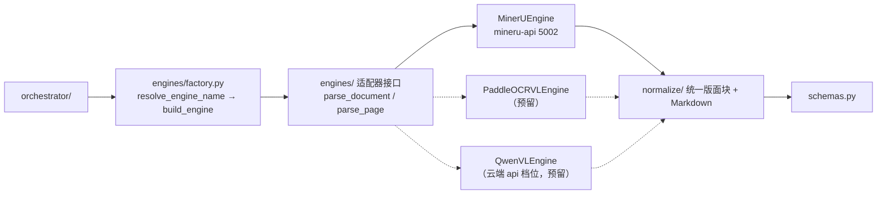

# 模型与引擎对接设计（model-integration）

设计状态：Accepted
确认状态：已确认
实现状态：Verified（MinerU 适配器已实现并真机取证；paddleocr-vl/qwen-vl 预留槽位）
最后更新：2026-09-23
关联代码：`src/axiom_flow/config.py`、`src/axiom_flow/engines/`、`src/axiom_flow/normalize/`
关联测试：`tests/unit/test_config.py`、`tests/unit/test_engines.py`、`tests/unit/test_engine_factory.py`、`tests/smoke/test_live_mineru_chain.py`
关联 ADR：[ADR 0004](../adr/0004-model-boundary-and-pipeline-ownership.md)

> **本篇回答的唯一问题**：本仓库**怎样与模型服务对话**——配置读什么、发什么、返回什么、
> 什么时候算不可用。产物怎么消费这些返回、什么算合格归
> [parsing-pipeline.md](parsing-pipeline.md)；任务与书目状态怎么流转归
> [parsing-management.md](parsing-management.md)。

## 目标与非目标

**目标**：

1. 用**可插拔适配器**隔离引擎差异：换模型不影响管线其余部分与任何状态语义。
2. 把与模型服务的协议事实**冻结到可复验**：端点、字段、坐标空间、类型字面值、窗口语义都来自
   真机探测留档，而不是猜测或文档抄写。
3. 让本仓库对模型**无知**：只发产物形态开关，不碰调参；只连接，不启停。
4. 在单机单 GPU 的现实约束下**不叠加提交**：把「被占用」与「不可用」判成两种可区分的状态。
5. 让配置在独立部署与被根仓库托管两种形态下都成立，且旧键不留别名（漂移即报错，不静默兼容）。

**非目标（各归其主）**：

- 归一化映射表、坐标换算、可见丢弃与对账不变式 → [PP-8、PP-9](parsing-pipeline.md)。
- 解析窗口切分与失败域 → [PP-11](parsing-pipeline.md)；本篇只定义窗口在协议侧的字段形状。
- 产物布局、版本目录、任务终态与生效指针 → [parsing-pipeline.md](parsing-pipeline.md)、
  [parsing-management.md](parsing-management.md)。
- 模型文件、镜像、启停、探针、资源互斥与**模型调参** → 根仓库 8900
  （[ADR 0004](../adr/0004-model-boundary-and-pipeline-ownership.md)）。
- 模块清单与实现状态 → [code-map.md](../architecture/code-map.md)；v1 模块退役登记亦在此。

## 边界与事实源

| 事项 | 本篇管 | 不管（事实源） |
| --- | --- | --- |
| 配置键 | 键名、语义、默认值、读取优先级、退役 | 数据根与库边界：[database-design.md](../architecture/database-design.md) |
| 适配器接口 | 方法契约与「不暴露调参」的边界 | 归一化后的版面块结构：[PP-7~PP-10](parsing-pipeline.md) |
| 预处理与后处理 | 两段的**归属**（恒在本仓库，MI-15）与「不向引擎侧下沉」的边界 | 两段的规则条文：[parsing-pipeline.md](parsing-pipeline.md)（`PP-2`、`PP-8~PP-10`、`PP-19`） |
| MinerU 协议 | 三段式端点与字段、窗口字段、坐标空间与类型**字面值来源** | 换算与映射：[parsing-pipeline.md](parsing-pipeline.md) |
| 超时与重试 | 单次调用 `deadline`、三层重试分列 | 任务进度与终态：[parsing-management.md](parsing-management.md) |
| 占用与可用性 | `health()` / `model_load()` 判据与文案归属 | 探活失败的 HTTP 后果：[PM 失败与质量语义](parsing-management.md) |
| 与 8900 的边界 | 归属划分 + 对根侧的出站要求 | 8900 侧实现：根仓库 |

**已移除的键**（v1 / 网关残留，不再读取，无别名）：`QED_API_SELECT`、`QED_LLM_GATEWAY_URL`、
`QED_LLM_TIMEOUT`、`QED_PROXY`、`QED_API_PROVIDER`、`QED_MODEL`、`QED_EMBEDDING_MODEL`、
`AXIOM_FLOW_DATA_DIR`、`AXIOM_PADDLEOCR_URL`、`AXIOM_VISION_CONTRACT_VERSION` /
`AXIOM_VISION_MAX_TOKENS` / `AXIOM_VISION_PAGE_ATTEMPTS` / `AXIOM_MODEL_CALL_BUDGET` /
`AXIOM_MODEL_TIMEOUT_SECONDS`、`QED_MINERU_URL`。新增键需按 ADR 流程登记，删除键不留兼容通道。

## 核心设计

### 配置键

| 变量 | 说明 | 默认 |
| --- | --- | --- |
| `AXIOM_OCR_ENGINE` | 解析引擎：`mineru` / `paddleocr-vl` / `qwen-vl`（后两者预留） | `mineru` |
| `QED_OCR_MODEL_URL` | 图像槽位本地端点（MinerU 容器，健康端点 `/health`） | `http://127.0.0.1:5002` |
| `AXIOM_OCR_TIMEOUT` | **单窗口/单页一次调用**的超时秒数（三段式提交/轮询/取结果共享） | `600` |
| `AXIOM_PARSE_WINDOW_SIZE` | 全本解析每个解析窗口的页数（串行提交；默认值由真机 W0 冻结） | `56` |
| `API_KEY` | 云端档位凭据（仅 qwen-vl 预留，注释态，不随解析默认路径读取） | — |
| `AXIOM_VISION_MODEL` | qwen-vl 档位模型名（仅 qwen-vl 预留，注释态） | `qwen-vl-plus` |
| `QED_DATA_ROOT` | 三项目统一数据根（`raw/` 只读输入、`parsed/` 本仓库产物） | 向上走查根 `.env` |

### 适配器分派

### 确定规范

> 每条守则一行：**结论 ＋ 判据**在左，**理由／例外／边界**居中，**实现落点 → 守护测试**在右（原「条文表」
> 并入本段，编号 `MI-n` 只在本篇内解析）。缺某项即无该项，以「—」占位。模型生命周期与调参、产物消费规则
> 不在本篇复制（事实源见文首与「边界与事实源」表）。

#### 配置与分派

| 编号 | 守则（结论 ＋ 判据） | 理由／例外／边界 | 实现落点 → 守护测试 |
| --- | --- | --- | --- |
| MI-1 | **配置只有三段，两边 `.env` 允许不一致**：配置中心只有三段——服务（`AXIOM_PORT`）/ 数据与库（`QED_DATA_ROOT`、`QED_DB_*`）/ 解析引擎（见上方「配置键」表）；读取优先级＝真实环境变量 > 自身 `.env` > 父目录 `.env`（向上走查）> 内置默认值 | 本仓库既要能独立部署，也要能被 QED-Engine 托管时跟随根 `.env`；「两边允许不一致」是明确裁决，不是默认行为。服务启动不依赖 8900 与模型在线，只在解析时连接模型 API | `config.py:load_settings`（三段式 + `.env` 向上走查） → `tests/unit/test_config.py` |
| MI-2 | **引擎名先解析后落库，未注册即 400**：实际引擎 = 请求体 `engine`（可选）优先、缺省回落 `AXIOM_OCR_ENGINE`，由 `engines/factory.py` 显式分派；`af_parse_jobs.engine` 存**解析后的实际引擎名**，DDL 侧该列**无默认值** | 缺引擎名必须报错、不做静默回落——否则这一行作业记录的引擎归属不可信。例外：未在 `factory.ENGINE_NAMES` 注册的名称返回 400；非法字面值由 schema 返回 422 | `engines/factory.py:resolve_engine_name/build_engine` → `tests/unit/test_engine_factory.py` |

#### 适配器契约与请求形态

| 编号 | 守则（结论 ＋ 判据） | 理由／例外／边界 | 实现落点 → 守护测试 |
| --- | --- | --- | --- |
| MI-3 | **适配器只暴露四个方法**：`parse_document(pdf_bytes, filename, start_page?, end_page?)`（默认全本）、`parse_page(image_bytes, page_no)`（逐页重解析）、`health()`（可用性）、`model_load()`（负载）；输出为页级原始结果（版面块 + Markdown + bbox + image_size + 坐标空间声明） | 引擎差异（MinerU `content_list`/`middle_json`、PaddleOCR-VL JSON、qwen-vl markdown）在适配层**消化成同一形状**，归一化侧因此不再分支判断引擎 | `engines/base.py` 适配器协议 → `tests/unit/test_engines.py` |
| MI-4 | **只发产物形态开关，不发解析调参**：必须显式发送 `return_content_list=true`、`return_middle_json=true`（openapi 默认 false，不送则版面块与页尺寸**恒缺失**），按需 `return_md=true` | **不发清单**：`backend`、`effort`、`parse_method`、`lang_list`、`formula_enable`、`table_enable`、`image_analysis`、`server_url`——让容器环境配置生效（模型调参归 8900）。也不请求 `return_images`，页图由本仓库 ingest 自产。两段的归属见 MI-15，窗口字段形状见 MI-6 | `engines/mineru.py:_OUTPUT_FLAGS` 表单字段构造 → `tests/unit/test_engines.py` |

#### MinerU 3.4.4 协议事实

| 编号 | 守则（结论 ＋ 判据） | 理由／例外／边界 | 实现落点 → 守护测试 |
| --- | --- | --- | --- |
| MI-5 | **三段式协议，`deadline` 只覆盖单次调用**：提交 `POST /tasks`（multipart 字段 `files`，200/202 受理，任务号在响应**顶层** `task_id`）→ 轮询 `GET /tasks/{task_id}`（状态取顶层 `status`，`pending → processing → completed`，失败态附顶层 `error` 文本）→ 取结果 `GET /tasks/{task_id}/result`（**202＝未就绪**继续等待；200＝载荷在 `results[<file_stem>]`，正文 `md_content`、版面块结构 `content_list`、页尺寸 `middle_json.pdf_info[*].page_size`） | `deadline` 语义：三段共享**本次调用**从 `AXIOM_OCR_TIMEOUT` 起算的 `deadline`，每次调用（一个解析窗口或一页）独立计 ⇒ 全本挂钟上限是「窗口数 × 单窗口超时」，而非整本一道墙。反例：旧式同步 `POST /file_parse` 与 `GET /get_task_results/{task_id}` 在 3.4.4 **均不存在**（后者返回 404——这一形状差异曾是 404 故障的根因） | `engines/mineru.py:_submit/_wait_done/_fetch_result` → `tests/unit/test_engines.py`、`tests/smoke/test_live_mineru_chain.py` |
| MI-6 | **窗口字段 0 基含两端，返回页号是窗口内相对**：`POST /tasks` 表单的 `start_page_id`/`end_page_id` 为 **0 基、含两端**（窗口大小 = `end − start + 1`）；本仓库对外的 `parse_document(start_page, end_page)` 用 **1 基含两端**并在适配器内换算；返回的 `content_list[].page_idx` 与 `middle_json.pdf_info[].page_idx` 都是**窗口内相对索引**（自 0 起），适配器必须按窗口起点还原为**全书绝对页号** | 例外：不送窗口字段即整本（默认 `0`/`99999`）。页枚举以 `pdf_info` 为准，这使空白页成为合法空页（[PP-12](parsing-pipeline.md)） | `engines/mineru.py:parse_document`（页号还原 + `pdf_info` 枚举） → `tests/unit/test_engines.py` |
| MI-7 | **坐标空间由适配器声明，不由消费方猜**：MinerU 3.4.4 的 `content_list[].bbox` 是**相对页框、逐轴归一化到 0–1000**（整本与逐页两条提交路径同一空间），适配器必须在 `PageResult.bbox_space` 声明 `"normalized_1000"` | 反例：`middle_json.pdf_info[*].page_size` 对 PNG 输入返回按 200 DPI 折算的标称点尺寸（与页图像素比约 1:2.78），**不能**当缩放基准。归属：换算规则与「哪个空间以 `page_size` 为基准」归 [PP-8](parsing-pipeline.md) | `engines/mineru.py` 的 `PageResult.bbox_space` 声明 → `tests/unit/test_engines.py` |
| MI-8 | **类型字面值只登记引擎侧事实**：`content_list[].type` 真机实测字面值含 `text`、`header`、`footer`（**不是** `page_header`/`page_footer`），另有 `equation`（其 `latex` 自带 `$$…$$`，行间式不走 `interline_equation`） | 归属：映射表内容、未覆盖字面值的可见丢弃与对账不变式归 [PP-9](parsing-pipeline.md)，定界符剥离归 [PP-10](parsing-pipeline.md) | 引擎侧事实（无独立落点，消费面在映射表） → `tests/unit/test_engines.py`（原始 `type` 断言） |

#### 稳健性

| 编号 | 守则（结论 ＋ 判据） | 理由／例外／边界 | 实现落点 → 守护测试 |
| --- | --- | --- | --- |
| MI-9 | **三层重试分列，互不吞并**：**单页重试 1 次**（逐页路径，编排层）；**轮询瞬时失败容忍连续 3 次**（适配层，HTTP 异常或非 2xx，成功一次即清零计数，全程受同一 `deadline` 约束）；**解析窗口级不重试**（恢复靠同 job 续跑，见 [PP-11](parsing-pipeline.md)） | 三者层级不同、文案不同，不得互相冒充为同一层重试——否则故障归因与挂钟预算都会失真 | `engines/mineru.py` 轮询容忍 + `pipeline.py:_parse_page_with_retry` → `tests/unit/test_engines.py`、`tests/unit/test_orchestrator.py` |
| MI-10 | **出站恒为直连，`trust_env=False`**：HTTP 客户端一律以 `trust_env=False` 构造 | 真机实证 Windows 注册表代理对 `127.0.0.1` **不做豁免**（`ProxyEnable=1` + 空 `ProxyOverrides` 时回环流量仍交给代理，代理规则变化即返回 502/0 字节，表现为「端点不存在」的假象）。例外：无——此约束与 `QED_PROXY` 退役一致，本地模型流量恒为直连，不提供代理开关 | `engines/mineru.py` 的 `httpx.Client(trust_env=False)` → `tests/unit/test_engines.py` |
| MI-11 | **响应解析防御式双兼容 + 异常归一**：正文接受 `md_content` 或 `markdown`；`content_list` 与 `middle_json` 兼容「JSON 字符串」与「已解析对象」两种载体；状态兼容顶层 `status` 与旧式 `data.state`；单文件提交时 `results` 按唯一键回落；非 JSON 或非 2xx 一律归一为 `EngineError`，`JSONDecodeError` 等内部异常**不得穿透编排层** | 异常穿透会牵连回滚已解析页行。边界：双兼容只针对**同一引擎版本的响应载体**，不是版本回落通道——协议事实变更须重新冻结探测并改契约 | `engines/mineru.py` 响应解析与 `EngineError` 归一 → `tests/unit/test_engines.py` |
| MI-12 | **单一占用闸门：把「被占用」与「不可用」判成两件事**：`model_load()` 读 `GET /health` 的 `queued_tasks` 与 `processing_tasks`（3.4.4 实测字段），返回 `ModelLoad(queued, processing)`；任务启动前若 `queued + processing > 0` 则**不提交任何内容**，按 5 秒间隔复探、最长等待 900 秒；超时才判失败，文案「模型服务被其他解析任务占用」，与「模型服务不可用」**分列不互相冒充** | 前提：本机 GPU 只容得下一个解析在飞，而 MinerU `max_concurrent_requests=3` 说明服务侧**允许**并行 ⇒ 资源约束必须由调用方自我执行。例外：非 200、JSON 异常或两字段缺失一律返回 `None`，表示「无法判定」，编排层**按可用放行**——不因为探测不灵就凭空造出一个阻塞；真正的不可达仍由 `health()` 判定。为什么：真机窗口里排队任务轮到恰逢容器重启，被误记成不可用，故障归因即失真。边界：闸门只保证**我方不叠加提交**，本仓库执行器另有 `max_workers=1` 的串行队列 | `engines/mineru.py:model_load()`、`pipeline.py:_await_model_idle` → `tests/unit/test_orchestrator.py` |

#### 扩展、边界与跨项目

| 编号 | 守则（结论 ＋ 判据） | 理由／例外／边界 | 实现落点 → 守护测试 |
| --- | --- | --- | --- |
| MI-13 | **预留槽位未实现即报错，不回落**：`paddleocr-vl`、`qwen-vl` 是已登记未实现的槽位，请求它们返回 400，**不回落 MinerU**（ADR 0004 不做静默兜底） | 启用路径：在 8900 注册单元 → 本仓库新增 `engines/<name>.py` 并登记进 `factory.IMPLEMENTED_ENGINES` → 需要新配置键时按 ADR 流程新增（`AXIOM_PADDLEOCR_URL` 已退役，启用时重新登记）。qwen-vl 属云端档位，启用时取消 `.env` 里 `API_KEY` / `AXIOM_VISION_MODEL` 的注释，输出 markdown 归一为统一版面块（bbox 可能缺失，标记来源） | `engines/factory.py:IMPLEMENTED_ENGINES` → `tests/unit/test_engine_factory.py` |
| MI-14 | **对根侧的出站要求：解析在飞时不得换起模型**：8900 在 8902 有未完成（`queued`/`running`）解析任务时**不得重启/换起 vision 槽位**，或至少提供可被 8902 探测的「占用中」信号；真机窗口执行前须与 8900 侧约定静默期（见 [operations runbook](../guides/operations.md)） | 模型容器的重启/换起权在 8900，而重启会直接毁掉在飞与排队中的解析（实证：一次并发重启使两个任务同时报断连/不可用） | 跨项目请求（无本仓库代码落点） → `docs/standards/cross-project-collaboration.md` 登记 |
| MI-15 | **预处理与后处理恒在本仓库做**：本仓库送给引擎的只有**源件（PDF 或 ingest 自产页图）+ 产物形态开关 + 窗口字段**（MI-4、MI-6）；解析前后的两段——**预处理**（页图渲染与 150 DPI 基准、`book.json` 元信息）与**后处理**（坐标换算、类型映射与可见丢弃、公式定界符、知识块切分、清单与质量信号）——实现位置**恒在本仓库**，即 `ingest/` 与 `normalize/`（规则条文：[PP-2](parsing-pipeline.md)、[PP-8~PP-10](parsing-pipeline.md)、[PP-19](parsing-pipeline.md)） | 预留：后续要加的输入整形（如去噪、二值化、按页方向校正）与结果修补（如公式修补、跨页条目合并）**只落在本仓库这两处**，并以新的质量信号或产物字段变得可见；**不通过新增引擎侧调参开关实现**（那属 8900 的调参域，MI-4 的不发清单即为此而设）。为什么：这两段决定产物是否可复现与可回归测试，放在引擎侧就要靠容器配置解释「同一本书为什么两次结果不同」，本仓库的契约稳定性与真机取证同时失效。例外：引擎内建的版面/公式/表格识别本身**不属这两段**——它是模型的本职，由 8900 侧配置，本仓库只消费其返回（MI-4） | `engines/mineru.py` 表单内容（只送源件 + 形态开关）、`ingest/` 与 `normalize/` 两段实现 → `tests/unit/test_engines.py`（不发送调参键）、`tests/unit/test_normalize.py` |

## 失败与质量语义

- **提交期探活失败**（`health()` 假）→ 503 且**不创建任务行**（状态机后果见
  [parsing-management.md](parsing-management.md)）；**受理后故障** → 任务 `failed`，已解析页保留。
- **占用超时** → `failed` 且文案「模型服务被其他解析任务占用」，不写页行、不激活版本；与「模型服务
  不可用」不互相冒充（MI-12）。
- **负载无法判定**（`model_load()` 返回 `None`）→ 按可用放行，不臆造阻塞（MI-12）。
- **响应载体异常**（非 JSON / 非 2xx / 内部解析异常）→ 归一为 `EngineError`，不外泄堆栈（MI-11）。
- **代理造成的假 502** → 由 `trust_env=False` 消除（MI-10）；出现「端点不存在」表象时先核对是否走了
  系统代理，再怀疑协议。
- **未归一成功的版面块** → 计入可见丢弃，在产物侧可见（[PP-9](parsing-pipeline.md)）；引擎侧不补占位条目、
  不猜类型。
- **不自动切换引擎**：质量不达标或某引擎故障时不静默换引擎（用户裁决，ADR 0004）。

## 验收判据

1. **协议事实来自冻结探测**，非推测：三段式端点与信封形状留档 `tmp/probes/mineru-3.4.4-20260920/`
   （W0 冻结）；窗口字段与页号相对性留档 `tmp/probes/window-req086-20260922/`；坐标空间与类型字面值
   留档 `tmp/probes/live-bringup-20260920/{L3d_coord_space.json,L3c_page0003.json}` 与
   `tmp/probes/live-bbox-fix-20260921/E1_anchor_after_fix.json`。
2. **单元**：`config.py` 引擎/地址/超时读取（含向上走查兜底、旧键忽略）→ `tests/unit/test_config.py`；
   适配器 mock 单测（三段协议 + 信封双兼容 + 窗口页号还原 + 直连开关 + `model_load` 判定）→
   `tests/unit/test_engines.py`。
3. **分派不回落**：未实现/未知引擎名即 400、非法字面值 422，绝不落其他引擎 →
   `tests/unit/test_engine_factory.py`、`tests/contract/test_api_v1_contract.py`。
4. **闸门可区分**：占用等待期不提交任何内容、超时文案与「不可用」不同；`None` 放行 →
   `tests/unit/test_orchestrator.py`（`_await_model_idle` 用例）。
5. **冒烟**：真实调用 MinerU 单页与整本成功，产物 `source=mineru` →
   `tests/smoke/test_live_mineru_chain.py`（`@smoke`，本地手动）。
6. **文档守护**：本篇六段骨架、`MI-n` 守则表（含并入的实现落点与守护测试）与 Mermaid 由 `tests/contract/test_design_documents.py`
   守护。

## 追溯

- **归属边界来源**：[ADR 0004](../adr/0004-model-boundary-and-pipeline-ownership.md)（模型生命周期归
  8900、解析管线归本仓库、直连不经网关、无静默兜底）。
- **直连契约来源**：根仓库 PLAN-046 / REQ-075——`QED_MINERU_URL` 删除改为 `QED_OCR_MODEL_URL`，
  MinerU 端口 8002 → 5002，不保留旧键别名；配置三段式与「调参归 8900」由 PLAN-002 确立。
- **协议与字段来源**：三段式协议与 404 根因来自 DEFECT-002；坐标空间与类型字面值来自 DEFECT-004 /
  DEFECT-005 的真机锚点实验；占用闸门来自 ARCH-017 与 R1 窗口实证；窗口字段与页号还原、空白页枚举来自
  REQ-086 / REQ-087（PLAN-007）；出站要求 REQ-085 与退役清单见 [code-map.md](../architecture/code-map.md)
  （v1 `llm_client.py` / `fallback/` / `database.py` 已随 `engines/` 落地退役）。日期化过程与真机读数
  一律在 [trackers/completed.md](../trackers/completed.md)。
- **叙述框架**：本篇的六段结构与 `MI-n` 编号由 [PLAN-012](../history/plans/2026-09/2026-09-23-design-narrative-framework.md)
  建立；取代 v0.1 的 `model-mode-config.md`（已归档 `history/design/`）。
