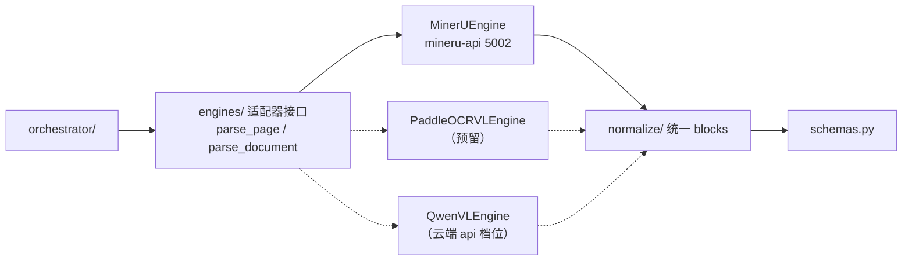

# 模型与引擎对接设计（model-integration）

设计状态：Accepted
确认状态：暂定
实现状态：In Progress（config 已实现；engines/ 适配器待 ARCH-016；llm_client/fallback 待退役）
最后更新：2026-09-17
关联代码：`src/axiom_flow/config.py`、`src/axiom_flow/engines/`（待实现）、`src/axiom_flow/normalize/`（待实现）、`src/axiom_flow/llm_client.py`（待退役）、`src/axiom_flow/fallback/`（待退役）
关联测试：`tests/unit/test_config.py`、`tests/unit/test_llm_client.py`、`tests/unit/test_fallback.py`
关联 ADR：`docs/adr/0004-model-boundary-and-pipeline-ownership.md`

> 本文档定义 Axiom-Flow 如何对接 OCR/解析模型：引擎配置、适配器接口、各引擎接入方式，
> 以及与根仓库 8900（模型生命周期）的边界。解析管线见 [parsing-pipeline.md](parsing-pipeline.md)；
> 取代原 `model-mode-config.md`（已归档 `history/design/`）。

## 背景与定位

v0.1 的 `llm_client.py` 双模式（local 直连 qwen-vl / qed-engine 经 8900 网关）在
[ADR 0004](../adr/0004-model-boundary-and-pipeline-ownership.md) 中被取代：

- **模型生命周期归 8900**：模型文件槽位、`/models/{slot}` 启停、探针、资源互斥（根仓库
  [local-model-management](https://github.com/QED-Engine/qed-engine/blob/main/docs/design/local-model-management.md)）；
- **解析调用归本仓库**：引擎适配器直连模型服务，不经 8900 网关；
- **模型无感知**：引擎由配置选择，统一 blocks 归一化在适配层完成。

**配置中心对齐（2026-09-17，根仓库 PLAN-046 / REQ-075）**：根 `.env` 重建为四段式，
`QED_MINERU_URL` 删除改为 `QED_OCR_MODEL_URL`，MinerU 端口 8002 → 5002；**不保留旧键别名**。
Axiom-Flow 只连接模型服务，**不负责启停**（启停/探针/资源互斥由 8900 托管，本仓库可经根仓库
脚本或 8900 `/models/{slot}` 手动触发，但不实现生命周期逻辑）。

## 引擎配置

| 变量 | 说明 | 默认 |
| --- | --- | --- |
| `AXIOM_OCR_ENGINE` | 解析引擎：`mineru` / `paddleocr-vl` / `qwen-vl` | `mineru` |
| `QED_OCR_MODEL_URL` | 图像槽位本地端点（MinerU 容器，健康端点 `/health`） | `http://127.0.0.1:5002` |
| `AXIOM_PADDLEOCR_URL` | PaddleOCR-VL 服务地址（预留） | — |
| `AXIOM_VISION_MODEL` | qwen-vl 云端档位模型名（预留引擎） | `qwen-vl-plus` |
| `API_KEY` | 云端档位凭据（只读，不下发） | — |
| `AXIOM_FLOW_DATA_DIR` | 数据根覆盖（缺省读根 `.env` `QED_DATA_ROOT`） | `<root>/dataset` |

配置读取优先级：真实环境变量 > 自身 `.env` > 父目录 `.env`（向上走查）> 内置默认值。
本仓库 `.env` 支持独立部署（含 `QED_DB_NAME=qed` 与引擎配置）；由 QED-Engine 启动时经向上
走查跟随根 `.env`，两边配置允许不一致（用户裁决 2026-09-17）。

## 引擎适配接口

适配器统一契约：

- 输入：`parse_page(image_bytes, page_no)` 或 `parse_document(pdf_bytes, filename)`；
- 输出：页级结果（`blocks` + `markdown` + `bbox`），由 `normalize/` 归一为统一 schema；
- 差异（MinerU `content_list`/`middle.json`、PaddleOCR-VL JSON、qwen-vl markdown）在适配层消化。

## 各引擎接入

### MinerU（先落地）

- 服务：`mineru-api` 容器（WSL，**5002**），健康端点 `GET /health`（**不是** `/api/v1/health`）；
  生命周期（启停/探针/资源互斥）由 8900 托管，本仓库只连接 `QED_OCR_MODEL_URL`。
- 调用：`POST /file_parse`（multipart，同步）或 `POST /tasks`（异步）；取结构化输出
  （`content_list` 含块类型与 bbox），归一化为统一 blocks。
- 全本解析：上传 PDF；逐页解析：上传页图。

### PaddleOCR-VL（预留）

- 服务：PaddleOCR-VL-1.6（0.9B，vLLM/Paddle 服务，端口待定），由根仓库 8900 启停托管；
- 接入方式与 MinerU 同契约（同一适配器接口 + 归一化）；启用时在 8900 注册 `paddleocr` 单元。

### qwen-vl（云端 api 档位）

- 用途：无本地 GPU / 快速验证；经 `API_KEY` 直连供应商（不依赖 8900 在线）；
- 输出为 markdown，归一化为统一 blocks（bbox 可能缺失，标记来源）。

## 与 8900 的边界

| 事项 | 归属 |
| --- | --- |
| 模型文件、镜像、启停、探针、资源互斥 | 根仓库 8900（`/models/{slot}`、`scripts/image-model/`、`scripts/text-model/`） |
| 引擎选择、调用、归一化、编排 | 本仓库（`engines/`、`normalize/`、`orchestrator/`） |
| 调用记录 `qed_llm_calls` | 本仓库直连成功路径自写（`service=axiom_flow`、`provider=<engine>`、`endpoint=vision`） |

模型服务地址可配置：默认直连本地服务（`QED_OCR_MODEL_URL`）；部署形态需要时可指向 8900
提供的代理地址，适配器契约不变。

## 退役清单

- `src/axiom_flow/llm_client.py`（VisionClient 双模式视觉调用）：由 `engines/` 适配器承接，
  ARCH-016 后删除。
- `src/axiom_flow/fallback/`（qwen-vl-plus 直连通道）：由 `engines/qwen_vl` 承接后退役。
- 环境变量 `AXIOM_VISION_CONTRACT_VERSION` / `AXIOM_VISION_MAX_TOKENS` / `AXIOM_VISION_PAGE_ATTEMPTS` /
  `AXIOM_MODEL_CALL_BUDGET` / `AXIOM_MODEL_TIMEOUT_SECONDS`：随 `llm_client` 退役，不进入新 `.env`。
- `AXIOM_API_KEY` / `AXIOM_MYSQL_*` / `AXIOM_DATA_DIR` / `AXIOM_WEB_DIR`：v1 残留，配置对齐后清除。

## 验证

- 单元：`config.py` 引擎/地址读取（含向上走查兜底与 `QED_DATA_ROOT` 回退）；适配器 mock 单测
  （各引擎输出 → 统一 blocks）；
- 契约：`tests/contract/test_design_documents.py` 守护本文档；
- 冒烟：真实调用 MinerU 单页/整本成功，产物 `source=mineru`；调用记录落 `qed_llm_calls`。
