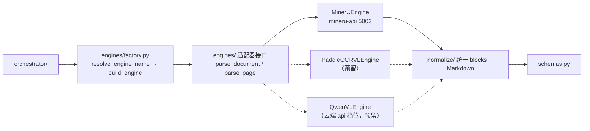

# 模型与引擎对接设计（model-integration）

设计状态：Accepted
确认状态：暂定
实现状态：Current（config/engines 已实现，MinerU 适配器按 3.4.4 异步协议落地 + `factory.py` 显式
分派 + `bbox_space` 坐标空间声明 + 归一化可见丢弃计数；paddleocr-vl/qwen-vl 预留；llm_client/fallback 已退役）
最后更新：2026-09-21
关联代码：`src/axiom_flow/config.py`、`src/axiom_flow/engines/`、`src/axiom_flow/normalize/`
关联测试：`tests/unit/test_config.py`、`tests/unit/test_engines.py`、`tests/unit/test_engine_factory.py`、`tests/smoke/test_live_mineru_chain.py`
关联 ADR：`docs/adr/0004-model-boundary-and-pipeline-ownership.md`

> 本文档定义 Axiom-Flow 如何对接解析模型：配置键、适配器接口、各引擎接入方式，以及与根仓库
> 8900（模型生命周期与调参）的边界。解析管线见 [parsing-pipeline.md](parsing-pipeline.md)；
> 解析管理闭环见 [parsing-management.md](parsing-management.md)；取代原 `model-mode-config.md`
> （已归档 `history/design/`）。

## 背景与定位

v0.1 的 `llm_client.py` 双模式（local 直连 qwen-vl / qed-engine 经 8900 网关）在
[ADR 0004](../adr/0004-model-boundary-and-pipeline-ownership.md) 中被取代：

- **模型生命周期归 8900**：模型文件槽位、`/models/{slot}` 启停、探针、资源互斥（根仓库
  [local-model-management](https://github.com/QED-Engine/qed-engine/blob/main/docs/design/local-model-management.md)）；
- **解析调用归本仓库**：引擎适配器直连模型服务，不经 8900 网关；
- **模型无感知**：引擎由配置选择，统一 blocks 归一化在适配层完成。

**配置简化（2026-09-17 用户裁决，PLAN-002）**：Axiom-Flow 只做「模型 API 调用 + 预处理/
后处理」，**模型调参（MinerU 等引擎参数）归 QED-Engine 侧**，本仓库不暴露调参入口。配置中心
简化为三段式：服务（`AXIOM_PORT`）/ 数据与数据库（`QED_DATA_ROOT`、`QED_DB_*`）/ 解析引擎
（`AXIOM_OCR_ENGINE`、`QED_OCR_MODEL_URL`、`AXIOM_OCR_TIMEOUT`）。服务启动不依赖 8900 与
模型在线，仅解析时连接模型 API。

**MinerU 直连契约（根仓库 PLAN-046 / REQ-075）**：`QED_MINERU_URL` 删除改为
`QED_OCR_MODEL_URL`，MinerU 端口 8002 → 5002；**不保留旧键别名**。本仓库只连接模型服务，
**不负责启停**。

## 引擎配置

| 变量 | 说明 | 默认 |
| --- | --- | --- |
| `AXIOM_OCR_ENGINE` | 解析引擎：`mineru` / `paddleocr-vl` / `qwen-vl`（后两者预留） | `mineru` |
| `QED_OCR_MODEL_URL` | 图像槽位本地端点（MinerU 容器，健康端点 `/health`） | `http://127.0.0.1:5002` |
| `AXIOM_OCR_TIMEOUT` | 单次解析调用超时秒数（整本解析耗时长） | `600` |
| `API_KEY` | 云端档位凭据（仅 qwen-vl 预留，注释态，不随解析默认路径读取） | — |
| `AXIOM_VISION_MODEL` | qwen-vl 档位模型名（仅 qwen-vl 预留，注释态） | `qwen-vl-plus` |
| `QED_DATA_ROOT` | 三项目统一数据根（`raw/` 只读输入、`parsed/` 本仓库产物） | 向上走查根 `.env` |

已移除（v1/网关残留，不再读取）：`QED_API_SELECT`、`QED_LLM_GATEWAY_URL`、`QED_LLM_TIMEOUT`、
`QED_PROXY`、`QED_API_PROVIDER`、`QED_MODEL`、`QED_EMBEDDING_MODEL`、`AXIOM_FLOW_DATA_DIR`、
`AXIOM_PADDLEOCR_URL`、`AXIOM_VISION_CONTRACT_VERSION` / `AXIOM_VISION_MAX_TOKENS` /
`AXIOM_VISION_PAGE_ATTEMPTS` / `AXIOM_MODEL_CALL_BUDGET` / `AXIOM_MODEL_TIMEOUT_SECONDS`。

配置读取优先级：真实环境变量 > 自身 `.env` > 父目录 `.env`（向上走查）> 内置默认值。
本仓库 `.env` 支持独立部署（含 `QED_DB_NAME=qed` 与引擎配置）；由 QED-Engine 启动时经向上
走查跟随根 `.env`，两边配置允许不一致（用户裁决 2026-09-17）。

## 引擎适配接口

适配器统一契约：

- 输入：`parse_document(pdf_bytes, filename)`（**默认全本**）或 `parse_page(image_bytes, page_no)`
  （指定 pages 的逐页重解析）；
- 输出：页级结果（`blocks` + `markdown` + `bbox` + `image_size`），由 `normalize/` 归一为统一 schema；
- 差异（MinerU `content_list`/`middle.json`、PaddleOCR-VL JSON、qwen-vl markdown）在适配层消化；
- 适配器**不暴露模型调参**：引擎参数（如 MinerU 后端/语言/公式开关）由模型服务侧（QED-Engine
  控制台与容器配置）管理，本仓库调用固定契约。

## 各引擎接入

### MinerU（已落地，3.4.4 异步任务协议）

- 服务：`mineru-api` 容器（WSL，**5002**），健康端点 `GET /health`（**不是** `/api/v1/health`）；
  生命周期（启停/探针/资源互斥）由 8900 托管，本仓库只连接 `QED_OCR_MODEL_URL`。
- 调用固定三段（`engines/mineru.py`；端点终版由 PLAN-003 W0 冻结探测确立，留档
  `data/probes/mineru-3.4.4-20260920/`）：

| 阶段 | 端点 | 请求与响应要点 |
| --- | --- | --- |
| 提交 `_submit` | `POST /tasks`（multipart 字段 `files`） | 200/202 受理，任务号在响应**顶层** `task_id`；全本上传 PDF、逐页上传页图 |
| 轮询 `_wait_done` | `GET /tasks/{task_id}` | 状态取**顶层** `status`（`pending → processing → completed`）；失败态附顶层 `error` 文本 |
| 取结果 `_fetch_result` | `GET /tasks/{task_id}/result` | **202＝未就绪**（继续等待，受同一 `deadline` 约束）、200＝载荷为 `results[<file_stem>]`，正文 `md_content`、块结构 `content_list`、页尺寸 `middle_json.pdf_info[*].page_size` |

  旧式同步 `POST /file_parse` 与 `GET /get_task_results/{task_id}` 在 3.4.4 **均不存在**（后者
  返回 404，即 DEFECT-002 根因）。

- **只设产物形态开关，不设解析调参**：必须显式发送 `return_content_list=true`、
  `return_middle_json=true`（openapi 默认 false，不送则 blocks 与页尺寸恒缺失），并按需
  `return_md=true`；**不发送** `backend`、`effort`、`parse_method`、`lang_list`、`formula_enable`、
  `table_enable`、`image_analysis`、`server_url`，让容器环境配置生效（模型调参归 8900，ADR 0004）；
  不请求 `return_images`（页图由本仓库 ingest 自产）。
- **原始块坐标空间与类型字面值（2026-09-20 真机锚点实验测定，2026-09-21 适配层落地）**：
  `content_list[].bbox` 为**相对页框逐轴归一化 0–1000**（整本与逐页两条路径一致），适配器必须在
  `PageResult.bbox_space` 声明 `"normalized_1000"`，由归一化侧按 `bbox / 1000 * image_size` 换算；
  `middle_json.pdf_info[*].page_size` 对 PNG 输入返回按 200 DPI 折算的标称点尺寸（与页图像素比
  约 1:2.78），**不能**当缩放基准，`page_size` 只留档、不参与坐标换算。`content_list[].type`
  实测字面值含 `text`、`header`、`footer`（**不是** `page_header`/`page_footer`），归一化侧两类
  字面值并存收录；映射表未覆盖的字面值按**可见丢弃**计入 `QualityMetrics.dropped_block_count` /
  `dropped_types`，不静默丢块（DEFECT-004 坐标空间与 DEFECT-005 类型映射均已修复，见
  [completed.md](../trackers/completed.md)）。
  实验与复验留档 `data/probes/live-bringup-20260920/{L3d_coord_space.json,L3c_page0003.json}`、
  `data/probes/live-bbox-fix-20260921/E1_anchor_after_fix.json`。

- 超时与两类重试分列：整次调用共享 `AXIOM_OCR_TIMEOUT` 推出的 `deadline`；**单页重试** 1 次
  （编排层，见 [parsing-pipeline.md](parsing-pipeline.md)）与**轮询瞬时失败容忍** 连续 3 次
  （适配层，成功一次即清零计数）互不吞并。
- 响应解析防御式双兼容：正文接受 `md_content` 或 `markdown`；`content_list` 与 `middle_json`
  兼容「JSON 字符串」与「已解析对象」两种载体；状态兼容顶层 `status` 与旧式 `data.state`；
  单文件提交时 `results` 按唯一键回落。非 JSON 或非 2xx 一律归一为 `EngineError`，`JSONDecodeError`
  等内部异常不得穿透编排层（否则会牵连回滚已解析页）。
- **直连，不经系统代理**：HTTP 客户端以 `trust_env=False` 构造。W0 实证 Windows 注册表代理对
  `127.0.0.1` 不做豁免（`ProxyEnable=1` + 空 `ProxyOverrides` 时回环流量仍交给代理，代理规则变化
  即返回 502/0 字节，表现为「端点不存在」的假象）；此约束与 `QED_PROXY` 键退役一致——本地模型
  流量恒为直连，不提供代理开关。
- 失败语义：模型服务不可达 → **提交期**探活返回 503 且不创建任务行；任务受理后进到执行期的故障
  → 页/任务 `failed`；**不自动切换引擎**（不设自动兜底）。
- 引擎分派：实际引擎 = 请求体 `engine`（可选）优先、缺省回落 `AXIOM_OCR_ENGINE`，由
  `engines/factory.py` 显式分派；未在 `factory.ENGINE_NAMES` 注册的名称返回 400、非法字面值由
  schema 返回 422，已登记但未实现的槽位（`paddleocr-vl`、`qwen-vl`）同样返回 400。
  `af_parse_jobs.engine` 存**解析后的实际引擎名**。

### PaddleOCR-VL（预留）

- 服务：PaddleOCR-VL-1.6（0.9B，vLLM/Paddle 服务，端口待定），由根仓库 8900 启停托管；
- 接入方式与 MinerU 同契约（同一适配器接口 + 归一化）；启用时在 8900 注册 `paddleocr` 单元，
  本仓库新增 `engines/paddleocr_vl.py` 并在 `factory.IMPLEMENTED_ENGINES` 登记；**当前无
  `AXIOM_PADDLEOCR_URL` 配置键**（该键已随配置简化退役，见「引擎配置」），启用时按 ADR 流程
  重新新增并届时登记。在此之前 `AXIOM_OCR_ENGINE=paddleocr-vl` 一律返回 400，不回落 MinerU。

### qwen-vl（云端 api 档位，预留）

- 用途：无本地 GPU / 快速验证；经 `API_KEY` 直连供应商（不依赖 8900 在线）；
- 输出为 markdown，归一化为统一 blocks（bbox 可能缺失，标记来源）；
- 启用时取消 `.env` 中 `API_KEY` / `AXIOM_VISION_MODEL` 注释。

## 与 8900 的边界

| 事项 | 归属 |
| --- | --- |
| 模型文件、镜像、启停、探针、资源互斥、**模型调参** | 根仓库 8900（`/models/{slot}`、`scripts/image-model/`、控制台） |
| 引擎选择、调用、归一化、分块、编排、产物落盘 | 本仓库（`engines/`、`normalize/`、`orchestrator/`） |
| 调用记录 `qed_llm_calls` | 本仓库直连成功路径自写（`service=axiom_flow`、`provider=<engine>`、`endpoint=vision`）；随解析闭环落地 |

模型服务地址可配置：默认直连本地服务（`QED_OCR_MODEL_URL`）；部署形态需要时可指向 8900
提供的代理地址，适配器契约不变。

## 退役清单（已执行，2026-09-17）

- `src/axiom_flow/llm_client.py`（VisionClient 双模式视觉调用）：已删除，由 `engines/` 适配器承接。
- `src/axiom_flow/fallback/`（qwen-vl-plus 直连通道）：已删除；qwen-vl 以预留引擎身份保留（未实现）。
- `src/axiom_flow/database.py`：并入 `db/engine.py`。
- 环境变量 `AXIOM_API_KEY` / `AXIOM_MYSQL_*` / `AXIOM_DATA_DIR` / `AXIOM_WEB_DIR` /
  `AXIOM_EVALUATION_DATA_DIR`：v1 残留，配置简化后清除。

## 验证

- 单元：`config.py` 引擎/地址/超时读取（含向上走查兜底、旧键忽略）；适配器 mock 单测
  （三段协议 + 信封双兼容 + 直连开关）；`factory.py` 分派单测（未实现/未知即报错，不回落）；
- 契约：`tests/contract/test_design_documents.py` 守护本文档；
- 冒烟：真实调用 MinerU 单页/整本成功，产物 `source=mineru`；调用记录落 `qed_llm_calls`。
