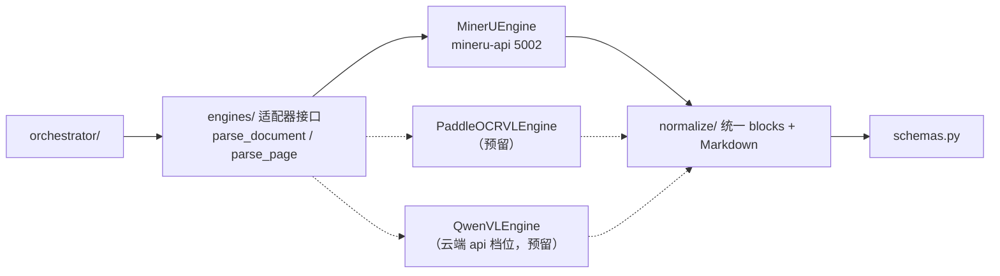

# 模型与引擎对接设计（model-integration）

设计状态：Accepted
确认状态：暂定
实现状态：Current（config/engines 已实现，MinerU 适配器落地；paddleocr-vl/qwen-vl 预留；llm_client/fallback 已退役）
最后更新：2026-09-17
关联代码：`src/axiom_flow/config.py`、`src/axiom_flow/engines/`、`src/axiom_flow/normalize/`
关联测试：`tests/unit/test_config.py`、`tests/unit/test_engines.py`
关联 ADR：`docs/adr/0004-model-boundary-and-pipeline-ownership.md`

> 本文档定义 Axiom-Flow 如何对接解析模型：配置键、适配器接口、各引擎接入方式，以及与根仓库
> 8900（模型生命周期与调参）的边界。解析管线见 [parsing-pipeline.md](parsing-pipeline.md)；
> 解析管理闭环见 [parsing-management.md](parsing-management.md)；取代原 `model-mode-config.md`
> （已归档 `history/design/`）。

## 背景与定位

v0.1 的 `llm_client.py` 双模式（local 直连 qwen-vl / qed-engine 经 8900 网关）在
[ADR 0004](../adr/0004-model-boundary-and-pipeline-ownership.md) 中被取代：

- **模型生命周期归 8900**：模型文件槽位、`/models/{slot}` 启停、探针、资源互斥（根仓库
  [local-model-management](https://github.com/QED-Engine/qed-engine/blob/main/docs/design/local-model-management.md)）；
- **解析调用归本仓库**：引擎适配器直连模型服务，不经 8900 网关；
- **模型无感知**：引擎由配置选择，统一 blocks 归一化在适配层完成。

**配置简化（2026-09-17 用户裁决，PLAN-002）**：Axiom-Flow 只做「模型 API 调用 + 预处理/
后处理」，**模型调参（MinerU 等引擎参数）归 QED-Engine 侧**，本仓库不暴露调参入口。配置中心
简化为三段式：服务（`AXIOM_PORT`）/ 数据与数据库（`QED_DATA_ROOT`、`QED_DB_*`）/ 解析引擎
（`AXIOM_OCR_ENGINE`、`QED_OCR_MODEL_URL`、`AXIOM_OCR_TIMEOUT`）。服务启动不依赖 8900 与
模型在线，仅解析时连接模型 API。

**MinerU 直连契约（根仓库 PLAN-046 / REQ-075）**：`QED_MINERU_URL` 删除改为
`QED_OCR_MODEL_URL`，MinerU 端口 8002 → 5002；**不保留旧键别名**。本仓库只连接模型服务，
**不负责启停**。

## 引擎配置

| 变量 | 说明 | 默认 |
| --- | --- | --- |
| `AXIOM_OCR_ENGINE` | 解析引擎：`mineru` / `paddleocr-vl` / `qwen-vl`（后两者预留） | `mineru` |
| `QED_OCR_MODEL_URL` | 图像槽位本地端点（MinerU 容器，健康端点 `/health`） | `http://127.0.0.1:5002` |
| `AXIOM_OCR_TIMEOUT` | 单次解析调用超时秒数（整本解析耗时长） | `600` |
| `API_KEY` | 云端档位凭据（仅 qwen-vl 预留，注释态，不随解析默认路径读取） | — |
| `AXIOM_VISION_MODEL` | qwen-vl 档位模型名（仅 qwen-vl 预留，注释态） | `qwen-vl-plus` |
| `QED_DATA_ROOT` | 三项目统一数据根（`raw/` 只读输入、`parsed/` 本仓库产物） | 向上走查根 `.env` |

已移除（v1/网关残留，不再读取）：`QED_API_SELECT`、`QED_LLM_GATEWAY_URL`、`QED_LLM_TIMEOUT`、
`QED_PROXY`、`QED_API_PROVIDER`、`QED_MODEL`、`QED_EMBEDDING_MODEL`、`AXIOM_FLOW_DATA_DIR`、
`AXIOM_PADDLEOCR_URL`、`AXIOM_VISION_CONTRACT_VERSION` / `AXIOM_VISION_MAX_TOKENS` /
`AXIOM_VISION_PAGE_ATTEMPTS` / `AXIOM_MODEL_CALL_BUDGET` / `AXIOM_MODEL_TIMEOUT_SECONDS`。

配置读取优先级：真实环境变量 > 自身 `.env` > 父目录 `.env`（向上走查）> 内置默认值。
本仓库 `.env` 支持独立部署（含 `QED_DB_NAME=qed` 与引擎配置）；由 QED-Engine 启动时经向上
走查跟随根 `.env`，两边配置允许不一致（用户裁决 2026-09-17）。

## 引擎适配接口

适配器统一契约：

- 输入：`parse_document(pdf_bytes, filename)`（**默认全本**）或 `parse_page(image_bytes, page_no)`
  （指定 pages 的逐页重解析）；
- 输出：页级结果（`blocks` + `markdown` + `bbox` + `image_size`），由 `normalize/` 归一为统一 schema；
- 差异（MinerU `content_list`/`middle.json`、PaddleOCR-VL JSON、qwen-vl markdown）在适配层消化；
- 适配器**不暴露模型调参**：引擎参数（如 MinerU 后端/语言/公式开关）由模型服务侧（QED-Engine
  控制台与容器配置）管理，本仓库调用固定契约。

## 各引擎接入

### MinerU（先落地）

- 服务：`mineru-api` 容器（WSL，**5002**），健康端点 `GET /health`（**不是** `/api/v1/health`）；
  生命周期（启停/探针/资源互斥）由 8900 托管，本仓库只连接 `QED_OCR_MODEL_URL`。
- 调用：`POST /file_parse`（multipart，同步；整本上传 PDF、逐页上传页图），取结构化输出
  （`content_list` 含块类型与 bbox），归一化为统一 blocks；HTTP 超时读 `AXIOM_OCR_TIMEOUT`。
- 失败语义：模型服务不可达 → 提交前健康检查返回 503；解析失败 → 页/任务 `failed`，**不自动
  切换引擎**（不设自动兜底）。

### PaddleOCR-VL（预留）

- 服务：PaddleOCR-VL-1.6（0.9B，vLLM/Paddle 服务，端口待定），由根仓库 8900 启停托管；
- 接入方式与 MinerU 同契约（同一适配器接口 + 归一化）；启用时在 8900 注册 `paddleocr` 单元，
  本仓库新增 `engines/paddleocr_vl.py` 与 `AXIOM_PADDLEOCR_URL` 配置键（届时登记）。

### qwen-vl（云端 api 档位，预留）

- 用途：无本地 GPU / 快速验证；经 `API_KEY` 直连供应商（不依赖 8900 在线）；
- 输出为 markdown，归一化为统一 blocks（bbox 可能缺失，标记来源）；
- 启用时取消 `.env` 中 `API_KEY` / `AXIOM_VISION_MODEL` 注释。

## 与 8900 的边界

| 事项 | 归属 |
| --- | --- |
| 模型文件、镜像、启停、探针、资源互斥、**模型调参** | 根仓库 8900（`/models/{slot}`、`scripts/image-model/`、控制台） |
| 引擎选择、调用、归一化、分块、编排、产物落盘 | 本仓库（`engines/`、`normalize/`、`orchestrator/`） |
| 调用记录 `qed_llm_calls` | 本仓库直连成功路径自写（`service=axiom_flow`、`provider=<engine>`、`endpoint=vision`）；随解析闭环落地 |

模型服务地址可配置：默认直连本地服务（`QED_OCR_MODEL_URL`）；部署形态需要时可指向 8900
提供的代理地址，适配器契约不变。

## 退役清单（已执行，2026-09-17）

- `src/axiom_flow/llm_client.py`（VisionClient 双模式视觉调用）：已删除，由 `engines/` 适配器承接。
- `src/axiom_flow/fallback/`（qwen-vl-plus 直连通道）：已删除；qwen-vl 以预留引擎身份保留（未实现）。
- `src/axiom_flow/database.py`：并入 `db/engine.py`。
- 环境变量 `AXIOM_API_KEY` / `AXIOM_MYSQL_*` / `AXIOM_DATA_DIR` / `AXIOM_WEB_DIR` /
  `AXIOM_EVALUATION_DATA_DIR`：v1 残留，配置简化后清除。

## 验证

- 单元：`config.py` 引擎/地址/超时读取（含向上走查兜底、旧键忽略）；适配器 mock 单测
  （各引擎输出 → 统一 blocks）；
- 契约：`tests/contract/test_design_documents.py` 守护本文档；
- 冒烟：真实调用 MinerU 单页/整本成功，产物 `source=mineru`；调用记录落 `qed_llm_calls`。
