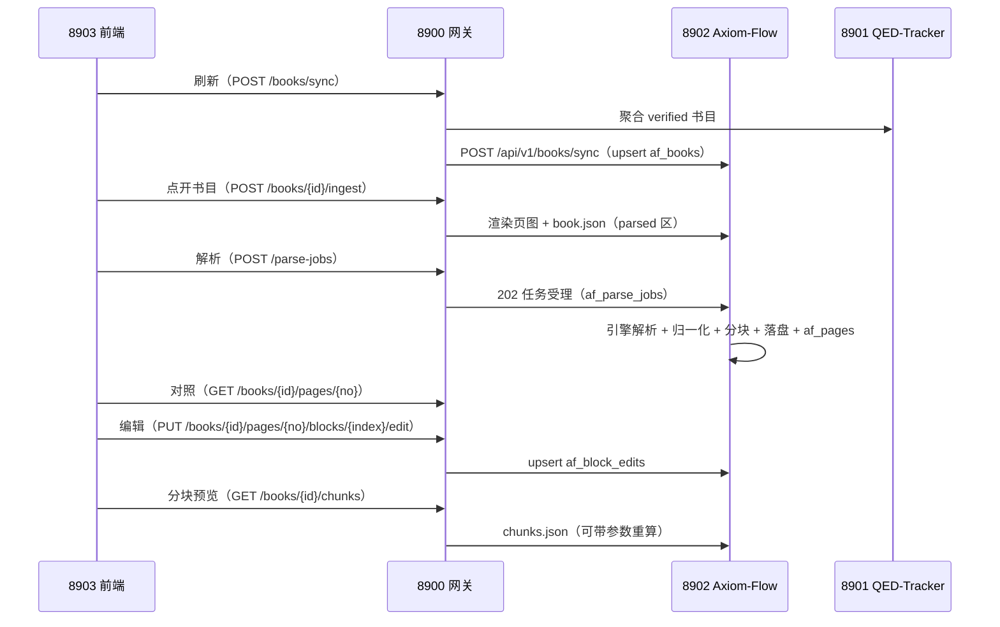

# 解析管理闭环设计（parsing-management）

设计状态：Accepted
确认状态：暂定
实现状态：Current（af_* 四表 + 同步/CRUD/ingest/异步解析/对照编辑/分块端点已实现）
最后更新：2026-09-17
关联代码：`src/axiom_flow/db/`、`src/axiom_flow/api/`、`src/axiom_flow/orchestrator/`
关联测试：`tests/contract/test_api_v1_contract.py`、`tests/unit/test_db.py`、`tests/unit/test_orchestrator.py`
关联 ADR：`docs/adr/0004-model-boundary-and-pipeline-ownership.md`、根仓库 [ADR 0014](https://github.com/QED-Engine/qed-engine/blob/main/docs/adr/0014-parsing-ownership-and-model-boundary.md)

> 本文档定义「文档解析管理」在 Axiom-Flow 侧的闭环：已验证书目同步、ingest、解析进度、
> 分块、对照数据供给与块级人工编辑。表结构见 `../architecture/database-design.md`；端点总表见
> `../architecture/api.md`；解析管线见 [parsing-pipeline.md](parsing-pipeline.md)。

## 背景与动机

QED-Engine「文档解析管理」界面需要按课程树展示**已验证（verified）书目**及其解析进度，
支持**逐页对照 + 块级人工校验修改**（判定/备注/文字修正/范围修正），并保证 QED-Tracker
（8901）与解析管线（本仓库）解耦。2026-09-14 根仓库 ARCH-020 重构裁决：af_* 由两表草案
（af_books/af_block_reviews）扩展为四表，块判定扩展为块编辑。

2026-09-17 用户裁决（PLAN-002）：本期优先交付**基本解析 + 分块**，对照编辑端点后置；
af_* 四表**一次迁移建全**（DDL 已冻结，编辑端点后置不影响表存在）。

## 设计原则

1. **解耦**：af_* 表为 Axiom-Flow 私有（qed 库 af_* 命名空间），只从 qt_books 同步已验证
   书行的只读元数据；QED-Tracker 任何故障/变更不影响本表读取。
2. **幂等**：同步以 `book_id`（同源 qt_books.book_id）为幂等键；编辑以
   `(book_id, page_no, block_index)` 为唯一键，重复提交覆盖更新。
3. **进度自持**：`ingest_status`/`parse_status`/`pages_done` 由本仓库维护。
4. **覆盖层**：解析产物文件为模型产物事实源，人工编辑落 `af_block_edits`，API 返回时合并；
   分块为派生文件（`chunks.json`），**不入库**、可重建。
5. **模型无感知**：解析经引擎适配器（[model-integration.md](model-integration.md)），本闭环
   不感知具体模型与调参。

## 数据流

## 表结构

四表（`af_books` / `af_parse_jobs` / `af_pages` / `af_block_edits`）DDL 与字段语义见
`../architecture/database-design.md`（结构事实源）；**一次 Alembic 迁移建全**。要点：

- `af_books`：已验证书快照（含 `file_path` 数据根相对路径、ingest/解析进度、notes）；
- `af_parse_jobs`：解析任务（pages NULL=全书、engine、status、progress）；
- `af_pages`：页级状态与质量信号（book_id+page_no 主键）；
- `af_block_edits`：块级人工编辑覆盖层（verdict/note/corrected_text/corrected_bbox）。

## API 契约（8902）

端点总表见 `../architecture/api.md` ②③；本闭环要点：

| 端点 | 语义 |
| --- | --- |
| `POST /books/sync` | 幂等 upsert af_books（请求 `[{book_id, domain_id, course_id, course_name, knowledge_id, title, part, authors, file_path}]`） |
| `GET /books`、`GET /books/{id}` | 书目列表/详情（af_books；空表回退文件系统） |
| `PATCH /books/{id}`、`DELETE /books/{id}` | 修改（notes）/删除（`?purge=true` 连产物） |
| `POST /books/{id}/ingest` | 渲染页图 + book.json（不调模型），回写 ingest_status/page_count/sha256 |
| `POST /parse-jobs`、`GET /parse-jobs/{id}` | 提交/查询解析任务（202 受理；pages 缺省 = 全本，指定 = 逐页） |
| `GET /books/{id}/pages/{no}` | 单页 blocks+markdown+image_url+已合并 edits |
| `PUT /books/{id}/pages/{no}/blocks/{index}/edit`、`GET .../edits` | 块编辑 upsert / 页内编辑列表 |
| `GET /books/{id}/chunks` | 分块预览（读 chunks.json；`?max_chars=&overlap_blocks=` 可实时重算） |

**错误语义**：400 参数非法；404 book/page/job 不存在；503 模型服务不可用。

**跨项目**：8900 现用 `/review`（ok/bad）需改 `/edit`（四表覆盖层），并补 `/ingest`、`/chunks`
透传；由本仓库 `REQ-001` 请求根仓库适配，根侧完成后回执。

## 降级与独立性

- 8902 离线 → 8900 返回 503，前端降级显示；8901 离线 → `POST /books/sync` 503（取数失败）；
- 模型服务离线 → 解析任务 `failed`（error 记原因），只读端点正常；
- 8900 离线 → 本仓库可经根仓库脚本手动启停模型并独立解析（[ADR 0004](../adr/0004-model-boundary-and-pipeline-ownership.md)）。

## 验证

1. 单元：sync 归一化/幂等（重复同步不产生重复行）、edit upsert 覆盖、ingest 幂等、chunk 规则；
2. 契约：`tests/contract/test_api_v1_contract.py`（端点结构与 schemas 一致）；
3. 联调冒烟：8903 → 8900 → 8901/8902 全链路（同步 → ingest → 解析 → 对照 → 编辑 → 回显）；
   8901/8902 离线降级验证。

## 备注

本文档为解析管理闭环（db/orchestrator/api 数据查询与对照部分）的 DesignRef 事实源；实施中
允许调整，调整时同步本文档与 `../architecture/api.md`、`../architecture/database-design.md`。

**配置语境（2026-09-17 用户裁决）**：af_* 落共享 MySQL `qed` 库（`qed_test` 为测试库）；
本服务本地启动读自身 `.env`（含 `QED_DB_NAME=qed`），由 QED-Engine 启动时经向上走查跟随根
`.env`，两边配置允许不一致。产物落 `<QED_DATA_ROOT>/parsed/<domain_id>/<course_id>/<book_id>/`，
`af_books.file_path` 为数据根相对路径（同源 `qt_books.file_path`），源 PDF 只读不复制。
MinerU 生命周期归 8900，本仓库只连接 `QED_OCR_MODEL_URL`（5002）；模型调参归 QED-Engine。
