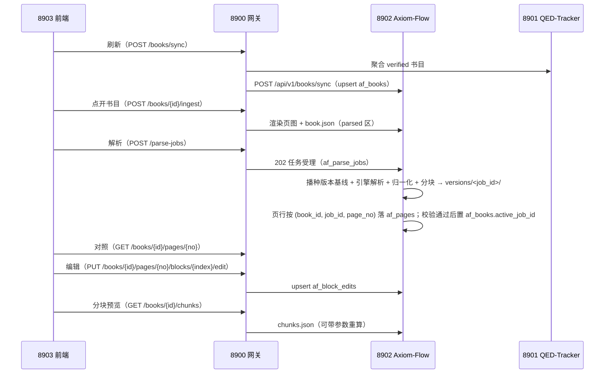

# 解析管理闭环设计（parsing-management）

设计状态：Accepted
确认状态：暂定
实现状态：Current（af_* 四表 + 同步/CRUD/ingest/异步解析/对照编辑/分块端点已实现；2026-09-21 起
读取面按生效解析版本解析目录，块编辑绑定其所属版本）
最后更新：2026-09-21
关联代码：`src/axiom_flow/db/`、`src/axiom_flow/api/`、`src/axiom_flow/orchestrator/`
关联测试：`tests/contract/test_api_v1_contract.py`、`tests/unit/test_db.py`、`tests/unit/test_orchestrator.py`
关联 ADR：`docs/adr/0004-model-boundary-and-pipeline-ownership.md`、根仓库 [ADR 0014](https://github.com/QED-Engine/qed-engine/blob/main/docs/adr/0014-parsing-ownership-and-model-boundary.md)

> 本文档定义「文档解析管理」在 Axiom-Flow 侧的闭环：已验证书目同步、ingest、解析进度、
> 分块、对照数据供给与块级人工编辑。表结构见 `../architecture/database-design.md`；端点总表见
> `../architecture/api.md`；解析管线见 [parsing-pipeline.md](parsing-pipeline.md)。

## 背景与动机

QED-Engine「文档解析管理」界面需要按课程树展示**已验证（verified）书目**及其解析进度，
支持**逐页对照 + 块级人工校验修改**（判定/备注/文字修正/范围修正），并保证 QED-Tracker
（8901）与解析管线（本仓库）解耦。2026-09-14 根仓库 ARCH-020 重构裁决：af_* 由两表草案
（af_books/af_block_reviews）扩展为四表，块判定扩展为块编辑。

2026-09-17 用户裁决（PLAN-002）：本期优先交付**基本解析 + 分块**，对照编辑端点后置；
af_* 四表**一次迁移建全**（DDL 已冻结，编辑端点后置不影响表存在）。

## 设计原则

1. **解耦**：af_* 表为 Axiom-Flow 私有（qed 库 af_* 命名空间），只从 qt_books 同步已验证
   书行的只读元数据；QED-Tracker 任何故障/变更不影响本表读取。
2. **幂等**：同步以 `book_id`（同源 qt_books.book_id）为幂等键；编辑以
   `(book_id, job_id, page_no, block_index)` 为唯一键，重复提交覆盖更新。
3. **进度自持**：`ingest_status`/`parse_status`/`pages_done` 由本仓库维护，且 `pages_done` 描述的是
   **生效版本**的已解析页数（不是全书历史累计）。
4. **覆盖层**：解析产物文件为模型产物事实源，人工编辑落 `af_block_edits`，API 返回时合并；
   分块为派生文件（`chunks.json`），**不入库**、可重建。
5. **模型无感知**：解析经引擎适配器（[model-integration.md](model-integration.md)），本闭环
   不感知具体模型与调参。
6. **版本隔离**：一次解析任务 = 一个解析版本（产物目录 `versions/<job_id>/` + 页状态/编辑的
   `job_id` 作用域），「哪一版生效」只由 `af_books.active_job_id` 单列决定；本闭环不做旧版本
   清理，也不做跨版本的人工编辑继承（块下标语义随版本变化，套用即污染）。

## 数据流

## 表结构

四表（`af_books` / `af_parse_jobs` / `af_pages` / `af_block_edits`）DDL 与字段语义见
`../architecture/database-design.md`（结构事实源）；**一次 Alembic 迁移建全**，解析版本作用域由
迁移 `20260920_0002` 增补，进度与结局分列由 `20260921_0001` 增补（ADR 0007）。要点：

- `af_books`：已验证书快照（含 `file_path` 数据根相对路径、ingest/解析进度、notes）+
  `active_job_id`（生效解析版本，`NULL` = 根视图 legacy）+ **进度与结局分列**：`parse_status`
  只表进度（`pending`/`parsing`），`last_parse_result` 只表最近一次任务结局
  （`completed`/`partial`/`failed`/`interrupted`，`''` = 从未有任务）；
- `af_parse_jobs`：**一次任务 = 一个解析版本**（pages NULL=全书、engine、status、progress，
  另有 `source_sha256`/`page_count` 自证本版解析的源文件与当时全书页数，`failed_pages` 是
  结构化、不截断的失败页码数组）；
- `af_pages`：页级状态与质量信号，主键 `(book_id, job_id, page_no)`（同一页在不同版本可有独立状态）；
- `af_block_edits`：块级人工编辑覆盖层（verdict/note/corrected_text/corrected_bbox），唯一键
  `(book_id, job_id, page_no, block_index)`，编辑绑定其所属版本。

## API 契约（8902）

端点总表见 `../architecture/api.md` ②③；本闭环要点：

| 端点 | 语义 |
| --- | --- |
| `POST /books/sync` | 幂等 upsert af_books（请求 `[{book_id, domain_id, course_id, course_name, knowledge_id, title, part, authors, file_path}]`）；`book_id`/`domain_id`/`course_id` 必须是安全路径段、`file_path` 为数据根相对路径（≤512 字符，**段规则为黑名单**：拒 `\`、半角 `:`、`/ : * ? " < > |`、控制字符、前导 `.` 与首尾空白/句点，全角标点放行——REQ-083），违规 422 |
| `GET /books`、`GET /books/{id}` | 书目列表/详情（af_books，含 `active_job_id`；空表回退文件系统） |
| `PATCH /books/{id}`、`DELETE /books/{id}` | 修改（notes）/删除：删 `af_books` 与该书**所有版本**的 `af_pages`/`af_block_edits` 行，`?purge=true` 连整本产物目录（含 `versions/`）一并删除；`af_parse_jobs` 历史行一律保留为审计 |
| `POST /books/{id}/ingest` | 渲染页图 + book.json（不调模型），回写 ingest_status/page_count/sha256。**重复 ingest 只替换根视图**（`book.json` + `pages/` 原子交换，`versions/` 完整保留），并置 `active_job_id=NULL`、`parse_status=pending`、`pages_done=0`，页行只清 `job_id='legacy'` 一批；历史版本状态与任务行保留，但旧版本不再对生效端点可见（源文件已变，需重新解析） |
| `POST /parse-jobs`、`GET /parse-jobs/{id}` | 提交/查询解析任务（202 受理；pages 缺省 = 全本，指定 = 逐页重解析，两者都产出一个**完整快照**版本；`pages` 越界在受理前 422，不探活不落任务行——DEFECT-006）。`status` 六态与判据见 [parsing-pipeline.md](parsing-pipeline.md) 条文 S1~S7；查询响应含 `failed_pages` |
| `GET /books/{id}/versions` | 解析版本只读列举（`job_id/engine/status/page_count/parsed/source_sha256/created_at/active`）；不改生效指针 |
| `GET /books/{id}/pages/{no}` | 单页 blocks+markdown+image_url+已合并 edits（**作用域 = 生效版本**；`active_job_id` 为空时读根视图 legacy） |
| `PUT /books/{id}/pages/{no}/blocks/{index}/edit`、`GET .../edits` | 块编辑 upsert / 页内编辑列表（写入生效版本的 `job_id`） |
| `GET /books/{id}/chunks` | 分块预览（读生效版本 `chunks.json`；`?max_chars=&overlap_blocks=` 可实时重算） |
| `GET /books/{id}/manifest` | 生效版本的产物清单，路径相对该版本目录（不含 `versions/<job_id>/` 前缀） |

**错误语义**：400 参数非法（含块下标越界、引擎槽位未实现）；404 book/page/job 不存在**或生效版本
目录缺失**（显式报错，不回落根视图）；422 入参 schema 违规（安全路径段、`file_path` 形态、引擎字面值、
`pages` 页码越界）；503 模型服务不可用（仅提交期探活失败，且不创建任务行）。

**引擎选择**：`POST /parse-jobs` 的 `engine` 可选，缺省回落 `AXIOM_OCR_ENGINE`；未实现/未知名称
一律显式报错，**绝不回落到其他引擎**（见 [model-integration](model-integration.md)）。

**跨项目**：8900 现用 `/review`（ok/bad）需改 `/edit`（四表覆盖层），并补 `/ingest`、`/chunks`
透传；由本仓库 `REQ-001` 请求根仓库适配，根侧完成后回执。**根侧承载行**为 `PLAN-044`／
`ARCH-020-D`（2026-09-21 改判：根仓库的 `REQ-001` 号已被 2026-08 端口迁移占用，与本方 `REQ-001`
同号不同事，故回执登记位置按对方计划行而非编号对齐）。

## 降级与独立性

- 8902 离线 → 8900 返回 503，前端降级显示；8901 离线 → `POST /books/sync` 503（取数失败）；
- 模型服务离线 → **提交期探活**返回 503 且不创建任务行；**已受理**任务的执行期故障记为 `failed`（error 记原因），只读端点正常；
- 8902 自身重启 → 冷启动受理首个请求**之前**做一次状态归一：上次进程遗留的 `queued`/`running` 任务行改判 `interrupted`，书目进度回 `pending`（ADR 0007 条文 S5/S6，前提是**单实例部署**，运维口径见 [operations.md](../guides/operations.md)）；只读端点在归一完成后即刻给出确定答案，不需要人工清理僵尸态；
- 8900 离线 → 本仓库可经根仓库脚本手动启停模型并独立解析（[ADR 0004](../adr/0004-model-boundary-and-pipeline-ownership.md)）。

## 验证

1. 单元：sync 归一化/幂等（重复同步不产生重复行）、edit upsert 覆盖、ingest 幂等、chunk 规则；
2. 契约：`tests/contract/test_api_v1_contract.py`（端点结构与 schemas 一致）；
3. 联调冒烟：8903 → 8900 → 8901/8902 全链路（同步 → ingest → 解析 → 对照 → 编辑 → 回显）；
   8901/8902 离线降级验证。

## 备注

本文档为解析管理闭环（db/orchestrator/api 数据查询与对照部分）的 DesignRef 事实源；实施中
允许调整，调整时同步本文档与 `../architecture/api.md`、`../architecture/database-design.md`。

**配置语境（2026-09-17 用户裁决）**：af_* 落共享 MySQL `qed` 库（`qed_test` 为测试库）；
本服务本地启动读自身 `.env`（含 `QED_DB_NAME=qed`），由 QED-Engine 启动时经向上走查跟随根
`.env`，两边配置允许不一致。产物落 `<QED_DATA_ROOT>/parsed/<domain_id>/<course_id>/<book_id>/`，
`af_books.file_path` 为数据根相对路径（同源 `qt_books.file_path`），源 PDF 只读不复制。
MinerU 生命周期归 8900，本仓库只连接 `QED_OCR_MODEL_URL`（5002）；模型调参归 QED-Engine。
