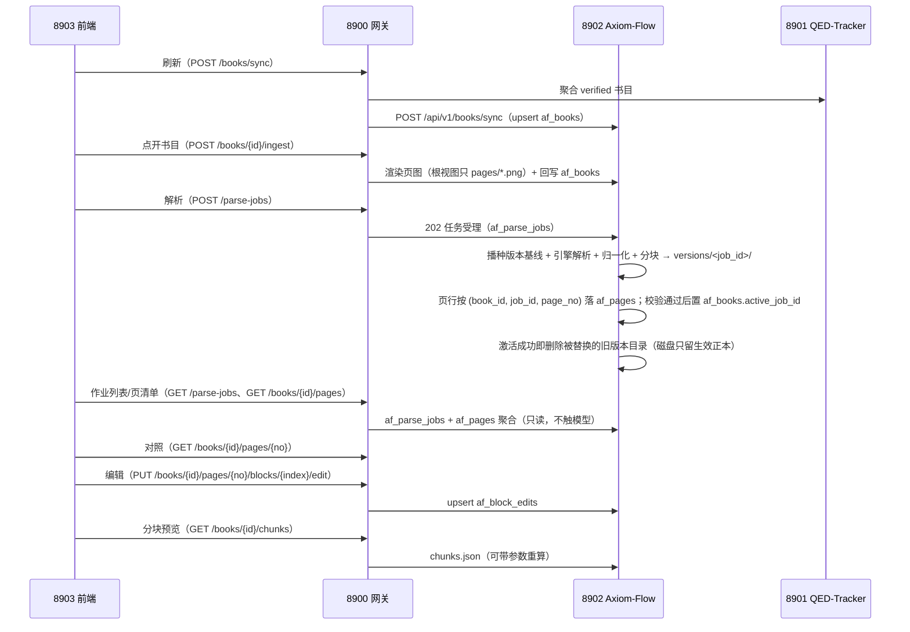

# 解析管理闭环设计（parsing-management）

设计状态：Accepted
确认状态：已确认
实现状态：Verified（af_* 表族 + 8902 管理与对照端点已实现并真机取证）
最后更新：2026-09-26
关联代码：`src/axiom_flow/db/`、`src/axiom_flow/api/`（含 `api/admin.py` 管理面）、`src/axiom_flow/orchestrator/`
关联测试：`tests/contract/test_api_v1_contract.py`、`tests/unit/test_db.py`、`tests/unit/test_orchestrator.py`
关联 ADR：[ADR 0004](../adr/0004-model-boundary-and-pipeline-ownership.md)、[ADR 0007](../adr/0007-parse-status-semantics.md)、根仓库 [ADR 0014](https://github.com/QED-Engine/qed-engine/blob/main/docs/adr/0014-parsing-ownership-and-model-boundary.md)

> **本篇回答的唯一问题**：一本书从「已验证书目」到「人工校验完成」，**状态如何流转、职责落在哪一段**。
> 产物怎么生成与什么算合格归 [parsing-pipeline.md](parsing-pipeline.md)；如何与模型服务对话归
> [model-integration.md](model-integration.md)。表结构与列语义的唯一事实源是
> [database-design.md](../architecture/database-design.md)，端点请求/响应形状的唯一事实源是
> [api.md](../architecture/api.md)——本篇一处都不复制它们，只写「谁写、何时写、写完给谁读」。

## 目标与非目标

**目标**：

1. 让 8903「文档解析管理」界面只消费 8902 一个数据源就能建树、看进度、发起解析、逐页对照与人工校验。
2. 把任务与书目的**状态语义**收在一处（[ADR 0007](../adr/0007-parse-status-semantics.md) 的执行面）：
   进度与结局分列、失败页结构化、终态判据与版本激活同源。
3. 让 af_* 闭环对上游故障免疫：8901/8900/模型服务任一离线，已落库的读取面照常给答案。
4. 让「重新解析一本书」成为**新增一个版本**而不是覆盖上一次：历史版本可逐页解释「当时成没成」。
5. 让人工校验结论可持久、可回显，且不会被套用到另一版产物上。

**非目标（各归其主）**：

- 表 DDL、列类型、迁移与回填策略 → [database-design.md](../architecture/database-design.md)。
- 端点参数、响应字段、错误码表 → [api.md](../architecture/api.md)。
- 页图渲染、归一化、产物目录布局与质量判据 → [parsing-pipeline.md](parsing-pipeline.md)。
- 引擎选择、调用协议与探活语义 → [model-integration.md](model-integration.md)。
- 旧版本磁盘清理与跨版本编辑继承：本篇**不做**（前者属 D 类数据操作需单独批准，后者会污染结论）。

## 边界与事实源

| 事项 | 本篇管 | 不管（事实源） |
| --- | --- | --- |
| af_* 表族 | 谁写哪一列、写入时机、可见性后果 | 列与约束：[database-design.md](../architecture/database-design.md) |
| 8902 端点 | 每条端点在闭环里的职责与不变式 | 参数与响应：[api.md](../architecture/api.md) |
| 任务/书目状态 | 六态判据、进度与结局分列、启动期归一 | 状态机的产物侧条件：[parsing-pipeline.md](parsing-pipeline.md) |
| 人工编辑 | 幂等键、覆盖层语义、版本绑定 | 版面块结构与 `index` 含义：[parsing-pipeline.md](parsing-pipeline.md) |
| 模块清单 | 不维护 | 职责与 DesignRef：[code-map.md](../architecture/code-map.md) |
| 部署与运维 | 单实例前提的归属 | 操作口径：[operations.md](../guides/operations.md) |

**配置语境**（不是本篇契约，只登记边界）：af_* 落共享 MySQL `qed` 库（`qed_test` 为本仓库自有测试库）；
本服务读自身 `.env`，由 QED-Engine 启动时经向上走查跟随根 `.env`，两边允许不一致（明确裁决，非默认行为）；
`af_books.file_path` 是数据根相对路径（同源 `qt_books.file_path`），产物落点见
[parsing-pipeline.md](parsing-pipeline.md)。

## 核心设计

### 生命周期与状态流转

### 确定规范

> 每条守则一行：**结论 ＋ 判据**在左，**理由／例外／边界**居中，**实现落点 → 守护测试**在右（原「条文表」
> 并入本段，编号 `PM-n` 只在本篇内解析）。缺某项即无该项，以「—」占位。表结构与列语义、端点参数与响应形状
> 不在本篇复制（事实源见文首指针）。

#### 数据来源与独立性

| 编号 | 守则（结论 ＋ 判据） | 理由／例外／边界 | 实现落点 → 守护测试 |
| --- | --- | --- | --- |
| PM-1 | **af_* 是私有表族**：只从 `qt_books` 同步「已验证」书行的只读快照；8901 的任何故障或结构变更都不进入本篇读取路径 | 课程归属字段冗余进 `af_books` 正是为此——上游改表不传导到解析管理面 | `db/repositories.py:BookRepository.upsert_many` → `tests/unit/test_db.py` |
| PM-2 | **同步幂等**：以 `book_id`（同源 `qt_books.book_id`）为幂等键，重复同步只 upsert 不产生重复行 | 例外：qt_books 侧删除或改名**不回写**已同步行（快照语义，重新同步才会带回） | `db/repositories.py:BookRepository.upsert_many` → `tests/unit/test_db.py`（重复同步不产生重复行） |

#### 幂等键、进度与覆盖层

| 编号 | 守则（结论 ＋ 判据） | 理由／例外／边界 | 实现落点 → 守护测试 |
| --- | --- | --- | --- |
| PM-3 | **编辑幂等键含解析版本**：`af_block_edits` 以 `(book_id, job_id, page_no, block_index)` 为唯一键 upsert，同版本同版面块重复提交＝覆盖更新 | 边界：`edit_id` 只是幂等标识，仓储一律按唯一键读写，故迁移前的存量行（旧摘要不含 `job_id`）升级后仍可达 | `db/repositories.py:BlockEditRepository.upsert`、`edit_id_for()` → `tests/unit/test_db.py`（edit upsert 覆盖） |
| PM-4 | **进度由本篇自持，且只描述生效版本**：`ingest_status`/`parse_status`/`pages_done` 由本篇维护，不依赖 qt_books 之外的上游字段；`pages_done` 与 `active_job_id` 一致地描述**生效版本**，不是全书历史累计 | — | `db/repositories.py:BookRepository.update_parse` → `tests/unit/test_db.py` |
| PM-5 | **人工编辑是覆盖层，不改产物文件**：解析产物文件是模型产物事实源，人工编辑只入 `af_block_edits`、**不改文件**；读取端在响应里按生效版本合并编辑 | 后果：「产物没变、校验结论变了」两件事可分别追溯 | `api/main.py` 单页端点合并 edits → `tests/contract/test_api_v1_contract.py` |

#### 生效指针与引擎边界

| 编号 | 守则（结论 ＋ 判据） | 理由／例外／边界 | 实现落点 → 守护测试 |
| --- | --- | --- | --- |
| PM-6 | **「哪一版生效」只有一列**：唯一事实源是 `af_books.active_job_id`（`NULL` = 根视图 `legacy`），`af_parse_jobs` **不设布尔生效列**；改写只经 `BookRepository.set_active_job()` 的单列 UPDATE | 为什么：同一事实两处存必漂移。产物目录布局与齐备判据见 [parsing-pipeline.md](parsing-pipeline.md) | `db/repositories.py:BookRepository.set_active_job` → `tests/unit/test_orchestrator.py` |
| PM-7 | **闭环对模型无感知**：闭环只传引擎名称，不感知模型、参数与服务地址；换模型不影响任何状态列的语义 | 协议事实源见 [model-integration.md](model-integration.md) | `orchestrator/pipeline.py:run_parse_job` → `tests/unit/test_orchestrator.py` |

#### 任务与书目状态语义

| 编号 | 守则（结论 ＋ 判据） | 理由／例外／边界 | 实现落点 → 守护测试 |
| --- | --- | --- | --- |
| PM-8 | **任务状态六态，原值透传**：`queued`/`running` 为活动态；终态 `completed`（目标页齐备）、`partial`（≥1 页 `parsed` 但未齐备）、`failed`（0 页产出或引擎整体异常）、`interrupted`（上次进程遗留） | 边界：六态**原值透传给前端**，不做「看起来更好」的归并——读取面一旦加工，就把语义分歧冻结给了前端 | `schemas.py:JobStatus`、`api/main.py` 响应 → `tests/contract/test_api_v1_contract.py` |
| PM-9 | **失败页结构化且不截断**：`af_parse_jobs.failed_pages` 存页码数组——「哪些页失败」必须是可机读的事实 | 边界：`error`（≤500）与 `progress.error`（≤200）只是给人看的摘要，摘要截断不丢页码 | `db/repositories.py:ParseJobRepository.mark_finished` → `tests/unit/test_db.py` |
| PM-10 | **书目进度与结局分列**：`parse_status` ∈ `pending`/`parsing` 只表进度；`last_parse_result` ∈ `completed`/`partial`/`failed`/`interrupted`（`""` = 从未有任务）**只在终态写入** | 为什么：运行中的进度刷新不得覆盖结局——根因是旧 `parse_status` 一列两用（该缺陷已修，判据由本条固定） | `db/repositories.py:BookRepository.update_parse`、`mark_parse_idle` → `tests/unit/test_db.py` |
| PM-11 | **`completed` 与版本激活同一判据**：齐备判定一次产出「任务终态」与「指针动作」，故「`completed` 但未激活」在**结构上不可能**，不是靠文档约定 | 例外：`partial`/`failed`/中断一律不激活，产物保留在 `versions/` 供排查（自然回滚 = 指针从未动过） | `orchestrator/pipeline.py:_version_is_complete` → `tests/unit/test_orchestrator.py` |

#### 中断、续跑与进度写入

| 编号 | 守则（结论 ＋ 判据） | 理由／例外／边界 | 实现落点 → 守护测试 |
| --- | --- | --- | --- |
| PM-12 | **`interrupted` 的唯一写入者是启动期归一**：`JobRunner.reconcile_on_startup()` 在 FastAPI `lifespan` 内、**受理首个请求之前**把遗留 `queued`/`running` 行改写为 `interrupted`，书目进度归 `pending`；结局仅在该任务是这本书的**最新**任务时置 `interrupted` | 反向约束：管线自身不产出 `interrupted`，迁移与运维脚本也不改写历史任务的 `status`（回填旧行为新三态＝伪造历史） | `orchestrator/jobs.py:JobRunner.reconcile_on_startup` → `tests/unit/test_orchestrator.py` |
| PM-13 | **单实例部署前提**：PM-12 成立的前提是「写活动态的只有这个进程」 | 后果：多实例会让存活实例的任务被同伴误判为中断——本契约显式承担该部署约束，代价与运维口径见 [operations.md](../guides/operations.md) | 部署边界（无独立代码落点） → `docs/guides/operations.md` 口径 |
| PM-14 | **`interrupted` 的续跑 = 同 `job_id` 重放**：不新建版本，已 `parsed` 且产物在位的页跳过引擎调用；重放方式因此是「再提交一次同 id」而不是「从头再来」 | 产物侧判据见 [parsing-pipeline.md](parsing-pipeline.md) | `orchestrator/pipeline.py:_resumed_pages` → `tests/unit/test_orchestrator.py` |
| PM-15 | **进度写入节流，但失败即时可见**：`progress` 在「距上次写入 ≥1 秒」或「每处理满 10 页」时覆写一次，终态必写一次，单页失败节点强制写入（使 `progress.error` 实时可见） | 边界：全本任务按**解析窗口**推进，运行中读到非零中间值是常态；`persist_per_page=False` 仅供性能排查退回调用方统一提交，不是静默兜底路径 | `orchestrator/pipeline.py:_flush_progress` → `tests/unit/test_orchestrator.py` |

#### 书目生命周期动作

| 编号 | 守则（结论 ＋ 判据） | 理由／例外／边界 | 实现落点 → 守护测试 |
| --- | --- | --- | --- |
| PM-16 | **重复 ingest 只作废根视图**：`POST /books/{id}/ingest` 成功后把 `active_job_id` 置 `NULL`、`parse_status` 归 `pending`、`pages_done` 归零，并只清 `job_id='legacy'` 的页行；历史版本作用域的页行、任务行与编辑行全部保留 | 为什么：源文件已变，旧版本不再对生效端点可见，但不会被伪造或删除。例外：`last_parse_result` **不回置**——ingest 不是任务 | `db/repositories.py:PageRepository.reset_legacy`、`api/main.py` ingest 路由 → `tests/contract/test_api_v1_contract.py` |
| PM-17 | **删除保审计，一键清除是唯一例外**：`DELETE /books/{id}` 删书目行与该书**所有版本**的页行/编辑行（`?purge=true` 连产物目录一并删），但 `af_parse_jobs` 历史行保留为审计线索 | 例外：唯一能删任务行的路径是 `POST /api/v1/admin/purge`（见下「管理面」），它存在的目的正是回到干净状态 | `api/admin.py`、`db/repositories.py:ParseJobRepository.delete_for_book` → `tests/contract/test_api_v1_contract.py` |

### 端点语义（形状一律见 api.md）

- **书目面**（`/books/sync`、`GET/PATCH/DELETE /books/{id}`）：同步入口 + 只读快照消费 + 带审计的删除；
  读取面**纯 DB 驱动**：af_books 空表即空列表 / 404，不回落文件系统 `book.json`（根视图已无元数据
  文件可回落，唯一事实源是本表）。
- **ingest**（`POST /books/{id}/ingest`）：状态机里唯一能作废根视图的动作（PM-16），本身不调模型。
- **解析任务**（`POST /parse-jobs`、`GET /parse-jobs/{id}`）：202 受理即返回，执行在后台单 worker 队列；
  `pages` 缺省＝全本、指定＝逐页重解析，两者都产出一个完整快照版本。
- **作业列表**（`GET /parse-jobs`）：任务中心抽屉的数据源。跨书列表**没有单一产物作用域**，因此它不读
  磁盘、不经版本解析入口，`active` 经 `af_books` 联结取得——审计行照常列出且恒 `false`。
- **逐页状态清单**（`GET /books/{id}/pages`）：失败页重解析按钮的数据源，一次给全集故**不分页**
  （「齐备与否」是全集判据）。客户端只需实现一条判据：无产物或 `failed` ⇒ 需重解析。
- **对照与编辑**（`GET /books/{id}/pages/{no}`、`PUT .../blocks/{index}/edit`、`GET .../edits`）：
  作用域恒等于生效版本；写入落到该 `job_id` 的编辑行（PM-5）。
- **版本列举**（`GET /books/{id}/versions`）：**只读**；切换/回滚不提供写入端点（属既定契约缺口，
  不是遗漏），天然回滚方式是把 `active_job_id` 置回 `NULL`。
- **分块预览**（`GET /books/{id}/chunks`、`GET /books/{id}/manifest`）：读生效版本的派生产物；
  带参数时实时重算、不落盘。`manifest` 在 legacy 作用域（`active_job_id` 为 `NULL`）固定 404
  「尚无生效版本」——根视图不再有清单正本，重算会把已退役的文件再写回磁盘。
- **管理面**（`POST /admin/purge`）：**非公开**——默认不挂载、需管理 token 与逐字确认、`dry_run` 缺省，
  且只执行 DML（无 DDL、无 `DROP DATABASE`）。六条不变式与错误语义的事实源在
  [api.md「非公开管理面」](../architecture/api.md)；8900 与 8903 不得透传。

## 失败与质量语义

- **8902 离线** → 8900 返回 503，前端降级显示；**8901 离线** → `POST /books/sync` 503（取数失败），
  已同步行照常可读。
- **模型服务离线** → 提交期探活返回 503 且**不创建任务行**（因此列表里不会出现「一条从未跑过的
  failed」）；已受理任务的执行期故障记 `failed` 并把原因写进 `error`，只读端点不受影响。
- **8902 自身重启** → 冷启动在受理首个请求之前完成 PM-12 归一，只读端点随即给出确定答案，不需要
  人工清理僵尸态。
- **8900 离线** → 本仓库可经根仓库脚本手动启停模型并独立解析（[ADR 0004](../adr/0004-model-boundary-and-pipeline-ownership.md)）。
- **磁盘产物被外部删除** → 读取端**如实报错不回落**：生效版本目录缺失即 404，页行 `parsed` 而无产物
  在逐页清单里原样暴露。静默改判会让磁盘事故从台账上消失。
- **错误码归属**：400 参数非法（版面块下标越界、引擎槽位未实现）；404 资源不存在**或生效版本产物缺失**；
  422 入参 schema 违规（含列表端点查询参数）；503 只属于提交期探活失败。逐行定义见
  [api.md 错误语义](../architecture/api.md)。

## 验收判据

1. 同步幂等：重复 `POST /books/sync` 行数不变 → `tests/unit/test_db.py`（`BookRepository` 幂等用例）。
2. 状态语义四件套（六态、失败页结构化、进度/结局分列、启动期归一）→ `tests/unit/test_db.py`、
   `tests/unit/test_orchestrator.py`、`tests/contract/test_api_v1_contract.py`。
3. 版本作用域读写与删除面（含审计保留）→ `tests/unit/test_db.py`、契约测试的 `delete`/`purge` 用例。
4. 只读端点结构与 schemas 一致、不泄漏磁盘绝对路径与凭据 → `tests/contract/test_api_v1_contract.py`。
5. 端到端联调（8903 → 8900 → 8901/8902：同步 → ingest → 解析 → 对照 → 编辑 → 回显）与 8901/8902
   离线降级 → 需 8903 排期窗口，联调证据归根仓库侧（`docs/trackers/completed.md` 的对照/编辑两行）。

## 追溯

- **跨项目**：8900 现用 `/review`（ok/bad）需改 `/edit`，并补 `/ingest`、`/chunks` 透传；由本仓库
  `REQ-001` 请求根仓库适配（根侧承载行为其 `PLAN-044`／`ARCH-020-D`）。
- **条文来源**：本篇的 `interrupted` 启动期归一与进度/结局分列来自
  [ADR 0007](../adr/0007-parse-status-semantics.md) 的裁决，由 PLAN-006 实施；版本作用域来自 PLAN-004；
  只读清单与作业列表端点来自 PLAN-008；一键清除来自 PLAN-010 与 PLAN-011（四者均已归档，
  去处见 [plans/index.md](../plans/index.md)）。
- **叙述框架**：本篇的六段结构与 `PM-n` 编号由 [PLAN-012](../history/plans/2026-09/2026-09-23-design-narrative-framework.md)
  建立；日期化的执行过程与真机读数一律在 [trackers/completed.md](../trackers/completed.md)。
