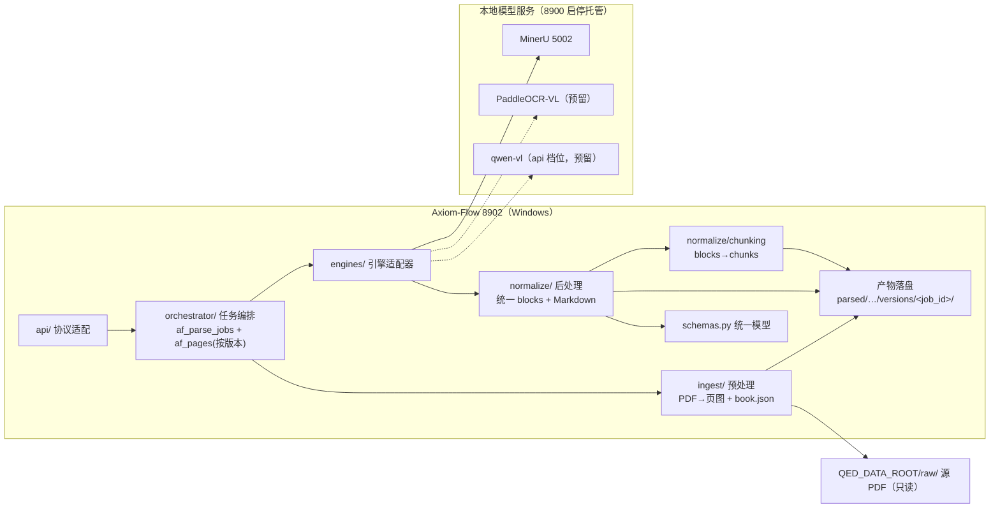

# PDF 解析与渲染管线设计（parsing-pipeline）

设计状态：Accepted
确认状态：已确认
实现状态：Verified（全链路已实现并真机取证；日期化过程见 trackers/completed.md）
最后更新：2026-09-23
关联代码：`src/axiom_flow/ingest/`、`src/axiom_flow/schemas.py`、`src/axiom_flow/engines/`、`src/axiom_flow/normalize/`、`src/axiom_flow/orchestrator/`
关联测试：`tests/unit/test_ingest.py`、`tests/unit/test_schemas.py`、`tests/unit/test_engines.py`、`tests/unit/test_normalize.py`、`tests/unit/test_chunking.py`、`tests/unit/test_orchestrator.py`、`tests/contract/test_api_v1_contract.py`、`tests/smoke/test_live_mineru_chain.py`
关联 ADR：[ADR 0001](../adr/0001-v2-exploration-direction.md)、[ADR 0004](../adr/0004-model-boundary-and-pipeline-ownership.md)、[ADR 0007](../adr/0007-parse-status-semantics.md)

> **本篇回答的唯一问题**：一份 PDF 怎样变成可消费的产物，以及**什么算合格**。
> 状态流转与职责分段归 [parsing-management.md](parsing-management.md)；如何与模型服务对话归
> [model-integration.md](model-integration.md)。端点形状的唯一事实源是
> [api.md](../architecture/api.md)，表结构是 [database-design.md](../architecture/database-design.md)，
> 模块清单是 [code-map.md](../architecture/code-map.md)——本篇不复制它们，只写产物怎么来、
> 合格怎么判。

## 目标与非目标

**目标**：

1. 把教材 PDF 完整解析为**统一格式**（页级结构化版面块 + 页级 Markdown + 书级知识块），供 8903
   高还原对照展示与人工校验消费，坐标可回指原页图像素位置。
2. 让产物**可追溯、可重建**：一次解析任务 = 一个完整快照版本，历史版本逐页可解释「当时这页成没成」。
3. 让失败**局部化**：单个页面或单个解析窗口失败不牵连整本，进度与失败原因实时可读，续跑不重做已成功页。
4. 让质量**可判定**：每页落质量信号，映射缺口以可见丢弃计数暴露，不允许「看起来解析得干净」。
5. 为 RAG/探索轮预留知识块（分块），且不因此污染产物事实源。

**非目标（各归其主）**：

- 任务与书目状态机、af_* 列语义、端点契约 → [parsing-management.md](parsing-management.md) 与
  [architecture/](../architecture/api.md)。
- 引擎选择规则、三段式提交协议、超时与重试层、占用闸门 → [model-integration.md](model-integration.md)。
- 模型文件、容器启停与推理调参（`processing_window_size` 等）→ 根仓库 8900（[ADR 0004](../adr/0004-model-boundary-and-pipeline-ownership.md)）；
  本仓库只连接、不感知。
- 人工编辑的存储与合并语义 → [PM-3、PM-5](parsing-management.md)；本篇只定义编辑定位所依赖的版面块结构。
- 旧版本磁盘清理：不做（属 D 类数据操作，需单独批准）。

**形态决策**（为什么长这样）：管线全部在本仓库，模型生命周期在根仓库 8900，解析**直连**模型服务、
不经网关；引擎以适配器可插拔（MinerU 先落地，PaddleOCR-VL / qwen-vl 预留）。调用粒度**默认全本**
（整本一次解析，阅读序与跨页更优），指定 pages 时逐页页图重解析。持久化采取「**文件系统承载产物
正本 + af_* 只存元数据与状态**」，知识块是派生文件、不入库、可重建。展示是对照模式：原页高清图 +
解析重渲染 + 版面块级人工校验。

## 边界与事实源

| 事项 | 本篇管 | 不管（事实源） |
| --- | --- | --- |
| 产物目录与文件 | 布局、命名、原子写入、版本目录与播种 | 清单字段与响应形状：[api.md](../architecture/api.md) |
| 统一 blocks 格式 | 类型集合、坐标空间换算、可见丢弃、对账不变式 | 表结构与列：[database-design.md](../architecture/database-design.md) |
| 知识块 | 切分规则与溯源字段 | 端点参数与实时重算：[api.md](../architecture/api.md) |
| 合格判据 | 质量信号含义、验收判据 | 状态机与结局分列：[parsing-management.md](parsing-management.md) |
| 引擎调用形状 | 窗口切分与页号还原的**产物侧后果** | 协议、超时、重试、闸门：[model-integration.md](model-integration.md) |
| 模块职责 | 不维护 | 路径、DesignRef、状态：[code-map.md](../architecture/code-map.md) |

**术语（全库统一，裸「块」禁用）**：

| 术语 | 英文/标识 | 含义 |
| --- | --- | --- |
| 版面块 | block | 页内一个结构化内容单元（`p<NNNN>.blocks.json` 数组元素），版面块编辑的定位单位 |
| 解析窗口 | window | 全本任务一次提交的连续页区间，默认 56 页（`AXIOM_PARSE_WINDOW_SIZE`），失败域单位 |
| 知识块 | chunk | 书级版面块序列切分出的检索/展示单元，落 `chunks.json`，派生可重建 |

## 核心设计

### 管线总览



| 阶段 | 模块 | 内容 |
| --- | --- | --- |
| 预处理 | `ingest/` | 源 PDF（数据根相对路径，只读）→ 150 DPI 原页图 + `book.json`；不调模型 |
| 调用 | `engines/` | 直连模型服务；默认全本（按解析窗口串行提交），指定 pages 时逐页页图 |
| 后处理 | `normalize/` | 原始输出 → 统一版面块（类型映射/坐标换算/阅读序）+ 页级 Markdown + 质量信号 |
| 分块 | `normalize/chunking` | 书级有序版面块 → 知识块，落 `chunks.json` |

### 产物布局

产物落 `<QED_DATA_ROOT>/parsed/<domain_id>/<course_id>/<book_id>/`（`domain_id` 为空时该层省略，
如 `parsed/linear_algebra/linearalgebra-b01/`，与根仓库 `dataset-conventions` 的「空段不建目录」一致）：

```text
<QED_DATA_ROOT>/
├── raw/<domain_id>/<course_id>/<slug>_<sha8>.pdf   # 只读输入（QED-Tracker 写入）
├── tmp/                                        # 根仓库工作区；**本服务不写数据根 tmp**（PP-6）
└── parsed/<domain_id>/<course_id>/<book_id>/
    ├── book.json            # book_id/title/authors/page_count/sha256/source_file/engine/ingested_at
    ├── manifest.json        # 根视图清单（路径 + 大小 + SHA-256；**不递归 versions/**）
    ├── pages/               # 原页图正本（ingest 拥有，150 DPI，对照左栏 + bbox 基准）
    │   └── p0001.png
    └── versions/<job_id>/   # 一次解析任务 = 一个完整快照版本
        ├── book.json        # 自基线继承（使版本目录自解释）
        ├── manifest.json    # 版本内清单，路径相对该版本目录
        ├── chunks.json      # 知识块（派生、不入库、可重建）
        └── pages/
            ├── p0001.png            # 与根页图同 inode 的硬链接（回落复制时告警）
            ├── p0001.md             # 页级 Markdown（$$...$$ / $...$ 内嵌公式）
            └── p0001.blocks.json    # 统一版面块（结构化，含 bbox）
```

`book.json` 的 `source_file` 为数据根相对路径（同源 `qt_books.file_path`）；`engine` 为实际引擎标识
（mineru / paddleocr-vl / qwen-vl）。

### 统一版面块格式

`schemas.py` 是内外契约的单一事实源：

```json
{
  "page": 1,
  "image_size": [1240, 1754],
  "source": "mineru",
  "blocks": [
    {"index": 0, "type": "heading", "level": 1, "text": "...", "bbox": [72, 54, 540, 80], "order": 0, "confidence": 0.97},
    {"index": 1, "type": "formula", "latex": "x + y = y + x", "display": true, "bbox": [72, 150, 540, 175], "order": 1}
  ],
  "quality": {"empty_block_ratio": 0.0, "avg_formula_confidence": 0.95, "table_count": 1, "text_length_ratio": 0.98}
}
```

### 知识块产物

`chunks.json` **每个解析版本一份**，落在该版本目录内（派生文件，不入库）：

```json
{
  "book_id": "mathanalysis-b05",
  "params": {"max_chars": 1000, "overlap_blocks": 1},
  "chunks": [
    {"chunk_id": "c0001", "order": 0, "type": "mixed",
     "text": "...（公式以 $$...$$ 内嵌）...",
     "page_start": 32, "page_end": 33,
     "block_refs": [{"page": 32, "index": 3}, {"page": 33, "index": 0}],
     "bbox": [72, 150, 540, 420], "char_count": 412}
  ]
}
```

### 确定规范

> 每条守则一行：**结论 ＋ 判据**在左，**理由／例外／边界**居中，**实现落点 → 守护测试**在右（原「条文表」
> 并入本段，编号 `PP-n` 只在本篇内解析）。缺某项即无该项，以「—」占位。表结构与列语义、端点参数与响应形状
> 不在本篇复制（事实源见文首指针）。

#### 管线形态与输入

| 编号 | 守则（结论 ＋ 判据） | 理由／例外／边界 | 实现落点 → 守护测试 |
| --- | --- | --- | --- |
| PP-1 | **单向流水线：每阶段只吃上一阶段的内存产物**：源 PDF → 页图 → 引擎原始输出 → 归一化 → 知识块切分 → 原子落盘；每阶段只消费上一阶段的内存产物，不读磁盘上的中间暂存 | 边界：不设自动引擎兜底（[ADR 0004](../adr/0004-model-boundary-and-pipeline-ownership.md)） | `orchestrator/pipeline.py:run_parse_job` → `tests/unit/test_orchestrator.py` |
| PP-2 | **预处理不调模型**：`ingest/` 把数据根相对路径的源 PDF 渲染为 150 DPI 原页图并生成 `book.json`（page_count/sha256/source_file） | 边界：源 PDF 只读、不复制。归属：预处理与后处理两段恒在本仓库实现，引擎侧只收源件与产物形态开关（见 [MI-15](model-integration.md)） | `ingest/importer.py:ingest_book`（页图渲染 + `write_book_meta`） → `tests/unit/test_ingest.py` |

#### 落盘与路径安全

| 编号 | 守则（结论 ＋ 判据） | 理由／例外／边界 | 实现落点 → 守护测试 |
| --- | --- | --- | --- |
| PP-3 | **页文件名只有一种格式**：`p<NNNN>.png` / `p<NNNN>.md` / `p<NNNN>.blocks.json`，`NNNN` = 页码 1 基四位零填充，由 ingest 首建，解析写入与 API 读取沿用同一格式 | 边界：版本内页图与根页图同名同内容 | `ingest/importer.py` 首建、`orchestrator/pipeline.py:_write_page_artifacts` 与 `api/main.py` 沿用 → `tests/unit/test_ingest.py` |
| PP-4 | **原子落盘、无搬迁阶段**：任何产物写入都是「临时文件 → 校验 → 原子替换」，不留半成品；版本目录从**第一页产物写入起**就是目标目录 | 不存在「先写别处、成功末尾再搬」——那会与 PP-13 的页级持久化不变式冲突 | `ingest/artifacts.py` 原子写入 + `version_dir_for()` → `tests/unit/test_ingest.py` |
| PP-5 | **数据根双闸：单段名 + 根内路径**：`domain_id`、`course_id`、`book_id`、`job_id` 必须是安全单段（拒绝 `/`、`..`、前导点与空串；`domain_id`/`course_id` 允许空表示未归属），违规在 schema 层 422；源 PDF 与全部落盘路径必须位于 `QED_DATA_ROOT` 之内（`resolve_source_pdf` 对绝对路径同样受限） | 写盘前经 `ingest/artifacts.ensure_within()` 纵深防御（符号链接与 `..` 归一化后仍受限）；数据根唯一事实源是 `config.load_settings().data_dir` | `ingest/artifacts.py:ensure_safe_segment/ensure_within`、`schemas.py` → `tests/unit/test_schemas.py`、`tests/unit/test_ingest.py` |
| PP-6 | **不写数据根 `tmp/`**：引擎提交/轮询/取结果的全部中间产物只存在于内存（HTTP 响应字节 → 解析后的结构），因此 `tmp/axiom-flow/<job_id>/` 恒不应出现 | 该目录一旦存在即视为缺陷。曾按 v1 习惯把它记作「未实现的暂存目录」，属设计表述错误，后改判为本条的字面判据 | 无落盘中间产物（内存直解） → `tests/contract/test_api_v1_contract.py`（数据根只有 `raw/`+`parsed/`） |

#### 版面块归一

| 编号 | 守则（结论 ＋ 判据） | 理由／例外／边界 | 实现落点 → 守护测试 |
| --- | --- | --- | --- |
| PP-7 | **十种版面块类型，按类型强制必需字段**：类型集合为 `heading / paragraph / formula / table / image / list / caption / header / footer / page_number`，必需字段分别为 heading.text+level、formula.latex、table.html、image.path、list.items、其余 text；`index` 为页内版面块数组下标（0 基，版面块编辑定位用它），`order` 为阅读顺序；`bbox` 为原页图像素坐标 `[x0, y0, x1, y1]`（左上原点），基准 `pages/p<NNNN>.png` | — | `schemas.py:Block` 判别字段 → `tests/unit/test_schemas.py` |
| PP-8 | **坐标空间显式声明，按声明换算**：原始版面块的 `bbox` 属于哪种坐标空间由 `PageResult.bbox_space` 声明（`pdf_points` / `normalized_1000` / `pixels`），`normalize/blocks.scale_bbox` 按声明换算：`normalized_1000` → `px = bbox / 1000 * image_size`（逐轴），`pixels` → 仅夹取，`pdf_points` → 按 `image_size / page_size` 缩放（**唯一以 `page_size` 为基准的空间**） | 实证：MinerU 3.4.4 声明为 `normalized_1000`（相对页框逐轴归一到 0–1000），整本（PDF）与逐页（PNG）两条提交路径同一空间。反例：`middle_json.pdf_info[].page_size` 仅在 PDF 输入时是真实 PDF 点尺寸，PNG 输入时是引擎按 200 DPI 折算的标称点（1241x1755 页图 → `[446, 631]`），因此**不得用作缩放基准**，在归一化侧只留档不参与换算。例外：缺失 `bbox` 的版面块直接铺满页图，不做二次映射 | `normalize/blocks.py:scale_bbox`、`engines/*:PageResult.bbox_space` → `tests/unit/test_normalize.py`、`tests/unit/test_engines.py` |
| PP-9 | **可见丢弃与对账不变式**：映射表未覆盖的字面值、以及必需字段缺失的条目（表格无 HTML、公式无 LaTeX、图片无路径、列表无条目）一律计入 `QualityMetrics.dropped_block_count` / `dropped_types`，**不静默丢版面块、不以占位条目补齐**；`index` 只在存活版面块上连续编号，因此 `原始条目数 = 存活版面块数 + dropped_block_count` 恒成立 | 例外：整页 Markdown 回退（铺满全页的单个 paragraph 版面块）只在引擎**未回任何结构化条目**时触发；回了条目却全部未能归一时**不回退**——否则映射缺口会被伪装成一个正文版面块。边界：`_TYPE_MAP` 同时收录 `header`/`footer` 与旧版 `page_header`/`page_footer`（并存以免版本回退）。成对约束：映射表版本与产物必须**成对**——增删字面值会改变同页存活版面块的下标含义，所以编辑必须绑定它核对时所在的解析版本（作用域语义见 [PM-3](parsing-management.md)）；修复前落盘的产物与其 `index` 不回溯修正，需重解析后在新版本上重建编辑 | `normalize/blocks.py:normalize_page`（`_TYPE_MAP` + 丢弃计数） → `tests/unit/test_normalize.py`（对账不变式） |
| PP-10 | **公式定界符契约：`latex` 恒为裸源码**：`formula.latex` 恒为**裸 LaTeX 源码**，行间/行内只由 `display` 表达；`normalize/blocks.split_math_delimiters` 在归一时剥掉成对定界符并让它决定 `display`：`$$…$$` 与 `\[…\]` → `display=true`，`$…$` 与 `\(…\)` → `display=false` | 引擎可能把定界符连内容一起返回（MinerU 3.4.4 的 `equation` 条目 `latex` 自带 `$$…$$`，且行间式不走 `interline_equation` 字面值、靠类型判不出行间）；而 `blocks_to_markdown` 与 `chunking.block_text` 都按「裸源码 + `display`」再包一层，定界符漏进 `latex` 就产出 `$$$…$$$`，KaTeX 无法渲染并污染 `chunks.json`。例外：剥后内部仍含同种定界符（两段公式拼进一个条目）时**不剥**，保留可见异常等人工判定 | `normalize/blocks.py:split_math_delimiters` → `tests/unit/test_normalize.py` |

#### 提交形状与页结果

| 编号 | 守则（结论 ＋ 判据） | 理由／例外／边界 | 实现落点 → 守护测试 |
| --- | --- | --- | --- |
| PP-11 | **解析窗口串行提交，失败域＝一个窗口**：全本任务把请求页 `1..page_count` 按 `AXIOM_PARSE_WINDOW_SIZE`（默认 **56**：真机实测 56 页 ≈4.4 秒/页，且 56 ≤ 容器 `processing_window_size=64`）切成连续区间，**串行**提交，每窗口一次 `parse_document(start_page, end_page)`（1 基含两端；页号还原规则见 [model-integration.md](model-integration.md)）。四条配套判据：① **失败域＝一个窗口**——窗口级 `EngineError` 只把该窗口目标页记 `failed`，原因写 `窗口 {a}-{b}：{引擎原文}` 进 `progress.error` 与终态 `error`，随后继续下一窗口，单窗口失败不把整本判 `failed`；② **不做窗口级重试**——最坏挂钟 = 窗口数 × 单窗口超时，重试会把它翻倍，恢复路径是同 job 重跑；③ **窗口间探活即止**——每窗口提交前查 `engine.health()`，服务已不可用就不再提交剩余窗口、把剩余目标页记 `failed` 并写「模型服务不可用」，避免拿剩余窗口逐个撞超时形成僵尸任务；④ **不改版本语义**——一次任务仍是一个解析版本，分块只改提交形状，激活门槛与目录布局零变化 | 适配器一次调用只有一个 `deadline`，而引擎侧按自己的批次推理——317 页书整本单提交会在超时墙处失败，且异常直接上抛使任务 `progress` 恒 0（既不可观测也无从续跑） | `orchestrator/pipeline.py:_page_windows()`、`_await_engine()` → `tests/unit/test_orchestrator.py` |
| PP-12 | **空白页是合法产物**：适配器以 `middle_json.pdf_info` 枚举窗口内的页——真机形状是空白页**只出现在 `pdf_info`**，`content_list` 与 `md_content` 完全省略它，因此它产出 `blocks=[]` 的合法页结果而非 `EngineError`，计 `parsed`、不阻塞全本激活；`QualityMetrics.blank_page` 的判据是「引擎确认该页存在但未回任何内容」，与「解析失败」「映射缺口」三者可区分 | 整页原始条目**全部**未归一时 `blank_page` 必为 false（此时 `dropped_block_count > 0`），不把映射缺口伪装成白页。例外：`content_list` 与 `pdf_info` 双缺（真无产物）仍抛 `EngineError`，不静默造空白页 | `engines/mineru.py`（`pdf_info` 枚举页）、`schemas.py:QualityMetrics.blank_page` → `tests/unit/test_engines.py`、`tests/unit/test_schemas.py` |

#### 页级持久化与版本目录

| 编号 | 守则（结论 ＋ 判据） | 理由／例外／边界 | 实现落点 → 守护测试 |
| --- | --- | --- | --- |
| PP-13 | **页级持久化：产物写先于页行提交**：每页成功或失败即 `session.commit()`，且**产物写先于页行提交**，因此「有页行必有对应版本目录里的产物文件」 | 这是断点续跑与「进程被杀不给出空版本」的地基 | `orchestrator/pipeline.py` 页级 commit → `tests/integration/test_parse_persistence.py` |
| PP-14 | **版本目录唯一落点与齐备判据**：解析产物只写 `<book_dir>/versions/<job_id>/`（`job_id` = `uuid4().hex[:12]`，仍过 PP-5 双闸），内部布局与根布局同构；**齐备** = 目标页全部 `parsed` 且产物在位 + `chunks.json` 与 `manifest.json` 重算成功，同一次判定同时给出任务终态与是否激活生效指针（[PM-11](parsing-management.md)），故「`completed` 但未激活」不可能 | 未齐备、失败、中断一律不激活，文件保留在 `versions/` 下供排查、不自动删除、也不被端点读到——运行中被杀则指针仍指旧版，读取端不可能看到半版本 | `orchestrator/pipeline.py:_version_is_complete()`、`ingest/artifacts.py:version_dir_for()` → `tests/unit/test_orchestrator.py` |
| PP-15 | **写时复制播种**：新版本先按 `os.link` 从**当前生效作用域**（`active_job_id` 指向的版本目录，为空则根视图）继承页图与既有页产物，再写本次目标页；跳过 `manifest.json` / `chunks.json` 派生文件与 `versions/` 子树 | 例外：页图硬链接失败回落 `copy2` 并记 `WARNING`。后果：逐页重解析不必重跑整本，且旧版本的文件条目不受影响（`os.replace` 只换目录项） | `ingest/artifacts.py:seed_version_from/link_pages_into` → `tests/unit/test_ingest.py` |
| PP-16 | **清单基准：版本内 POSIX 相对路径**：版本 `manifest.json` 的路径基准是**版本目录内 POSIX 相对路径**（`pages/p0001.blocks.json`），不带 `versions/<job_id>/` 前缀（该字段经 8900 原样透传给前端） | 边界：根 `manifest.json` 只描述 ingest 级文件，`build_manifest()` 显式排除 `versions/` 子树与隐藏临时文件 | `ingest/artifacts.py:build_manifest()` → `tests/unit/test_ingest.py`、`tests/contract/test_api_v1_contract.py` |
| PP-17 | **版本自证：SHA 与页数的写入时机**：`af_parse_jobs.source_sha256` 与 `page_count` 在建任务后、调用引擎前写入，使「这一版解析的是哪份文件、当时全书多少页」在行内可证，不依赖根视图当前状态 | 重新 ingest 后 SHA 变化即可判定旧版本已不匹配当前源文件 | `orchestrator/pipeline.py` 建任务后写 `source_sha256/page_count` → `tests/unit/test_orchestrator.py` |
| PP-18 | **页行同构与续跑认产物**：新版本播种后把基线里「已 `parsed` **且**产物在位」的页行复制进本版本作用域（`_inherit_page_rows`），因此 `af_pages` 始终如实描述该版本内容，`pages_done` 描述的是生效版本；续跑作用域 = `(book_id, job_id)`：同一 job 重跑时，状态 `parsed` **且** `blocks.json` 在位的页跳过引擎调用（不重解析、不重复落盘） | 只认页行不够——产物缺失时宁可重解析也不给出空版本 | `orchestrator/pipeline.py:_inherit_page_rows/_resumed_pages` → `tests/unit/test_orchestrator.py` |

#### 知识块与质量信号

| 编号 | 守则（结论 ＋ 判据） | 理由／例外／边界 | 实现落点 → 守护测试 |
| --- | --- | --- | --- |
| PP-19 | **知识块切分规则（数学文档感知）**：输入为**书级有序版面块序列**（页序 + `order`），跨页合并；`heading` 结束当前知识块并作为新知识块开头（保留标题上下文）；`formula` / `table` 这类版面块整块不可拆——加入后超预算则先收尾再让该版面块单独成为一个知识块（单个版面块超预算时允许超出）；`paragraph` / `list` / `caption` 累积至 `max_chars`；`header` / `footer` / `page_number` 默认跳过（噪声）；`overlap_blocks` 控制相邻知识块的上下文重叠（默认取 1 个段落版面块作前缀）；每个知识块记录溯源 `page_start/page_end` + `block_refs` + `bbox` 并集 | 边界：落盘版由解析收尾在**该版本目录内**重建；带参数的预览请求是实时重算、不落盘 | `normalize/chunking.py` → `tests/unit/test_chunking.py` |
| PP-20 | **质量信号只记录标记，不自动兜底**：每页随 `blocks.json` 落盘 `QualityMetrics`——空版面块率、formula 平均置信度、table 解析成功数、页文本长度与原生文本长度比值（扫描件无原生文本则跳过）、`blank_page`（PP-12）、**可见丢弃计数**（PP-9） | `dropped_block_count > 0` 即表示映射表有缺口，人工据此判定是否补映射，而不是页面看起来「解析得干净」。边界：信号不达标只记录并标记，**不自动切换引擎**（用户裁决不设自动兜底） | `normalize/blocks.py` 质量信号构造、`schemas.py:QualityMetrics` → `tests/unit/test_normalize.py`、`tests/unit/test_schemas.py` |

## 失败与质量语义

| 场景 | 行为 |
| --- | --- |
| 单页失败（逐页路径：超时/空输出/异常） | 重试 1 次 → 仍失败标记该页 `failed`，任务不中断；页码进 `failed_pages`（结构化、不截断，[PM-9](parsing-management.md)），进行中摘要写 `progress.error`、终态摘要写 `error`；终态按齐备与否判定 |
| 单个解析窗口失败 | 只失败该窗口目标页并保留窗口原因，继续下一窗口（PP-11），不做窗口级重试 |
| 轮询期瞬时失败 | 由适配器按层计数，与逐页重试分列不互相吞并（分层判据见 [MI-9](model-integration.md)） |
| 结果载荷非 JSON | 归一为 `EngineError`；`JSONDecodeError` 等内部异常不得穿透编排层（否则任务回滚会吞掉已解析页行） |
| 整页条目全部未能归一 | 不判空白页、不整页回退，计入 `dropped_block_count`（PP-9、PP-12） |
| 模型服务提交期不可用 | 不创建任务行、不产出任何产物（状态机侧后果见 [PM 失败与质量语义](parsing-management.md)）；受理后故障 → 任务 `failed`，已解析页与产物保留可续跑 |
| 模型服务被占用 | 任务在编排层等待闸门，等待期不提交任何内容（闸门判据与文案归属见 [MI-12](model-integration.md)） |
| 电源中断/进程被杀 | 页级持久化不变式（PP-13）保证已提交页产物齐备 → 启动期归一把遗留活动行判 `interrupted` → 同一 `(book_id, job_id)` 续跑「无行 ∪ failed」页；未激活的版本指针不动，读取端继续看到上一个完整版本 |
| 磁盘产物被外部删除 | 如实暴露：生效版本目录缺失即 404 不回落根视图；页行 `parsed` 而无产物在逐页清单原样呈现（改判会让磁盘事故从台账消失） |

进度写入与终态判据的归属见 [PM-11、PM-15](parsing-management.md)；全本任务因按解析窗口提交，进度**按窗口**
推进（窗口之间必然跨过秒级真实耗时），因此独立连接读到非零中间值是常态。

**为什么必须有闸门与串行**（真机窗口实证）：本机 GPU 只够一个解析在飞，而模型服务自身
`max_concurrent_requests=3` 不会替调用方排队，根侧控制台可与本仓库并发提交。无闸门时排队任务轮到
时恰逢容器重启，探活失败却被记成「模型服务不可用」，故障归因失真——串行性由编排层自身负责，闸门把
「占用」与「不可用」拆成两种可判状态。

## 验收判据

1. **全流程**：代表书（Rudin 中译 + 吉米多维奇习题集）同步 → ingest → 解析 → 分块 → 产物落盘跑通 →
   `tests/smoke/test_live_mineru_chain.py`（5 页含公式小样，本地手动）。
2. **页级质量**：每本抽查 20 页（首/中/尾 + 公式密集页），公式 LaTeX 可被 KaTeX 正确渲染 ≥ 90%（人工
   抽查），版面块类型标注无明显错乱。
3. **坐标还原**：合成 A4 五行已知点坐标锚点、整本路径，逐版面块平均 IoU ≥ 0.9 且最大偏移 ≤ 10px。修复后
   实测 5/5 个版面块 IoU **0.93**、最大偏移 **7px**；旧实现同一判据下 IoU **0.01** 且有两个版面块被夹取到页边 →
   `data/probes/live-bbox-fix-20260921/E1_anchor_after_fix.json`、`L3d_coord_space.json`（该缺陷的关闭记录见
   [completed.md](../trackers/completed.md)）。
4. **对账不变式**：任意页 `原始条目数 = 存活版面块数 + dropped_block_count` → `tests/unit/test_normalize.py`
   （关闭记录见 [completed.md](../trackers/completed.md)）。
5. **公式可解析率**：抽查页的公式段 LaTeX 可解析率 100%（修复前 91.95% / 87.79%，规模 b05 生效版本
   312 页 3838 处、b11 首版 20 页 126 处）→
   `data/probes/window-20260922/C4_forensic_*.json`、`C6_forensic_*_postfix.json`。
6. **知识块**：抽样 20 页无公式腰斩、无跨知识块语义断裂，溯源可回跳页/版面块 → `tests/unit/test_chunking.py`。
7. **版本与恢复**：kill 编排进程后重启，未完成页在同一 `(book_id, job_id)` 内续跑成功，未激活版本不被
   端点读到 → `tests/unit/test_orchestrator.py`、`tests/integration/test_parse_persistence.py`
   （真 MySQL 提交边界）；真机留档脚本 `scripts/tmp/live_wholebook_req086.py`、
   `scripts/tmp/live_reparse_b01_pages.py`。
8. **数据根不变式**：契约用例断言数据根只有 `raw/` 与 `parsed/`，`tmp/axiom-flow/` 恒不存在 →
   `tests/contract/test_api_v1_contract.py`。

**测试策略（探索项目，分层但轻量）**：单元覆盖 schemas 校验、质量信号、归一化、分块规则、产物文件名与
哈希、状态机转换；集成层用 mock 服务代替真机调用（CI 无 GPU）；冒烟层真实调用小样（`@smoke`，本地手动）；
契约层守 API 返回结构与 schemas 一致、产物三件套 + `chunks.json` 完整性。本地门禁 `pytest + ruff`，
不引入远端 CI。

## 追溯

- **条文来源**：PP-1~PP-6 与 PP-13~PP-18 由 PLAN-003 / PLAN-004（REQ-080 解析版本布局）确立；
  PP-11、PP-12 由 PLAN-007（REQ-086·REQ-087）确立；PP-8、PP-9 由 DEFECT-004、DEFECT-005 的
  真机锚点实验确立（[ADR 0004](../adr/0004-model-boundary-and-pipeline-ownership.md) 划定归属边界，
  [ADR 0007](../adr/0007-parse-status-semantics.md) 划定终态判据）；PP-10 由 ARCH-018 确立；
  PP-19、PP-20 由 ARCH-004 / ARCH-009 确立。
- **配置语境**：MinerU 直连地址读 `QED_OCR_MODEL_URL`（5002，`QED_MINERU_URL` 已删除且无别名）；
  单次调用超时读 `AXIOM_OCR_TIMEOUT`；窗口大小读 `AXIOM_PARSE_WINDOW_SIZE`。模型生命周期与调参归 8900，
  本仓库只连接（PLAN-002 配置简化）。v1 的 `llm_client.py` / `fallback/` 已随 `engines/` 落地退役。
- **允许调整**：本篇为解析管线契约（`ingest/normalize/orchestrator/engines/schemas` 的 DesignRef 事实源）。
  技术选型、端口、产物字段可按实际调整，调整时同步更新本篇与后续计划；日期化的执行过程与真机读数一律在
  [trackers/completed.md](../trackers/completed.md)，不写进本篇正文。
- **叙述框架**：本篇的六段结构与 `PP-n` 编号由 [PLAN-012](../history/plans/2026-09/2026-09-23-design-narrative-framework.md)
  建立。
