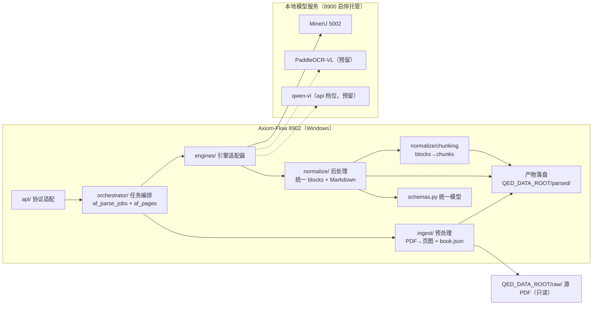

# PDF 解析与渲染管线设计（parsing-pipeline）

设计状态：Accepted
确认状态：暂定
实现状态：Current（预处理/引擎适配/归一化/分块/编排/落盘全链路已实现；MinerU 真机冒烟待 ARCH-009）
最后更新：2026-09-17
关联代码：`src/axiom_flow/ingest/`、`src/axiom_flow/schemas.py`、`src/axiom_flow/engines/`（待实现）、`src/axiom_flow/normalize/`（待实现）、`src/axiom_flow/orchestrator/`（待实现）
关联测试：`tests/unit/test_ingest.py`、`tests/unit/test_schemas.py`（engines/normalize/orchestrator 待对应任务）
关联 ADR：`docs/adr/0001-v2-exploration-direction.md`、`docs/adr/0004-model-boundary-and-pipeline-ownership.md`

> 本文档定义解析管线的内部结构：预处理（PDF → 页图）→ 引擎调用 → 后处理（归一化 + 分块）
> → 编排落盘 → 质量信号。对外 API 契约见 `../architecture/api.md`；数据库表见
> `../architecture/database-design.md`；模型/引擎配置与对接见
> [model-integration.md](model-integration.md)；解析管理闭环见
> [parsing-management.md](parsing-management.md)。

## 背景与决策记录

2026-08-14 用户裁决：Axiom-Flow 转入探索型重构，聚焦「PDF 完整解析 + 统一格式 + 高还原展示」
的后端解析能力。2026-09-14（根仓库 ARCH-020，[ADR 0004](../adr/0004-model-boundary-and-pipeline-ownership.md)）
裁决：**模型生命周期归 8900、解析管线归本仓库**，解析直连模型服务。

2026-09-17 用户裁决（配置简化与阶段重排）：Axiom-Flow 只做「模型 API 调用 + 预处理/后处理」，
模型调参归 QED-Engine；本期优先交付**基本解析 + 分块**（对照编辑后置）。分块为 RAG/探索轮
预留（ARCH-004 并入本期）。

关键决策：

| 维度 | 决策 |
| --- | --- |
| 重构策略 | 推倒重来：旧代码与 115+ 测试不沿用，git 历史与 docs/history 保留作经验参考 |
| 管线归属 | 全部在本仓库（预处理/引擎调用/归一化/分块/编排/落盘）；模型生命周期在根仓库 8900 |
| 解析引擎 | 引擎适配器可插拔：MinerU 先落地，PaddleOCR-VL / qwen-vl 预留（见 [model-integration.md](model-integration.md)） |
| 调用粒度 | **默认全本**（pages 缺省：整本 PDF 一次解析，阅读序/跨页更优）；指定 pages 时逐页页图重解析 |
| 模型调用 | 直连本地模型服务（不经 8900 网关）；统一 blocks 归一化在适配层完成 |
| 展示形态 | 对照模式：原页高清图 + 解析重渲染 + 块级人工校验修改 |
| 持久化 | 产物文件（`QED_DATA_ROOT/parsed/`）+ af_* 四表元数据（见 [parsing-management.md](parsing-management.md)） |
| 分块 | blocks → chunk（派生文件 `chunks.json`，不入库、可重建），为 RAG/探索轮预留 |

## 总体架构



## 预处理、调用与后处理

| 阶段 | 模块 | 内容 |
| --- | --- | --- |
| 预处理 | `ingest/` | 源 PDF（数据根相对路径，只读）→ 150 DPI 原页图 + `book.json`（page_count/sha256/source_file）；不调模型 |
| 调用 | `engines/` | 适配器直连模型服务：默认全本 `POST /file_parse`（PDF），指定 pages 时逐页（页图）；超时 `AXIOM_OCR_TIMEOUT` |
| 后处理 | `normalize/` | 引擎原始输出 → 统一 blocks（类型映射/bbox 缩放/阅读序）+ 页级 Markdown 组装 + `QualityMetrics` |
| 分块 | `normalize/chunking` | 书级有序 blocks → chunks（规则见下），落 `chunks.json` |

## 统一格式与产物

产物落 `<QED_DATA_ROOT>/parsed/<domain_id>/<course_id>/<book_id>/`：

```text
<QED_DATA_ROOT>/
├── raw/<domain_id>/<course_id>/<slug>_<sha8>.pdf   # 只读输入（QED-Tracker 写入）
├── tmp/axiom-flow/<job_id>/                        # 模型调用暂存，任务结束清理
└── parsed/<domain_id>/<course_id>/<book_id>/
    ├── book.json            # book_id/title/authors/page_count/sha256/source_file/engine/ingested_at
    ├── manifest.json        # 产物清单（路径 + 大小 + SHA-256）
    ├── chunks.json          # 分块（派生、不入库、可重建）
    └── pages/
        ├── p0001.png        # 原页图（150 DPI，对照左栏 + bbox 基准）
        ├── p0001.md         # 页级 Markdown（$$...$$ / $...$ 内嵌公式）
        └── p0001.blocks.json# 统一 blocks（结构化，含 bbox）
```

- 写入一律「临时文件 → 校验 → 原子替换」，不留半成品；源 PDF 只读不复制。
- `book.json` 的 `source_file` 为数据根相对路径（同源 `qt_books.file_path`）；`engine` 为实际
  引擎标识（mineru / paddleocr-vl / qwen-vl）。
- 人工编辑为覆盖层（`af_block_edits`），不改产物文件；分块为派生数据，重建不影响产物事实源。

统一 blocks schema（`schemas.py` 单一事实源）：

```json
{
  "page": 1,
  "image_size": [1240, 1754],
  "source": "mineru",
  "blocks": [
    {"index": 0, "type": "heading", "level": 1, "text": "...", "bbox": [72, 54, 540, 80], "order": 0, "confidence": 0.97},
    {"index": 1, "type": "formula", "latex": "x + y = y + x", "display": true, "bbox": [72, 150, 540, 175], "order": 1}
  ],
  "quality": {"empty_block_ratio": 0.0, "avg_formula_confidence": 0.95, "table_count": 1, "text_length_ratio": 0.98}
}
```

- 块类型 10 种：`heading / paragraph / formula / table / image / list / caption / header / footer /
  page_number`；按类型强制必需字段（heading.text+level、formula.latex、table.html、image.path、
  list.items、其余 text）。
- `bbox`：原页图像素坐标 `[x0, y0, x1, y1]`（左上原点），基准 `pages/pXXXX.png`；模型坐标系差异
  由 `normalize/` 按 `image_size` 缩放归一。
- `index` 为页内块数组下标（0 基，与块编辑定位一致）；`order` 为阅读顺序。

## 分块（blocks → chunk）

分块产物 `chunks.json`（书级，派生文件，不入库）：

```json
{
  "book_id": "mathanalysis-b05",
  "params": {"max_chars": 1000, "overlap_blocks": 1},
  "chunks": [
    {"chunk_id": "c0001", "order": 0, "type": "mixed",
     "text": "...（公式以 $$...$$ 内嵌）...",
     "page_start": 32, "page_end": 33,
     "block_refs": [{"page": 32, "index": 3}, {"page": 33, "index": 0}],
     "bbox": [72, 150, 540, 420], "char_count": 412}
  ]
}
```

切分规则（数学文档感知，参数可经 `GET /books/{id}/chunks` 覆盖后重算）：

1. 输入为**书级有序块序列**（页序 + `order`），跨页合并；
2. `heading` 结束当前 chunk 并作为新 chunk 开头（保留标题上下文）；
3. `formula` / `table` 整块不可拆：加入后超预算则先收尾再单独成块（单块超预算允许超出）；
4. `paragraph` / `list` / `caption` 累积至 `max_chars`；
5. `header` / `footer` / `page_number` 默认跳过（噪声）；
6. `overlap_blocks` 控制相邻 chunk 上下文重叠（默认 1 个段落块作前缀）；
7. 每块记录溯源：`page_start/page_end` + `block_refs` + `bbox` 并集。

## 组件职责

| 模块 | 职责 |
| --- | --- |
| `api/` | 对外 `/api/v1` 路由，只做协议适配（契约见 `../architecture/api.md`） |
| `orchestrator/` | 解析任务编排：接收 job → 默认全本/逐页 → 调引擎 → 归一化 → 分块 → 落盘 → 更新 af_parse_jobs/af_pages/af_books |
| `ingest/` | 预处理：PDF 导入、渲染页图（150 DPI）、生成 book.json（含 SHA-256/page_count）；源 PDF 只读不复制 |
| `engines/` | 引擎适配器：调用模型服务，返回原始输出（见 [model-integration.md](model-integration.md)） |
| `normalize/` | 后处理：引擎原始输出 → 统一 blocks（坐标归一、类型映射、阅读序）+ Markdown + 质量信号 |
| `normalize/chunking` | 分块：书级 blocks → chunks（溯源完整、可重建） |
| `schemas.py` | 统一格式 Pydantic 模型（blocks/page/book/job/edit/chunk）——内外契约单一事实源 |

## 错误处理与质量验收

| 场景 | 行为 |
| --- | --- |
| 单页失败（超时/空输出/异常） | 重试 1 次 → 仍失败标记 `failed`，job 不中断，汇总报告列出失败页 |
| 页质量信号不达标 | 记录质量信号并标记；不自动切换引擎（用户裁决不设自动兜底） |
| 模型服务未启动 | 任务提交前健康检查（`QED_OCR_MODEL_URL`），返回 503 + 提示经 8900 `/models/{slot}` 启停模型 |
| 电源中断/进程被杀 | af_pages 页状态持久化 → 重启后按状态续跑未完成页（幂等） |
| 模型服务不可达 | API 层错误映射为可读中文错误信息，不泄漏堆栈 |

质量信号（每页随 blocks.json 落盘，`QualityMetrics`）：空块率、formula 平均置信度、table
解析成功数、页文本长度与原生文本长度比值（扫描件无原生文本则跳过）。

### 验收标准

1. 代表书（Rudin 中译 + 吉米多维奇习题集）全流程跑通：同步 → ingest → 解析 → 分块 → 产物落盘；
2. 页级质量：抽查每本 20 页（首/中/尾 + 公式密集页），公式 LaTeX 可被 KaTeX 正确渲染 ≥ 90%
   （人工抽查），块类型标注无明显错乱；
3. 分块：抽样 20 页无公式腰斩、无跨块语义断裂；chunk 溯源可回跳页/块；
4. API 契约：`/api/v1` 全部端点可用，返回结构与 schemas 一致；
5. 失败恢复：kill 编排进程后重启，未完成页续跑成功。

### 测试策略（探索项目，分层但轻量）

| 层 | 内容 | 工具 |
| --- | --- | --- |
| 单元 | schemas 校验、质量信号计算、归一化、分块规则、产物文件名/哈希、状态机转换 | pytest |
| 集成 | 编排层对模型服务的调用（mock 服务代替，CI 无 GPU） | pytest + mock |
| 冒烟 | 真实调用：单 PDF 小样（5 页含公式）跑通全链路 | pytest + `@smoke`，本地手动跑 |
| 契约 | API 返回结构与 schemas 一致性、产物三件套 + chunks 完整性 | pytest（轻量） |

本地门禁 `pytest + ruff`（不引入远端 CI）。

## 备注

本文档为解析管线契约（ingest/normalize/orchestrator/engines/schemas 的 DesignRef 事实源）。
实现中允许按实际情况调整（技术选型、端口、产物字段等），调整时同步更新本文档与后续计划。

**配置简化（2026-09-17，PLAN-002）**：MinerU 直连地址读 `QED_OCR_MODEL_URL`（5002，`QED_MINERU_URL`
已删除且无别名）；模型生命周期与调参归 8900，本仓库只连接。v1 的 `llm_client.py` / `fallback/`
已随 `engines/` 落地退役（见 [model-integration.md](model-integration.md) 退役清单）。
