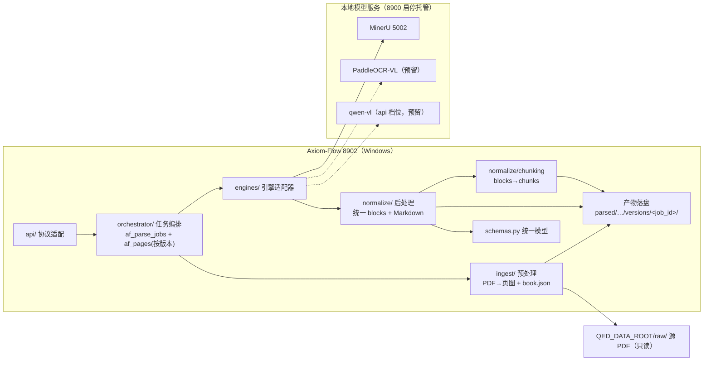

# PDF 解析与渲染管线设计（parsing-pipeline）

设计状态：Accepted
确认状态：暂定
实现状态：Current（预处理/引擎适配/归一化/分块/编排/落盘全链路已实现并真机验证；2026-09-20 小样打通
（整本 + 逐页 + 失败注入 + kill 续跑）；2026-09-21 三项契约落地并真机复验——bbox 坐标空间（DEFECT-004）、
块类型字面值映射与可见丢弃（DEFECT-005）、解析产物按版本划分（PLAN-004 / REQ-080，R1 窗口真机首次激活）；
**2026-09-22 R2 窗口代表书抽查口径验收达成**（ARCH-009 判据 ①~⑤ PASS：两本各 20 页公式段可解析率 100%、
b11 零丢弃、chunk 完整性 PASS；判据为程序化结构可解析 + 人工留档），同轮发现并修复**公式定界符缺陷**
（ARCH-018，见下「公式定界符契约」条）。**未随本轮消失**：b05 的 `ref_text` 映射丢弃缺口另立 ARCH-019、
b05 混合版本产物的全量重生归 ARCH-011 批量批次）
最后更新：2026-09-22
关联代码：`src/axiom_flow/ingest/`、`src/axiom_flow/schemas.py`、`src/axiom_flow/engines/`、`src/axiom_flow/normalize/`、`src/axiom_flow/orchestrator/`
关联测试：`tests/unit/test_ingest.py`、`tests/unit/test_schemas.py`、`tests/unit/test_engines.py`、`tests/unit/test_normalize.py`、`tests/unit/test_chunking.py`、`tests/unit/test_orchestrator.py`、`tests/contract/test_api_v1_contract.py`、`tests/smoke/test_live_mineru_chain.py`
关联 ADR：`docs/adr/0001-v2-exploration-direction.md`、`docs/adr/0004-model-boundary-and-pipeline-ownership.md`、`docs/adr/0007-parse-status-semantics.md`

> 本文档定义解析管线的内部结构：预处理（PDF → 页图）→ 引擎调用 → 后处理（归一化 + 分块）
> → 编排落盘 → 质量信号。对外 API 契约见 `../architecture/api.md`；数据库表见
> `../architecture/database-design.md`；模型/引擎配置与对接见
> [model-integration.md](model-integration.md)；解析管理闭环见
> [parsing-management.md](parsing-management.md)。

## 背景与决策记录

2026-08-14 用户裁决：Axiom-Flow 转入探索型重构，聚焦「PDF 完整解析 + 统一格式 + 高还原展示」
的后端解析能力。2026-09-14（根仓库 ARCH-020，[ADR 0004](../adr/0004-model-boundary-and-pipeline-ownership.md)）
裁决：**模型生命周期归 8900、解析管线归本仓库**，解析直连模型服务。

2026-09-17 用户裁决（配置简化与阶段重排）：Axiom-Flow 只做「模型 API 调用 + 预处理/后处理」，
模型调参归 QED-Engine；本期优先交付**基本解析 + 分块**（对照编辑后置）。分块为 RAG/探索轮
预留（ARCH-004 并入本期）。

关键决策：

| 维度 | 决策 |
| --- | --- |
| 重构策略 | 推倒重来：旧代码与 115+ 测试不沿用，git 历史与 docs/history 保留作经验参考 |
| 管线归属 | 全部在本仓库（预处理/引擎调用/归一化/分块/编排/落盘）；模型生命周期在根仓库 8900 |
| 解析引擎 | 引擎适配器可插拔：MinerU 先落地，PaddleOCR-VL / qwen-vl 预留（见 [model-integration.md](model-integration.md)） |
| 调用粒度 | **默认全本**（pages 缺省：整本 PDF 一次解析，阅读序/跨页更优）；指定 pages 时逐页页图重解析 |
| 模型调用 | 直连本地模型服务（不经 8900 网关）；统一 blocks 归一化在适配层完成 |
| 展示形态 | 对照模式：原页高清图 + 解析重渲染 + 块级人工校验修改 |
| 持久化 | 产物文件（`QED_DATA_ROOT/parsed/`）+ af_* 四表元数据（见 [parsing-management.md](parsing-management.md)） |
| 分块 | blocks → chunk（派生文件 `chunks.json`，不入库、可重建），为 RAG/探索轮预留 |

## 总体架构



## 预处理、调用与后处理

| 阶段 | 模块 | 内容 |
| --- | --- | --- |
| 预处理 | `ingest/` | 源 PDF（数据根相对路径，只读）→ 150 DPI 原页图 + `book.json`（page_count/sha256/source_file）；不调模型 |
| 调用 | `engines/` | `factory.py` 按「请求体 `engine` → `AXIOM_OCR_ENGINE`」解析出实际引擎名后构造适配器；适配器直连模型服务，默认全本（PDF）、指定 pages 时逐页（页图）；三段式提交/轮询/取结果共享 `AXIOM_OCR_TIMEOUT` 的 `deadline`（协议细节见 [model-integration.md](model-integration.md)） |
| 后处理 | `normalize/` | 引擎原始输出 → 统一 blocks（类型映射/坐标空间换算/阅读序）+ 页级 Markdown 组装 + `QualityMetrics` |
| 分块 | `normalize/chunking` | 书级有序 blocks → chunks（规则见下），落 `chunks.json` |

## 统一格式与产物

产物落 `<QED_DATA_ROOT>/parsed/<domain_id>/<course_id>/<book_id>/`（真实现状：`domain_id` 为空时
该层省略，如 `parsed/linear_algebra/linearalgebra-b01/`，与根仓库 `dataset-conventions` 的「空段不建
目录」一致）：

```text
<QED_DATA_ROOT>/
├── raw/<domain_id>/<course_id>/<slug>_<sha8>.pdf   # 只读输入（QED-Tracker 写入）
├── tmp/                                        # 根仓库工作区；**本服务不写数据根 tmp**（见下）
└── parsed/<domain_id>/<course_id>/<book_id>/
    ├── book.json            # book_id/title/authors/page_count/sha256/source_file/engine/ingested_at
    ├── manifest.json        # 根视图清单（路径 + 大小 + SHA-256；**不递归 versions/**）
    ├── pages/               # 原页图正本（ingest 拥有，150 DPI，对照左栏 + bbox 基准）
    │   └── p0001.png
    └── versions/<job_id>/   # 一次解析任务 = 一个完整快照版本（见「解析版本与生效指针」）
        ├── book.json        # 自基线继承（使版本目录自解释）
        ├── manifest.json    # 版本内清单，路径相对该版本目录
        ├── chunks.json      # 分块（派生、不入库、可重建）
        └── pages/
            ├── p0001.png            # 与根页图同 inode 的硬链接（回落复制时告警）
            ├── p0001.md             # 页级 Markdown（$$...$$ / $...$ 内嵌公式）
            └── p0001.blocks.json    # 统一 blocks（结构化，含 bbox）
```

- 页文件名唯一格式：`p<NNNN>.png` / `p<NNNN>.md` / `p<NNNN>.blocks.json`，`NNNN` = 页码 1 基
  四位零填充（`p0001`），由 ingest 首建，解析写入与 API 读取沿用同一格式。
- 写入一律「临时文件 → 校验 → 原子替换」，不留半成品；源 PDF 只读不复制。
- **不写数据根 `tmp/`（PLAN-003 条文 12）**：引擎提交/轮询/取结果的全部中间产物只存在于内存
  （HTTP 响应字节 → 解析后的结构），因此 `tmp/axiom-flow/<job_id>/` 恒不应出现；该目录一旦存在即
  视为缺陷（曾按 v1 习惯把它记作「未实现的暂存目录」，属设计表述错误，2026-09-20 改判）。
- `book.json` 的 `source_file` 为数据根相对路径（同源 `qt_books.file_path`）；`engine` 为实际
  引擎标识（mineru / paddleocr-vl / qwen-vl）。
- 人工编辑为覆盖层（`af_block_edits`），不改产物文件；分块为派生数据，重建不影响产物事实源。
- **数据根边界**：`domain_id`、`course_id`、`book_id` 必须是安全单段（拒绝 `/`、`..`、前导点与
  空串；`domain_id`/`course_id` 允许空表示未归属），违规在 schema 层返回 422；源 PDF 与全部产物
  落盘路径必须位于 `QED_DATA_ROOT` 之内（`resolve_source_pdf` 对绝对路径同样受限），写盘前经
  `ingest/artifacts.ensure_within()` 做纵深防御（符号链接与 `..` 归一化后仍受限）。数据根唯一
  事实源是 `config.load_settings().data_dir`（`QED_DATA_ROOT`）。

统一 blocks schema（`schemas.py` 单一事实源）：

```json
{
  "page": 1,
  "image_size": [1240, 1754],
  "source": "mineru",
  "blocks": [
    {"index": 0, "type": "heading", "level": 1, "text": "...", "bbox": [72, 54, 540, 80], "order": 0, "confidence": 0.97},
    {"index": 1, "type": "formula", "latex": "x + y = y + x", "display": true, "bbox": [72, 150, 540, 175], "order": 1}
  ],
  "quality": {"empty_block_ratio": 0.0, "avg_formula_confidence": 0.95, "table_count": 1, "text_length_ratio": 0.98}
}
```

- 块类型 10 种：`heading / paragraph / formula / table / image / list / caption / header / footer /
  page_number`；按类型强制必需字段（heading.text+level、formula.latex、table.html、image.path、
  list.items、其余 text）。
- `bbox`：原页图像素坐标 `[x0, y0, x1, y1]`（左上原点），基准 `pages/p<NNNN>.png`；模型坐标系差异
  由 `normalize/` 按引擎声明的坐标空间换算归一。
- **坐标空间契约（2026-09-20 真机锚点实验测定，2026-09-21 实现）**：引擎原始块的 `bbox` 属于哪种
  坐标空间由 `PageResult.bbox_space` 显式声明（`pdf_points` / `normalized_1000` / `pixels`），
  `normalize/blocks.scale_bbox` 按声明换算：`normalized_1000` → `px = bbox / 1000 * image_size`（逐轴），
  `pixels` → 仅夹取，`pdf_points` → 按 `image_size / page_size` 缩放（**唯一以 `page_size` 为基准的空间**）。
  MinerU 3.4.4 声明为 `normalized_1000`：其 `content_list[].bbox` 是**相对页框、逐轴归一化到 0–1000**
  的坐标，整本（PDF）与逐页（PNG）两条提交路径同一空间。`middle_json.pdf_info[].page_size` 仅在 PDF
  输入时是真实 PDF 点尺寸，PNG 输入时是引擎按 200 DPI 折算的标称点（如 1241x1755 页图 → `[446, 631]`），
  因此**不得用作缩放基准**，在归一化侧仅留档不参与换算；缺失 `bbox` 的块直接铺满页图，不再二次映射。
  真机端到端复核（合成 A4 五行已知点坐标锚点，整本路径）：5/5 块平均 IoU **0.93**、最大偏移 **7px**，
  旧实现同一判据下 IoU **0.01** 且两块被夹取到页边（[DEFECT-004](../trackers/completed.md) 关闭证据
  `data/probes/live-bbox-fix-20260921/E1_anchor_after_fix.json`、`L3d_coord_space.json`）。
- **引擎类型字面值（同一轮测定，2026-09-21 实现）**：`content_list[].type` 真机出现 `text` /
  `header` / `footer`（非 `page_header`/`page_footer`）；映射表未覆盖的字面值必须**可见丢弃**
  （计入质量信号），不得静默丢块造成页内 `index` 漂移。实现：`_TYPE_MAP` 同时收录 `header`/`footer`
  与旧版 `page_header`/`page_footer`（并存以免版本回退）；`normalize_page` 逐条统计丢弃，
  `QualityMetrics.dropped_block_count` 记丢弃条数、`dropped_types` 记被丢弃条目的原始 `type`
  字面值（去重升序），因此「引擎返回 n 项 / 归一 m 块」的差额始终可解释，且 `index` 只在存活块上
  连续编号（[DEFECT-005](../trackers/completed.md) 关闭）。必需字段缺失（表格无 HTML、公式无
  LaTeX、图片无路径、列表无条目）同样计入该计数，不做占位补块。整页 markdown 回退（引擎**未回任何
  结构化条目**时铺满全页的单个 paragraph 块）只在 `content_list` 为空时触发：回了条目却全部未能归一
  时**不回退**，否则映射缺口会被伪装成一个正文块。由此对账不变式恒成立：
  `原始条目数 = 存活块数 + dropped_block_count`。
- **公式定界符契约（2026-09-22 代表书取证发现，同日实现）**：`formula.latex` 恒为**裸 LaTeX 源码**，
  行间/行内只由 `display` 表达。引擎可能把定界符连内容一起返回（MinerU 3.4.4 的 `equation` 条目
  `latex` 自带 `$$…$$`，且行间式不走 `interline_equation` 字面值，靠类型判不出行间），故
  `normalize/blocks.split_math_delimiters` 在归一时剥掉成对定界符并让它决定 `display`：`$$…$$` 与
  `\[…\]` → `display=true`，`$…$` 与 `\(…\)` → `display=false`；剥后内部仍含同种定界符（两段公式
  拼进一个条目）时**不剥**，保留可见异常等人工判定。理由：`blocks_to_markdown` 与
  `chunking.block_text` 都按「裸源码 + `display`」再包一层，定界符漏进 `latex` 就产出 `$$$…$$$`，
  KaTeX 无法渲染并污染 `chunks.json`（修复前真机规模：b05 生效版本 312 页 3838 处、b11 首版 20 页
  126 处；修复后两本各 20 页的公式段可解析率 91.95% / 87.79% → **100%**，见
  `data/probes/window-20260922/C4_forensic_*.json` 与 `C6_forensic_*_postfix.json`）。
- **映射表变更的追溯影响**：`af_block_edits` 以 `(book_id, job_id, page_no, block_index)` 为唯一
  定位键，而 `index` 是归一化后数组下标 —— 映射表增删字面值会改变同页存活块的下标含义。因此
  **映射表版本与产物必须成对**，且编辑绑定它核对时所在的那个解析版本：换版本后旧编辑不自动套用
  （块下标语义不同）。修复前落盘的产物与其 `index` 不回溯修正，需重解析后在新版本上重建编辑
  （2026-09-21 改键时真机 `af_block_edits` 为 0 行，无需数据搬迁）。
- `index` 为页内块数组下标（0 基，与块编辑定位一致）；`order` 为阅读顺序。

## 解析版本与生效指针（PLAN-004 / REQ-080）

「重新解析一本书」不覆盖上一次的产物：**一次解析任务 = 一个解析版本**，规则如下（承接根仓库
`dataset-conventions.md` 的 REQ-080；实现体在 `orchestrator/pipeline.run_parse_job` 与
`ingest/artifacts.py`）。

| # | 条文 | 实现要点 |
| --- | --- | --- |
| V1 | **版本目录唯一落点**：解析产物只写 `<book_dir>/versions/<job_id>/`，内部布局与根布局同构；`job_id`（`uuid4().hex[:12]`）仍过 `ensure_safe_segment()` + `ensure_within()` 双闸 | `version_dir_for()`；版本目录从**第一页产物写入起**就是目标目录，不存在「先写别处、成功末尾再搬」的阶段（那会与条文 3 的页级持久化不变式冲突） |
| V2 | **生效指针唯一事实源 = `af_books.active_job_id`**（`NULL` = 根视图 legacy）；`af_parse_jobs` 不存布尔「生效」列，避免同一事实两处漂移 | `BookRepository.set_active_job()` 单列 UPDATE |
| V3 | **激活门槛 = `completed` 判据本身**：目标页全部 `parsed` 并产物在位、`chunks.json` 与 `manifest.json` 重算成功后，才把指针交给该版本；同一次判定同时决定任务终态（ADR 0007 决定 5），故不存在「`completed` 但未激活」。**未齐备**（`partial`）、`failed`、中断、校验不过一律**不激活**，文件保留在 `versions/` 下供排查，不自动删除、也不被端点读到 | 运行中被杀 → 指针仍指旧版，读取端不可能看到半版本 |
| V4 | **版本是完整快照（写时复制播种）**：新版本先按 `os.link` 从**当前生效作用域**（`active_job_id` 指向的版本目录，为空则根视图）继承页图与既有页产物，再写本次目标页；跳过 `manifest.json`/`chunks.json` 派生文件与 `versions/` 子树 | `seed_version_from()` + `link_pages_into()`；页图硬链接失败回落 `copy2` 并 `WARNING`。逐页重解析因此不必重跑整本，且旧版本的文件条目不受影响（`os.replace` 只换目录项） |
| V5 | **manifest 基准 = 版本目录内 POSIX 相对路径**（`pages/p0001.blocks.json`），不带 `versions/<job_id>/` 前缀（该字段经 8900 原样透传给前端）；根 `manifest.json` 只描述 ingest 级文件，`build_manifest()` 显式排除 `versions/` 子树与隐藏临时文件 | `ingest/artifacts.build_manifest()` |
| V10 | **不引入数据根暂存**：引擎中间产物只在内存，版本目录之外不得产生中间产物；`<data_root>/tmp/axiom-flow/` 恒不应存在，存在即缺陷 | 契约用例断言数据根只有 `raw/` 与 `parsed/` |

配套的三个不变式：

1. **页行与版本产物同构**：新版本播种后把基线里「已 `parsed` 且产物在位」的页行复制进本版本作用域
   （`_inherit_page_rows`），因此 `af_pages` 始终如实描述该版本的内容，`af_books.pages_done` 描述的
   是**生效版本**的页数。
2. **续跑作用域 = `(book_id, job_id)`**：同一 job 重跑时，状态 `parsed` **且** `blocks.json` 在位的页
   跳过引擎调用（不重解析、不重复落盘）；只认页行不够——产物缺失时宁可重解析也不给出空版本。
3. **版本自证**：`af_parse_jobs.source_sha256` 与 `page_count` 在建任务后、调用引擎前写入，使「这一版
   解析的是哪份文件、当时全书多少页」在行内可证，不依赖根视图当前状态。

只读版本列举见 `GET /api/v1/books/{book_id}/versions`（`architecture/api.md` V6/V9）；**切换/回滚的写入
端点与旧版本清理都不在本契约内**（清理属 D 类数据操作，需用户确认）。天然回滚方式：把
`active_job_id` 置回 `NULL` 即回到根视图行为，不搬动任何文件。

## 任务与书目状态语义（PLAN-006 / ADR 0007）

旧契约把「做到哪」和「怎么结束」挤在同一列（`af_books.parse_status` 同时取 `parsing` 与
`completed`），于是 DEFECT-007（进度刷新覆盖结局）与 DEFECT-006（部分完成无处表达）都无解。
现按 ADR 0007 分列，条文如下：

| # | 条文 | 落点 |
| --- | --- | --- |
| S1 | **任务 `status` 六态**：`queued`/`running` 活动态；终态 `completed`（目标页齐备）、`partial`（≥1 页 `parsed` 但未齐备）、`failed`（0 页产出或引擎整体异常）、`interrupted`（上次进程遗留） | `schemas.JobStatus` |
| S2 | **失败页结构化且不截断**：`af_parse_jobs.failed_pages` 存页码数组；`error`（≤500）与 `progress.error`（≤200）只是给人看的摘要，摘要截断不丢页码 | `ParseJobRepository.mark_finished()` |
| S3 | **书目进度与结局分列**：`parse_status` ∈ `pending`/`parsing` 只表进度；`last_parse_result` ∈ `completed`/`partial`/`failed`/`interrupted`（`""` = 从未有任务）只在**终态**写入，运行中的进度刷新不得覆盖它 | `BookRepository.update_parse()` / `mark_parse_idle()` |
| S4 | **`completed` 与版本激活同一判据**：`_version_is_complete()` 一次判定同时给出 `status` 与指针动作，「completed 但未激活」在结构上不可能（不是靠文档约定） | `pipeline.run_parse_job` 终态块 |
| S5 | **`interrupted` 的唯一写入者是启动期归一**：`JobRunner.reconcile_on_startup()` 在 FastAPI `lifespan` 内、**受理首个请求之前**把遗留 `queued`/`running` 行改写为 `interrupted`，书目进度归 `pending`；结局仅在该任务是这本书的**最新**任务时置 `interrupted`（更早的中断行不得覆盖后来的真实结局） | `api/main.py` lifespan |
| S6 | **单实例前提**：归一能成立，是因为「写活动态的只有这个进程」。多实例部署会让存活实例的任务被同伴误判为中断——本契约显式承担该部署约束，代价与运维口径见 `docs/guides/operations.md` | 部署边界 |
| S7 | **`interrupted` 的续跑 = 同 `job_id` 重放**，不新建版本：版本作用域 `(book_id, job_id)` 下已 `parsed` 且产物在位的页跳过引擎（不变式 2） | `pipeline` 续跑判据 |

**反向约束**：迁移与运维脚本都不改写历史任务的 `status`（回填旧行为新三态等于伪造历史），
管线自身也**不产出** `interrupted`——四种终态之外的那一态只有一个作者。

## 分块（blocks → chunk）

分块产物 `chunks.json`（**每个解析版本一份**，落在该版本目录内；派生文件，不入库）：

```json
{
  "book_id": "mathanalysis-b05",
  "params": {"max_chars": 1000, "overlap_blocks": 1},
  "chunks": [
    {"chunk_id": "c0001", "order": 0, "type": "mixed",
     "text": "...（公式以 $$...$$ 内嵌）...",
     "page_start": 32, "page_end": 33,
     "block_refs": [{"page": 32, "index": 3}, {"page": 33, "index": 0}],
     "bbox": [72, 150, 540, 420], "char_count": 412}
  ]
}
```

切分规则（数学文档感知；`GET /books/{id}/chunks` 带参数时为**实时重算、不落盘**，落盘版本由解析
收尾在**该版本目录内**重建）：

1. 输入为**书级有序块序列**（页序 + `order`），跨页合并；
2. `heading` 结束当前 chunk 并作为新 chunk 开头（保留标题上下文）；
3. `formula` / `table` 整块不可拆：加入后超预算则先收尾再单独成块（单块超预算允许超出）；
4. `paragraph` / `list` / `caption` 累积至 `max_chars`；
5. `header` / `footer` / `page_number` 默认跳过（噪声）；
6. `overlap_blocks` 控制相邻 chunk 上下文重叠（默认 1 个段落块作前缀）；
7. 每块记录溯源：`page_start/page_end` + `block_refs` + `bbox` 并集。

## 组件职责

| 模块 | 职责 |
| --- | --- |
| `api/` | 对外 `/api/v1` 路由，只做协议适配；读取面经「生效版本解析」唯一入口定位目录（契约见 `../architecture/api.md`） |
| `orchestrator/` | 解析任务编排：接收 job → 播种版本基线 → 默认全本/逐页 → 调引擎 → 归一化 → 分块 → **写版本目录** → 更新 af_parse_jobs/af_pages → 校验通过后激活版本 |
| `ingest/` | 预处理：PDF 导入、渲染页图（150 DPI）、生成 book.json（含 SHA-256/page_count）、版本目录与硬链接工具（`version_dir_for`/`link_pages_into`/`seed_version_from`）；源 PDF 只读不复制；重复 ingest 只替换根视图 |
| `engines/` | 引擎适配器：调用模型服务，返回原始输出（见 [model-integration.md](model-integration.md)） |
| `normalize/` | 后处理：引擎原始输出 → 统一 blocks（坐标归一、类型映射、阅读序）+ Markdown + 质量信号 |
| `normalize/chunking` | 分块：书级 blocks → chunks（溯源完整、可重建） |
| `schemas.py` | 统一格式 Pydantic 模型（blocks/page/book/job/edit/chunk）——内外契约单一事实源 |

## 错误处理与质量验收

| 场景 | 行为 |
| --- | --- |
| 单页失败（超时/空输出/异常） | 重试 1 次 → 仍失败标记 `af_pages.status=failed`，job 不中断；页码进 `af_parse_jobs.failed_pages`（结构化、不截断，S2），失败页摘要即时写入 `progress.error`（≤200 字符），终态摘要写 `af_parse_jobs.error`（≤500 字符）；终态按齐备与否判 `completed`/`partial`/`failed`（S1） |
| 轮询期瞬时失败（HTTP 异常/非 2xx） | 适配器累计**连续 3 次**才判引擎失败（成功一次即清零计数），全程受同一 `deadline` 约束；不与单页重试互相吞并 |
| 结果载荷非 JSON | 归一为 `EngineError`；`JSONDecodeError` 等内部异常不得穿透编排层（否则任务回滚会吞掉已解析页行） |
| 页质量信号不达标 | 记录质量信号并标记；不自动切换引擎（用户裁决不设自动兜底） |
| 模型服务未启动 | **两段语义**：提交期探活（参数校验后、落库前）失败 → 503 且**不创建 job 行** + 提示经 8900 `/models/{slot}` 启停模型；任务受理后的故障 → job `failed` |
| 模型服务被其他解析占用 | **单一占用闸门（2026-09-21 R1 窗口后新增）**：任务启动前读 `model_load()`，`queued + processing > 0` 时**不提交任何内容**，按 5 秒间隔复探、最长等待 900 秒；等待期内 job 保持 `queued`（`started_at` 为空），超时才判 `failed` 且文案为「模型服务被其他解析任务占用」——与「模型服务不可用」分列，不互相冒充。引擎不上报负载（返回 `None`）时按可用放行，不臆造阻塞 |
| 电源中断/进程被杀 | 每页成功/失败即 `session.commit()`，且**产物写先于页行提交**（不变式：有页行必有产物）→ 重启后**先由启动期归一把遗留活动行判为 `interrupted`**（S5），再在同一版本作用域 `(book_id, job_id)` 内续跑「无行 ∪ failed」页；未激活的版本指针不动，读取端继续看到上一个完整版本 |
| 模型服务不可达 | API 层错误映射为可读中文错误信息，不泄漏堆栈 |

进度写入节流：`af_parse_jobs.progress` 在「距上次写入 ≥1 秒」或「每处理满 10 页」时覆写一次，
任务终态必写一次；单页失败节点强制写入（使 `progress.error` 实时可见）。
`persist_per_page=False` 仅供性能排查退回调用方统一提交，不是静默兜底路径。

**为什么必须有闸门**（窗口实证 2026-09-21）：本机 GPU 只够一个 MinerU 解析在飞，而模型服务自身
`max_concurrent_requests=3` 不会替调用方排队；根侧控制台可与本仓库并发提交。无闸门时排队任务在
轮到时恰逢容器被重启，探活失败却被记成「模型服务不可用」，故障归因失真。闸门把「占用」与
「不可用」拆成两种可判状态，串行性由编排层自身负责。

质量信号（每页随 blocks.json 落盘，`QualityMetrics`）：空块率、formula 平均置信度、table
解析成功数、页文本长度与原生文本长度比值（扫描件无原生文本则跳过）、**可见丢弃计数**
（`dropped_block_count` + `dropped_types`：引擎返回但未能归一的条目数及其原始 `type` 字面值，
去重升序）。丢弃必须可计数、可归因：信号里 `dropped_block_count > 0` 即表示映射表有缺口，
人工据此判定是否补映射，而不是页面看起来「解析得干净」。

### 验收标准

1. 代表书（Rudin 中译 + 吉米多维奇习题集）全流程跑通：同步 → ingest → 解析 → 分块 → 产物落盘；
2. 页级质量：抽查每本 20 页（首/中/尾 + 公式密集页），公式 LaTeX 可被 KaTeX 正确渲染 ≥ 90%
   （人工抽查），块类型标注无明显错乱；
3. 分块：抽样 20 页无公式腰斩、无跨块语义断裂；chunk 溯源可回跳页/块；
4. API 契约：`/api/v1` 全部端点可用，返回结构与 schemas 一致；
5. 失败恢复：kill 编排进程后重启，未完成页续跑成功。

### 测试策略（探索项目，分层但轻量）

| 层 | 内容 | 工具 |
| --- | --- | --- |
| 单元 | schemas 校验、质量信号计算、归一化、分块规则、产物文件名/哈希、状态机转换 | pytest |
| 集成 | 编排层对模型服务的调用（mock 服务代替，CI 无 GPU） | pytest + mock |
| 冒烟 | 真实调用：单 PDF 小样（5 页含公式）跑通全链路 | pytest + `@smoke`，本地手动跑 |
| 契约 | API 返回结构与 schemas 一致性、产物三件套 + chunks 完整性 | pytest（轻量） |

本地门禁 `pytest + ruff`（不引入远端 CI）。

## 备注

本文档为解析管线契约（ingest/normalize/orchestrator/engines/schemas 的 DesignRef 事实源）。
实现中允许按实际情况调整（技术选型、端口、产物字段等），调整时同步更新本文档与后续计划。

**配置简化（2026-09-17，PLAN-002）**：MinerU 直连地址读 `QED_OCR_MODEL_URL`（5002，`QED_MINERU_URL`
已删除且无别名）；模型生命周期与调参归 8900，本仓库只连接。v1 的 `llm_client.py` / `fallback/`
已随 `engines/` 落地退役（见 [model-integration.md](model-integration.md) 退役清单）。
