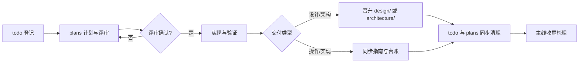

# 文档治理规范

状态：Current
确认状态：已确认
最后更新：2026-10-01
治理对象：文档分类与事实边界、确认状态、文档生命周期、代码与文档追溯、写作命名与体裁化元数据、固定文档骨架与可对账契约、版本末期整理、归档与删除
依据：QED-Tracker `docs/standards/doc-governance.md` 治理模式（[ADR 0003](../adr/0003-standards-governance-alignment.md)），
元数据体裁、骨架与对账规则由 [ADR 0008](../adr/0008-fixed-doc-form-and-metadata-genres.md) 立法；上游参照 QED-Engine 根仓库标准
关联测试：`tests/contract/test_document_structure.py`、`tests/contract/test_standard_governance.py`、
`tests/contract/test_fixed_document_form.py`、`tests/contract/test_markdown_links.py`、`tests/contract/test_code_document_mapping.py`

## 目的与边界

本标准规定 Axiom-Flow 每类文档保存什么事实、处于什么状态（暂定/已确认）、新建与晋升路径，
以及何时归档或删除。agent 与项目开发**优先读取已确认文档**；暂定文档可读可执行但地位低于
已确认文档。具体任务状态查[待做任务](../trackers/todo.md)，实时现状查
[项目状态快照](../trackers/project-status.md)，长期决策查 [ADR 索引](../adr/index.md)。

**职责划分**：本文档治理文档共性链路（分类边界、确认状态、生命周期、命名、元数据、归档总纲）。
专项机制由专项标准承接：任务分类与计划准入→[任务生命周期](task-lifecycle.md)，ADR 准入/编号/
状态/取代→[ADR 治理](adr-governance.md)，测试分层与门禁→[测试架构与门禁](testing.md)，跨项目
需求传递→[跨项目协作流程](cross-project-collaboration.md)，本地环境事实→
[本地开发环境](local-dev.md)；本文档不复制其正文。

跨项目契约（服务端口 8900/8901/8902/8903、根 `.env` 变量、dataset 布局）以 QED-Engine 根仓库
`docs/` 为准，本仓库文档只链接不复制。

## 强制规则

### 文档分类与事实边界

| 位置 | 唯一职责 |
| --- | --- |
| 根 `README.md` | 项目定位、能力、技术栈和快速启动。 |
| 根 `AGENTS.md` | Agent 执行总纲：目标、标准映射、任务路由、问题定位、边界与完成检查。只指引，不保存正文事实。 |
| `docs/index.md` 与各目录 `index.md` | 只导航当前文件，不保存正文事实。 |
| `architecture/` | 当前系统结构、运行拓扑、对外契约与代码映射（含 overview、api、database-design、code-map）。 |
| `design/` | 当前流程、接口、状态、失败语义、质量门槛和验收契约。**仅收已评审确定的设计**：未定稿/待评审设计一律随计划在 `plans/` 承载，用户确定后以稳定名称迁入本目录（[ADR 0002](../adr/0002-pending-design-location.md)）。登记处为[设计索引](../design/index.md)，每篇声明「管/不管」职责边界。 |
| `standards/` | 工程治理规则唯一事实源，入口[规范索引](index.md)。 |
| `adr/` | 影响长期约束的决定、理由、后果和取代关系。 |
| `guides/` | 当前可重复执行的开发与运维步骤。 |
| `plans/` | 已批准且尚未关闭的短期执行合同，兼作任务行的**承载文档**（独立计划文件或 `## 承载 <ID>` 承载节，见 [ADR 0006](../adr/0006-ledger-plan-carrier-contract.md)）；**待评审设计内容随计划承载**，确定后按 [ADR 0002](../adr/0002-pending-design-location.md) 迁入 `design/`。 |
| `trackers/` | 全部未关闭任务、关闭台账、实时状态快照与无状态能力路线图。 |
| `history/` | 选择性保留的归档证据和旧基线。 |

一个事实只设一个维护位置，其他文档使用链接。标准不得复制操作命令、设计契约或 ADR 决策理由。

### 文档架构变更约束

未经 todo 任务 + plan 计划讨论确认，不得在 `docs/` 下新增文件夹改变文档架构。
新增文件夹必须：

1. 先在 `docs/trackers/todo.md` 创建任务；
2. 在 `docs/plans/` 创建实施计划并评审；
3. 更新本文档的「文档分类与事实边界」表格；
4. 更新 `docs/index.md` 的文档域导航。

### 确认状态

- 所有受治理文档（`architecture/`、`design/`、`standards/` 正文）声明
  `确认状态：暂定 | 已确认`。
- **已确认**：经评审通过的事实源，agent 与项目开发优先读取；**暂定**：可读可执行、待评审，
  地位低于已确认文档。
- 首批登记（2026-09-11 经用户确认）：`standards/` 六份正文标准均为**已确认**；
  `architecture/`、`design/` 全量确认状态补登记列入 [ARCH-010](../trackers/todo.md) 版本末期轮。
- **冲突优先级**：同一事实的多份文档冲突时，已确认 > 暂定；`architecture/` > `design/` >
  `plans/`；同类文档以最后更新时间较新者为准（不得以此绕过评审流程）。冲突无法自动判定时
  必须询问用户。
- **「可读可执行」的边界**：暂定文档允许 agent 基于其内容执行实现任务，但不得将暂定措辞
  提升为已确认标准；实现完成后暂定文档仍为暂定时，提交信息标注「基于暂定设计实现，待评审
  确认」；已确认与暂定文档冲突时，以已确认为准实现，并在 todo 登记待解决项。
- **转正评审触发条件**（满足任一）：① 用户在对话中明确确认/通过/批准；② 关联任务状态变为
  Completed 且门禁通过；③ 已通过 `tests/contract/` 相关守护且无 pending 评审标注。
  转正操作：`确认状态：暂定` 改 `已确认` 并刷新 `最后更新`。发现严重事实错误时可由用户发起
  回退（改回暂定并标注原因）。

### 文档生命周期

- 新建文档链路：todo 登记 → 在 `plans/` 建计划 → 按计划实现（TDD）→ 验证与代码评审 →
  设计/契约以稳定名称（无日期前缀）迁入 `design/` 或合并进 `architecture/`，或操作结果同步
  `guides/` 与 `trackers/`。
- `design/` 文档只有 plans/ 下评审确认完毕才晋升；迁入时设计状态标 `Accepted`，确认状态初始
  为 `暂定`，随转正评审变为 `已确认`。
- 任务完成时**同时清理 todo 条目与对应 plans/ 文档**（见「归档与删除」的关闭计划两态判定）；
  台账列契约、「进度单源」（含「承载」列唯一指针）与收口顺序一律按
  [任务生命周期](task-lifecycle.md)执行：列口径见其「任务台账与承载」，收口六步见其「计划生命周期」第 5 步。本文档不复制其口径；立法见
  [ADR 0006](../adr/0006-ledger-plan-carrier-contract.md) 与
  [ADR 0013](../adr/0013-ledger-row-three-elements.md)。
- 每次主线任务完成后梳理文档一致性：① 检查涉及模块的 `architecture/`、`design/` 文档是否需
  增改删；② 检查 todo 行三列（任务／成功标准／承载）是否完整；③ 完成任务从 todo 移入 `completed.md`；④ 主线完成或
  长期任务重大变化在 `project-status.md` 记录。

### 代码与文档追溯

`docs/architecture/code-map.md` 是代码/设计/测试映射的**唯一事实源**；模块文件头与设计文档
头部的 DesignRef 只用于阅读时反查，不是第二份映射表。

- 所有受管且非豁免模块（豁免：`__init__.py`、`__main__.py`、无业务语义的极短文件）必须在
  code-map 恰好登记一次，声明层级职责、状态、设计关联与关联测试。
- 模块新增、移动或删除时，同一变更内同步 code-map 与关联设计文档；先用 `rg "旧路径"` 全库
  扫描确认无残余引用。
- 修改代码前先在 code-map 定位模块职责与设计关联；契约变化先完成 ADR/设计，再同步实现、
  code-map 和语义测试。
- `src/axiom_flow/` 受管模块文件头声明 `设计关联（DesignRef）`；code-map 的「测试」列与
  `tests/contract/test_code_document_mapping.py` 共同保证双向可追溯。

### 写作、命名与索引

- 中文说明使用短句和明确主语；标识符、API 字段和外部协议名称保留英文。
- 文件名使用小写英文和连字符；活跃架构、设计、标准和指南使用稳定名称，不绑定产品版本。
- `plans/` 计划文件名格式：`YYYY-MM-DD-<slug>.md`（全小写连字符）；`<slug>` 以关联请求/缺陷
  编号开头（如 `req080-parse-version-layout`），无编号需求词直接开头（如 `parse-live-bringup`）。
- 文档目录入口统一为小写 `index.md`；`docs/**/README.md` 禁止存在。
- 内部链接显式指向文件或 `index.md`，不依赖托管平台目录解析。
- Mermaid 图与说明在同一正文维护，不提交派生图片。

### 元数据

元数据按**体裁**分三类（[ADR 0008](../adr/0008-fixed-doc-form-and-metadata-genres.md)）：

- **契约正文类**（`architecture/` 的 overview、api、database-design 与 `design/` 三篇）声明
  `设计状态`、`确认状态`、`实现状态`、`最后更新`、`关联代码`、`关联测试`、`关联 ADR`。`实现状态`
  一行只允许「枚举值 + 至多一个未达条件从句」，从句内不得出现任务编号或日期。
- **映射与索引类**（`architecture/code-map.md` 等登记表）声明 `状态`（只允许 `Current` /
  `Superseded`）、`确认状态`、`最后更新`、`覆盖范围`；**不得**声明 `设计状态` / `实现状态`——
  映射表不是方案，没有「实现与否」可言。
- **目录索引类**（各目录 `index.md`）只声明 `状态` 与 `最后更新`，纯导航、不保存正文事实。
- 标准声明状态、确认状态、最后更新、治理对象、依据、关联测试，并使用统一公共章节
  （目的与边界 / 强制规则 / 执行与门禁 / 变更与取代）。
- ADR 元数据与状态按 [ADR 治理](adr-governance.md) 执行。
- 指南和 tracker 至少声明 `状态` 与 `最后更新`。
- 设计状态只允许 `Draft`、`Proposed`、`Accepted`、`Rejected`、`Superseded`、`Historical`；
  实现状态只允许 `Not Started`、`In Progress`、`Implemented`、`Verified`、`Blocked`、
  `Completed`；确认状态只允许 `暂定`、`已确认`。

`Implemented` 表示实现和本地定向门禁完成；`Verified` 还要求适用全量与远端门禁通过；`Blocked`
必须声明证据、恢复条件和责任位置。

**设计状态与确认状态正交**：设计状态描述设计方案本身的成熟度与命运，确认状态描述文档作为
事实源的权威性。禁止组合 `Historical + 暂定`（历史文档若保留应标已确认，否则不应保留）。
参考同类文档只能借用组织方式，必须重新确认状态、关联、范围和项目事实。

### 固定文档骨架与可对账契约

- **四段骨架**：`architecture/` 的契约正文固定为 `目的与边界 / 当前契约 / 失败与兼容语义 /
  验证与追溯`，H2 顺序固定、白名单穷举，缺段或多段即守护转红；`design/` 三篇用六段骨架，
  守则段统一名「确定规范」（见[设计索引](../design/index.md)）。
- **正文去日期化**：固定文档的**契约正文段**（除末段追溯段以外的全部段落）不得出现任务编号
  （`REQ-`/`PLAN-`/`ARCH-`/`DEFECT-`）与具体日期。来源与判例只写在末段追溯段
  （`architecture/` 的 `## 验证与追溯`、`design/` 的 `## 追溯`），那里允许 Accepted ADR、在地条文编号
  （`PP-n`/`PM-n`/`MI-n`）与「来源：PLAN-0xx（已归档）」式的归档壳链接；但追溯段也不得把条文编号
  指向已归档壳。日期化过程的事实源是 `trackers/completed.md` 与承载计划，不是固定文档头部或正文。
- **契约表必须可对账**：`architecture/api.md` 每个端点一节、节标题固定为 `#### METHOD /path`
  （四段骨架占 H2、接口分类占 H3）；管理面端点同形但单独成节、不进公共契约总表；
  `architecture/database-design.md` 每张表一张列清单表。守护以**运行态真源**（FastAPI `app.routes`、
  SQLAlchemy `Model.__table__.columns`）双向对账，「文档有码无」与「码有文档无」都判失败——固定文档
  的 `实现状态` 因此不能靠措辞虚报完成。
- **守护只校结构与枚举**：契约测试不得把历史字符串、commit 锚点或具体用例名写进断言；新增守护
  逐条做变异转红复验。

### 版本末期文档整理

本节固化每次版本确认前的文档整理轮，长期执行由 [ARCH-010](../trackers/todo.md) 承载。
子项目版本纪元与根仓库一致：当前为 v1.0；`docs/adr/index.md` 声明当前版本。版本切换由用户
确认，agent 不自行判定。

**触发条件**：每次版本确认前（开发分支 `develop` 合入 `main`，[ADR 0014](../adr/0014-develop-branch-rename.md)；
用户确认升版本时）执行一轮；版本之间
文档变化未达整理规模时，由 ARCH-010 todo 条目记录待整理项，版本末期统一处理。

**检查清单**：

1. **ADR 决策合并**：本版本新增 ADR 决策合并进 `architecture/` 或其他固定文档；`history/`
   记录前版本；ADR 正文与编号保留（编号进入主分支后永不复用）。
2. **固定文档同步**：`plans/` 中已确定的内容必须同步到固定文档（`architecture/` 或
   `design/`）——API 路由/字段变更 → `architecture/api.md`；数据库表结构 →
   `architecture/database-design.md`；解析/模型等设计 → 对应 `design/` 文档或新建 plans 文档
   待后续晋升；版本末期确认更新后落 `architecture/`，更新前旧版本进 `history/`。
3. **design/ 三态梳理**：设计内容已并入固定文档的标 Superseded 并删除（内容由固定文档承接）；
   已完成使命的存档文档移入 `docs/history/`；仍具契约价值且任务未完成或后续轮继续使用的保持
   原状并更新实现状态。
4. **trackers/ 实时状态同步与清理**：`todo.md` 已完成任务移除并追加 `completed.md`；暂停/
   低优先级任务评估去留；长期任务逐项审视；`project-status.md` 刷新当前主线与服务状态；
   `roadmap.md` 无执行状态。
5. **确认状态统一处置**：`architecture/` 与 `design/` 正文逐篇转「已确认」或写明留在「暂定」的
   评审项，不得出现同目录内权威等级随机不一致（[ADR 0008](../adr/0008-fixed-doc-form-and-metadata-genres.md) 决定 6）。
6. **链接与引用完整**：`tests/contract/` 守护全部通过（入口集合/元数据/链接/代码引用/
   tracker ID）。
7. **metadata 规范化**：按「元数据」节的体裁分类逐字段核对（契约正文类 / 映射与索引类 / 目录
   索引类），取值合法、最后更新刷新、关联代码/关联测试准确。
8. **框架结构审视**：版本末期评估文档架构是否需要调整（拆分、合并或新建）；结构变更走
   「文档架构变更约束」流程。
9. **项目流程重梳理**：刷新 `project-status.md` 当前主线与里程碑；刷新 `guides/development.md`
   门禁命令与 `guides/operations.md` 操作流程；评估 `AGENTS.md` 任务路由表与 `docs/index.md`
   文档域导航。
10. **形式与对账复扫**：跑「固定文档骨架与可对账契约」节的守护（骨架白名单、正文去日期化、
    端点与列清单对账），确认没有把过程叙述写回固定文档、也没有靠措辞虚报实现状态。

**执行流程**：读取 `code-map.md` 与 `project-status.md` 掌握当前状态 → 按检查清单逐项整理 →
每轮执行记录写入该轮承载计划（进度单源，口径见[任务生命周期](task-lifecycle.md)）→ 运行 `tests/contract/` 定向门禁，再运行完整门禁
（见[开发指南](../guides/development.md)）。

### 归档与删除

- Rejected/Superseded ADR 永久进入 `docs/history/adr/`。
- **关闭计划两态判定**（todo 任务结束时对 `docs/plans/` 文档的处理）：
  - **用户判定**：由用户在任务关闭时指定；未指定时 agent 按以下默认规则建议，经用户确认后执行；
  - **Retain（归档 `history/baselines/` 等历史目录）**：仅当记录已执行数据操作、迁移/发布
    里程碑、事故复盘或不可替代外部证据；
  - **Delete（删除）**：其余计划在事实已并入固定文档或同步于 tracker，且 Git 锚点有效后删除，
    不保留计划壳；
  - 两态均同步 todo 镜像并在 `plans/index.md` 登记去处。
- 被整体替换的起源文档进入 `docs/history/baselines/`，标注范围、失效原因和不可变 Git commit
  摘要，不复制旧代码或文档树。
- 失效指南默认删除，旧操作从 commit 或 tag 恢复。
- 选择性保留的历史正文保持当时结论，只允许补充 Historical 声明、反向关系或修复链接。

## 执行与门禁

- `tests/contract/` 守护：文档入口集合、元数据、链接解析、代码/测试引用、标准集合、计划与
  tracker 治理、架构与设计集合。
- 新增或改动活跃架构/设计/ADR/标准后，运行对应契约测试与全量门禁（`pytest tests -q` +
  `ruff check src tests`）。
- 每次版本确认前按「版本末期文档整理」节执行文档整理轮。
- 涉及根仓库边界的文档变更，先确认根仓库规范与
  [跨项目协作流程](cross-project-collaboration.md)，不越权修改其内容。

## 变更与取代

改变文档分类、事实归属、确认状态、强制元数据、索引入口或归档条件时必须先新增 ADR。措辞、
勘误、链接和不改变语义的结构整理可直接修改。活跃标准不保留版本副本；旧内容从 Git 恢复或按
归档规则进入 `history/`。
